# Learn JavaScript 🟨

<div align="center">

[](https://opensource.org/licenses/MIT)
[](https://tc39.es/ecma262/)
[](https://github.com/TheLearningHubOrg/learn-javascript/actions/workflows/ci.yml)
[](https://github.com/TheLearningHubOrg/learn-javascript/releases)
[](https://nodejs.org/)
[](https://html.spec.whatwg.org/multipage/webappapis.html#event-loops)

**From your first `console.log` to staff-level JavaScript: the language, its runtime, and the habits that keep large codebases healthy.**  
Types and coercion, functions and closures, prototypes and classes, the event loop, the DOM and Web APIs, performance, security and interview preparation.

[Getting Started](#1-stage-1-syntax-types--operators) • [Functions & Closures](#2-stage-2-functions-closures-arrays-strings--modules) • [Objects & Classes](#3-stage-3-objects-prototypes-classes--error-handling) • [Async & Event Loop](#4-stage-4-asynchronous-javascript--the-event-loop) • [DOM & Web APIs](#5-stage-5-dom-browser-apis-networking--json) • [Performance & Idioms](#6-stage-6-performance-best-practices--modern-idioms) • [Interview Prep](#7-stage-7-staff-javascript-engineer-interview-handbook--cheatsheet)

<br/>

<a href="https://www.buymeacoffee.com/manthanank">
  
</a>

</div>

> **Language used in this guide.** Every example, the starter project and its tests are written in plain JavaScript (ES modules), because this guide teaches the language itself. Browser examples run in any current browser; everything else runs on Node.js 22 or newer with no build step and no TypeScript. The starter has zero runtime dependencies, so each line you read is the language, not a framework.

---

## 🗺️ 7-Stage Pedagogical Roadmap

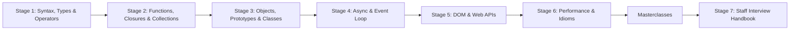

| Stage | Focus Domain | Core Concepts & Engineering Outcomes |
| :--- | :--- | :--- |
| **Stage 1** | **Syntax, Types & Operators** | Engines vs runtimes, `node` and `<script type="module">`, `let`/`const`/`var` and the TDZ, the 7 primitives plus objects, `typeof`, `Number()` vs `parseInt()`, `==` vs `===` vs `Object.is`, IEEE 754 and `BigInt`, `??` and `?.`, `if`/`switch`/loops. You can read any JavaScript statement and predict its value. |
| **Stage 2** | **Functions, Closures, Arrays, Strings & Modules** | Declarations vs expressions vs arrows, default and rest parameters, lexical scope, hoisting, closures, `this` with `call`/`apply`/`bind`, higher-order functions, `map`/`filter`/`reduce`, `toSorted`, `Intl.Segmenter`, tagged templates, `import`/`export`. You can build the starter's `strings.js` and `functions.js` from scratch. |
| **Stage 3** | **Objects, Prototypes, Classes & Error Handling** | Property descriptors, `Object.freeze`, the prototype chain, `class` with `#private` fields and `static` blocks, getters, `Symbol.iterator` and generators, `Map`/`Set`/`WeakMap` and ES2025 Set methods, `structuredClone`, `Date` and `Intl`, custom `Error` subclasses with `cause`. You can model a domain like the starter's `Inventory`. |
| **Stage 4** | **Asynchronous JavaScript & the Event Loop** | Callbacks, timers, the Promise state machine, `async`/`await`, microtasks vs tasks, `Promise.all`/`allSettled`/`any`/`race`. |
| **Stage 5** | **DOM, Browser APIs, Networking & JSON** | DOM traversal and mutation, events, the BOM (`window`, `location`, `history`), Web Storage, `fetch`, JSON serialisation, canvas and charting libraries. |
| **Stage 6** | **Performance, Best Practices & Modern Idioms** | Common mistakes, performance habits, ES5 and ES2015 feature reference, production snippets and shorthands. |
| **Masterclasses** | **Engine Internals, Concurrency & Metaprogramming** | V8 pipeline (Ignition, TurboFan), Hidden Classes, Inline Caches, Generational GC, Proxies, Reflect, Atomics, ArrayBuffer, and Iterator Helpers. |
| **Stage 7** | **Staff Interview Handbook** | Interview Q&As and a coding problem bank with worked solutions. |

---

## 🆕 JavaScript Versions, What's New & Migration

JavaScript is standardised as ECMAScript (ECMA-262) by the TC39 committee. Since 2015 a new edition ships every June and is named after its year. A proposal moves through stages 0 to 4; anything at Stage 4 by the spring cut-off goes into that year's edition. Engines (V8 in Chrome and Node.js, SpiderMonkey in Firefox, JavaScriptCore in Safari and Bun) often ship features before the edition is published, so "which edition" matters less than "which engine version".

### V.1 Release Timeline

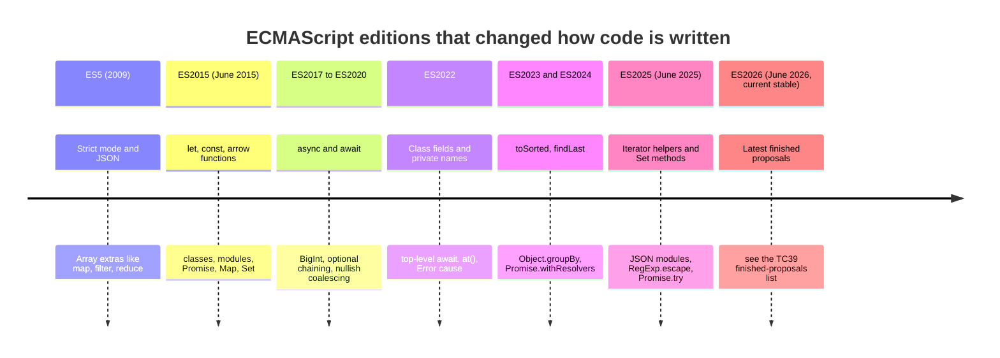

### V.2 Compatibility Matrix

| Runtime | Released | Supported until | Engine | Language level | Notes |
| --- | --- | --- | --- | --- | --- |
| Node.js 22 (LTS) | April 2024 | Maintenance LTS until April 2027 | V8 12.4 | ES2024, plus Set methods and iterator helpers | `require()` of ES modules works without a flag from 22.12. |
| Node.js 24 (LTS) | May 2025 | Maintenance LTS until April 2028 | V8 13.6 | ES2025 (`RegExp.escape`, `Float16Array`, `Promise.try`), `using` declarations | Ships npm 11 and a global `URLPattern`. Base image of this repo's Dockerfile. |
| Node.js 26 | April 2026 | LTS from October 2026 (current stable) | current stable V8 | current stable | Check `node -p process.versions.v8` for the exact engine. |
| Chrome / Edge | Every 4 weeks | Evergreen | V8 | Latest | Share V8 with Node, so features usually land in Chrome first. |
| Firefox | Every 4 weeks | Evergreen; ESR yearly | SpiderMonkey | Latest | ESR lags; check it if you support enterprise desktops. |
| Safari (macOS, iOS) | Yearly major, point releases | Tied to OS updates | JavaScriptCore | Latest | Older iPhones stay on older Safari; this is usually the slowest target. |

Node.js 20 reached end of life on 30 April 2026. Pin `"engines": { "node": ">=22" }` in `package.json` (this repo does) so `npm` warns on older runtimes.

### V.3 What's New in ES2025

ES2025 is the most recent edition whose full contents are settled in every major engine. Each feature below shows the code you wrote before and the code you write now.

#### Iterator helpers

Iterators (from `Map.prototype.entries()`, generators, `Intl.Segmenter`) now have lazy `map`, `filter`, `take`, `drop`, `flatMap`, `reduce`, `toArray`, `some`, `every`, `find` and `forEach`. Lazy means nothing runs until you pull values, and nothing is copied into an intermediate array.

```javascript
function* naturals() {
  let n = 1;
  while (true) yield n++;
}

// Before: build an array, which is impossible for an infinite source.
const firstEvensOld = [];
for (const n of naturals()) {
  if (n % 2 === 0) firstEvensOld.push(n * n);
  if (firstEvensOld.length === 3) break;
}

// After: a lazy pipeline that stops after three values.
const firstEvens = naturals()
  .filter((n) => n % 2 === 0)
  .map((n) => n * n)
  .take(3)
  .toArray();

console.log(firstEvensOld, firstEvens); // [ 4, 16, 36 ] [ 4, 16, 36 ]
```

#### Set methods

`Set.prototype` gained `union`, `intersection`, `difference`, `symmetricDifference`, `isSubsetOf`, `isSupersetOf` and `isDisjointFrom`. The starter's `compareTags()` in [`src/lib/collections.js`](src/lib/collections.js) uses them.

```javascript
const backend = new Set(['node', 'sql', 'docker']);
const frontend = new Set(['css', 'node', 'html']);

// Before
const sharedOld = new Set([...backend].filter((x) => frontend.has(x)));

// After
const shared = backend.intersection(frontend);
console.log(sharedOld, shared); // Set(1) { 'node' } Set(1) { 'node' }
console.log(backend.symmetricDifference(frontend)); // Set(4) { 'sql', 'docker', 'css', 'html' }
```

#### JSON modules and import attributes

```javascript
// Before (Node): read and parse by hand.
import { readFile } from 'node:fs/promises';
const configOld = JSON.parse(await readFile(new URL('./config.json', import.meta.url), 'utf8'));

// After: the attribute tells the host to parse JSON and never execute the file.
import config from './config.json' with { type: 'json' };
console.log(configOld.port === config.port);
```

The older `assert { type: 'json' }` syntax was removed from V8 and Node.js 22; use `with`.

#### `Promise.try`

Runs a function and always gives you a promise, even if the function throws synchronously or returns a plain value.

```javascript
function loadUser(id) {
  if (typeof id !== 'number') throw new TypeError('id must be a number'); // sync throw
  return Promise.resolve({ id });
}

// Before: the sync throw escapes, so .catch() never runs and the caller crashes.
try {
  loadUser('x').catch(() => console.log('never reached'));
} catch (e) {
  console.log('escaped synchronously:', e.message);
}

// After: Promise.try turns the sync throw into a rejection.
Promise.try(loadUser, 'x').catch((e) => console.log('rejected:', e.message));
```

#### `RegExp.escape`

```javascript
const userInput = 'price (USD): $5.00?';

// Before: a hand-written escape that is easy to get wrong.
const escapedOld = userInput.replace(/[.*+?^${}()|[\]\\]/g, '\\$&');

// After
const pattern = new RegExp(RegExp.escape(userInput));
console.log(new RegExp(escapedOld).test(userInput), pattern.test(userInput)); // true true
```

#### Also in ES2025

| Feature | What it gives you |
| --- | --- |
| `Float16Array`, `Math.f16round`, `DataView` float16 methods | Half-precision numbers for WebGPU and ML tensors. |
| RegExp pattern modifiers `(?i:...)` | Turn flags on or off for part of a pattern. |
| Duplicate named capture groups | The same `(?<year>...)` name may appear in different `|` alternatives. |

#### Recently added before ES2025 that you should already be using

| Edition | Feature | Replaces |
| --- | --- | --- |
| ES2022 | `array.at(-1)` | `array[array.length - 1]` |
| ES2022 | `Object.hasOwn(obj, key)` | `Object.prototype.hasOwnProperty.call(obj, key)` |
| ES2022 | `new Error(msg, { cause })` | Custom `originalError` properties |
| ES2022 | Top-level `await` in modules | Wrapping a module body in an async IIFE |
| ES2023 | `toSorted`, `toReversed`, `toSpliced`, `with` | `[...arr].sort()` copies |
| ES2023 | `findLast`, `findLastIndex` | `[...arr].reverse().find()` |
| ES2024 | `Object.groupBy`, `Map.groupBy` | Hand-written `reduce` grouping |
| ES2024 | `Promise.withResolvers()` | Capturing `resolve`/`reject` in outer `let` variables |
| ES2024 | RegExp `v` flag | Limited Unicode set operations with `u` |

### V.4 Migration Guide (ES5 / CommonJS → modern ES modules)

Most real migrations are not "edition N to N+1" (new editions never break old code) but "an old ES5 or CommonJS codebase to modern modules on a supported runtime". Do it in this order, committing after each step so a failing test points at one change.

```bash
# 1. Move to a supported runtime and record it.
node --version                       # must print v22 or newer
npm pkg set engines.node=">=22"

# 2. Add a linter that understands modern syntax before you touch code.
npm install --save-dev eslint @eslint/js globals
npx eslint .                         # baseline: fix or suppress existing errors first

# 3. Mechanical syntax upgrade with lebab (var -> let/const, arrows, templates, classes).
npx lebab --replace src/ --transform let,arrow,arrow-return,template,obj-shorthand,obj-method,class,includes
npm test

# 4. CommonJS -> ES modules.
npx lebab --replace src/ --transform commonjs
npm pkg set type=module
npm test                             # fix __dirname, require.resolve and JSON imports by hand

# 5. Turn on the rules that keep it modern.
#    eslint.config.js: 'no-var': 'error', 'prefer-const': 'error', eqeqeq: ['error', 'always']
npx eslint . --fix
```

Hand fixes that step 4 leaves behind:

| CommonJS | ES module replacement |
| --- | --- |
| `__dirname`, `__filename` | `import.meta.dirname`, `import.meta.filename` (Node 20.11+) |
| `require('./data.json')` | `import data from './data.json' with { type: 'json' }` |
| `module.exports = fn` | `export default fn` |
| `require.resolve('pkg')` | `import.meta.resolve('pkg')` |
| Conditional `require()` inside a function | `await import('./module.js')` |
| Extensionless relative paths `./util` | Full paths with extension `./util.js` (ESM requires them) |

### V.5 Deprecations & Breaking Changes

New ECMAScript editions are backwards compatible ("don't break the web"), so most entries below are legacy features you should stop using, plus host APIs (Node.js, browsers) that really were removed.

| Version | Deprecated / removed | Replacement | What breaks and how to fix it |
| --- | --- | --- | --- |
| ES5 strict mode (default in modules and classes) | `with` statement, `arguments.callee`, octal literals `010`, assigning to undeclared variables | Destructuring, named function expressions, `0o10`, declare with `let`/`const` | `SyntaxError` or `ReferenceError` as soon as a file becomes a module. Fix the code; do not drop `type: module`. |
| Annex B (legacy web compatibility) | `escape`/`unescape`, `String.prototype.substr`, `__proto__`, `Date.prototype.getYear` | `encodeURIComponent`, `slice`, `Object.getPrototypeOf`/`Object.create`, `getFullYear` | Still run, but linters flag them and some non-browser hosts omit them. |
| V8 12.x / Node.js 22 | Import assertions `assert { type: 'json' }` | Import attributes `with { type: 'json' }` | `SyntaxError: Unexpected identifier 'assert'`. Replace the keyword. |
| Node.js (runtime deprecation) | `new Buffer(n)` | `Buffer.alloc(n)`, `Buffer.from(data)` | `DEP0005` warning; the old form can expose uninitialised memory. |
| Node.js | `url.parse()` | `new URL(input, base)` | `DEP0169` warning; `url.parse` mis-parses some hostnames. |
| Node.js 20 | End of life (30 April 2026) | Node.js 22 or 24 LTS | No security patches. Update CI matrices and Docker base images. |
| Browsers | Synchronous `XMLHttpRequest` on the main thread | `fetch` with `await` | Deprecation warnings today; freezes the page while waiting. |
| Browsers | `document.write()` after page load, and inserting parser-blocking scripts with it | DOM APIs (`append`, `insertAdjacentHTML`) | Chrome blocks `document.write`-inserted scripts on slow connections; calling it after load wipes the page. |

---

## 📋 Table of Contents

- [🆕 JavaScript Versions, What's New & Migration](#-javascript-versions-whats-new--migration)
  - [V.1 Release Timeline](#v1-release-timeline)
  - [V.2 Compatibility Matrix](#v2-compatibility-matrix)
  - [V.3 What's New in ES2025](#v3-whats-new-in-es2025)
  - [V.4 Migration Guide (ES5 / CommonJS → modern ES modules)](#v4-migration-guide-es5--commonjs--modern-es-modules)
  - [V.5 Deprecations & Breaking Changes](#v5-deprecations--breaking-changes)
- [1. Stage 1: Syntax, Types & Operators](#1-stage-1-syntax-types--operators)
  - [1.1 What JavaScript Is: Language, Engine and Runtime](#11-what-javascript-is-language-engine-and-runtime)
  - [1.2 Running JavaScript: Node.js, the Browser and the Starter](#12-running-javascript-nodejs-the-browser-and-the-starter)
  - [1.3 Line-by-Line Breakdown of the Starter Project](#13-line-by-line-breakdown-of-the-starter-project)
  - [1.4 Statements, Comments, Semicolons and Strict Mode](#14-statements-comments-semicolons-and-strict-mode)
  - [1.5 Variables: `let`, `const`, `var` and the Temporal Dead Zone](#15-variables-let-const-var-and-the-temporal-dead-zone)
  - [1.6 Data Types, `typeof` and the Memory Model](#16-data-types-typeof-and-the-memory-model)
  - [1.7 Type Conversion, Coercion and Equality](#17-type-conversion-coercion-and-equality)
  - [1.8 Operators: Precedence, Short-Circuiting, `??` and `?.`](#18-operators-precedence-short-circuiting--and-)
  - [1.9 Booleans, Truthiness and Short-Circuit Logic](#19-booleans-truthiness-and-short-circuit-logic)
  - [1.10 Numbers, BigInt and Math](#110-numbers-bigint-and-math)
  - [1.11 Conditional Statements](#111-conditional-statements)
  - [1.12 Loops and Iteration](#112-loops-and-iteration)
  - [1.13 Pitfalls](#113-pitfalls)
  - [1.14 Best Practices](#114-best-practices)
  - [1.15 Hands-on Exercise](#115-hands-on-exercise)
- [2. Stage 2: Functions, Closures, Arrays, Strings & Modules](#2-stage-2-functions-closures-arrays-strings--modules)
  - [2.1 Declaring Functions: Declarations, Expressions and Arrows](#21-declaring-functions-declarations-expressions-and-arrows)
  - [2.2 Parameters: Defaults, Rest, Spread and Destructuring](#22-parameters-defaults-rest-spread-and-destructuring)
  - [2.3 Scope and the Scope Chain](#23-scope-and-the-scope-chain)
  - [2.4 Hoisting and the Two Phases of Running Code](#24-hoisting-and-the-two-phases-of-running-code)
  - [2.5 Closures](#25-closures)
  - [2.6 `this`, `call`, `apply` and `bind`](#26-this-call-apply-and-bind)
  - [2.7 Higher-Order Functions, Composition and Currying](#27-higher-order-functions-composition-and-currying)
  - [2.8 IIFEs and the Module Pattern](#28-iifes-and-the-module-pattern)
  - [2.9 Recursion](#29-recursion)
  - [2.10 Arrays](#210-arrays)
  - [2.11 Strings and Unicode](#211-strings-and-unicode)
  - [2.12 ES Modules](#212-es-modules)
  - [2.13 Pitfalls](#213-pitfalls)
  - [2.14 Best Practices](#214-best-practices)
  - [2.15 Hands-on Exercise](#215-hands-on-exercise)
- [3. Stage 3: Objects, Prototypes, Classes & Error Handling](#3-stage-3-objects-prototypes-classes--error-handling)
  - [3.1 Objects: Literals, Keys and Everyday Operations](#31-objects-literals-keys-and-everyday-operations)
  - [3.2 Property Descriptors, Getters, Setters and Immutability](#32-property-descriptors-getters-setters-and-immutability)
  - [3.3 Prototypes and the Prototype Chain](#33-prototypes-and-the-prototype-chain)
  - [3.4 Classes: Fields, Private Members, Accessors and Inheritance](#34-classes-fields-private-members-accessors-and-inheritance)
  - [3.5 Symbols, Iterators and Generators](#35-symbols-iterators-and-generators)
  - [3.6 Map and WeakMap](#36-map-and-weakmap)
  - [3.7 Set, WeakSet and the ES2025 Set Methods](#37-set-weakset-and-the-es2025-set-methods)
  - [3.8 Copying Objects: Shallow, Deep and `structuredClone`](#38-copying-objects-shallow-deep-and-structuredclone)
  - [3.9 Dates, Time Zones, `Intl` and Temporal](#39-dates-time-zones-intl-and-temporal)
  - [3.10 Error Handling: `try`/`catch`, Custom Errors and `cause`](#310-error-handling-trycatch-custom-errors-and-cause)
  - [3.11 Memory Management and Garbage Collection](#311-memory-management-and-garbage-collection)
  - [3.12 Pitfalls](#312-pitfalls)
  - [3.13 Best Practices](#313-best-practices)
  - [3.14 Hands-on Exercise](#314-hands-on-exercise)
- [4. Stage 4: Asynchronous JavaScript & the Event Loop](#4-stage-4-asynchronous-javascript--the-event-loop)
  - [4.1 Callbacks](#41-callbacks)
  - [4.2 Timers and Asynchronous Execution](#42-timers-and-asynchronous-execution)
  - [4.3 Promises](#43-promises)
  - [4.4 async and await](#44-async-and-await)
- [5. Stage 5: DOM, Browser APIs, Networking & JSON](#5-stage-5-dom-browser-apis-networking--json)
  - [5.1 The Document Object Model (DOM)](#51-the-document-object-model-dom)
  - [5.2 The Browser Object Model (BOM)](#52-the-browser-object-model-bom)
  - [5.3 Web APIs](#53-web-apis)
  - [5.4 AJAX and HTTP Requests](#54-ajax-and-http-requests)
  - [5.5 JSON](#55-json)
  - [5.6 jQuery (Legacy)](#56-jquery-legacy)
  - [5.7 Graphics and Charting](#57-graphics-and-charting)
- [6. Stage 6: Performance, Best Practices & Modern Idioms](#6-stage-6-performance-best-practices--modern-idioms)
  - [6.1 Best Practices](#61-best-practices)
  - [6.2 Common Mistakes](#62-common-mistakes)
  - [6.3 Performance](#63-performance)
  - [6.4 ES5 Features](#64-es5-features)
  - [6.5 ES2015 (ES6) Features](#65-es2015-es6-features)
  - [6.6 Snippets](#66-snippets)
  - [6.7 Shorthands](#67-shorthands)
- [🎓 Masterclasses: Engine Internals, Concurrency & Advanced JavaScript Architecture](#-masterclasses-engine-internals-concurrency--advanced-javascript-architecture)
  - [M.1 V8 Engine Architecture: Ignition, TurboFan, Hidden Classes & Inline Caching](#m1-v8-engine-architecture-ignition-turbofan-hidden-classes--inline-caching)
  - [M.2 V8 Memory Management: Generational GC, Scavenger & Heap Profiling](#m2-v8-memory-management-generational-gc-scavenger--heap-profiling)
  - [M.3 Metaprogramming: Proxies, Reflect, WeakRef & Decorators](#m3-metaprogramming-proxies-reflect-weakref--decorators)
  - [M.4 Binary Data & Memory Layout: ArrayBuffer, TypedArrays & DataView](#m4-binary-data--memory-layout-arraybuffer-typedarrays--dataview)
  - [M.5 Advanced Concurrency: Web Workers, SharedArrayBuffer & Atomics](#m5-advanced-concurrency-web-workers-sharedarraybuffer--atomics)
  - [M.6 Specification Protocols: Well-Known Symbols, Property Enumeration & Coercion](#m6-specification-protocols-well-known-symbols-property-enumeration--coercion)
  - [M.7 Modern Iteration: Iterator Helpers, Async Generators & Reactive Streams](#m7-modern-iteration-iterator-helpers-async-generators--reactive-streams)
  - [M.8 Advanced Regular Expressions: Lookarounds, Unicode Sets & ReDoS Prevention](#m8-advanced-regular-expressions-lookarounds-unicode-sets--redos-prevention)
  - [M.9 Internationalization (Intl): Collator, PluralRules & UTF-16 Unicode Surrogates](#m9-internationalization-intl-collator-pluralrules--utf-16-unicode-surrogates)
- [7. Stage 7: Staff JavaScript Engineer Interview Handbook & Cheatsheet](#7-stage-7-staff-javascript-engineer-interview-handbook--cheatsheet)
  - [7.1 Questions for Freshers](#71-questions-for-freshers)
  - [7.2 Questions for Experienced](#72-questions-for-experienced)
  - [7.3 Coding Questions & Exercises](#73-coding-questions--exercises)
  - [7.6 Coding Problem Bank](#76-coding-problem-bank)
  - [7.7 Practice Problem List](#77-practice-problem-list)
- [🧪 Example Projects](#-example-projects)
- [📝 Cheat Sheets](#-cheat-sheets)
- [📚 Resources](#-resources)
- [🤝 Contributing](#-contributing)
- [📄 License](#-license)
- [🙏 Acknowledgments](#-acknowledgments)
- [🌐 Connect with me](#-connect-with-me)
- [☕ Support](#-support)

---

## 1. Stage 1: Syntax, Types & Operators

This stage covers how JavaScript code reaches an engine, how values and variables work, and how operators convert and compare values. You need no prior JavaScript; you need a terminal and Node.js 22 or newer. Afterwards you can read any expression in the starter project and predict its result, including the coercion corner cases interviewers like to ask about.

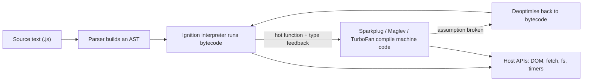

The diagram is V8's pipeline (Chrome, Edge, Node.js, Deno). SpiderMonkey and JavaScriptCore have different tier names but the same idea: start interpreting quickly, then compile the functions that run often, using the types they have actually seen.

### 1.1 What JavaScript Is: Language, Engine and Runtime

Three separate things share the name "JavaScript", and most confusion comes from mixing them up.

| Layer | What it is | Examples | Defines |
| --- | --- | --- | --- |
| Language | The ECMAScript specification (ECMA-262), updated every June | ES2025, ES2026 | Syntax, types, `Array`, `Promise`, `Map`, modules, the job queue |
| Engine | A program that parses and executes ECMAScript | V8, SpiderMonkey, JavaScriptCore | Parsing, bytecode, JIT compilation, garbage collection |
| Runtime (host) | An engine embedded in an application that adds I/O | Browsers, Node.js, Deno, Bun, Cloudflare Workers | `document`, `fetch`, `setTimeout`, `fs`, `process`, the event loop |

`setTimeout`, `console`, `fetch` and `document` are not part of the language. They are host APIs. That is why `document` is undefined in Node.js and `require` is undefined in a browser module. When this guide says "JavaScript does X", it means the language; when behaviour depends on the host, the section says which host.

JavaScript is:

- **Dynamically typed**: values have types, variables do not. `let x = 1; x = 'one';` is legal.
- **Weakly typed**: operators convert operands silently (`'5' * 2` is `10`). Section 1.7 shows the exact rules.
- **Garbage collected**: you allocate objects; the engine frees them when nothing references them.
- **Single-threaded per agent, with an event loop**: one call stack runs your code; I/O completes in the background and queues callbacks. Stage 4 covers this.
- **Multi-paradigm**: first-class functions (Stage 2), prototype-based objects with `class` syntax on top (Stage 3).

Compared with languages people often know first:

| Concern | JavaScript | Python | Java |
| --- | --- | --- | --- |
| Typing | Dynamic, weak (implicit coercion) | Dynamic, strong (`'5' * 2` is `'55'`, `'5' + 2` is a `TypeError`) | Static, strong |
| Numbers | One `number` type (64-bit float) plus `bigint` | `int` (arbitrary size) and `float` | `int`, `long`, `double`, ... |
| Concurrency | Event loop, workers for parallelism | Threads with a GIL (free-threaded builds exist), asyncio | Threads, virtual threads |
| Objects | Prototypes; `class` is syntax over them | Classes | Classes |
| Distribution | Source text, compiled on the fly by the engine | Source or bytecode | Bytecode in the JVM |

### 1.2 Running JavaScript: Node.js, the Browser and the Starter

Install a current Node.js LTS from the official installer or a version manager, then check it:

```bash
node --version          # v22.x, v24.x or newer
npm --version

# Run a one-liner
node -e "console.log(typeof 42n)"          # bigint

# Start the REPL; type .exit or press Ctrl+D twice to leave
node

# Run a file. Node treats .mjs, or .js inside a package with "type": "module", as an ES module.
echo "console.log([1, 2, 3].at(-1));" > hello.mjs
node hello.mjs                              # 3

# Re-run on every save (built into Node.js, no nodemon needed)
node --watch hello.mjs
```

Clone and run this repository's starter:

```bash
git clone https://github.com/TheLearningHubOrg/learn-javascript.git
cd learn-javascript
npm ci                  # installs ESLint and Prettier only; the app has no runtime dependencies
npm test                # node --test runs every tests/*.test.js file
npm run lint            # ESLint flat config in eslint.config.js
npm start               # node src/server.js, listening on http://0.0.0.0:8080
npm run demo            # node src/index.js prints the closure / prototype / event-loop demo

curl "http://localhost:8080/api/types?value=42px"
curl -X POST http://localhost:8080/api/text/stats \
  -H 'content-type: application/json' -d '{"text":"to be or not to be","top":2}'
```

In the browser, code runs from a `<script>` element. Modern pages load modules:

```html
<!doctype html>
<html lang="en">
  <head>
    <meta charset="utf-8" />
    <title>Modules in the browser</title>
    <!-- type="module": strict mode, own scope, deferred until HTML is parsed, can use import -->
    <script type="module" src="./main.js"></script>
  </head>
  <body>
    <output id="result"></output>
  </body>
</html>
```

```javascript
// main.js
import { slugify } from './strings.js';
document.querySelector('#result').textContent = slugify('Hello, Modules!');
```

Opening this file with `file://` fails because browsers block module imports from the file system. Serve the folder instead, for example with `npx serve .` or `python3 -m http.server`.

How the `<script>` attributes change loading:

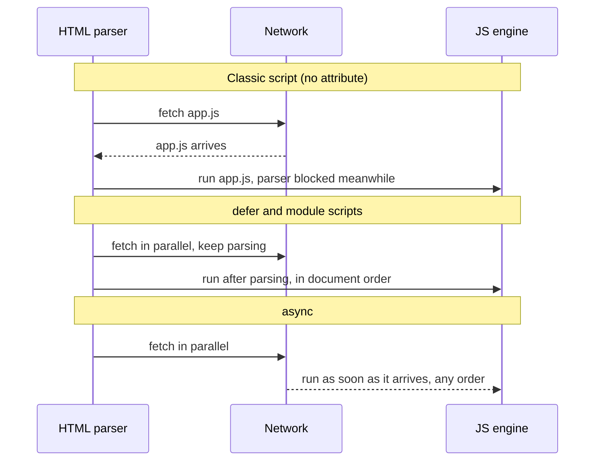

| Attribute | Blocks parsing | Execution order | Use for |
| --- | --- | --- | --- |
| none | Yes, while fetching and running | Document order | Almost never in new code |
| `defer` | No | Document order, after parsing | Classic scripts that touch the DOM |
| `async` | Only while running | Whichever finishes downloading first | Independent scripts such as analytics |
| `type="module"` | No (deferred by default) | Document order; `async` allowed | All new application code |

The rest of this section is the original reference on where to place scripts and how to show output.

#### Adding JavaScript to a Web Page

There are three ways to add JavaScript to a web page:

1. **Inline JavaScript** - It is used to add JavaScript directly to the HTML document. It is added inside the `<script>` tag in the HTML document.

2. **Internal JavaScript** - It is used to add JavaScript to the HTML document. It is added inside the `<script>` tag in the `<head>` or `<body>` section of the HTML document.

3. **External JavaScript** - It is used to add JavaScript to the HTML document. It is added in a separate file with a `.js` extension and linked to the HTML document using the `<script>` tag.

**JavaScript in `<head>`** -

```html
<!DOCTYPE html>
<html>
<head>
<script>
    //code
</script>
</head>
<body>
<h2>Heading</h2>
</body>
</html>
```

**JavaScript in `<body>`**

```html
<!DOCTYPE html>
<html>
<body>

<h2>Heading</h2>

<script>
    //code
</script>

</body>
</html>
```

**External JavaScript** -

```html
<!DOCTYPE html>
<html>
<body>

<h2>Heading</h2>

<script src="myScript.js"></script>
</body>
</html>
```

#### Displaying Output

#### JavaScript can "display" data in different ways

**1. Writing into an HTML element, using `innerHTML`**

```html
<!DOCTYPE html>
<html>
<body>

<h1>My First Web Page</h1>
<p>My First Paragraph</p>

<p id="demo"></p>

<script>
document.getElementById("demo").innerHTML = 5 + 6;
</script>

</body>
</html>
```

**2. Writing into an HTML element, using `document.write()`**

```html
<!DOCTYPE html>
<html>
<body>

<h1>My First Web Page</h1>
<p>My first paragraph.</p>

<script>
document.write(5 + 6);
</script>

</body>
</html>
```

**3. Writing into an alert box, using `window.alert()`**

```html
<!DOCTYPE html>
<html>
<body>

<h1>My First Web Page</h1>
<p>My first paragraph.</p>

<script>
window.alert(5 + 6);
</script>

</body>
</html>
```

**4. Writing into the browser console, using `console.log()`**

```html
<!DOCTYPE html>
<html>
<body>

<script>
console.log(5 + 6);
</script>

</body>
</html>
```

`document.write()` is shown for completeness only. Called after the page has loaded it replaces the whole document, and browsers may block scripts that it inserts. Use `textContent` (safe for untrusted text) or DOM methods instead. `innerHTML` with user-supplied strings is an XSS hole; see the starter's `html` tagged template in Section 2.10.

### 1.3 Line-by-Line Breakdown of the Starter Project

The starter is a small HTTP API built only on `node:http`. Its layout:

```text
learn-javascript/
├── src/
│   ├── server.js          entry point: reads PORT, listens, handles SIGTERM
│   ├── app.js             createApp(): route table, JSON parsing, error mapping
│   ├── lib/
│   │   ├── types.js       Stage 1: typeTag, conversions, toSafeInteger
│   │   ├── numbers.js     Stage 1: cents, nearlyEqual, BigInt sums
│   │   ├── strings.js     Stage 2: Intl.Segmenter, slugify, html tag
│   │   ├── functions.js   Stage 2: pipe, compose, once, memoize, partial
│   │   ├── collections.js Stages 2-3: chunk, uniqueBy, Set methods, LruCache
│   │   ├── errors.js      Stage 3: AppError hierarchy with cause
│   │   └── inventory.js   Stage 3: Product and Inventory classes
│   ├── runtime/           closures, prototypes and event-loop demos used by `npm run demo`
│   ├── roadmap.js         the 7 stages as data
│   └── index.js           CLI demo
├── tests/                 node:test suites, one per stage plus the HTTP API
├── eslint.config.js
├── Dockerfile             multi-stage, node:24-alpine, non-root
└── package.json           "type": "module", no runtime dependencies
```

`src/server.js` in full:

```javascript
import { createServer } from 'node:http';
import { createApp } from './app.js';

const port = Number.parseInt(process.env.PORT ?? '8080', 10);
const host = process.env.HOST ?? '0.0.0.0';

const server = createServer(createApp());

server.listen(port, host, () => {
  console.log(`learn-javascript starter listening on http://${host}:${port}`);
});

function shutdown(signal) {
  console.log(`${signal} received, closing server`);
  server.close(() => process.exit(0));
  // Force exit if open keep-alive sockets hold the server past 10 seconds.
  setTimeout(() => process.exit(1), 10_000).unref();
}

process.on('SIGTERM', shutdown);
process.on('SIGINT', shutdown);
```

| Line / API | Role | What happens at runtime |
| :--- | :--- | :--- |
| `import { createServer } from 'node:http'` | Static ES module import of a built-in | The `node:` prefix guarantees the core module, never an npm package with the same name. Imports are resolved and linked before any line of the module runs. |
| `process.env.PORT ?? '8080'` | Nullish coalescing | Environment variables are always strings or `undefined`. `??` falls back only for `undefined`/`null`, so `PORT=''` would stay `''`. |
| `Number.parseInt(..., 10)` | String to integer | Always pass the radix. `parseInt` stops at the first non-digit, so `'8080abc'` gives `8080`. |
| `'0.0.0.0'` | Bind address | Listens on every interface. `localhost` would be unreachable from outside a container. |
| `createServer(createApp())` | Function returning a function | `createApp()` returns the request handler, a closure that owns the route table and inventory (Stage 2). |
| `server.listen(port, host, cb)` | Start listening | Returns immediately; the callback runs later from the event loop once the socket is bound. |
| `` `...${host}:${port}` `` | Template literal | Interpolates values with their `String()` conversion. |
| `10_000` | Numeric separator | Underscores are ignored; this is `10000`. |
| `.unref()` | Timer handle method | The timer will not keep the process alive by itself. |
| `process.on('SIGTERM', shutdown)` | Signal handler | Docker and Kubernetes send `SIGTERM` on stop; closing the server lets in-flight requests finish. |

And the request path through `src/app.js`:

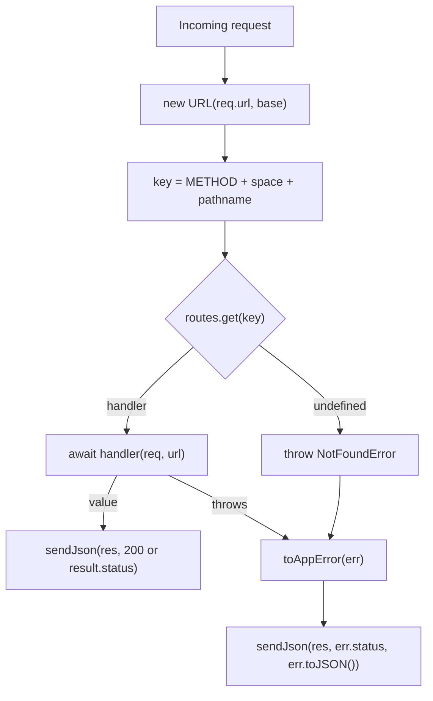

### 1.4 Statements, Comments, Semicolons and Strict Mode

A script is a list of statements (`let x = 1;`, `if (...) {...}`, `return`). Expressions produce values (`1 + 2`, `f()`, `a ? b : c`); an expression followed by `;` is an expression statement.

**Automatic Semicolon Insertion (ASI).** If a line break appears where the grammar cannot continue, the parser inserts a semicolon. Two cases bite people whatever style they choose:

```javascript
function getConfig() {
  return            // ASI inserts ';' here because 'return' cannot be followed by a line break
  {
    port: 8080,
  };
}
console.log(getConfig()); // undefined

const a = 1
const b = a
;[1, 2].forEach((n) => console.log(n)) // without the leading ';', this line is parsed as a[1, 2]...
```

Pick one style (this repo uses semicolons, enforced by Prettier) and let the formatter apply it.

**Strict mode** turns silent mistakes into errors. It is on automatically inside ES modules and `class` bodies, so modern code rarely writes `'use strict'`.

```javascript
'use strict';

function sloppy() {
  undeclared = 5; // ReferenceError in strict mode; creates a global in sloppy mode
}

try {
  sloppy();
} catch (e) {
  console.log(e.name); // ReferenceError
}

const frozen = Object.freeze({ x: 1 });
try {
  frozen.x = 2; // TypeError in strict mode; silently ignored in sloppy mode
} catch (e) {
  console.log(e.message); // Cannot assign to read only property 'x' of object '#<Object>'
}
```

| Behaviour | Sloppy mode | Strict mode |
| --- | --- | --- |
| Assigning to an undeclared name | Creates a global | `ReferenceError` |
| Writing to a read-only property | Ignored | `TypeError` |
| `this` in a plain function call | `globalThis` | `undefined` |
| `with`, octal `010`, `arguments.callee` | Allowed | `SyntaxError` / `TypeError` |
| Duplicate parameter names | Allowed | `SyntaxError` |

#### Comments

Single line comments start with `//`

```javascript
// comments
```

#### Multi-line Comments

Multi-line comments start with `/*` and end with `*/`.

```javascript
/* Hey!
Hello, How are you?
*/ 
```

Use `/** ... */` JSDoc comments on exported functions. Editors (and TypeScript's checker, if you enable `// @ts-check`) read the `@param` and `@returns` tags, which gives you type hints in plain JavaScript files. The starter's `src/lib/types.js` shows the format.

### 1.5 Variables: `let`, `const`, `var` and the Temporal Dead Zone

A declaration creates a *binding*: a name in a scope that refers to a value.

| Keyword | Scope | Re-assign | Re-declare in same scope | Before the declaration line | Creates a `globalThis` property at top level of a script |
| --- | --- | --- | --- | --- | --- |
| `const` | Block | No | No | `ReferenceError` (TDZ) | No |
| `let` | Block | Yes | No | `ReferenceError` (TDZ) | No |
| `var` | Function | Yes | Yes | `undefined` | Yes |

`const` makes the *binding* constant, not the value. A `const` array can still be pushed to; use `Object.freeze` for a shallow read-only value (Stage 3).

```javascript
const tags = ['js'];
tags.push('node');      // fine: same array, new contents
// tags = [];           // TypeError: Assignment to constant variable.

console.log(typeof later); // ReferenceError: the TDZ applies even to typeof
let later = 1;
```

The last two lines throw `ReferenceError: Cannot access 'later' before initialization`. Between the start of the block and the `let` line, `later` exists but is uninitialised. That window is the **Temporal Dead Zone (TDZ)**. It even defeats `typeof`, which is otherwise safe on undeclared names.

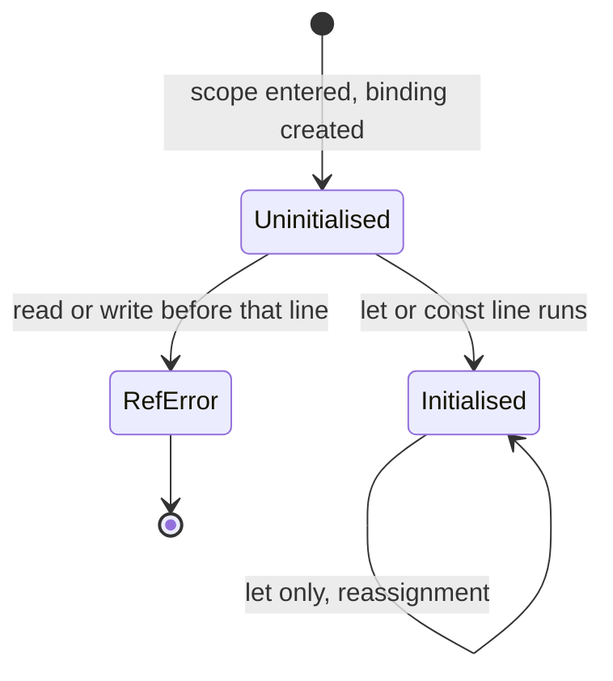

`var` has no TDZ: the binding is created and set to `undefined` when the function starts. That is why the classic loop bug happens:

```javascript
const callbacks = [];
for (var i = 0; i < 3; i++) callbacks.push(() => i);
console.log(callbacks.map((f) => f())); // [ 3, 3, 3 ]: one shared i

const fixed = [];
for (let j = 0; j < 3; j++) fixed.push(() => j);
console.log(fixed.map((f) => f())); // [ 0, 1, 2 ]: a fresh j per iteration
```

Rule: use `const` by default, `let` when you must reassign, and never `var` in new code. ESLint's `no-var` and `prefer-const` rules (enabled in this repo) enforce it.

Variables are containers for storing data values. In JavaScript, variables are declared using the `var`, `let`, or `const` keyword.

#### Declare Variables

There are three ways to declare variables in JavaScript:

**1. var** - It is used to declare a variable. It is function-scoped.

```javascript
var a = 1; // Declare a variable a with the value 1 (function-level scope).
```

**2. let** - It is used to declare a variable. It is block-scoped.

```javascript
let b = 1; // Declare a variable b with the value 1 (block-level scope).
```

**3. const** - It is used to declare a read-only variable. It is block-scoped.

```javascript
const c = 1; // Declare a constant binding c with the value 1 (block-level scope).
```

### 1.6 Data Types, `typeof` and the Memory Model

JavaScript has **seven primitive types** and **one object type**:

| Type | Example | `typeof` | Notes |
| --- | --- | --- | --- |
| `undefined` | `undefined` | `'undefined'` | Missing value: unset variables, absent properties, no `return` |
| `null` | `null` | `'object'` | Intentional "no value". The `typeof` result is a bug kept since 1995 for compatibility. |
| `boolean` | `true` | `'boolean'` | |
| `number` | `42`, `3.14`, `NaN`, `Infinity` | `'number'` | 64-bit IEEE 754 float |
| `bigint` | `42n` | `'bigint'` | Arbitrary-precision integer (ES2020) |
| `string` | `'hi'` | `'string'` | Immutable UTF-16 code units |
| `symbol` | `Symbol('id')` | `'symbol'` | Unique key, never equal to another symbol |
| `object` | `{}`, `[]`, `new Map()`, functions | `'object'` or `'function'` | Everything else: arrays, dates, functions, class instances |

Primitives are immutable and compared by value. Objects are mutable and compared by identity: two separately created objects are never `===`, even with identical contents.

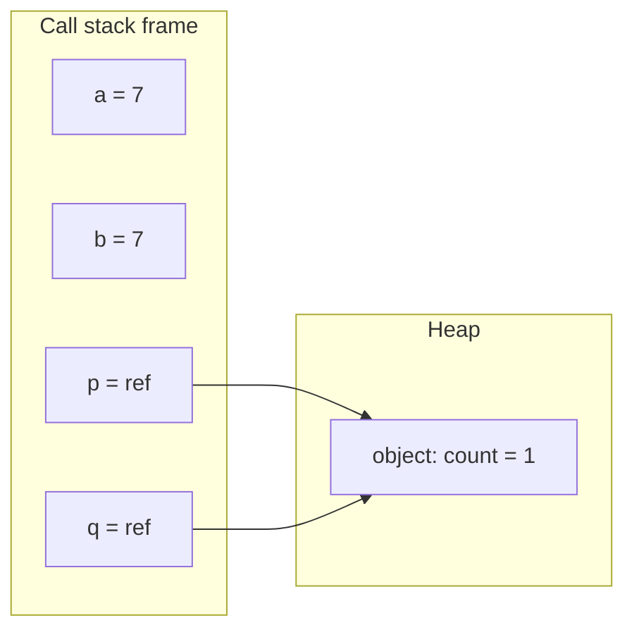

```javascript
let a = 7;
let b = a;
b += 1;
console.log(a, b); // 7 8: primitives copy the value

const p = { count: 1 };
const q = p;
q.count += 1;
console.log(p.count); // 2: p and q reference the same object
console.log({ x: 1 } === { x: 1 }); // false: different identities
```

The stack/heap picture is a mental model, not a guarantee. V8 stores small integers ("Smis") inline and most other values, including strings and boxed numbers, on the heap. What the model gets right is the behaviour: assignment copies primitive values but copies only *references* to objects.

`typeof` is the fastest check for primitives and functions, but it cannot tell `null`, arrays, dates or maps apart. The starter's `typeTag()` fills the gap:

```javascript
export function typeTag(value) {
  if (value === null) return 'null';
  const t = typeof value;
  if (t !== 'object' && t !== 'function') return t;
  if (Array.isArray(value)) return 'array';
  if (t === 'function') return 'function';
  // Object.prototype.toString gives "[object Date]", "[object Map]", ...
  return Object.prototype.toString.call(value).slice(8, -1).toLowerCase();
}
```

| Check | Use it for | Why not the alternatives |
| --- | --- | --- |
| `value === null` | null | `typeof null` is `'object'` |
| `value === undefined` or `value == null` | missing values | `== null` matches both `null` and `undefined`; it is the one widely accepted use of `==` |
| `Array.isArray(value)` | arrays | Works across iframes and realms, unlike `instanceof Array` |
| `typeof value === 'function'` | callables | Also true for classes |
| `Number.isNaN(value)` | NaN | Global `isNaN('abc')` converts first and returns `true` |
| `value instanceof Date` | class instances from your realm | Follows the prototype chain (Stage 3) |

Data types are used to define the type of data that a variable can store. JavaScript is a loosely typed language, which means that you do not have to declare the data type of a variable when you declare it.

There are two types of data types in JavaScript:

- **Primitive Data Types**
- **Non-Primitive Data Types**

#### 1. Primitive Data Types

**Primitive data types** are the most basic data types in JavaScript. They are immutable (cannot be changed) and are copied by value.

**Primitive data types** include:

- **numbers**
- **strings**
- **booleans**
- **null**
- **undefined**
- **symbol**
- **bigint**

**numbers** - numbers can be written with or without decimals.

```javascript
let number = 10;
```

**strings** - strings are text. They are written inside double or single quotes.

```javascript
let name = "Manthan";
```

**booleans** - booleans can only have two values: true or false.

```javascript
let value1 = true;
let value2 = false;
```

**null** - null is an empty value.

```javascript
let value = null;
```

**undefined** - undefined means a variable has been declared but has not yet been assigned a value.

```javascript
let name;
```

**symbol** - symbols are unique and immutable values.

```javascript
let a = Symbol();
```

**bigint** - integers of any size, written with an `n` suffix (ES2020).

```javascript
let big = 9007199254740993n;
```

#### 2. Non Primitive Data Types

**Non-primitive data types** are complex data types that are mutable (can be changed) and are copied by reference.

**Non-primitive data types** include:

- **objects**
- **arrays**
- **functions**
- **regexp**

**functions** - functions are objects that can be invoked.

```javascript
function greet() {
  return "Hello!";
}
```

**object** - objects are used to store collections of data and more complex entities.

```javascript
let name = {firstName:"Manthan", lastName:"Ank"};
```

**arrays** - arrays are used to store multiple values in a single variable.

```javascript
let array = ["value1", "value2"];
```

**regexp** - regular expressions are used to perform pattern-matching in strings.

```javascript
let pattern = /hello/i;
```

#### The `typeof` Operator

The typeof operator is used to get the data type of a variable or an expression.

```javascript
typeof "John"                 // Returns "string"
typeof 3.14                   // Returns "number"
typeof NaN                    // Returns "number"
typeof false                  // Returns "boolean"
typeof [1,2,3,4]              // Returns "object"
typeof {name:'John', age:34}  // Returns "object"
typeof new Date()             // Returns "object"
typeof function () {}         // Returns "function"
typeof myCar                  // Returns "undefined" *
typeof null                   // Returns "object"
```

Keep in mind that

- The data type of NaN is number
- The data type of an array is object
- The data type of a date is object
- The data type of null is object
- The data type of an undefined variable is undefined *
- The data type of a variable that has not been assigned a value is also undefined *

### 1.7 Type Conversion, Coercion and Equality

Conversion is *explicit* when you call `String(x)`, `Number(x)`, `Boolean(x)` or `BigInt(x)`. Coercion is the same conversion done *implicitly* by an operator. Both run the same abstract operations from the spec:

| Abstract operation | Triggered by | Key rules |
| --- | --- | --- |
| `ToPrimitive` | `+`, `==`, template literals, `<` on objects | Calls `obj[Symbol.toPrimitive]`, else `valueOf()` then `toString()` (or the reverse for string hints). Arrays become `'1,2'`; plain objects `'[object Object]'`. |
| `ToNumber` | `-`, `*`, `/`, `<`, unary `+`, `Number()` | `''` and whitespace are `0`, `'12px'` is `NaN`, `null` is `0`, `undefined` is `NaN`, `true` is `1`. |
| `ToString` | `+` with a string, `String()`, template literals | `-0` becomes `'0'`, symbols throw on implicit conversion. |
| `ToBoolean` | `if`, `!`, `&&`, `\|\|`, `?:`, `Boolean()` | Exactly 8 falsy values; everything else, including `'0'`, `'false'`, `[]` and `{}`, is truthy. |

The `+` operator is the one that surprises: if either operand is a string after `ToPrimitive`, it concatenates.

```javascript
console.log(1 + '2');        // '12'
console.log('3' - 1);        // 2: minus always converts to number
console.log([] + []);        // '': both become ''
console.log([] + {});        // '[object Object]'
console.log(+'');            // 0
console.log(+' 42 ');        // 42: surrounding whitespace is trimmed
console.log(1 < 2 < 3, 3 > 2 > 1); // true false: (3 > 2) is true, true > 1 is 1 > 1
```

**Equality.** JavaScript has four equality algorithms:

| Operator / API | Algorithm | `NaN` equals `NaN` | `+0` equals `-0` | Converts types |
| --- | --- | --- | --- | --- |
| `==` | IsLooselyEqual | No | Yes | Yes |
| `===`, `switch`, `indexOf` | IsStrictlyEqual | No | Yes | No |
| `Object.is` | SameValue | Yes | No | No |
| `includes`, `Map`/`Set` keys | SameValueZero | Yes | Yes | No |

How `==` decides, simplified:

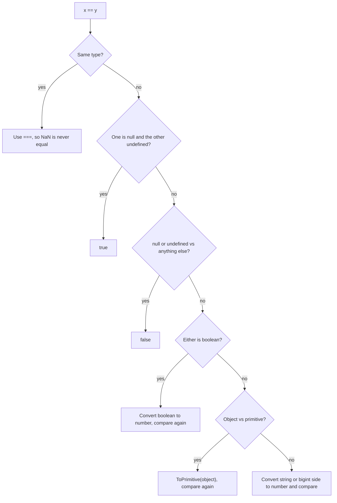

```javascript
console.log(null == undefined, null == 0);     // true false
console.log('' == 0, '0' == 0, '' == '0');     // true true false: == is not transitive
console.log([0] == false);                     // true: false -> 0, [0] -> '0' -> 0
console.log(NaN === NaN, Object.is(NaN, NaN)); // false true
console.log(Object.is(0, -0), [NaN].includes(NaN)); // false true
```

Run the starter's endpoint to see the conversions applied to any input:

```bash
curl -s "http://localhost:8080/api/types?value=%20%20"
# {"input":"  ","typeofInput":"string","number":0,"parseInt":"NaN","boolean":true,
#  "looseEqualsZero":true,"strictEqualsZero":false,"isSafeInteger":true}
```

For user input, prefer a strict parser over `Number()` or `parseInt()`. The starter's `toSafeInteger()` accepts only an optional sign and digits:

```javascript
import { toSafeInteger } from './src/lib/types.js';

console.log(Number('1e3'), Number.parseInt('1e3', 10), toSafeInteger('1e3')); // 1000 1 null
console.log(Number('0x10'), toSafeInteger('0x10'));                          // 16 null
console.log(toSafeInteger(' 42 '), toSafeInteger('9007199254740993'));      // 42 null
```

JavaScript is a loosely typed language, which means that variables can hold values of any data type. JavaScript automatically converts the data type of a variable to the appropriate type when needed.

#### Convert string to numbers

**Number** - Converts a string to a number using the Number() function.

```javascript
Number("3.14") // 3.14
Number(Math.PI) // 3.141592653589793
Number(" ") // 0
Number("") // 0
Number("99 88") // NaN
Number("John") // NaN
```

**parseFloat** - Converts a string to a floating-point number using the parseFloat() method.

```javascript
let num = parseFloat("123.456");
console.log(num); // Output: 123.456
```

**parseInt** - Converts a string to an integer using the parseInt() method.

```javascript
let num = parseInt("123");
console.log(num); // Output: 123
```

#### Convert number to a string

**String** - Converts a number to a string using the String() method.

```javascript
let str = String(123);
console.log(str); // Output: "123"
```

**toString** - Converts a number to a string using the toString() method.

```javascript
let str = (123).toString();
console.log(str); // Output: "123"
```

**toExponential** - Converts a number to a string, using toExponential() method.

```javascript
let str = (123).toExponential();
console.log(str); // Output: 1.23e+2
```

**toFixed** - Converts a number to a string, using toFixed() method.

```javascript
let str = (123).toFixed();
console.log(str); // Output: 123
```

**toPrecision** - Converts a number to a string, using toPrecision() method.

```javascript
let str = (123).toPrecision();
console.log(str); // Output: 123
```

#### Convert dates to numbers

**Number** - Converts a date to a number using the Number() function.

```javascript
d = new Date();
Number(d) // 1673677425068
```

**getTime** Converts a date to a number using the getTime() method.

```javascript
d = new Date();
d.getTime() // 1673677461233
```

**string** - Converts a date to a string using the String() function.

```javascript
String(Date()) // 'Sat Jan 14 2023 11:54:38 GMT+0530 (India Standard Time)'
```

**toString** - Converts a date to a string using the toString() method.

```javascript
Date().toString() //'Sat Jan 14 2023 11:54:57 GMT+0530 (India Standard Time)'
```

#### Convert boolean to number

**Number** - Converts a boolean to a number using the Number() function.

```javascript
Number(false)     // returns 0
Number(true)      // returns 1
```

#### Convert boolean to string

**string** - Converts a boolean to a string using the String() function.

```javascript
String(false)      // returns "false"
String(true)       // returns "true"
```

| Original Value | Converted to Number | Converted to String | Converted to Boolean |
|---|---|---|---|
| false | 0 | "false" | false |
| true | 1 | "true" | true |
| 0 | 0 | "0" | false |
| 1 | 1 | "1" | true |
| "0" | 0 | "0" | true |
| "000" | 0 | "000" | true |
| "1" | 1 | "1" | true |
| NaN | NaN | "NaN" | false |
| Infinity | Infinity | "Infinity" | true |
| -Infinity | -Infinity | "-Infinity" | true |
| "" | 0 | "" | false |
| "20" | 20 | "20" | true |
| "twenty" | NaN | "twenty" | true |
| [ ] | 0 | "" | true |
| [20] | 20 | "20" | true |
| [10,20] | NaN | "10,20" | true |
| ["twenty"] | NaN | "twenty" | true |
| ["ten","twenty"] | NaN | "ten,twenty" | true |
| function(){} | NaN | "function(){}" | true |
| { } | NaN | "[object Object]" | true |
| null | 0 | "null" | false |
| undefined | NaN | "undefined" | false |

### 1.8 Operators: Precedence, Short-Circuiting, `??` and `?.`

Most operators behave as in C-family languages. The ones with JavaScript-specific behaviour:

| Operator | Returns | Notes |
| --- | --- | --- |
| `a && b` | `a` if falsy, else `b` | Returns an operand, not a boolean. `b` is not evaluated if `a` is falsy. |
| `a \|\| b` | `a` if truthy, else `b` | Treats `0`, `''` and `false` as missing, which is often wrong for defaults. |
| `a ?? b` | `a` unless it is `null`/`undefined` | Correct operator for defaults. Cannot be mixed with `&&`/`\|\|` without parentheses (`SyntaxError`). |
| `a?.b`, `a?.[k]`, `f?.()` | `undefined` if the left side is `null`/`undefined` | Short-circuits the rest of the chain. |
| `a ??= b`, `a \|\|= b`, `a &&= b` | Assigns only when needed (ES2021) | `obj.cache ??= new Map()` creates once. |
| `**` | Exponent | `-2 ** 2` is a `SyntaxError`; write `(-2) ** 2`. |
| `typeof`, `void`, `delete` | Unary keyword operators | `delete` removes own properties, never variables. |
| `,` | The last operand | Mostly appears in `for` headers. |

```javascript
const settings = { retries: 0, label: '' };

console.log(settings.retries || 3); // 3: wrong, 0 was a real setting
console.log(settings.retries ?? 3); // 0: correct
console.log(settings.label ?? 'untitled'); // '': kept, as intended

const user = { profile: null };
console.log(user.profile?.email ?? 'no email');   // 'no email'
console.log(user.getName?.());                     // undefined instead of a TypeError

const counts = {};
counts.js ??= 0;
counts.js += 1;
console.log(counts); // { js: 1 }
```

Precedence trips people up mostly around `??`, `!` and `in`/`instanceof`:

```javascript
const obj = {};
console.log(!'a' in obj);   // false: parsed as (!'a') in obj, i.e. 'false' in obj
console.log(!('a' in obj)); // true: what was meant

const x = null;
console.log(x ?? 0 + 1);    // 1: + binds tighter, so this is x ?? (0 + 1)
```

When precedence is not obvious, add parentheses. Prettier keeps them if they change meaning and removes them otherwise.

Operators are used to perform operations on variables and values.

There are different types of operators in JavaScript:

- **Arithmetic Operators**
- **Logical Operators**
- **Comparison Operators**
- **Bitwise Operators**
- **Type Operators**
- **Assignment Operators**
- **Conditional (Ternary) Operator**
- **Nullish Coalescing Operator(??)**
- **Optional Chaining Operator(?.)**
- **delete Operator**
- **Spread (...) Operator**

#### Arithmetic Operators

| Operator | Description |
| :-----------: | :-----------: |
| + | Addition |
| - | Subtraction |
| * | Multiplication |
| ** | Exponentiation (ES2016) |
| / | Division |
| % | Modulus (Division Remainder) |
| ++ | Increment |
| -- | Decrement |

Examples

```javascript
let x = 5;
let y = 2;

console.log(x + y); // Output: 7
console.log(x - y); // Output: 3
console.log(x * y); // Output: 10
console.log(x / y); // Output: 2.5
console.log(x % y); // Output: 1

x++;
console.log(x); // Output: 6

y--;
console.log(y); // Output: 1
```

#### Logical Operators

| Operator | Description |
| :-----------: | :-----------: |
| && | logical and |
| ll | logical or |
| ! | logical not |

Examples

```javascript
let x = true;
let y = false;

console.log(x && y); // Output: false
console.log(x || y); // Output: true
console.log(!x); // Output: false
console.log(!y); // Output: true
```

#### Comparison Operators

| Operator | Description |
| :-----------: | :-----------: |
| == | equal to |
| === | equal value and equal type |
| != | not equal |
| !== | not equal value or not equal type |
| > | greater than |
| < | less than |
| >= | greater than or equal to |
| <= | less than or equal to |
| ?| ternary operator |

Examples

```javascript
let x = 5;
let y = 10;

console.log(x == y); // Output: false
console.log(x === y); // Output: false
console.log(x != y); // Output: true
console.log(x !== y); // Output: true
console.log(x > y); // Output: false
console.log(x < y); // Output: true
console.log(x >= y); // Output: false
console.log(x <= y); // Output: true
console.log(x ? y : x); // Output: 10
console.log(x ? x : y); // Output: 5
```

#### Bitwise Operators

| Operator | Description |
| :-----------: | :-----------: |
| & | AND |
| l | OR |
| ~ | NOT |
| ^| XOR |
| << | Left shift |
| >> | Right shift |
| >>> | Unsigned right |

Examples

```javascript
let x = 5; // Binary representation: 101
let y = 3; // Binary representation: 011

console.log(x & y); // Output: 1 (binary: 001)
console.log(x | y); // Output: 7 (binary: 111)
console.log(x ^ y); // Output: 6 (binary: 110)
console.log(~x); // Output: -6 (binary: 11111111111111111111111111111010)
console.log(x << 1); // Output: 10 (binary: 1010)
console.log(x >> 1); // Output: 2 (binary: 10)
console.log(x >>> 1); // Output: 2 (binary: 10)
```

#### Type Operators

| Operator | Description |
| :-----------: | :-----------: |
| typeof | Returns the type of a variable |
| instanceof | Returns true if an object is an instance of an object type |

Examples

```javascript
console.log(typeof 5); // Output: "number"
console.log(typeof 'hello'); // Output: "string"
console.log(typeof true); // Output: "boolean"
console.log(typeof undefined); // Output: "undefined"
console.log(typeof null); // Output: "object" (this is a bug in JavaScript)
console.log(typeof {}); // Output: "object"
console.log(typeof []); // Output: "object"
console.log(typeof function() {}); // Output: "function"

let cars = ['BMW', 'Volvo', 'Mini'];

console.log(cars instanceof Array); // Output: true
console.log(cars instanceof Object); // Output: true
console.log(cars instanceof String); // Output: false
console.log(cars instanceof Number); // Output: false
console.log(cars instanceof Function); // Output: false
console.log(cars instanceof RegExp); // Output: false
console.log(cars instanceof Date); // Output: false
console.log(cars instanceof Symbol); // Output: false
console.log(cars instanceof Boolean); // Output: false
```

#### Assignment Operators

| Operator | Description |
| :-----------: | :-----------: |
| = | x = y |
| += | x += y |
| -= | x -= y |
| *= | x *= y |
| /= | x /= y |
| %= | x %= y |
| **= | x **= y |
| : | x : 45 |

```javascript
let x = 5;
let y = 10;

x += y; // x = x + y
console.log(x); // Output: 15

x -= y; // x = x - y
console.log(x); // Output: 5

x *= y; // x = x * y
console.log(x); // Output: 50

x /= y; // x = x / y
console.log(x); // Output: 5

x %= y; // x = x % y
console.log(x); // Output: 5

x **= y; // x = x ** y
console.log(x); // Output: 9765625

x = y; // x = y
console.log(x); // Output: 10
```

#### Conditional (Ternary) Operator

The conditional (ternary) operator is the only JavaScript operator that takes three operands: a condition followed by a question mark (?), then an expression to execute if the condition is truthy followed by a colon (:), and finally the expression to execute if the condition is falsy.

Syntax

```javascript
(condition) ? x : y
```

```javascript
let x = 10;
let y = 5;

let result = (x > y) ? "x is greater than y" : "x is less than y";

console.log(result); // Output: "x is greater than y"
```

#### Nullish Coalescing Operator(??)

The nullish coalescing operator (??) is a new operator in JavaScript that returns the right-hand operand when the left-hand operand is null or undefined.

Example

```javascript
let x = null;
let y = undefined;
let z = 'Hello';

console.log(x ?? 'Default Value'); // Output: "Default Value"
console.log(y ?? 'Default Value'); // Output: "Default Value"
console.log(z ?? 'Default Value'); // Output: "Hello"
```

#### Optional Chaining Operator(?.)

The optional chaining operator (?.) is a new operator in JavaScript that allows you to access properties of an object without having to check if the object or its properties are null or undefined.

Example

```javascript
let person = {
  name: 'John',
  age: 30,
  address: {
    street: '123 Main St',
    city: 'New York',
    state: 'NY'
  }
};

console.log(person.address?.city); // Output: "New York"
console.log(person.address?.zipCode); // Output: undefined
```

#### delete Operator

The delete operator is used to delete a property from an object.

Example

```javascript
const person = {
  firstName:"Manthan",
  lastName:"Ank",
  age:25,
  eyeColor:"black"
};

delete person.age;

console.log(person); // Output: {firstName: "Manthan", lastName: "Ank", eyeColor: "black"}
```

#### Spread (...) Operator

The spread operator is a new addition to the JavaScript language in ES6. It is denoted by three dots (...). It is used to expand an array or object into individual elements.

Example

```javascript
// Array literal
let numbers = [1, 2, 3];
let newNumbers = [...numbers, 4, 5, 6];
console.log(newNumbers); // Output: [1, 2, 3, 4, 5, 6]

// Object literal
let person = {name: 'John', age: 30};
let newPerson = {...person, city: 'New York', country: 'USA'};
console.log(newPerson); // Output: {name: "John", age: 30, city: "New York", country: "USA"}

// Function call
function sum(a, b, c) {
  return a + b + c;
}
let numbers = [1, 2, 3];
console.log(sum(...numbers)); // Output: 6

// Copy an array
let numbers = [1, 2, 3];
let newNumbers = [...numbers];
console.log(newNumbers); // Output: [1, 2, 3]
```

### 1.9 Booleans, Truthiness and Short-Circuit Logic

There are exactly eight falsy values: `false`, `0`, `-0`, `0n`, `''`, `null`, `undefined` and `NaN`. Everything else is truthy, including `'0'`, `'false'`, `[]`, `{}`, `new Boolean(false)` and `-1`.

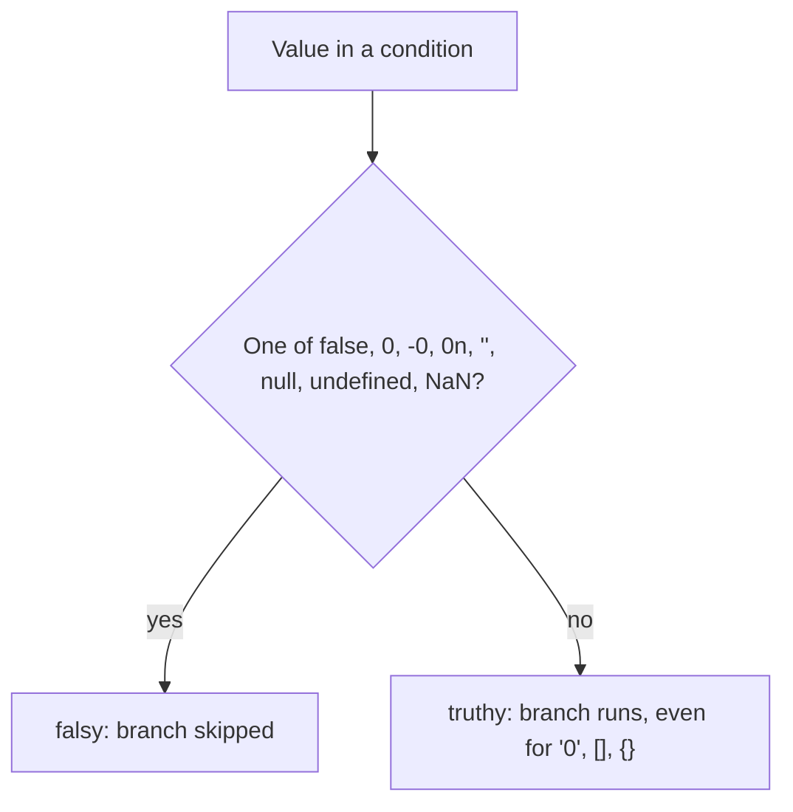

```javascript
const inputs = [0, '0', '', ' ', [], {}, null, NaN, 0n, 'false'];
console.log(inputs.map((v) => (v ? 'T' : 'F')).join(' ')); // F T F T T T F F F T

// Pitfall: an empty array is truthy, so check length.
const results = [];
if (results) console.log('runs even though nothing was found');
if (results.length > 0) console.log('does not run');

// Converting to a real boolean
console.log(Boolean('x'), !!'x'); // true true
```

Never construct booleans with `new Boolean(false)`: the result is an object, and every object is truthy.

JavaScript booleans can have one of two values: true or false.

```javascript
let value = true;
```

#### Boolean Methods and Properties

The following are some of the most commonly used boolean methods and properties in JavaScript:

**constructor** - Returns the function that created JavaScript's Boolean prototype

```javascript
let value = true;

console.log(value.constructor); // Output: ƒ Boolean() { [native code] }
```

**prototype** - Shows that properties added to `Boolean.prototype` are inherited by every boolean. Never modify built-in prototypes in real code

```javascript
Boolean.prototype.age = 25;

let value = true;

console.log(value.age); // Output: 25
```

**toString()** - Converts a boolean value to a string, and returns the result

```javascript
let value = true;

console.log(value.toString()); // Output: "true"
```

**valueOf()** - Returns the primitive value of a boolean

```javascript
let value = true;

console.log(value.valueOf()); // Output: true
```

### 1.10 Numbers, BigInt and Math

Every `number` is a 64-bit IEEE 754 double: 1 sign bit, 11 exponent bits, 52 fraction bits. Consequences:

- Integers are exact only up to `Number.MAX_SAFE_INTEGER` (2^53 - 1 = 9007199254740991).
- Most decimal fractions have no exact binary form: `0.1 + 0.2` is `0.30000000000000004`.
- There is a negative zero (`Object.is(-0, 0)` is `false`) and `NaN`, which is not equal to itself.
- Division by zero gives `Infinity`, not an error.

```javascript
console.log(0.1 + 0.2 === 0.3);                  // false
console.log(2 ** 53 === 2 ** 53 + 1);            // true: precision ran out
console.log(Number.isSafeInteger(2 ** 53));      // false
console.log((1.005).toFixed(2));                 // '1.00': 1.005 is stored as 1.00499999...
console.log(0.1 * 3, 1 / 0, -1 / 0, 0 / 0);       // 0.30000000000000004 Infinity -Infinity NaN
```

The starter's `src/lib/numbers.js` applies the standard fixes:

```javascript
import { toCents, formatCents, nearlyEqual, sumBig } from './src/lib/numbers.js';

// Money: store integer cents, convert once at the edge.
const total = toCents(0.1) + toCents(0.2);         // 10 + 20 = 30, exact
console.log(formatCents(total));                   // '$0.30'

// Measurements: compare with a tolerance.
console.log(nearlyEqual(0.1 + 0.2, 0.3));          // true

// Database IDs and counters beyond 2^53: BigInt.
console.log(sumBig([Number.MAX_SAFE_INTEGER, 2])); // 9007199254740993n
```

| Need | Use | Avoid |
| --- | --- | --- |
| Currency | Integer minor units (cents), or a decimal library for division-heavy maths | Floats with `toFixed` |
| 64-bit IDs from an API | Strings or `BigInt` | `JSON.parse` straight into `number` (silently rounds) |
| Parse user input | `Number()` with `Number.isFinite`, or a strict regex | `parseInt` without radix, unary `+` on untrusted input |
| Formatting | `Intl.NumberFormat` | Hand-written thousands separators |
| Random IDs and tokens | `crypto.randomUUID()`, `crypto.getRandomValues()` | `Math.random()` (not cryptographically secure) |

`BigInt` values cannot mix with `number` in arithmetic (`1n + 1` is a `TypeError`), `Math` methods do not accept them, and `JSON.stringify(1n)` throws. Convert explicitly at the boundary.

The Math object allows you to perform mathematical tasks on numbers.

```javascript
Math.PI // returns 3.141592653589793
```

#### Math Property

```javascript
Math.property
```

Example

```javascript
Math.E        // returns Euler's number
Math.PI       // returns PI
Math.SQRT2    // returns the square root of 2
Math.SQRT1_2  // returns the square root of 1/2
Math.LN2      // returns the natural logarithm of 2
Math.LN10     // returns the natural logarithm of 10
Math.LOG2E    // returns base 2 logarithm of E
Math.LOG10E   // returns base 10 logarithm of E
```

#### Math Methods

The Math object has several built-in methods that can be used to perform mathematical tasks. Some of the most commonly used methods are:

**Math.round** - Returns x rounded to its nearest integer

```javascript
Math.round(4.6); // 5
```

**Math.ceil** - Returns x rounded up to its nearest integer

```javascript
Math.ceil(4.4); // 5
```

**Math.floor** - Returns x rounded down to its nearest integer

```javascript
Math.floor(4.7); // 4
```

**Math.trunc** - Returns the integer part of x (new in ES6)

```javascript
Math.trunc(4.7); // 4
```

**Math.sign** - Returns if x is negative, null or positive.

```javascript
Math.sign(4); // 1
```

**Math.pow** - returns the value of x to the power of y.

```javascript
Math.pow(8, 2); // 64
```

**Math.sqrt** - returns the square root of x.

```javascript
Math.sqrt(64); // 8
```

**Math.abs** - returns the absolute (positive) value of x.

```javascript
Math.abs(-4.7); // 4.7
```

**Math.sin** - returns the sine (a value between -1 and 1) of the angle x (given in radians).

```javascript
Math.sin(90 * Math.PI / 180);     // returns 1 (the sine of 90 degrees)
```

**Math.cos** - returns the cosine (a value between -1 and 1) of the angle x (given in radians).

```javascript
Math.cos(0 * Math.PI / 180);     // returns 1 (the cos of 0 degrees)
```

**Math.min** - It can be used to find the lowest value in a list of arguments.

```javascript
Math.min(0, 150, 30, 20, -8, -200); // -200
```

**Math.max** - It can be used to find the highest value in a list of arguments.

```javascript
Math.max(0, 150, 30, 20, -8, -200); // 150
```

**Math.random** - returns a random number between 0 (inclusive), and 1 (exclusive).

```javascript
Math.random(); // 0.07840484495533051
```

**Math.log** - returns the natural logarithm of x.

```javascript
Math.log(1); // 0
```

**Math.log2** - returns the base 2 logarithm of x.

```javascript
Math.log2(8); // 3
```

**Math.log10** - returns the base 10 logarithm of x.

```javascript
Math.log10(1000); // 3
```

| Method | Description |
|---|---|
| abs(x) | Returns the absolute value of x |
| acos(x) | Returns the arccosine of x, in radians |
| acosh(x) | Returns the hyperbolic arccosine of x |
| asin(x) | Returns the arcsine of x, in radians |
| asinh(x) | Returns the hyperbolic arcsine of x |
| atan(x) | Returns the arctangent of x as a numeric value between -PI/2 and PI/2 radians |
| atan2(y, x) | Returns the arctangent of the quotient of its arguments |
| atanh(x) | Returns the hyperbolic arctangent of x |
| cbrt(x) | Returns the cubic root of x |
| ceil(x) | Returns x, rounded upwards to the nearest integer |
| cos(x) | Returns the cosine of x (x is in radians) |
| cosh(x) | Returns the hyperbolic cosine of x |
| exp(x) | Returns the value of Ex |
| floor(x) | Returns x, rounded downwards to the nearest integer |
| log(x) | Returns the natural logarithm (base E) of x |
| max(x, y, z, ..., n) | Returns the number with the highest value |
| min(x, y, z, ..., n) | Returns the number with the lowest value |
| pow(x, y) | Returns the value of x to the power of y |
| random() | Returns a random number between 0 and 1 |
| round(x) | Rounds x to the nearest integer |
| sign(x) | Returns if x is negative, null or positive (-1, 0, 1) |
| sin(x) | Returns the sine of x (x is in radians) |
| sinh(x) | Returns the hyperbolic sine of x |
| sqrt(x) | Returns the square root of x |
| tan(x) | Returns the tangent of an angle |
| tanh(x) | Returns the hyperbolic tangent of a number |
| trunc(x) | Returns the integer part of a number (x) |

### 1.11 Conditional Statements

`if`/`else` evaluates truthiness (Section 1.9). `switch` compares with `===`, falls through until `break`, and evaluates `case` expressions lazily in order.

```javascript
function httpClass(status) {
  switch (true) {
    case status >= 500:
      return 'server error';
    case status >= 400:
      return 'client error';
    case status >= 300:
      return 'redirect';
    case status >= 200:
      return 'success';
    default:
      return 'informational';
  }
}
console.log(httpClass(404)); // 'client error'

// A lookup object is often clearer than a switch on string values.
const ICONS = { info: 'i', warn: '!', error: 'x' };
const icon = (level) => ICONS[level] ?? '?';
console.log(icon('warn'), icon('debug')); // ! ?
```

| Construct | Best when | Watch out for |
| --- | --- | --- |
| `if` / `else if` | Ranges, mixed conditions | Deep nesting; prefer early `return` |
| `switch` | Many exact values of one variable | Missing `break`; `let` in cases shares one block unless you add `{ }` |
| Lookup object or `Map` | Value-to-value mapping | Prototype keys like `'constructor'` on plain objects; use `Object.hasOwn` or `Map` |
| Ternary `a ? b : c` | Choosing a value inline | Nested ternaries; split them |

Conditional statements are used to perform different actions based on different conditions.

There are several types of conditional statements in JavaScript:

- if statement
- if else statement
- if else else if statement
- switch statement

#### if statement

The if statement is used to execute a block of code if a specified condition is true.

```javascript
if (x > 0) {
  console.log("x is greater than 0");
}
```

#### if else statement

The if...else statement is used to execute a block of code if a specified condition is true and another block of code if the condition is false.

```javascript
if (x > 0) {
  console.log("x is greater than 0");
} else {
  console.log("x is not greater than 0");
}
```

#### if else else if statement

The if...else if...else statement is used to specify multiple conditions and execute a different block of code for each one.

```javascript
if (x > 0) {
  console.log("x is positive");
} else if (x < 0) {
  console.log("x is negative");
} else {
  console.log("x is zero");
}
```

#### switch statement

The switch statement is used to select one of many blocks of code to be executed.

```javascript
let day = new Date().getDay();
switch (day) {
  case 0:
    console.log("Sunday");
    break;
  case 1:
    console.log("Monday");
    break;
  case 2:
    console.log("Tuesday");
    break;
  // and so on
  default:
    console.log("Invalid day");
}
```

### 1.12 Loops and Iteration

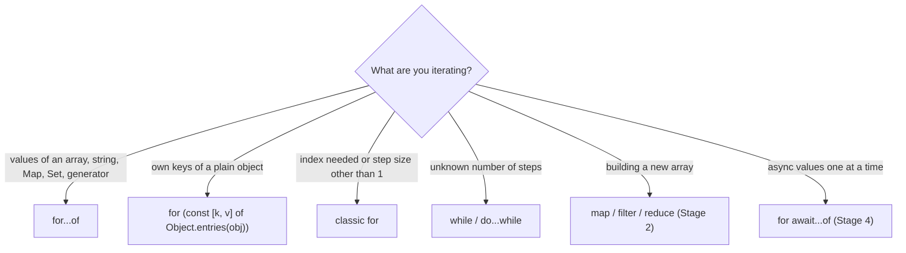

`for...in` walks enumerable string keys, *including inherited ones*, and gives array indices as strings. Use it only for plain objects, and even then `Object.keys`/`Object.entries` is clearer.

```javascript
const scores = [10, 20];
scores.extra = 'oops';
for (const i in scores) console.log(i, typeof i); // '0' string, '1' string, 'extra' string
for (const s of scores) console.log(s);           // 10, 20

// Labels let break/continue target an outer loop.
const grid = [
  [1, 2],
  [3, 4],
];
outer: for (const row of grid) {
  for (const cell of row) {
    if (cell === 3) break outer;
    console.log(cell); // 1, 2
  }
}

// for...of over a string iterates code points, not UTF-16 units.
for (const ch of 'a😀') console.log(ch); // 'a', '😀'
```

`forEach` cannot be stopped with `break` and ignores returned promises; use `for...of` when you need either.

Loops are used to execute a block of code multiple times.

There are several types of loops in JavaScript:

- for loop
- while loop
- do while loop
- for in loop
- for of loop

#### for loop

This type of loop is used to execute a block of code a specified number of times.

```javascript
for (let i = 0; i < 5; i++) {
  console.log(i);
}
```

#### while loop

This type of loop is used to execute a block of code as long as a specified condition is true.

```javascript
let i = 0;
while (i < 5) {
  console.log(i);
  i++;
}
```

#### do while loop

This type of loop is similar to the while loop, but it guarantees that the code block will be executed at least once.

```javascript
let i = 0;
do {
  console.log(i);
  i++;
} while (i < 5);
```

#### for in loop

This type of loop is used to iterate over the enumerable properties of an object.

```javascript
let obj = {a: 1, b: 2, c: 3};
for (let prop in obj) {
  console.log(prop + ": " + obj[prop]);
}
```

#### for of loop

This type of loop is used to iterate over the iterable objects such as arrays, strings, and maps.

```javascript
let arr = [1, 2, 3];
for (let value of arr) {
  console.log(value);
}
```

### 1.13 Pitfalls

| Pitfall | Symptom | Fix |
| --- | --- | --- |
| Reading a `let`/`const` before its line | `ReferenceError: Cannot access 'x' before initialization` | Move the declaration up; this is the TDZ (Section 1.5). |
| `return` followed by a line break | Function returns `undefined` | Keep the returned expression on the same line as `return`. |
| `\|\|` for defaults | `0`, `''` or `false` replaced by the default | Use `??`. |
| `typeof null === 'object'` | Null passes an "is object" check, then `TypeError: Cannot read properties of null` | Test `value !== null && typeof value === 'object'`. |
| `0.1 + 0.2 !== 0.3` | Off-by-a-cent totals, failing equality checks | Integer cents or a tolerance (`nearlyEqual`). |
| `parseInt('08')` style input parsing | `parseInt('12px', 10)` gives `12`, `parseInt('1e3', 10)` gives `1` | Validate with a regex first, as `toSafeInteger` does. |
| Large IDs in JSON | `JSON.parse('{"id":9007199254740993}').id` is `9007199254740992` | Send IDs as strings. |
| `==` between mixed types | `'' == 0` is `true`, `[] == ![]` is `true` | Use `===`; allow `== null` only. |
| `for...in` on arrays | String indices, inherited or extra keys appear | `for...of` or array methods. |
| `var` in loops with callbacks | Every callback sees the final value | `let` creates a binding per iteration. |
| Assigning to an undeclared name in a script | Silent global variable, or `ReferenceError` in modules | Declare everything; use modules (strict by default). |
| `new Boolean(false)` / `new Number(0)` | Object wrapper is truthy | Call `Boolean(x)` / `Number(x)` without `new`. |

### 1.14 Best Practices

- **`const` by default, `let` when reassigning, never `var`**: smaller scopes and the TDZ catch ordering bugs early.
- **Always `===` and `!==`**: the `==` rules are not transitive; `== null` is the single accepted exception.
- **`??` for defaults, `?.` for optional data**: they treat `0` and `''` as real values.
- **Write ES modules (`"type": "module"`)**: you get strict mode, explicit imports and top-level `await`.
- **Validate at the boundary, then trust types inside**: parse strings from requests, env vars and files once (`toSafeInteger`), not throughout the code.
- **Use integer cents or `BigInt` for exact values**: floats are for measurements, not money or IDs.
- **Prefer `Number.isNaN`, `Number.isFinite`, `Number.parseInt`**: the global versions coerce first.
- **Let tools enforce style**: ESLint for correctness rules, Prettier for formatting, both run in CI.
- **Use `textContent`, not `innerHTML`, for text**: it cannot inject markup.

### 1.15 Hands-on Exercise

Write `parseBoolean(raw)` in `src/lib/types.js` for environment variables. It must return `true` for `'true'`, `'1'`, `'yes'`, `'on'` (any case, surrounding spaces allowed), `false` for `'false'`, `'0'`, `'no'`, `'off'` and `''`, and throw a `TypeError` naming the input for anything else. `Boolean('false')` is `true`, which is exactly the bug this function prevents.

Expected behaviour:

```javascript
import assert from 'node:assert/strict';
import { parseBoolean } from '../src/lib/types.js';

assert.equal(parseBoolean(' YES '), true);
assert.equal(parseBoolean('0'), false);
assert.equal(parseBoolean(''), false);
assert.throws(() => parseBoolean('maybe'), /maybe/);
```

Write it yourself first (hint: trim, lower-case, then look the value up in two `Set`s and throw for the rest), run `npm test`, then compare with the solution: `parseBoolean` in [`src/lib/types.js`](src/lib/types.js) and its test in [`tests/stage1.test.js`](tests/stage1.test.js).

[Back to top ⤴️](#-table-of-contents)

---


## 2. Stage 2: Functions, Closures, Arrays, Strings & Modules

Functions are values in JavaScript: you store them in variables, pass them to other functions and return them. This stage covers how functions are declared, how scope and closures work, what `this` refers to, and the array, string and module APIs you will use every day. It assumes Stage 1. Afterwards you can write the starter's `functions.js`, `strings.js` and `collections.js` yourself.

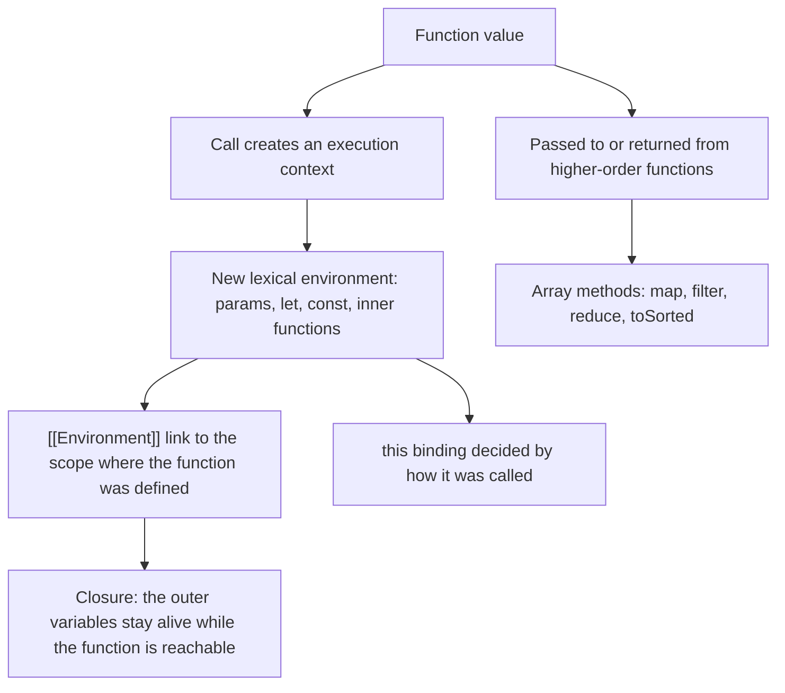

### 2.1 Declaring Functions: Declarations, Expressions and Arrows

| Form | Syntax | Hoisted | Own `this` / `arguments` | Can be `new`-ed | Typical use |
| --- | --- | --- | --- | --- | --- |
| Declaration | `function add(a, b) {}` | Yes, fully | Yes | Yes | Top-level named helpers |
| Expression | `const add = function (a, b) {}` | Binding only (TDZ) | Yes | Yes | Rare; named expressions help recursion and stack traces |
| Arrow | `const add = (a, b) => a + b` | Binding only (TDZ) | No, uses the outer ones | No | Callbacks, short pure functions |
| Method shorthand | `{ add(a, b) {} }` | n/a | Yes | No | Object and class methods |
| Generator | `function* ids() {}` | Yes | Yes | No | Lazy sequences (Stage 3) |
| Async | `async function load() {}` | Yes | Yes | No | Awaiting promises (Stage 4) |

```javascript
console.log(square(4)); // 16: declarations are usable before their line

function square(n) {
  return n * n;
}

const cube = (n) => n ** 3;               // concise body returns the expression
const toPoint = (x, y) => ({ x, y });     // wrap an object literal in parentheses
const log = (msg) => {
  console.log(msg);                       // block body needs an explicit return
};

// A named function expression can call itself even if the outer variable changes.
const factorial = function fact(n) {
  return n <= 1 ? 1 : n * fact(n - 1);
};

console.log(cube(3), toPoint(1, 2), factorial(5)); // 27 { x: 1, y: 2 } 120
log('done');
```

Every function has a `name` (inferred from the variable for anonymous expressions and arrows) and a `length` (the number of parameters before the first default or rest parameter). The starter's `curry()` in `src/runtime/closure-scope.js` relies on `fn.length`.

The original reference examples follow. Note that `new Function(...)` compiles a string at runtime, like `eval`: it ignores the surrounding scope, is blocked by most Content Security Policies, and should not appear in application code.

Functions are blocks of code that can be reused to perform a specific task. Defined with the function keyword, followed by a name, followed by parentheses ().

```javascript
function name(parameter1, parameter2, parameter3) {
  // code to be executed
}
```

#### Types of Functions

- Named Function
- Anonymous Function
- Arrow Function
- IIFE
- Higher-Order Function
- Function Expression
- Function Declaration
- Function Constructor

#### Named Function

A named function is a function that has a name. It can be defined using the function keyword followed by the function name.

```javascript
function name(parameter1, parameter2, parameter3) {
  // code to be executed
}
```

#### Anonymous Function

An anonymous function is a function that does not have a name. It can be defined using the function keyword followed by parentheses ().

```javascript
const name = function(parameter1, parameter2, parameter3) {
  // code to be executed
}
```

#### Arrow Function

Arrow functions are a more concise way to write functions in JavaScript. They are defined using the => syntax.

```javascript
const name = (parameter1, parameter2, parameter3) => {
  // code to be executed
}

const name = (parameter1, parameter2, parameter3) => expression

const name = parameter => expression

const name = () => expression

const name = (parameter1, parameter2, parameter3) => {
  return expression
}

const name = parameter => {
  return expression
}

const name = () => {
  return expression
}
```

A function expression is a function that is assigned to a variable.

```javascript
const greet = function() {
  return "Hello World!";
}

console.log(greet()); // Output: "Hello World!"
```

#### Function Declaration

A function declaration is a function that is defined using the function keyword followed by the function name.

```javascript
function greet() {
  return "Hello World!";
}

console.log(greet()); // Output: "Hello World!"
```

#### Function Constructor

The `Function` constructor compiles a string into a function at runtime. Like `eval`, it ignores the surrounding scope and is blocked by most Content Security Policies, so avoid it.

```javascript
const greet = new Function("return 'Hello World!'");
console.log(greet()); // Output: "Hello World!"
```

### 2.2 Parameters: Defaults, Rest, Spread and Destructuring

```javascript
// Default values are evaluated at call time, only when the argument is undefined.
function connect({ host = '127.0.0.1', port = 8080, tls = false } = {}, ...tags) {
  return { url: `${tls ? 'https' : 'http'}://${host}:${port}`, tags };
}

console.log(connect());                                  // { url: 'http://127.0.0.1:8080', tags: [] }
console.log(connect({ port: 443, tls: true }, 'prod'));  // { url: 'https://127.0.0.1:443', tags: [ 'prod' ] }
console.log(connect({ port: null }).url);                // 'http://127.0.0.1:null': null is not undefined

// Spread turns an array into separate arguments.
const nums = [5, 1, 9];
console.log(Math.max(...nums)); // 9

// Defaults can refer to earlier parameters.
const range = (start, end = start + 10, step = 1) =>
  Array.from({ length: Math.ceil((end - start) / step) }, (_, i) => start + i * step);
console.log(range(0, 5)); // [ 0, 1, 2, 3, 4 ]
```

| Feature | Rule | Gotcha |
| --- | --- | --- |
| Default parameter | Used when the argument is `undefined` (missing or passed explicitly) | `null` does not trigger it |
| Rest parameter `...args` | Real array of remaining arguments; must be last | Not counted in `fn.length` |
| `arguments` object | Array-like, exists in non-arrow functions | Not available in arrows; prefer rest parameters |
| Destructured parameter | `function f({ a, b })` | Calling `f()` throws `TypeError: Cannot destructure property 'a' of 'undefined'` unless you add `= {}` |
| Options object | One object parameter instead of many positional ones | Order-independent and self-documenting at call sites |

JavaScript passes arguments *by sharing*: the parameter receives a copy of the value, and for objects that value is a reference. Reassigning a parameter never affects the caller; mutating an object parameter does.

```javascript
function rename(user) {
  user.name = 'changed'; // visible to the caller: same object
  user = { name: 'new object' }; // invisible to the caller: rebinding the local name only
}
const u = { name: 'original' };
rename(u);
console.log(u.name); // 'changed'
```

### 2.3 Scope and the Scope Chain

Scope decides where a name is visible. JavaScript uses **lexical** (static) scope: visibility is fixed by where code is *written*, not where it is called from.

| Scope | Created by | Holds |
| --- | --- | --- |
| Global | The script or the realm | `var` and function declarations of classic scripts (as `globalThis` properties), plus top-level `let`/`const` (not on `globalThis`) |
| Module | Each ES module file | Its top-level declarations; nothing leaks to the global scope |
| Function | Each function call | Parameters, `var`, `let`, `const`, inner functions |
| Block | `{ }`, `if`, `for`, `switch`, `try`/`catch` | `let`, `const`, `class`, and function declarations in strict mode |

Name lookup walks outward through the chain of environments until it finds the name or reaches the global scope:

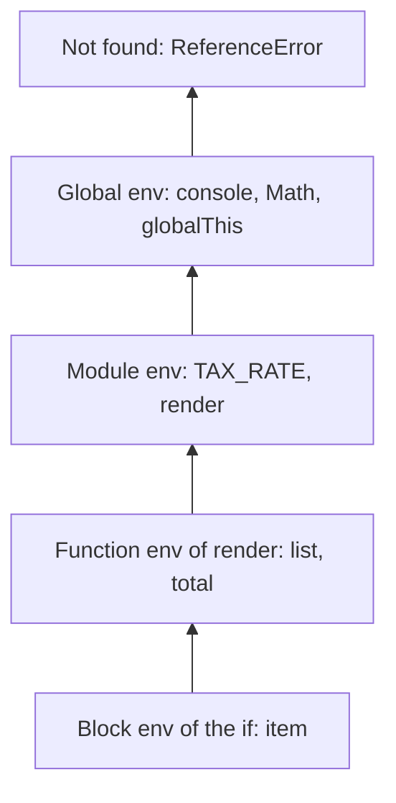

```javascript
const TAX_RATE = 0.2; // module scope

export function render(list) {
  let total = 0; // function scope
  for (const item of list) {
    if (item.price > 0) {
      const withTax = item.price * (1 + TAX_RATE); // block scope; TAX_RATE found two levels up
      total += withTax;
    }
  }
  // console.log(withTax); // ReferenceError: withTax is not defined
  return total;
}

console.log(render([{ price: 10 }, { price: 5 }])); // 18
```

An inner declaration with the same name **shadows** the outer one for that scope. ESLint's `no-shadow` rule flags accidental shadowing.

Scope refers to the visibility of variables in JavaScript. There are three types of scope in JavaScript:

- Global Scope
- Function Scope
- Block Scope

#### Global Scope

```javascript
let a = 10;
function myFunction() {
    console.log(a);
}
myFunction();
```

#### Block Scope

```javascript
//var
function myFunction () {
    if(true) {
        var a = 10; // it exists in function scope
    }
    console.log(a);
}
myFunction();

//let
function myFunction () {
    if(true) {
        let a = 10; // it exists in block scope
    }
    console.log(a);
}
myFunction();

//const
function myFunction () {
    if(true) {
        const a = 10; // it exists in block scope
    }
    console.log(a);
}
myFunction();
```

#### Function Scope

```javascript
//var
function myFunction() {
    var a = 10;
}
myFunction()
console.log(a);

//let
function myFunction() {
    let a = 10;
}
myFunction()
console.log(a);

//const
function myFunction() {
    const a = 10;
}
myFunction()
console.log(a);
```

### 2.4 Hoisting and the Two Phases of Running Code

#### Execution Context: Creation and Execution Phases
Every execution context (Global, Function, or Eval) in JavaScript is processed in two distinct phases:

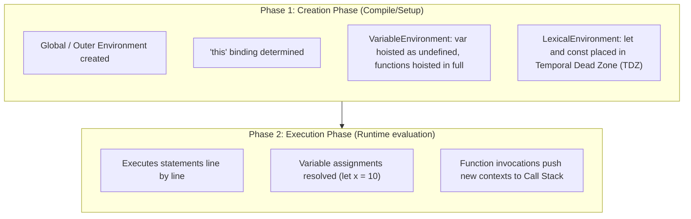

1. **Creation Phase**:
   - The engine creates the **LexicalEnvironment** and **VariableEnvironment**.
   - Functions declarations are hoisted into memory with their full definitions.
   - Variables declared with `var` are initialized to `undefined`.
   - Variables declared with `let` and `const` are registered in the LexicalEnvironment Record uninitialized, entering the **Temporal Dead Zone (TDZ)**.
   - The `this` binding reference is established.
2. **Execution Phase**:
   - The engine runs code sequentially line-by-line.
   - Variable assignments are evaluated; attempting to access `let` or `const` before their assignment line throws a `ReferenceError`.
   - Function calls allocate a new execution context on top of the Call Stack.

Before a scope's code runs, the engine scans it and creates every binding declared in it. This is what "hoisting" describes; nothing is physically moved.

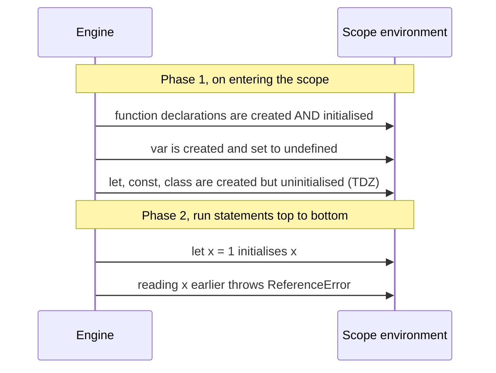

```javascript
console.log(typeof helper); // 'function': declaration fully hoisted
console.log(legacy);        // undefined: var hoisted, value not yet assigned
// console.log(modern);     // ReferenceError: Cannot access 'modern' before initialization

function helper() {}
var legacy = 'set';
let modern = 'set';

// Function expressions follow the rules of their variable.
try {
  greet();
} catch (e) {
  console.log(e.constructor.name); // TypeError: greet is undefined (var) so it is not callable
}
var greet = function () {};
```

| Declaration | Hoisted binding | Initial value | Access before the line |
| --- | --- | --- | --- |
| `function f() {}` | Yes | The function | Works |
| `var x` | Yes | `undefined` | `undefined` |
| `let x` / `const x` | Yes | Uninitialised | `ReferenceError` |
| `class C {}` | Yes | Uninitialised | `ReferenceError` |
| `import` | Yes, resolved before the module runs | The live binding | Works (cycles aside) |

Hoisting describes how declarations behave as if they were moved to the top of their scope: the engine creates every binding when it enters the scope, before running any statement. `var` starts as `undefined`; `let`, `const` and `class` stay uninitialised until their line runs (Section 2.4).

```javascript
console.log(x); // Output: undefined

var x = 5;
```

### 2.5 Closures

A closure is a function together with the environment it was created in. Every JavaScript function keeps an internal `[[Environment]]` reference to the scope where it was defined, so it can still read and write those variables after the outer function has returned. The variables stay alive as long as the inner function is reachable.

The starter's `createCounter` (in `src/runtime/closure-scope.js`) uses a closure for private state:

```javascript
export function createCounter(initialValue = 0) {
  let count = initialValue; // only the three methods below can reach this

  return {
    increment(by = 1) {
      count += by;
      return count;
    },
    decrement(by = 1) {
      count -= by;
      return count;
    },
    getValue() {
      return count;
    },
  };
}

const counter = createCounter(100);
counter.increment(25);
console.log(counter.getValue(), counter.count); // 125 undefined
```

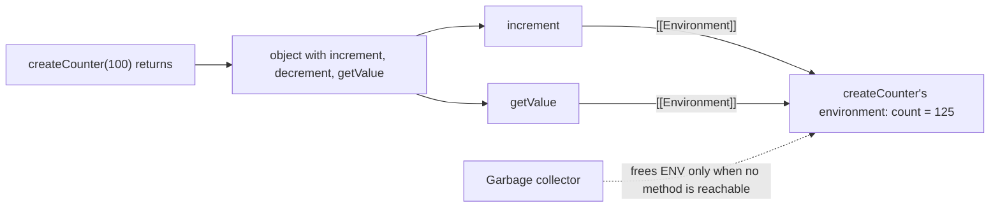

| Line / API | Role | What happens at runtime |
| :--- | :--- | :--- |
| `let count = initialValue` | Private variable | Lives in the environment record created for this call of `createCounter`. |
| `return { increment, ... }` | Expose behaviour, not data | Each method is created inside the call, so each has `[[Environment]]` pointing at that record. |
| `count += by` | Write through the closure | The engine looks up `count` in the captured environment, not a copy. |
| Calling `createCounter` twice | Independent instances | Each call creates a fresh environment, so counters do not share `count`. |

Closures power most of `src/lib/functions.js`. `once` remembers whether it ran; `memoize` keeps a `Map` cache:

```javascript
export function once(fn) {
  let called = false;
  let result;
  return function (...args) {
    if (!called) {
      called = true;
      result = fn.apply(this, args);
    }
    return result;
  };
}
```

Memory note: a closure keeps alive whatever it references, and V8 shares one context object between all closures created in the same scope. If one long-lived callback and one closure that references a large buffer come from the same function, the buffer can stay alive as long as the callback does. Keep long-lived closures small, and set references to `null` when you are done with large data.

Closures versus classes with `#private` fields (Stage 3):

| Concern | Closure (factory function) | Class with `#private` |
| --- | --- | --- |
| Privacy | Total; nothing outside can reach `count` | Total; `#count` is inaccessible outside the class body |
| Memory per instance | One function object per method per instance | Methods shared on the prototype |
| `instanceof` / type checks | Not available | Available |
| `this` pitfalls | None if methods do not use `this` | Detached methods lose `this` |
| Best for | Small modules, callbacks, a few instances | Many instances, inheritance, tooling support |

### 2.6 `this`, `call`, `apply` and `bind`

`this` is not decided by where a function is written; it is decided by *how it is called*. Arrow functions are the exception: they have no `this` of their own and use the one from the enclosing scope.

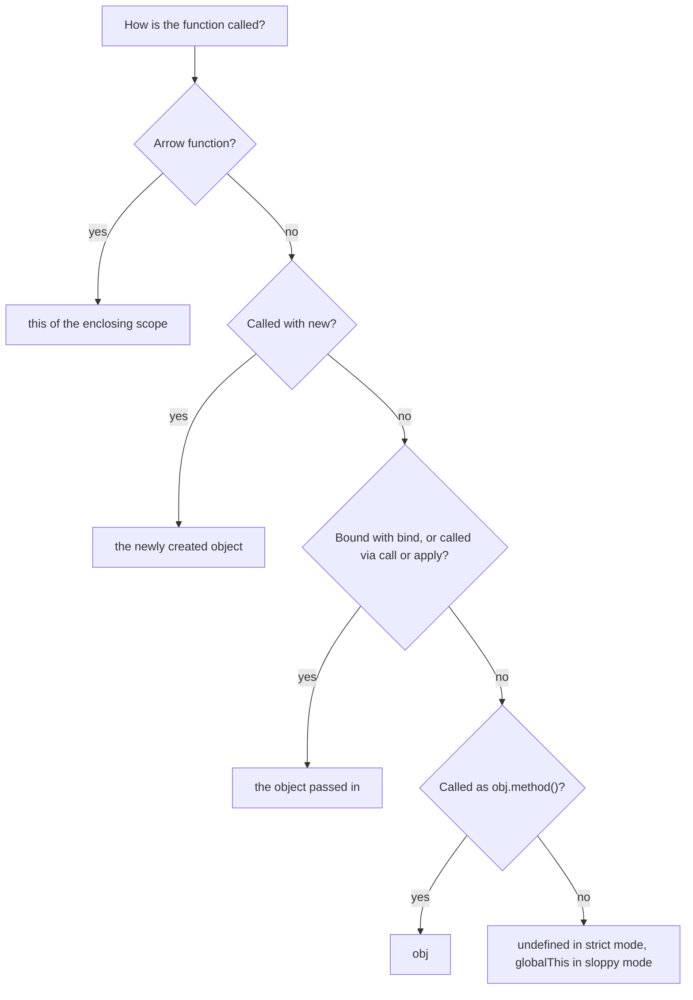

```javascript
const account = {
  owner: 'Ada',
  describe() {
    return `Account of ${this.owner}`;
  },
  describeLater() {
    // Arrow keeps describeLater's this; a regular function here would lose it.
    return new Promise((resolve) => setTimeout(() => resolve(this.describe()), 0));
  },
};

console.log(account.describe()); // 'Account of Ada'

const detached = account.describe;
try {
  detached(); // plain call: this is undefined in modules
} catch (e) {
  console.log(e.message); // Cannot read properties of undefined (reading 'owner')
}

const bound = account.describe.bind(account);
console.log(bound()); // 'Account of Ada'

function introduce(greeting, punctuation) {
  return `${greeting}, I am ${this.owner}${punctuation}`;
}
console.log(introduce.call(account, 'Hi', '!'));    // arguments listed
console.log(introduce.apply(account, ['Hello', '.'])); // arguments as an array

account.describeLater().then(console.log); // 'Account of Ada'
```

| Method | Calls now | Arguments | Returns |
| --- | --- | --- | --- |
| `fn.call(thisArg, a, b)` | Yes | Listed | The result |
| `fn.apply(thisArg, [a, b])` | Yes | Array | The result |
| `fn.bind(thisArg, a)` | No | Pre-filled (partial application) | A new function whose `this` is fixed forever |

The most common real bug is passing a method as a callback: `button.addEventListener('click', obj.handle)` or `setTimeout(obj.save, 100)`. Fix it with an arrow wrapper (`() => obj.save()`), with `bind`, or with a class field arrow (`handle = () => {...}`).

### 2.7 Higher-Order Functions, Composition and Currying

A higher-order function takes a function as an argument, returns a function, or both. `map`, `filter`, `addEventListener`, `setTimeout` and `Promise.prototype.then` are all higher-order.

```javascript
import { pipe, compose, memoize, partial } from './src/lib/functions.js';

const trim = (s) => s.trim();
const lower = (s) => s.toLowerCase();
const dashes = (s) => s.replace(/\s+/g, '-');

const toSlug = pipe(trim, lower, dashes); // read left to right
console.log(toSlug('  Hello World  ')); // 'hello-world'

const toSlug2 = compose(dashes, lower, trim); // same thing, read right to left
console.log(toSlug2('  Mixed Case ')); // 'mixed-case'

const fib = memoize((n) => (n < 2 ? n : fib(n - 1) + fib(n - 2)));
console.log(fib(90)); // 2880067194370816000, instant; without memoize this would never finish

const add3 = (a, b, c) => a + b + c;
const add10 = partial(add3, 10);
console.log(add10(1, 2)); // 13
```

**Currying** turns `f(a, b, c)` into `f(a)(b)(c)`. The starter's generic `curry()` collects arguments until it has `fn.length` of them:

```javascript
export function curry(fn) {
  return function curried(...args) {
    if (args.length >= fn.length) {
      return fn.apply(this, args);
    }
    return function (...moreArgs) {
      return curried.apply(this, args.concat(moreArgs));
    };
  };
}

const volume = curry((l, w, h) => l * w * h);
console.log(volume(2)(3)(4), volume(2, 3)(4), volume(2)(3, 4)); // 24 24 24
```

| Technique | What it returns | Typical use |
| --- | --- | --- |
| Partial application (`partial`, `bind`) | Function waiting for the remaining arguments | Fixing configuration such as a base URL |
| Currying (`curry`) | Chain of one-or-more-argument functions | Building specialised functions from generic ones |
| Composition (`pipe`, `compose`) | One function running others in sequence | Data transformation pipelines |
| Memoisation (`memoize`) | Same function with a cache | Pure, expensive, frequently repeated calls |

The classic trap with higher-order functions is passing a function that accepts more parameters than you expect:

```javascript
console.log(['1', '2', '3'].map(parseInt)); // [ 1, NaN, NaN ]: map passes (value, index), so parseInt('2', 1)
console.log(['1', '2', '3'].map(Number));   // [ 1, 2, 3 ]
```

A higher-order function is a function that takes another function as an argument or returns a function as a result.

```javascript
function greet() {
  return "Hello World!";
}

function greetUser(greet) {
  return greet();
}

console.log(greetUser(greet)); // Output: "Hello World!"
```

Currying is a technique in which a function with multiple arguments is converted into a sequence of nested functions, each taking a single argument.

```javascript
function multiply(a) {
  return function(b) {
    return function(c) {
      return a * b * c;
    };
  };
}

console.log(multiply(2)(3)(4)); // Output: 24
```

### 2.8 IIFEs and the Module Pattern

An IIFE (Immediately Invoked Function Expression) creates a private scope and runs at once. Before ES modules it was the only way to avoid leaking variables into the global scope of a browser page.

```javascript
// Classic module pattern: private state plus a public API, in one global name.
const Analytics = (() => {
  const queue = [];
  function flush() {
    console.log(`sending ${queue.length} events`);
    queue.length = 0;
  }
  return {
    track(event) {
      queue.push(event);
      if (queue.length >= 2) flush();
    },
  };
})();

Analytics.track('open');
Analytics.track('click'); // sending 2 events
```

Today an ES module gives the same privacy with less ceremony: anything you do not `export` is private to the file, and top-level `await` removes the need for async IIFEs in modules. IIFEs still appear in bundler output, in inline `<script>` tags, and for running async code at the top level of a CommonJS file.

An IIFE (Immediately Invoked Function Expression) is a JavaScript function that runs as soon as it is defined.

```javascript
(function() {
  console.log("Hello World!");
})();
```

### 2.9 Recursion

A recursive function calls itself on a smaller input until it reaches a base case. Each call adds a frame to the call stack, and engines limit the stack (around 10,000 frames in V8 with default flags, depending on frame size). Exceeding it throws `RangeError: Maximum call stack size exceeded`. JavaScript engines other than JavaScriptCore do not implement proper tail calls, so do not rely on tail recursion to save stack.

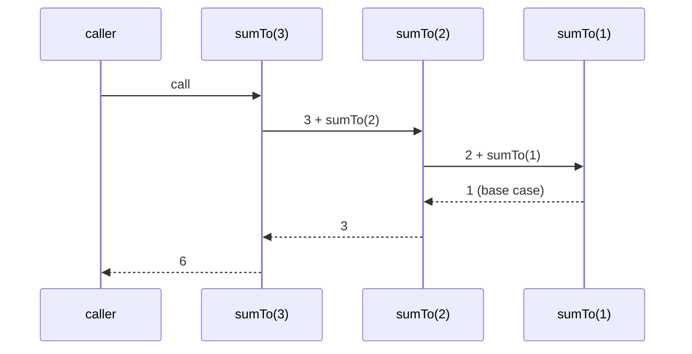

```javascript
// Recursion fits naturally recursive data such as trees.
const tree = { name: 'src', children: [{ name: 'lib', children: [{ name: 'types.js' }] }, { name: 'app.js' }] };

function countFiles(node) {
  if (!node.children) return 1; // base case: a leaf
  return node.children.reduce((sum, child) => sum + countFiles(child), 0);
}
console.log(countFiles(tree)); // 2

// For deep or unbounded input, use an explicit stack instead.
function countFilesIterative(root) {
  let files = 0;
  const stack = [root];
  while (stack.length > 0) {
    const node = stack.pop();
    if (node.children) stack.push(...node.children);
    else files += 1;
  }
  return files;
}
console.log(countFilesIterative(tree)); // 2
```

Recursion is a programming technique where a function calls itself in order to solve a problem. Recursion is used to solve problems that can be broken down into smaller, more manageable subproblems.

```javascript
function factorial(n) {
  if (n === 0) {
    return 1;
  } else {
    return n * factorial(n - 1);
  }
}

factorial(5); // 120
```

### 2.10 Arrays

Arrays are ordered, zero-indexed lists that can hold any mix of values. They are objects with integer-like keys and a `length` that is always one more than the highest index. The most important design distinction in the API is whether a method **mutates** the array or **returns a new one**:

| Task | Mutating (changes the original) | Non-mutating (returns a copy) |
| --- | --- | --- |
| Sort | `sort()` | `toSorted()` (ES2023) |
| Reverse | `reverse()` | `toReversed()` (ES2023) |
| Insert / remove | `splice()` | `toSpliced()` (ES2023), `slice()` |
| Replace one element | `arr[i] = v` | `with(i, v)` (ES2023) |
| Add to end / start | `push()`, `unshift()` | `[...arr, v]`, `concat()` |
| Remove from end / start | `pop()`, `shift()` | `slice(0, -1)`, `slice(1)` |
| Fill | `fill()`, `copyWithin()` | `Array.from({ length }, fn)` |

Mutating shared arrays is a top cause of bugs in UI state and caches. Prefer the copying versions unless you own the array and performance measurements say otherwise.

```javascript
const prices = [30, 5, 100, 20];

console.log(prices.toSorted());               // [ 100, 20, 30, 5 ]: default sort compares strings!
console.log(prices.toSorted((a, b) => a - b)); // [ 5, 20, 30, 100 ]
console.log(prices);                          // [ 30, 5, 100, 20 ]: unchanged

const people = [
  { name: 'Ana', age: 31 },
  { name: 'Bo', age: 25 },
  { name: 'Cy', age: 31 },
];
// Sort is stable (since ES2019): equal ages keep their original order.
console.log(people.toSorted((a, b) => a.age - b.age).map((p) => p.name)); // [ 'Bo', 'Ana', 'Cy' ]

// Locale-aware string sort
console.log(['é', 'z', 'a'].toSorted((a, b) => a.localeCompare(b))); // [ 'a', 'é', 'z' ]
```

The iteration methods take a callback `(element, index, array)`:

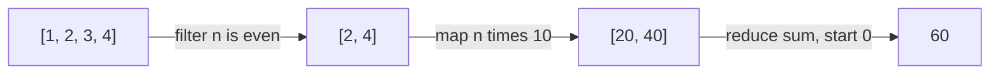

```javascript
const orders = [
  { id: 1, total: 40, status: 'paid' },
  { id: 2, total: 15, status: 'refunded' },
  { id: 3, total: 60, status: 'paid' },
];

const revenue = orders
  .filter((o) => o.status === 'paid')
  .map((o) => o.total)
  .reduce((sum, t) => sum + t, 0); // always pass the initial value
console.log(revenue); // 100

console.log(orders.find((o) => o.total > 50)?.id);     // 3
console.log(orders.findLast((o) => o.status === 'paid').id); // 3
console.log(orders.some((o) => o.status === 'refunded'));    // true
console.log(orders.every((o) => o.total > 10));               // true
console.log(Object.groupBy(orders, (o) => o.status).paid.length); // 2
console.log(orders.at(-1).id);                                 // 3
```

| Need | Method | Returns |
| --- | --- | --- |
| Transform each element | `map` | New array, same length |
| Keep some elements | `filter` | New array |
| Combine into one value | `reduce` / `reduceRight` | Anything |
| First / last match | `find` / `findLast` | Element or `undefined` |
| Position of a match | `findIndex` / `findLastIndex` / `indexOf` | Index or `-1` |
| Membership | `includes` (handles `NaN`) | Boolean |
| Any / all | `some` / `every` | Boolean, stops early |
| Flatten | `flat(depth)` / `flatMap` | New array |
| Group | `Object.groupBy` / `Map.groupBy` (ES2024) | Object / Map of arrays |
| Build from an iterable | `Array.from(iterable, mapFn)` | New array |

The starter's `chunk` and `uniqueBy` in `src/lib/collections.js` show two patterns these methods do not cover directly:

```javascript
export function chunk(items, size) {
  if (!Number.isInteger(size) || size < 1) throw new RangeError('size must be a positive integer');
  const out = [];
  for (let i = 0; i < items.length; i += size) out.push(items.slice(i, i + size));
  return out;
}

export function uniqueBy(items, keyFn) {
  const seen = new Set();
  return items.filter((item) => {
    const key = keyFn(item);
    if (seen.has(key)) return false;
    seen.add(key);
    return true;
  });
}
```

Sparse arrays (holes) behave inconsistently: `forEach`, `map` and `filter` skip holes, while `for...of`, `Array.from` and the ES2023 copying methods treat them as `undefined`. Create filled arrays with `Array.from({ length: n }, () => value)`, never `new Array(n)` followed by `map`.

#### Array Method Reference

Arrays are used to store multiple values in a single variable.

```javascript
const letters = ['a', 'b', 'c'];
```

#### Array Methods

The following are some of the most commonly used array methods in JavaScript:

- **at()**
- **concat()**
- **constructor**
- **copyWithin()**
- **entries()**
- **every()**
- **fill()**
- **filter()**
- **find()**
- **findIndex()**
- **findLast()**
- **findLastIndex()**
- **flat()**
- **flatMap()**
- **forEach()**
- **from()**
- **includes()**
- **indexOf()**
- **isArray()**
- **join()**
- **keys()**
- **lastIndexOf()**
- **length**
- **map()**
- **pop()**
- **prototype**
- **push()**
- **reduce()**
- **reduceRight()**
- **reverse()**
- **shift()**
- **slice()**
- **some()**
- **sort()**
- **splice()**
- **toLocaleString()**
- **toReversed()**
- **toSorted()**
- **toSpliced()**
- **toString()**
- **unshift()**
- **valueOf()**
- **values()**
- **with()**

**at()** - Returns the element at a specified index in an array

```javascript
let array = ['a', 'b', 'c'];

console.log(array.at(1)); // Output: "b"
```

**concat()** - Joins arrays and returns an array with the joined arrays.

```javascript
let array1 = ['a', 'b', 'c'];
let array2 = ['d', 'e', 'f'];

let mergedArray = array1.concat(array2);
console.log(mergedArray); // mergedArray is ['a', 'b', 'c', 'd', 'e', 'f']
```

**constructor** - Returns the function that created the Array object's prototype

```javascript
let array = ['a', 'b', 'c'];

console.log(array.constructor); // Output: ƒ Array() { [native code] }
```

**copyWithin()** - Copies array elements within the array, to and from specified positions

```javascript
let array = ['a', 'b', 'c', 'd', 'e', 'f'];

array.copyWithin(2, 0);
console.log(array); // Output: ["a", "b", "a", "b", "c", "d"]

array.copyWithin(4, 0, 2);
console.log(array); // Output: ["a", "b", "a", "b", "a", "b"]
```

**entries()** - Returns a key/value pair Array Iteration Object

```javascript
let array = ['a', 'b', 'c'];

let iterator = array.entries();

console.log(iterator.next().value); // Output: [0, "a"]
console.log(iterator.next().value); // Output: [1, "b"]
console.log(iterator.next().value); // Output: [2, "c"]
```

**every()** - Checks if every element in an array pass a test

```javascript
let array = [1, 2, 3, 4, 5];

let result = array.every(value => value > 0);

console.log(result); // Output: true
```

**fill()** - Fill the elements in an array with a static value

```javascript
let array = ['a', 'b', 'c', 'd', 'e', 'f'];

array.fill('x', 2, 4);

console.log(array); // Output: ["a", "b", "x", "x", "e", "f"]
```

**filter()** - Creates a new array with every element in an array that pass a test

```javascript
let array = [1, 2, 3, 4, 5];

let newArray = array.filter(value => value > 3);

console.log(array); // Output: [1, 2, 3, 4, 5]
console.log(newArray); // Output: [4, 5]
```

**find()** - Returns the value of the first element in an array that pass a test

```javascript
let array = [1, 2, 3, 4, 5];

let value = array.find(value => value > 3);

console.log(array); // Output: [1, 2, 3, 4, 5]
console.log(value); // Output: 4
```

**findIndex()** - Returns the index of the first element in an array that pass a test

```javascript
let array = [1, 2, 3, 4, 5];

let index = array.findIndex(value => value > 3);

console.log(array); // Output: [1, 2, 3, 4, 5]
console.log(index); // Output: 3
```

**findLast()** - Returns the value of the last element in an array that pass a test

```javascript
let array = [1, 2, 3, 4, 5];

let value = array.findLast(value => value > 3);

console.log(array); // Output: [1, 2, 3, 4, 5]
console.log(value); // Output: 5
```

**findLastIndex()** - Returns the index of the last element in an array that pass a test

```javascript
let array = [1, 2, 3, 4, 5];

let index = array.findLastIndex(value => value > 3);

console.log(array); // Output: [1, 2, 3, 4, 5]
console.log(index); // Output: 4
```

**flat()** - Flattens an array up to a specified depth

```javascript
let array = [1, 2, [3, 4, [5, 6]]];

let newArray = array.flat(2);

console.log(array); // Output: [1, 2, [3, 4, [5, 6]]]
console.log(newArray); // Output: [1, 2, 3, 4, 5, 6]
```

**flatMap()** - Maps each element using a mapping function, then flattens the result into a new array

```javascript
let array = [1, 2, 3, 4, 5];

let newArray = array.flatMap(value => [value * 2]);

console.log(array); // Output: [1, 2, 3, 4, 5]
console.log(newArray); // Output: [2, 4, 6, 8, 10]
```

**forEach()** - Calls a function for each array element

```javascript
let array = [1, 2, 3, 4, 5];

array.forEach(value => {
  console.log(value);
});

// Output: 1
// Output: 2
// Output: 3
// Output: 4
// Output: 5
```

**from()** - Creates an array from an object

```javascript
let array = 'hello';

let newArray = Array.from(array);

console.log(array); // Output: "hello"
console.log(newArray); // Output: ["h", "e", "l", "l", "o"]
```

**includes()** - Check if an array contains the specified element

```javascript
let array = [1, 2, 3, 4, 5];

let result = array.includes(3);

console.log(array); // Output: [1, 2, 3, 4, 5]

console.log(result); // Output: true
console.log(array.includes(6)); // Output: false
```

**indexOf()** - Search the array for an element and returns its position

```javascript
let array = [1, 2, 3, 4, 5];

let index = array.indexOf(3);

console.log(array); // Output: [1, 2, 3, 4, 5]

console.log(index); // Output: 2
console.log(array.indexOf(6)); // Output: -1
```

**isArray()** - Checks whether an object is an array

```javascript
let array = [1, 2, 3, 4, 5];

let result = Array.isArray(array);

console.log(array); // Output: [1, 2, 3, 4, 5]

console.log(result); // Output: true
console.log(Array.isArray('hello')); // Output: false
```

**join()** - Joins all elements of an array into a string

```javascript
let array = ['a', 'b', 'c'];

let result = array.join();

console.log(array); // Output: ["a", "b", "c"]
console.log(result); // Output: "a,b,c"
```

**keys()** - Returns a Array Iteration Object, containing the keys of the original array

```javascript
let array = ['a', 'b', 'c'];

let iterator = array.keys();

console.log(array); // Output: ["a", "b", "c"]
console.log(iterator.next().value); // Output: 0
```

**lastIndexOf()** - Search the array for an element, starting at the end, and returns its position

```javascript
let array = [1, 2, 3, 4, 5, 3];

let index = array.lastIndexOf(3);

console.log(array); // Output: [1, 2, 3, 4, 5, 3]
console.log(index); // Output: 5
```

**length** - Sets or returns the number of elements in an array

```javascript
let array = ['a', 'b', 'c'];

console.log(array); // Output: ["a", "b", "c"]
console.log(array.length); // Output: 3
```

**map()** - Creates a new array with the result of calling a function for each array element

```javascript
let array = [1, 2, 3, 4, 5];

let newArray = array.map(value => value * 2);

console.log(array); // Output: [1, 2, 3, 4, 5]
console.log(newArray); // Output: [2, 4, 6, 8, 10]
```

**pop()** - Removes the last element of an array, and returns that element

```javascript
let array = ['a', 'b', 'c'];

let element = array.pop();

console.log(array); // Output: ["a", "b"]
console.log(element); // Output: "c"
```

**prototype** - Allows you to add properties and methods to an Array object

```javascript
let array = ['a', 'b', 'c'];

Array.prototype.age = 25;

console.log(array); // Output: ["a", "b", "c"]
console.log(array.age); // Output: 25
```

**push()** - Adds new elements to the end of an array, and returns the new length

```javascript
let array = ['a', 'b', 'c'];

let length = array.push('d', 'e');

console.log(array); // Output: ["a", "b", "c", "d", "e"]
console.log(length); // Output: 4
```

**reduce()** - Reduce the values of an array to a single value (going left-to-right)

```javascript
let array = [1, 2, 3, 4, 5];

let total = array.reduce((accumulator, value) => accumulator + value, 0);

console.log(array); // Output: [1, 2, 3, 4, 5]
console.log(total); // Output: 15
```

**reduceRight()** - Reduce the values of an array to a single value (going right-to-left)

```javascript
let array = [1, 2, 3, 4, 5];

let total = array.reduceRight((accumulator, value) => accumulator + value, 0);

console.log(array); // Output: [1, 2, 3, 4, 5]
console.log(total); // Output: 15
```

**reverse()** - Reverses the order of the elements in an array

```javascript
let array = ['a', 'b', 'c'];

array.reverse();

console.log(array); // Output: ["c", "b", "a"]
```

**shift()** - Removes the first element of an array, and returns that element

```javascript
let array = ['a', 'b', 'c'];

let element = array.shift();

console.log(array); // Output: ["b", "c"]
console.log(element); // Output: "a"
```

**slice()** - Selects a part of an array, and returns the new array

```javascript
let array = ['a', 'b', 'c', 'd', 'e', 'f'];

let newArray = array.slice(2, 4);

console.log(array); // Output: ["a", "b", "c", "d", "e", "f"]
console.log(newArray); // Output: ["c", "d"]
```

**some()** - Checks if any of the elements in an array pass a test

```javascript
let array = [1, 2, 3, 4, 5];

let result = array.some(value => value > 3);

console.log(array); // Output: [1, 2, 3, 4, 5]
console.log(result); // Output: true
```

**sort()** - Sorts the elements of an array

```javascript
let array = [3, 1, 4, 1, 5, 9, 2, 6, 5, 3, 5];

array.sort();

console.log(array); // Output: [1, 1, 2, 3, 3, 4, 5, 5, 5, 6, 9]
```

**splice()** - Adds/Removes elements from an array

```javascript
let array = ['a', 'b', 'c', 'd', 'e', 'f'];

array.splice(2, 0, 'x', 'y');

console.log(array); // Output: ["a", "b", "x", "y", "c", "d", "e", "f"]
```

**toLocaleString()** - Converts an array to a string, using locale-specific settings

```javascript
let array = ['a', 'b', 'c'];

console.log(array.toLocaleString()); // Output: "a,b,c"
```

**toReversed()** - Reverses the elements of an array

```javascript
let array = ['a', 'b', 'c'];

let reversedArray = array.toReversed();

console.log(array); // Output: ["a", "b", "c"]
console.log(reversedArray); // Output: ["c", "b", "a"]
```

**toSorted()** - Sorts the elements of an array

```javascript
let array = [3, 1, 4, 1, 5, 9, 2, 6, 5, 3, 5];

let sortedArray = array.toSorted();

console.log(array); // Output: [3, 1, 4, 1, 5, 9, 2, 6, 5, 3, 5]
console.log(sortedArray); // Output: [1, 1, 2, 3, 3, 4, 5, 5, 5, 6, 9]
```

**toSpliced()** - Adds/Removes elements from an array

```javascript
let array = ['a', 'b', 'c', 'd', 'e', 'f'];

let splicedArray = array.toSpliced(2, 0, 'x', 'y');

console.log(array); // Output: ["a", "b", "c", "d", "e", "f"]
console.log(splicedArray); // Output: ["a", "b", "x", "y", "c", "d", "e", "f"]
```

**toString()** - Converts an array to a string, and returns the result

```javascript
let array = ['a', 'b', 'c'];

console.log(array.toString()); // Output: "a,b,c"
```

**unshift()** - Adds new elements to the beginning of an array, and returns the new length

```javascript
let array = ['a', 'b', 'c'];

let length = array.unshift('x', 'y');

console.log(array); // Output: ["x", "y", "a", "b", "c"]
```

**valueOf()** - Returns the primitive value of an array

```javascript
let array = ['a', 'b', 'c'];

console.log(array.valueOf()); // Output: ["a", "b", "c"]
```

**values()** - Returns an Array Iteration Object, containing the values of the original array

```javascript
let array = ['a', 'b', 'c'];

let iterator = array.values();

console.log(array); // Output: ["a", "b", "c"]
console.log(iterator.next().value); // Output: "a"
```

**with()** - Allows you to add properties and methods to an Array object

```javascript
let array = ['a', 'b', 'c'];

Array.with = 25;

console.log(array); // Output: ["a", "b", "c"]
console.log(Array.with); // Output: 25
```

### 2.11 Strings and Unicode

Strings are immutable sequences of UTF-16 code units. Every "modifying" method returns a new string. Characters outside the Basic Multilingual Plane (most emoji, many CJK ideographs) take two code units (a surrogate pair), and what a reader sees as one character can be several code points joined together. So `length` counts code units, not characters:

| Text | `length` (UTF-16 units) | `[...text].length` (code points) | Graphemes (what users see) |
| --- | --- | --- | --- |
| `'abc'` | 3 | 3 | 3 |
| `'😀'` | 2 | 1 | 1 |
| `'é'` written as `e` + combining accent | 2 | 2 | 1 |
| `'👨‍👩‍👧'` (family emoji, joined with ZWJ) | 8 | 5 | 1 |

The starter's `src/lib/strings.js` uses `Intl.Segmenter`, which follows the Unicode segmentation rules, to count and cut text correctly:

```javascript
const graphemeSegmenter = new Intl.Segmenter('en', { granularity: 'grapheme' });

export function truncate(text, max, ellipsis = '\u2026') {
  const parts = Array.from(graphemeSegmenter.segment(text), (s) => s.segment);
  return parts.length <= max ? text : parts.slice(0, max).join('') + ellipsis;
}

console.log('hi 👋🏽 there'.slice(0, 4)); // 'hi \uD83D': half an emoji, rendered as �
console.log(truncate('hi 👋🏽 there', 4));  // 'hi 👋🏽…'
```

| Line / API | Role | What happens at runtime |
| :--- | :--- | :--- |
| `new Intl.Segmenter('en', { granularity: 'grapheme' })` | Created once at module load | Loads the segmentation rules; reusing one instance avoids that cost per call. |
| `segmenter.segment(text)` | Returns an iterable | Lazily yields `{ segment, index, input }` objects, one per grapheme cluster. |
| `Array.from(iterable, mapFn)` | Collect and map in one pass | Builds an array of the segment strings. |
| `parts.slice(0, max).join('')` | Cut at a grapheme boundary | Never splits a surrogate pair, skin-tone modifier or ZWJ sequence. |

**Template literals and tagged templates.** Backtick strings interpolate `${expression}` and can span lines. A *tag* is a function that receives the literal parts and the values separately, which lets it escape or transform values before they are joined. The starter's `html` tag escapes everything interpolated, so user input cannot inject markup:

```javascript
const HTML_ESCAPES = { '&': '&amp;', '<': '&lt;', '>': '&gt;', '"': '&quot;', "'": '&#39;' };

export function html(strings, ...values) {
  return strings.reduce((out, chunk, i) => {
    const escaped = String(values[i - 1]).replace(/[&<>"']/g, (c) => HTML_ESCAPES[c]);
    return out + escaped + chunk;
  });
}

const name = '';
console.log(html`<p>Hello ${name}</p>`); // <p>Hello &lt;img src=x onerror=alert(1)&gt;</p>
```

`reduce` without an initial value starts with `strings[0]` as `out` and index `1`, so `values[i - 1]` lines up with the literal chunk that follows it. `String.raw` is a built-in tag that leaves backslashes untouched, useful for regular expressions and Windows paths.

Comparing and normalising:

```javascript
const composed = 'caf\u00e9';     // é as one code point
const decomposed = 'cafe\u0301';  // e + combining acute accent
console.log(composed === decomposed);                                   // false
console.log(composed.normalize('NFC') === decomposed.normalize('NFC')); // true
console.log('a'.localeCompare('B', 'en', { sensitivity: 'base' }));    // -1
console.log('straße'.toUpperCase());                                    // 'STRASSE'
console.log('İ'.toLowerCase().length);                                  // 2: case mapping can change length
```

The starter's `slugify` normalises to NFKD, strips the combining marks in the range U+0300 to U+036F, and keeps only `a-z0-9`, so `'Crème Brûlée'` becomes `'creme-brulee'`.

#### String Method Reference

Strings are used to store text. Strings must be enclosed in single or double quotes.

```javascript
const name = 'Manthan';
```

#### Strings methods

The following are some of the most commonly used string methods in JavaScript:

- **at()**
- **charAt()**
- **charCodeAt()**
- **concat()**
- **constructor**
- **endsWith()**
- **fromCharCode()**
- **includes()**
- **indexOf()**
- **lastIndexOf()**
- **length**
- **localeCompare()**
- **match()**
- **matchAll()**
- **padEnd()**
- **padStart()**
- **prototype**
- **repeat()**
- **replace()**
- **replaceAll()**
- **search()**
- **slice()**
- **split()**
- **startsWith()**
- **substr()**
- **substring()**
- **toLocaleLowerCase()**
- **toLocaleUpperCase()**
- **toLowerCase()**
- **toString()**
- **toUpperCase()**
- **trim()**
- **trimEnd()**
- **trimStart()**
- **valueOf()**

**at()** - Returns the character at a specified index (position)

```javascript
let myString = "Hello World!";

console.log(myString.at(0)); // Output: "H"
```

**charAt()** - Returns the character at a specified index (position)

```javascript
let myString = "Hello World!";

console.log(myString.charAt(0)); // Output: "H"
```

**charCodeAt()** - Returns the Unicode of the character at a specified index

```javascript
let myString = "Hello World!";

console.log(myString.charCodeAt(0)); // Output: 72
```

**concat()** - Returns two or more joined strings

```javascript
let myString1 = "Hello";
let myString2 = "World!";

let newString = myString1.concat(" ", myString2);

console.log(newString); // Output: "Hello World!"
```

**constructor** - Returns the string's constructor function

```javascript
let myString = "Hello World!";

console.log(myString.constructor); // Output: ƒ String() { [native code] }
```

**endsWith()** - Returns if a string ends with a specified value

```javascript
let myString = "Hello World!";

console.log(myString.endsWith("!")); // Output: true
```

**fromCharCode()** - Returns Unicode values as characters

```javascript
let myString = String.fromCharCode(72, 101, 108, 108, 111);

console.log(myString); // Output: "Hello"
```

**includes()** - Returns if a string contains a specified value

```javascript
let myString = "Hello World!";

console.log(myString.includes("World")); // Output: true
```

**indexOf()** - Returns the index (position) of the first occurrence of a value in a string

```javascript
let myString = "Hello World!";

console.log(myString.indexOf("World")); // Output: 6
```

**lastIndexOf()** - Returns the index (position) of the last occurrence of a value in a string

```javascript
let myString = "Hello World! World!";

console.log(myString.lastIndexOf("World")); // Output: 13
```

**length** - Returns the length of a string

```javascript
let myString = "Hello World!";

console.log(myString.length); // Output: 12
```

**localeCompare()** - Compares two strings in the current locale

```javascript
let myString = "Hello World!";

console.log(myString.localeCompare("Hello World!")); // Output: 0
```

**match()** - Searches a string for a value, or a regular expression, and returns the matches

```javascript
let myString = "The quick brown fox jumps over the lazy dog.";

let result = myString.match(/the/i);

console.log(myString); // Output: "The quick brown fox jumps over the lazy dog."
console.log(result); // Output: ["the", index: 30, input: "The quick brown fox jumps over the lazy dog.", groups: undefined]
```

**matchAll()** - Returns an iterator of all results matching a string against a regular expression

```javascript
let myString = "The quick brown fox jumps over the lazy dog.";

let result = myString.matchAll(/the/gi);

console.log(myString); // Output: "The quick brown fox jumps over the lazy dog."
console.log(result); // Output: [RegExpStringIterator]
```

**padEnd()** - Pads a string with a specified value at the end

```javascript
let myString = "Hello";

let newString = myString.padEnd(10, " World!");

console.log(myString); // Output: "Hello"
console.log(newString); // Output: "Hello World!"
```

**padStart()** - Pads a string with a specified value at the start

```javascript
let myString = "Hello";

let newString = myString.padStart(10, " World!");

console.log(myString); // Output: "Hello"
console.log(newString); // Output: " World!Hello"
```

**prototype** - Allows you to add properties and methods to an object

```javascript
let myString = "Hello World!";
String.prototype.age = 25;

console.log(myString.age); // Output: 25
```

**repeat()** - Returns a new string with a number of copies of a string

```javascript
let myString = "Hello World!";

console.log(myString.repeat(2)); // Output: "Hello World!Hello World!"
```

**replace()** - Searches a string for a value, or a regular expression, and returns a string where the values are replaced

```javascript
let myString = "Hello World!";

let newString = myString.replace("World", "Universe");

console.log(myString); // Output: "Hello World!"
console.log(newString); // Output: "Hello Universe!"
```

**search()** - Searches a string for a value, or regular expression, and returns the index (position) of the match

```javascript
let myString = "The quick brown fox jumps over the lazy dog.";

let result = myString.search(/fox/);

console.log(myString); // Output: "The quick brown fox jumps over the lazy dog."
console.log(result); // Output: 16
```

**slice()** - Extracts a part of a string and returns a new string

```javascript
let myString = "Hello World!";

let newString = myString.slice(6, 11);

console.log(myString); // Output: "Hello World!"
console.log(newString); // Output: "World"
```

**split()** - Splits a string into an array of substrings

```javascript
let myString = "Hello World!";

let array = myString.split(" ");

console.log(myString); // Output: "Hello World!"
console.log(array); // Output: ["Hello", "World!"]
```

**startsWith()** - Checks whether a string begins with specified characters

```javascript
let myString = "Hello World!";

console.log(myString.startsWith("Hello")); // Output: true
```

**substr()** - Extracts a number of characters from a string, from a start index (position)

```javascript
let myString = "Hello World!";

let newString = myString.substr(6, 5);

console.log(myString); // Output: "Hello World!"
console.log(newString); // Output: "World"
```

**substring()** - Extracts characters from a string, between two specified indices (positions)

```javascript
let myString = "Hello World!";

let newString = myString.substring(6, 11);

console.log(myString); // Output: "Hello World!"
console.log(newString); // Output: "World"
```

**toLocaleLowerCase()** - Returns a string converted to lowercase letters, using the host's locale

```javascript
let myString = "Hello World!";

console.log(myString.toLocaleLowerCase()); // Output: "hello world!"
```

**toLocaleUpperCase()** - Returns a string converted to uppercase letters, using the host's locale

```javascript
let myString = "Hello World!";

console.log(myString.toLocaleUpperCase()); // Output: "HELLO WORLD!"
```

**toLowerCase()** - Returns a string converted to lowercase letters

```javascript
let myString = "Hello World!";

console.log(myString); // Output: "Hello World!"
console.log(myString.toLowerCase()); // Output: "hello world!"
```

**toString()** - Returns a string or a string object as a string

```javascript
let myString = "Hello World!";
let number = 25; 

console.log(myString.toString()); // Output: "Hello World!"
console.log(number.toString()); // Output: "25"
```

**toUpperCase()** - Returns a string converted to uppercase letters

```javascript
let myString = "Hello World!";

console.log(myString); // Output: "Hello World!"
console.log(myString.toUpperCase()); // Output: "HELLO WORLD
```

**trim()** - Returns a string with removed whitespaces

```javascript
let myString = " Hello World! ";

console.log(myString); // Output: " Hello World! "
console.log(myString.trim()); // Output: "Hello World!"
```

**trimEnd()** - Returns a string with removed whitespaces from the end

```javascript
let myString = " Hello World! ";

console.log(myString); // Output: " Hello World! "
console.log(myString.trimEnd()); // Output: " Hello World!"
```

**trimStart()** - Returns a string with removed whitespaces from the start

```javascript
let myString = " Hello World! ";

console.log(myString); // Output: " Hello World! "
console.log(myString.trimStart()); // Output: "Hello World! "
```

**valueOf()** - Returns the primitive value of a string or a string object.

```javascript
let myString = "Hello World!";

console.log(myString.valueOf()); // Output: "Hello World!"
```

### 2.12 ES Modules

Each file is a module with its own scope. `export` makes a binding available; `import` brings it in. Imports are resolved and linked before any code runs, which lets tools build the dependency graph statically, tree-shake unused exports, and report a missing export as a `SyntaxError` at load time.

```javascript
// src/lib/numbers.js: named exports
export function toCents(amount) {
  return Math.round(amount * 100);
}
export const CURRENCY = 'USD';

// src/report.js
import { toCents, CURRENCY as currency } from './lib/numbers.js'; // named, with rename
import * as strings from './lib/strings.js';                     // namespace object
import config from './config.json' with { type: 'json' };        // JSON module (ES2025)

console.log(toCents(1.5), currency, strings.slugify('A B'), config);

// Lazy loading: returns a promise for the module namespace.
if (process.argv.includes('--debug')) {
  const { inspect } = await import('node:util'); // top-level await, modules only
  console.log(inspect({ deep: { nested: true } }, { depth: 0 }));
}
```

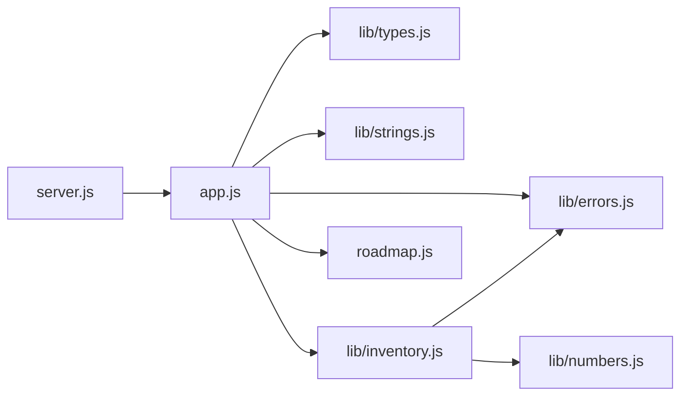

Loading happens in three phases: **construction** (fetch and parse every file in the graph), **instantiation** (create the bindings and link each import to the exporting module's binding), and **evaluation** (run each module once, dependencies first). Because of linking, imports are **live bindings**: if the exporting module reassigns an exported `let`, importers see the new value. Importers can never assign to an import (`TypeError: Assignment to constant variable`).

| | ES modules (ESM) | CommonJS (CJS) |
| --- | --- | --- |
| Syntax | `import` / `export` | `require()` / `module.exports` |
| Loading | Async, linked before running | Sync, runs on `require` |
| Bindings | Live | Copied values at the time of `require` |
| Strict mode | Always | Opt-in |
| Top-level `await` | Yes | No |
| File paths | Extension required (`./a.js`) | Extension optional |
| `__dirname` | `import.meta.dirname` | Built in |
| In Node.js | `.mjs`, or `.js` with `"type": "module"` | `.cjs`, or `.js` without `"type"` |
| Interop | Can `import` CJS (default export = `module.exports`) | Can `require()` synchronous ESM in Node 22.12+ and 20.19+ |

| Export style | Pros | Cons |
| --- | --- | --- |
| Named (`export function f`) | Auto-import and rename-refactoring work; tree-shakes well | Callers must know the names |
| Default (`export default`) | One obvious main value | Each importer picks a name, so the same thing gets different names across a codebase |

This repo uses named exports everywhere so a symbol has one name in every file.

### 2.13 Pitfalls

| Pitfall | Symptom | Fix |
| --- | --- | --- |
| Method passed as a callback | `TypeError: Cannot read properties of undefined (reading 'owner')` | Arrow wrapper, `bind`, or class-field arrow. |
| Arrow function as an object method | `this` is the module's `undefined`, not the object | Use method shorthand `name() {}`. |
| `arr.sort()` on numbers | `[100, 20, 30, 5]` | `toSorted((a, b) => a - b)`. |
| `sort()` on a shared array | Other code sees a reordered array | `toSorted()`, or copy first. |
| `['1','2','3'].map(parseInt)` | `[1, NaN, NaN]` | `map(Number)` or `map((s) => parseInt(s, 10))`. |
| `reduce` without an initial value | `TypeError: Reduce of empty array with no initial value` | Always pass the second argument. |
| Returning an object literal from an arrow | `() => { a: 1 }` returns `undefined` (the braces are a block, `a:` a label) | `() => ({ a: 1 })`. |
| `forEach` with `async` callbacks | Code after the loop runs before the work finishes | `for...of` with `await`, or `Promise.all(arr.map(...))`. |
| `text.length` for user-visible length | Emoji count as 2 or more | `Intl.Segmenter` with `granularity: 'grapheme'`. |
| `slice` on emoji text | Lone surrogate `'\ud83d'` renders as a replacement character | Cut at grapheme boundaries (`truncate`). |
| Deep recursion on user-controlled input | `RangeError: Maximum call stack size exceeded` | Iterative loop with an explicit stack. |
| Missing extension in an ESM import | `ERR_MODULE_NOT_FOUND: Cannot find module '.../util'` | Write `./util.js`. |
| Circular imports | `ReferenceError: Cannot access 'x' before initialization` at load | Move shared code into a third module, or access the import inside a function rather than at the top level. |
| Default destructured parameter missing | `TypeError: Cannot destructure property 'host' of 'undefined'` | `function f({ host } = {})`. |

### 2.14 Best Practices

- **Small, pure functions**: same input, same output, no hidden mutation; they are trivial to test and to memoise.
- **Options objects for three or more parameters**: call sites read like documentation and parameter order stops mattering.
- **Arrows for callbacks, method shorthand for methods**: arrows inherit `this`, methods receive it.
- **Non-mutating array methods (`toSorted`, `with`, spread) by default**: shared state stays predictable.
- **Always give `reduce` an initial value**: it handles empty arrays and fixes the accumulator's type.
- **Name your functions**: names appear in stack traces and profiler output; anonymous arrows show as `<anonymous>` unless assigned.
- **Bound memoisation caches**: an unbounded cache is a memory leak; `memoize` here evicts after `maxSize`.
- **Grapheme-aware text handling for user-visible strings**: counts, truncation and cursor movement must match what users see.
- **Escape at output time**: `textContent`, a tagged template like `html`, or the framework's escaping, never string concatenation into `innerHTML`.
- **Named exports and explicit `.js` extensions**: one name per symbol, and paths that work in Node.js and browsers without a bundler.

### 2.15 Hands-on Exercise

Write `countBy(items, keyFn)` in `src/lib/collections.js`. It returns a `Map` from each key to how many items produced it, ordered by count (highest first) and then by first appearance. Use it to list the most common file extensions:

```javascript
import { countBy } from '../src/lib/collections.js';

const files = ['a.js', 'b.md', 'c.js', 'd.json', 'e.md', 'f.js'];
const byExt = countBy(files, (f) => f.slice(f.lastIndexOf('.') + 1));
console.log([...byExt]); // [ [ 'js', 3 ], [ 'md', 2 ], [ 'json', 1 ] ]
```

Hints: build the counts with a `Map` and `??`, then use `toSorted` on its entries (stable sort keeps first-appearance order for ties). Run `npm test`, then compare with the solution in [`src/lib/collections.js`](src/lib/collections.js) and its test in [`tests/stage2.test.js`](tests/stage2.test.js).

[Back to top ⤴️](#-table-of-contents)

---


## 3. Stage 3: Objects, Prototypes, Classes & Error Handling

Everything that is not a primitive is an object, and every object can inherit from another through its prototype. This stage covers object properties and their descriptors, the prototype chain, `class` syntax with private fields, iterators and generators, the keyed collections (`Map`, `Set` and their weak versions), copying, dates, error handling and garbage collection. It assumes Stages 1 and 2. Afterwards you can design a domain model like the starter's `Product` and `Inventory` and reason about how it behaves in memory.

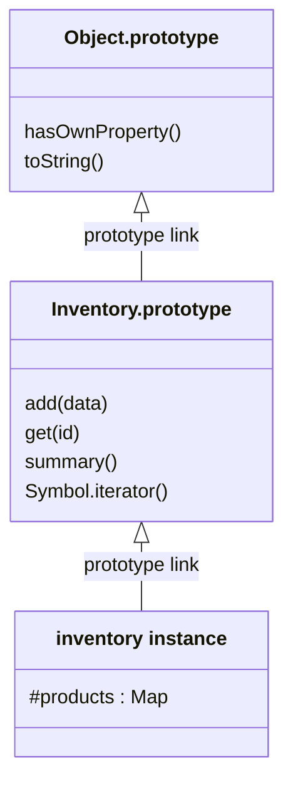

### 3.1 Objects: Literals, Keys and Everyday Operations

An object is a collection of properties. Each property has a key (a string or a symbol) and either a value or a getter/setter pair. Keys of any other type are converted to strings: `obj[1]` and `obj['1']` are the same property.

```javascript
const field = 'status';
const createdAt = new Date('2026-01-01T00:00:00Z');

const order = {
  id: 'ord_1',
  createdAt,                      // shorthand for createdAt: createdAt
  [field]: 'paid',                // computed key
  [`${field}History`]: ['new'],   // computed key from a template
  total() {                       // method shorthand
    return 42;
  },
  'content-type': 'json',         // keys that are not identifiers need quotes
};

console.log(order.status, order['content-type'], order.total());       // paid json 42
console.log(Object.keys(order));       // [ 'id', 'createdAt', 'status', 'statusHistory', 'total', 'content-type' ]
console.log('status' in order, Object.hasOwn(order, 'toString'));     // true false
console.log(order.missing?.deep);      // undefined, not a TypeError

// Copy-and-update with spread: a new object, shallow copy.
const refunded = { ...order, status: 'refunded' };
console.log(order.status, refunded.status); // paid refunded

// Destructuring with rename, default and rest
const { id, status: currentStatus, discount = 0, ...rest } = order;
console.log(id, currentStatus, discount, Object.keys(rest).length); // ord_1 paid 0 4
```

Property order is defined by the spec: integer-like keys first in ascending order, then string keys in insertion order, then symbols in insertion order. That is why `{ b: 1, 2: 0, a: 1, 1: 0 }` lists `1, 2, b, a`.

| Need | Use | Notes |
| --- | --- | --- |
| Own enumerable string keys / values / pairs | `Object.keys` / `values` / `entries` | Skip symbols and inherited properties |
| Build from pairs | `Object.fromEntries(pairs)` | Inverse of `entries`; handy with `map` |
| Own property check | `Object.hasOwn(obj, key)` | Works on `Object.create(null)` objects, unlike `obj.hasOwnProperty` |
| Any property, inherited too | `key in obj` | |
| Shallow merge | `{ ...a, ...b }` or `Object.assign(target, a, b)` | Spread ignores setters and creates a new object; `assign` invokes setters on `target` |
| Group array items | `Object.groupBy(items, fn)` | Result has a `null` prototype |
| Dictionary of arbitrary keys | `Map` (Section 3.6) | Avoids collisions with `__proto__`, `constructor` and other inherited names |

#### Object Basics Reference

Objects are used to store key/value (name/value) collections.

```javascript
const person = {
  firstName: "Manthan",
  lastName: "Ank",
};
```

#### Object Methods & Properties

The following are some of the most commonly used object methods and properties in JavaScript:

**constructor** - Returns the function that created an object's prototype

```javascript
let person = {
  firstName: "Manthan",
  lastName: "Ank",
};

console.log(person.constructor); // Output: ƒ Object() { [native code] }
```

**keys()** - `Object.keys(obj)` returns an array of the object's own enumerable string keys

```javascript
const person = {
  firstName: "Manthan",
  lastName: "Ank",
};

let keys = Object.keys(person);
console.log(keys); // Output: ["firstName", "lastName"]
```

**prototype** - Shows that properties added to `Object.prototype` are inherited by every object. This is prototype pollution: never modify built-in prototypes in real code

```javascript
let person = {
  firstName: "Manthan",
  lastName: "Ank",
};

Object.prototype.age = 25;

console.log(person.age); // Output: 25
```

**toString()** - Converts an object to a string and returns the result

```javascript
let person = {
  firstName: "Manthan",
  lastName: "Ank",
};

console.log(person.toString()); // Output: "[object Object]"
```

**valueOf()** - Returns the primitive value of an object

```javascript
let person = {
  firstName: "Manthan",
  lastName: "Ank",
};

console.log(person.valueOf()); // Output: {firstName: "Manthan", lastName: "Ank"}
```

#### Object Static Methods Reference

Objects are used to store collections of data and more complex entities.

```javascript
const person = {
  firstName: "Manthan",
  lastName: "Ank",
  age: 25,
  hobbies: ["reading", "coding", "traveling"],
  address: {
    street: "123 Main St",
    city: "Mumbai",
    state: "MH",
  },
};
```

#### Object Methods

The following are some of the most commonly used object methods in JavaScript:

- **assign()**
- **create()**
- **defineProperties()**
- **defineProperty()**
- **entries()**
- **freeze()**
- **fromEntries()**
- **getOwnPropertyDescriptor()**
- **getOwnPropertyDescriptors()**
- **getOwnPropertyNames()**
- **getOwnPropertySymbols()**
- **getPrototypeOf()**
- **groupBy()**
- **hasOwn()**
- **is()**
- **isExtensible()**
- **isFrozen()**
- **isSealed()**
- **keys()**
- **preventExtensions()**
- **prototype**
- **seal()**
- **setPrototypeOf()**
- **values()**

**assign()** - Copies the values of all enumerable own properties from one or more source objects to a target object

```javascript
const person = {
  firstName: "Manthan",
  lastName: "Ank",
};

const details = {
  age: 25,
  hobbies: ["reading", "coding", "traveling"],
};

const newPerson = Object.assign(person, details);

console.log(newPerson); // Output: {firstName: "Manthan", lastName: "Ank", age: 25, hobbies: Array(3)}
```

**create()** - Creates a new object with the specified prototype object and properties

```javascript
const person = {
  firstName: "Manthan",
  lastName: "Ank",
};

const newPerson = Object.create(person);

console.log(newPerson); // Output: {}
```

**defineProperties()** - Defines new or modifies existing properties directly on an object, returning the object

```javascript
const person = {};

Object.defineProperties(person, {
  firstName: {
    value: "Manthan",
    writable: true,
  },
  lastName: {
    value: "Ank",
    writable: true,
  },
});

console.log(person); // Output: {firstName: "Manthan", lastName: "Ank"}
```

**defineProperty()** - Defines a new property directly on an object, or modifies an existing property on an object, and returns the object

```javascript
const person = {};

Object.defineProperty(person, "firstName", {
  value: "Manthan",
  writable: true,
});

console.log(person); // Output: {firstName: "Manthan"}
```

**entries()** - Returns an array of a given object's own enumerable string-keyed property [key, value] pairs

```javascript
const person = {
  firstName: "Manthan",
  lastName: "Ank",
};

const entries = Object.entries(person);

console.log(entries); // Output: [["firstName", "Manthan"], ["lastName", "Ank"]]
```

**freeze()** - Freezes an object: other code can't delete or change any properties

```javascript
const person = {
  firstName: "Manthan",
  lastName: "Ank",
};

Object.freeze(person);

person.age = 25;

console.log(person); // Output: {firstName: "Manthan", lastName: "Ank"}
```

**fromEntries()** - Returns a new object from an iterable of [key, value] pairs

```javascript
const entries = [
  ["firstName", "Manthan"],
  ["lastName", "Ank"],
];

const person = Object.fromEntries(entries);

console.log(person); // Output: {firstName: "Manthan", lastName: "Ank"}
```

**getOwnPropertyDescriptor()** - Returns a property descriptor for a named property on an object

```javascript
const person = {
  firstName: "Manthan",
  lastName: "Ank",
};

const descriptor = Object.getOwnPropertyDescriptor(person, "firstName");

console.log(descriptor); // Output: {value: "Manthan", writable: true, enumerable: true, configurable: true}
```

**getOwnPropertyDescriptors()** - Returns all own property descriptors of a given object

```javascript
const person = {
  firstName: "Manthan",
  lastName: "Ank",
};

const descriptors = Object.getOwnPropertyDescriptors(person);

console.log(descriptors); // Output: {firstName: {…}, lastName: {…}}
```

**getOwnPropertyNames()** - Returns an array of all properties (enumerable or not) found directly upon a given object

```javascript
const person = {
  firstName: "Manthan",
  lastName: "Ank",
};

const properties = Object.getOwnPropertyNames(person);

console.log(properties); // Output: ["firstName", "lastName"]
```

**getOwnPropertySymbols()** - Returns an array of all symbol properties found directly upon a given object

```javascript
const person = {
  [Symbol("firstName")]: "Manthan",
  [Symbol("lastName")]: "Ank",
};

const symbols = Object.getOwnPropertySymbols(person);

console.log(symbols); // Output: [Symbol(firstName), Symbol(lastName)]
```

**getPrototypeOf()** - Returns the prototype of the specified object

```javascript
const person = {
  firstName: "Manthan",
  lastName: "Ank",
};

const prototype = Object.getPrototypeOf(person);

console.log(prototype); // Output: {constructor: ƒ, __defineGetter__: ƒ, __defineSetter__: ƒ, hasOwnProperty: ƒ, __lookupGetter__: ƒ, …}
```

**groupBy()** - Groups the elements of an array based on the given function

```javascript
const people = [
  { name: "Manthan", age: 25 },
  { name: "Ank", age: 30 },
  { name: "John", age: 25 },
];

const groupedPeople = people.groupBy(person => person.age);

console.log(groupedPeople); // Output: {25: Array(2), 30: Array(1)}
```

**hasOwn()** - Returns a boolean indicating whether the object has the specified property as its own property

```javascript
const person = {
  firstName: "Manthan",
  lastName: "Ank",
};

console.log(person.hasOwn("firstName")); // Output: true
```

**is()** - Compares if two values are the same value

```javascript
const person = {
  firstName: "Manthan",
  lastName: "Ank",
};

const newPerson = {
  firstName: "Manthan",
  lastName: "Ank",
};

console.log(Object.is(person, newPerson)); // Output: false
```

**isExtensible()** - Returns a boolean indicating if the object is extensible

```javascript
const person = {
  firstName: "Manthan",
  lastName: "Ank",
};

console.log(Object.isExtensible(person)); // Output: true
```

**isFrozen()** - Returns a boolean indicating if the object is frozen

```javascript
const person = {
  firstName: "Manthan",
  lastName: "Ank",
};

Object.freeze(person);

console.log(Object.isFrozen(person)); // Output: true
```

**isSealed()** - Returns a boolean indicating if the object is sealed

```javascript
const person = {
  firstName: "Manthan",
  lastName: "Ank",
};

Object.seal(person);

console.log(Object.isSealed(person)); // Output: true
```

**keys()** - Returns an array of a given object's own enumerable property names

```javascript
const person = {
  firstName: "Manthan",
  lastName: "Ank",
};

const keys = Object.keys(person);

console.log(keys); // Output: ["firstName", "lastName"]
```

**preventExtensions()** - Prevents any extensions of an object

```javascript
const person = {
  firstName: "Manthan",
  lastName: "Ank",
};

Object.preventExtensions(person);

person.age = 25;

console.log(person); // Output: {firstName: "Manthan", lastName: "Ank"}
```

**prototype** - Allows you to add properties and methods to an object

```javascript
const person = {
  firstName: "Manthan",
  lastName: "Ank",
};

Object.prototype.age = 25;

console.log(person.age); // Output: 25
```

**seal()** - Prevents other code from deleting properties of an object

```javascript
const person = {
  firstName: "Manthan",
  lastName: "Ank",
};

Object.seal(person);

delete person.firstName;

console.log(person); // Output: {firstName: "Manthan", lastName: "Ank"}
```

**setPrototypeOf()** - Sets the prototype (i.e., the internal [[Prototype]] property) of a specified object to another object or null

```javascript
const person = {
  firstName: "Manthan",
  lastName: "Ank",
};

const newPerson = {
  age: 25,
};

Object.setPrototypeOf(newPerson, person);

console.log(newPerson); // Output: {age: 25}
```

**values()** - Returns an array of a given object's own enumerable property values

```javascript
const person = {
  firstName: "Manthan",
  lastName: "Ank",
};

const values = Object.values(person);

console.log(values); // Output: ["Manthan", "Ank"]
```

### 3.2 Property Descriptors, Getters, Setters and Immutability

Each property has attributes. A *data* property has `value`, `writable`, `enumerable` and `configurable`; an *accessor* property has `get`, `set`, `enumerable` and `configurable`. Literal syntax creates properties with all flags `true`; `Object.defineProperty` defaults every flag you leave out to `false`.

```javascript
const product = { name: 'Keyboard', priceCents: 8950 };

Object.defineProperty(product, 'sku', {
  value: 'KB-001',
  writable: false,    // assignments are ignored (TypeError in strict mode)
  enumerable: false,  // hidden from Object.keys, for...in and JSON.stringify
  configurable: false // cannot be deleted or redefined
});

Object.defineProperty(product, 'price', {
  get() {
    return this.priceCents / 100;
  },
  set(value) {
    if (!(value >= 0)) throw new RangeError('price must be >= 0');
    this.priceCents = Math.round(value * 100);
  },
  enumerable: true,
});

product.price = 99.5;
console.log(product.priceCents, product.sku, JSON.stringify(product));
// 9950 KB-001 {"name":"Keyboard","priceCents":9950,"price":99.5}
console.log(Object.getOwnPropertyDescriptor(product, 'sku'));
// { value: 'KB-001', writable: false, enumerable: false, configurable: false }
```

| Function | Add properties | Delete properties | Change values | Depth |
| --- | --- | --- | --- | --- |
| `Object.preventExtensions(o)` | No | Yes | Yes | Shallow |
| `Object.seal(o)` | No | No | Yes | Shallow |
| `Object.freeze(o)` | No | No | No | Shallow |

```mermaid
flowchart LR
    NORMAL["Normal object"] -->|"preventExtensions"| NOEXT["No new properties"]
    NOEXT -->|"seal: configurable false on all"| SEALED["Sealed"]
    SEALED -->|"freeze: writable false on all"| FROZEN["Frozen"]
```

`freeze` is shallow: a frozen object's nested arrays and objects stay mutable. The starter freezes a copied array for each product's tags, so callers cannot change the product through the array they read:

```javascript
// src/lib/inventory.js
this.tags = Object.freeze([...new Set(tags.map(String))]);
```

A deep freeze has to walk the graph:

```javascript
function deepFreeze(value, seen = new WeakSet()) {
  if (value === null || typeof value !== 'object' || seen.has(value)) return value;
  seen.add(value);
  for (const key of Reflect.ownKeys(value)) deepFreeze(value[key], seen);
  return Object.freeze(value);
}

const config = deepFreeze({ db: { host: 'localhost', ports: [5432] } });
console.log(Object.isFrozen(config.db.ports)); // true
```

### 3.3 Prototypes and the Prototype Chain

Every object has an internal `[[Prototype]]` link to another object or to `null`. When you read a property that the object does not have, the engine follows the link and looks there, then follows that object's link, and so on until it reaches `null`. Writes do not follow the chain: assigning creates or updates an *own* property (unless an inherited setter or a non-writable inherited property intercepts it).

```mermaid
flowchart LR
    ARR["[1, 2, 3]: own 0, 1, 2, length"] -->|"[[Prototype]]"| AP["Array.prototype: map, filter, push"]
    AP -->|"[[Prototype]]"| OP["Object.prototype: hasOwnProperty, toString"]
    OP -->|"[[Prototype]]"| NULL["null: lookup stops, result is undefined"]
```

```javascript
const animal = {
  describe() {
    return `${this.name} says ${this.sound}`;
  },
};

const dog = Object.create(animal); // dog's [[Prototype]] is animal
dog.name = 'Rex';
dog.sound = 'woof';

console.log(dog.describe());                           // 'Rex says woof': found on animal
console.log(Object.getPrototypeOf(dog) === animal);    // true
console.log(Object.hasOwn(dog, 'describe'));           // false: inherited
console.log(Object.keys(dog));                         // [ 'name', 'sound' ]

// A dictionary with no prototype at all: no inherited keys to collide with.
const dict = Object.create(null);
dict.constructor = 'just data';
console.log(dict.constructor, 'toString' in dict);     // 'just data' false
```

The starter's `inspectPrototypeChain` walks the chain with `Object.getPrototypeOf`:

```javascript
export function inspectPrototypeChain(obj) {
  const chain = [];
  let current = Object.getPrototypeOf(obj);

  while (current !== null) {
    chain.push(current.constructor?.name || '[Anonymous Object]');
    current = Object.getPrototypeOf(current);
  }

  return chain;
}

class BaseService {}
class AnalyticsService extends BaseService {}
console.log(inspectPrototypeChain(new AnalyticsService())); // [ 'AnalyticsService', 'BaseService', 'Object' ]
```

| API | Purpose | Avoid |
| --- | --- | --- |
| `Object.getPrototypeOf(o)` | Read the prototype | `o.__proto__` (legacy, missing on null-prototype objects) |
| `Object.create(proto, descriptors?)` | Create with a given prototype | `Object.setPrototypeOf` on existing objects: it invalidates engine optimisations |
| `o instanceof C` | Is `C.prototype` anywhere on `o`'s chain? | Cross-realm checks (iframes, `vm`); use `Array.isArray` or brand checks |
| `C.prototype.isPrototypeOf(o)` | Same test without a constructor | |

**Prototype pollution.** If code merges untrusted JSON into an object with a recursive "deep merge", a payload such as `{"__proto__": {"isAdmin": true}}` can write to `Object.prototype`, and then *every* object in the process has `isAdmin`. Defences: build dictionaries with `Object.create(null)` or `Map`, skip the keys `__proto__`, `constructor` and `prototype` when merging, and validate input shape before use. The reference sections above show `Object.prototype.age = 25` and `Boolean.prototype.age = 25` to demonstrate inheritance; never modify built-in prototypes in real code.

```javascript
function unsafeMerge(target, source) {
  for (const key of Object.keys(source)) {
    if (typeof source[key] === 'object' && source[key] !== null) {
      target[key] ??= {};
      unsafeMerge(target[key], source[key]);
    } else {
      target[key] = source[key];
    }
  }
  return target;
}

unsafeMerge({}, JSON.parse('{"__proto__": {"polluted": true}}'));
console.log({}.polluted); // true: every object is now affected
delete Object.prototype.polluted; // clean up the demo
```

### 3.4 Classes: Fields, Private Members, Accessors and Inheritance

`class` is syntax over prototypes: methods go on `ClassName.prototype`, and `new` creates an object whose `[[Prototype]]` is that object. Classes add things plain prototypes cannot do: `#private` members, `static` blocks, `super`, and a constructor that throws if called without `new`.

The starter's `Product` (`src/lib/inventory.js`) uses most class features:

```javascript
import { ValidationError } from './errors.js';
import { toCents } from './numbers.js';

export class Product {
  static #nextId = 1;   // private static field: one counter shared by all products

  #priceCents;          // private instance field, declared up front

  constructor({ name, price, quantity = 0, tags = [] } = {}) {
    const problems = [];
    if (typeof name !== 'string' || name.trim() === '')
      problems.push('name must be a non-empty string');
    if (typeof price !== 'number' || !(price >= 0) || !Number.isFinite(price)) {
      problems.push('price must be a finite number >= 0');
    }
    if (!Number.isInteger(quantity) || quantity < 0)
      problems.push('quantity must be an integer >= 0');
    if (!Array.isArray(tags)) problems.push('tags must be an array');
    if (problems.length > 0) throw new ValidationError('Invalid product', problems);

    this.id = Product.#nextId++;
    this.name = name.trim();
    this.#priceCents = toCents(price);
    this.quantity = quantity;
    this.tags = Object.freeze([...new Set(tags.map(String))]);
  }

  get price() {         // accessor: read like a property, computed on demand
    return this.#priceCents / 100;
  }

  get totalCents() {
    return this.#priceCents * this.quantity;
  }

  toJSON() {            // JSON.stringify calls this automatically
    return { id: this.id, name: this.name, price: this.price, quantity: this.quantity, tags: this.tags };
  }
}
```

| Line / API | Role | What happens at runtime |
| :--- | :--- | :--- |
| `static #nextId = 1` | Private static field | Stored on the `Product` constructor itself, invisible outside the class body. |
| `#priceCents;` | Private field declaration | Every instance gets the slot before the constructor body runs. Reading `p.#priceCents` outside the class is a `SyntaxError`, not `undefined`. |
| `{ name, price, quantity = 0, tags = [] } = {}` | Destructured options with defaults | `new Product()` gives a validation error instead of a destructuring `TypeError`. |
| `!(price >= 0)` | NaN-safe check | `NaN >= 0` is false, so `NaN` is rejected; `price < 0` alone would let `NaN` through. |
| `throw new ValidationError(...)` | Fail fast with every problem | Callers get all problems at once (the HTTP API returns them in `details`). |
| `Product.#nextId++` | Post-increment | Uses the current value, then increments the shared counter. |
| `get price()` | Getter on the prototype | `p.price` runs the function; there is no stored `price` property, so `Object.keys(p)` does not list it. |
| `toJSON()` | Serialisation hook | `JSON.stringify(product)` serialises what this returns, which is how the getter's value ends up in API responses. |

Inheritance with `extends` and `super`, from `src/lib/errors.js`:

```javascript
export class AppError extends Error {
  constructor(message, { status = 500, code = 'INTERNAL', cause } = {}) {
    super(message, { cause });   // must run before `this` is used
    this.name = new.target.name; // 'ValidationError' when constructed via the subclass
    this.status = status;
    this.code = code;
  }

  toJSON() {
    return { error: { code: this.code, message: this.message } };
  }
}

export class ValidationError extends AppError {
  constructor(message, details = [], options = {}) {
    super(message, { status: 400, code: 'VALIDATION', ...options });
    this.details = details;
  }

  toJSON() {
    return { error: { code: this.code, message: this.message, details: this.details } };
  }
}
```

```mermaid
classDiagram
    Error <|-- AppError
    AppError <|-- ValidationError
    AppError <|-- NotFoundError
    class AppError {
        +status number
        +code string
        +cause unknown
        +toJSON()
    }
    class ValidationError {
        +details array
        +toJSON()
    }
    class NotFoundError
```

Other class features worth knowing:

```javascript
class Temperature {
  static #instances = 0;
  static units = ['C', 'F'];

  static {
    // Static initialisation block: runs once when the class is defined.
    Temperature.freezing = new Temperature(0);
  }

  #celsius;

  constructor(celsius) {
    this.#celsius = celsius;
    Temperature.#instances += 1;
  }

  static count() {
    return Temperature.#instances;
  }

  static isTemperature(value) {
    return #celsius in value; // ergonomic brand check (ES2022): no try/catch needed
  }

  get fahrenheit() {
    return (this.#celsius * 9) / 5 + 32;
  }

  set fahrenheit(f) {
    this.#celsius = ((f - 32) * 5) / 9;
  }

  #format() {
    // private method
    return `${this.#celsius.toFixed(1)} C`;
  }

  toString() {
    return this.#format();
  }

  // Class field arrow: bound per instance, safe to pass as a callback.
  report = () => `It is ${this}`;
}

const t = new Temperature(25);
t.fahrenheit = 212;
console.log(`${t}`, Temperature.count(), Temperature.isTemperature(t), Temperature.isTemperature({}));
// 100.0 C 2 true false
const { report } = t;
console.log(report()); // It is 100.0 C
```

| Concern | Class | Factory function + closure | `Object.create` |
| --- | --- | --- | --- |
| Privacy | `#private` fields | Closure variables | None built in |
| Methods shared across instances | Yes, on the prototype | No, one copy per instance | Yes |
| Inheritance | `extends`, `super` | Composition | Manual chain |
| `instanceof` | Yes | No | Only with a constructor |
| Readability for many developers | Familiar from other languages | Simple for small units | Rare in application code |

Prefer composition over deep hierarchies: one or two levels of `extends` (as with the error classes) is normal, five is a design smell.

### 3.5 Symbols, Iterators and Generators

A `Symbol` is a unique primitive used as a property key that cannot collide with any string key. Libraries use symbols to attach metadata without risking clashes, and the language uses **well-known symbols** as hooks:

| Well-known symbol | Called by | Lets you customise |
| --- | --- | --- |
| `Symbol.iterator` | `for...of`, spread, destructuring, `Array.from` | How an object is iterated |
| `Symbol.asyncIterator` | `for await...of` | Async iteration (Stage 4) |
| `Symbol.toPrimitive` | `+`, `==`, template literals | Conversion to primitives |
| `Symbol.hasInstance` | `instanceof` | The result of `instanceof` |
| `Symbol.toStringTag` | `Object.prototype.toString` | The `[object X]` tag that `typeTag` reads |

**The iteration protocol.** An *iterable* has a `[Symbol.iterator]()` method that returns an *iterator*. An iterator has `next()`, which returns `{ value, done }`.

```mermaid
sequenceDiagram
    participant L as for...of loop
    participant I as iterable (inventory)
    participant G as iterator (generator object)
    L->>I: [Symbol.iterator]()
    I-->>L: generator object
    L->>G: next()
    G-->>L: value product1, done false
    L->>G: next()
    G-->>L: value product2, done false
    L->>G: next()
    G-->>L: value undefined, done true
    Note over L,G: break or throw in the loop calls G.return() to clean up
```

A **generator function** (`function*`) builds that iterator for you: each `yield` pauses the function and hands out a value; the next `next()` call resumes it. The starter's `Inventory` makes itself iterable with one line:

```javascript
export class Inventory {
  #products = new Map();

  /** Makes `for (const p of inventory)` and `[...inventory]` work. */
  *[Symbol.iterator]() {
    yield* this.#products.values(); // delegate to the Map's own iterator
  }
}
```

Hand-written iterators and generators side by side:

```javascript
// By hand: an object with next()
function countdownIterator(from) {
  let current = from;
  return {
    [Symbol.iterator]() {
      return this;
    },
    next() {
      return current > 0 ? { value: current--, done: false } : { value: undefined, done: true };
    },
  };
}

// With a generator: same behaviour, a third of the code
function* countdown(from) {
  for (let n = from; n > 0; n--) yield n;
}

console.log([...countdownIterator(3)], [...countdown(3)]); // [ 3, 2, 1 ] [ 3, 2, 1 ]

// Generators are lazy, so infinite sequences are fine with iterator helpers (ES2025).
function* ids(prefix) {
  let n = 1;
  while (true) yield `${prefix}-${n++}`;
}
console.log(ids('user').drop(2).take(2).toArray()); // [ 'user-3', 'user-4' ]
```

Symbols as private-ish keys:

```javascript
const META = Symbol('meta');
const record = { id: 1, [META]: { source: 'import' } };
console.log(Object.keys(record), JSON.stringify(record)); // [ 'id' ] {"id":1}
console.log(record[META].source);                          // 'import'
console.log(Object.getOwnPropertySymbols(record).length);  // 1: hidden, not secret
console.log(Symbol('x') === Symbol('x'), Symbol.for('x') === Symbol.for('x')); // false true
```

### 3.6 Map and WeakMap

A `Map` holds key-value pairs where keys can be any value, including objects, and remembers insertion order. Use it instead of a plain object whenever keys are dynamic.

| Concern | `Map` | Plain object |
| --- | --- | --- |
| Key types | Any value (SameValueZero equality) | Strings and symbols only |
| Inherited keys | None | `toString`, `constructor`, `__proto__` unless `Object.create(null)` |
| Size | `map.size` | `Object.keys(obj).length` (O(n)) |
| Iteration order | Insertion order | Integer keys first, then insertion order |
| Frequent add/remove | Designed for it | Can make V8 switch the object to slow "dictionary mode" |
| JSON | Needs conversion: `Object.fromEntries(map)` | Native |
| Best for | Caches, counters, lookups by ID or object | Records with known, fixed fields |

The starter's `LruCache` (`src/lib/collections.js`) relies on `Map` remembering insertion order: the first key is always the least recently used.

```javascript
export class LruCache {
  #map = new Map();
  #capacity;

  constructor(capacity) {
    if (!Number.isInteger(capacity) || capacity < 1) throw new RangeError('capacity must be >= 1');
    this.#capacity = capacity;
  }

  get(key) {
    if (!this.#map.has(key)) return undefined;
    const value = this.#map.get(key);
    this.#map.delete(key); // move to the end: most recently used
    this.#map.set(key, value);
    return value;
  }

  set(key, value) {
    this.#map.delete(key);
    this.#map.set(key, value);
    if (this.#map.size > this.#capacity) this.#map.delete(this.#map.keys().next().value);
    return this;
  }
}

const cache = new LruCache(2);
cache.set('a', 1).set('b', 2);
cache.get('a');      // touch 'a'
cache.set('c', 3);   // evicts 'b', the least recently used
```

```mermaid
flowchart LR
    S1["set a, set b: order a, b"] --> S2["get a: order b, a"]
    S2 --> S3["set c: order b, a, c"]
    S3 --> S4["size 3 > capacity 2: delete first key b"]
    S4 --> S5["order a, c"]
```

A **`WeakMap`** holds its keys weakly: if nothing else references a key object, the entry can be garbage collected. Keys must be objects (or non-registered symbols). It has no `size` and cannot be iterated, because its contents depend on when the collector runs. Use it to attach data to objects you do not own without leaking them:

```javascript
const metadata = new WeakMap();

function track(request) {
  metadata.set(request, { startedAt: performance.now() });
}

function finish(request) {
  const { startedAt } = metadata.get(request);
  return Math.round(performance.now() - startedAt);
}

const req = { url: '/health' };
track(req);
console.log(typeof finish(req)); // 'number'; when req is unreachable, its entry can be collected too
```

`Map.groupBy` (ES2024) groups into a `Map`, which matters when keys are objects or when you need insertion order:

```javascript
const items = [{ qty: 0 }, { qty: 5 }, { qty: 12 }];
const byLevel = Map.groupBy(items, ({ qty }) => (qty === 0 ? 'out' : qty < 10 ? 'low' : 'ok'));
console.log([...byLevel.keys()]); // [ 'out', 'low', 'ok' ]
```

A Map holds key-value pairs where the keys can be any datatype. A Map remembers the original insertion order of the keys.

```javascript
const fruits = new Map([
  ["apples", 500],
  ["bananas", 300],
  ["oranges", 200]
]);
```

#### Map Properties

**constructor** - Returns the function that created the Map object's prototype

```javascript
fruits.constructor; // ƒ Map() { [native code] }
```

**prototype** - Allows you to add properties and methods to a Map object

```javascript
Map.prototype.size = 0;

const fruits = new Map([
  ["apples", 500],
  ["bananas", 300],
  ["oranges", 200]
]);
fruits.size; // 3
```

#### Map Methods

The Map object has several built-in methods that can be used to work with Maps. Some of the most commonly used methods are:

- new Map()
- set()
- get()
- delete()
- has()
- forEach()
- entries()
- size

**new Map** - Creates a new Map

```javascript
// Create a Map
const fruits = new Map([
  ["apples", 500],
  ["bananas", 300],
  ["oranges", 200]
]);
```

**set** - Sets the value for a key in a Map

```javascript
// Create a Map
const fruits = new Map();

// Set Map Values
fruits.set("apples", 500);
fruits.set("bananas", 300);
fruits.set("oranges", 200);
```

**get** - Gets the value for a key in a Map

```javascript
fruits.get("apples");    // Returns 500
```

**delete** - Removes a Map element specified by the key

```javascript
fruits.delete("apples");
```

**has** - Returns true if a key exists in a Map

```javascript
fruits.has("apples");
```

**forEach** - Calls a function for each key/value pair in a Map

```javascript
// List all entries
let text = "";
fruits.forEach (function(value, key) {
  text += key + ' = ' + value;
})
```

**entries** - Returns an iterator with the [key, value] pairs in a Map.

```javascript
// List all entries
let text = "";
for (const x of fruits.entries()) {
  text += x;
}
```

**size Property** - Returns the number of elements in a Map

```javascript
fruits.size;
```

### 3.7 Set, WeakSet and the ES2025 Set Methods

A `Set` stores unique values (SameValueZero equality, so `NaN` is stored once and `0`/`-0` are the same). Membership checks with `has` are O(1) on average, compared with O(n) for `array.includes`.

```javascript
const ids = [3, 1, 3, 2, 1];
console.log([...new Set(ids)]); // [ 3, 1, 2 ]: dedupe, keeping first-seen order

const allowed = new Set(['GET', 'POST']);
console.log(allowed.has('DELETE')); // false
```

The ES2025 methods take any "set-like" argument (an object with `size`, `has` and `keys`, so a `Map` works too) and return a new `Set`:

```mermaid
flowchart LR
    A["A = js, node, web"] --> U["A.union(B) = js, node, web, css"]
    B["B = web, css"] --> U
    A --> I["A.intersection(B) = web"]
    B --> I
    A --> D["A.difference(B) = js, node"]
    B --> D
    A --> X["A.symmetricDifference(B) = js, node, css"]
    B --> X
```

| Method | Returns | Equivalent before ES2025 |
| --- | --- | --- |
| `a.union(b)` | Set | `new Set([...a, ...b])` |
| `a.intersection(b)` | Set | `new Set([...a].filter((x) => b.has(x)))` |
| `a.difference(b)` | Set | `new Set([...a].filter((x) => !b.has(x)))` |
| `a.symmetricDifference(b)` | Set | Union minus intersection |
| `a.isSubsetOf(b)` | boolean | `[...a].every((x) => b.has(x))` |
| `a.isSupersetOf(b)` | boolean | `[...b].every((x) => a.has(x))` |
| `a.isDisjointFrom(b)` | boolean | `![...a].some((x) => b.has(x))` |

The starter's `compareTags` returns several at once:

```javascript
import { compareTags } from './src/lib/collections.js';
console.log(compareTags(['js', 'node', 'web'], ['web', 'css']));
// { both: [ 'web' ], either: [ 'css', 'js', 'node', 'web' ], onlyLeft: [ 'js', 'node' ], disjoint: false }
```

A `WeakSet` holds objects weakly. A common use is marking objects as visited without keeping them alive, as `deepFreeze` in Section 3.2 does. The reference section below has one correction: `size` is a getter on `Set.prototype`, so assigning `Set.prototype.size = 0` does nothing in sloppy mode and throws a `TypeError` in modules.

A Set is a collection of unique values. A Set can hold any datatype, including primitive types and objects.

```javascript
const letters = new Set(["a","b","c"]);
```

#### Set Properties

**constructor** - Returns the function that created the Set object's prototype

```javascript
letters.constructor; // ƒ Set() { [native code] }
```

**prototype** - Allows you to add properties and methods to a Set object

```javascript
// size is a getter on Set.prototype; it reports the number of values.
const letters = new Set(["a","b","c"]);
letters.size; // 3
```

#### Set Methods

The Set object has several built-in methods that can be used to work with Sets. Some of the most commonly used methods are:

- new Set()
- add()
- delete()
- has()
- forEach()
- values()
- size

**new Set** - Creates a new Set

```javascript
const letters = new Set(["a","b","c"]);
```

**add** - Adds a new element to the Set

```javascript
letters.add("d");
```

**delete** - Removes an element from a Set

```javascript
letters.delete("d");
```

**has** - Returns true if a value exists in the Set

```javascript
letters.has("a");
```

**forEach** - Invokes a callback for each element in the Set

```javascript
// Create a Set
const letters = new Set(["a", "b", "c"]);

// List all Elements
let text = "";
letters.forEach(function(value) {
  text += value + " ";
});

console.log(text.trim()); // Output: "a b c"
```

**values** - Returns an iterator with all the values in a Set

```javascript
letters.values()   // Returns [object Set Iterator]
```

**size Property** - Returns the number of elements in a Set

```javascript
letters.size;
```

### 3.8 Copying Objects: Shallow, Deep and `structuredClone`

| Technique | Depth | Keeps prototypes / classes | Handles cycles | `Date`, `Map`, `Set` | Functions |
| --- | --- | --- | --- | --- | --- |
| `{ ...obj }`, `Object.assign({}, obj)` | Shallow | No (plain object) | n/a | Copied by reference | Copied by reference |
| `JSON.parse(JSON.stringify(obj))` | Deep | No | Throws `TypeError: Converting circular structure to JSON` | `Date` becomes a string, `Map`/`Set` become `{}` | Dropped |
| `structuredClone(obj)` | Deep | No (plain objects; class instances lose their prototype) | Yes | Yes | Throws `DataCloneError` |
| Starter `createDeepClone` | Deep | Yes | Yes (`WeakMap`) | `Date`, `RegExp` | Copied by reference |

```javascript
const original = {
  when: new Date('2026-03-01T00:00:00Z'),
  tags: new Set(['a']),
  nested: { list: [1, 2] },
};
original.self = original; // a cycle

const shallow = { ...original };
const deep = structuredClone(original);

shallow.nested.list.push(3);
console.log(original.nested.list);      // [ 1, 2, 3 ]: shared with the shallow copy
console.log(deep.nested.list);          // [ 1, 2 ]: independent
console.log(deep.when instanceof Date, deep.tags.has('a'), deep.self === deep); // true true true
```

The starter's `createDeepClone` (`src/runtime/prototypes.js`) keeps prototypes and property descriptors, which `structuredClone` does not:

```javascript
export function createDeepClone(obj, hash = new WeakMap()) {
  if (obj === null || typeof obj !== 'object') return obj;
  if (obj instanceof Date) return new Date(obj);
  if (obj instanceof RegExp) return new RegExp(obj);
  if (hash.has(obj)) return hash.get(obj); // circular reference handling

  const clone = Array.isArray(obj) ? [] : Object.create(Object.getPrototypeOf(obj));
  hash.set(obj, clone);

  for (const key of Reflect.ownKeys(obj)) {
    const desc = Object.getOwnPropertyDescriptor(obj, key);
    if (desc) {
      if (typeof desc.value === 'object' && desc.value !== null) {
        desc.value = createDeepClone(desc.value, hash);
      }
      Object.defineProperty(clone, key, desc);
    }
  }

  return clone;
}
```

| Line / API | Role | What happens at runtime |
| :--- | :--- | :--- |
| `hash = new WeakMap()` | Visited map | Maps each original object to its clone; weak, so it never leaks. |
| `if (hash.has(obj)) return hash.get(obj)` | Cycle guard | A cycle points back to an object already being cloned, so the existing clone is reused. |
| `Object.create(Object.getPrototypeOf(obj))` | Same prototype | Class instances keep their methods and `instanceof` result. |
| `Reflect.ownKeys(obj)` | Every own key | Includes symbols and non-enumerable keys, unlike `Object.keys`. |
| `Object.defineProperty(clone, key, desc)` | Copy descriptors | Getters, read-only and non-enumerable flags survive. |

It does not copy `Map`, `Set` or private `#fields` (which only the class constructor can create). For data that crosses a boundary (workers, `postMessage`, IndexedDB), `structuredClone` is the right tool; for class instances, give the class its own `clone()` method.

### 3.9 Dates, Time Zones, `Intl` and Temporal

`Date` stores one number: milliseconds since 1970-01-01T00:00:00Z. Everything else is a view on that number in either UTC or the runtime's local time zone, and most of the API's surprises come from mixing the two.

```javascript
const d = new Date(2026, 0, 31); // months are 0-based: this is 31 January, local time
d.setMonth(1);                   // "31 February" overflows
console.log(d.getMonth(), d.getDate()); // 2 3 in non-leap 2026: 3 March

console.log(new Date('2026-05-01').getUTCHours());          // 0: date-only ISO strings are UTC
console.log(new Date('2026-05-01T00:00').toISOString());    // local midnight, shifted to UTC: depends on TZ
console.log(Number.isNaN(new Date('31/12/2026').getTime())); // true: non-ISO formats are not portable

// Format for people with Intl, not hand-written string building.
const when = new Date('2026-11-03T14:05:00Z');
console.log(new Intl.DateTimeFormat('en-GB', { dateStyle: 'medium', timeStyle: 'short', timeZone: 'Asia/Kolkata' }).format(when));
// 3 Nov 2026, 19:35
console.log(new Intl.RelativeTimeFormat('en', { numeric: 'auto' }).format(-1, 'day')); // 'yesterday'
```

| Rule | Why |
| --- | --- |
| Store and transmit instants as ISO 8601 strings with `Z` or as epoch milliseconds | One unambiguous point in time |
| Parse only ISO 8601 with `new Date(string)` | Other formats are implementation-defined |
| Do arithmetic on `getTime()` values, or on UTC getters and setters | Local setters cross daylight-saving changes in surprising ways |
| Format with `Intl.DateTimeFormat` and an explicit `timeZone` for server output | Server time zones differ between laptops, CI and containers |
| Run tests with `TZ=UTC` (or several zones) | Catches local-time assumptions |

**Temporal** is the replacement for `Date`: immutable types that separate an exact instant (`Temporal.Instant`), a wall-clock date or time without a zone (`Temporal.PlainDate`, `PlainDateTime`), and a zoned date-time (`Temporal.ZonedDateTime`), with correct calendar arithmetic. It is shipping in current Firefox and Chrome releases. Check your runtime with `typeof Temporal` and use the `@js-temporal/polyfill` package where it is missing.

```javascript
if (typeof Temporal !== 'undefined') {
  const due = Temporal.PlainDate.from('2026-01-31').add({ months: 1 });
  console.log(due.toString()); // '2026-02-28': clamps to the end of the month, no overflow
}
```

```mermaid
flowchart TD
    Q{"What does the value mean?"} -->|"an exact moment, such as a log timestamp"| I["Date / Temporal.Instant, stored in UTC"]
    Q -->|"a calendar date, such as a birthday"| P["Temporal.PlainDate or a 'YYYY-MM-DD' string"]
    Q -->|"a meeting in a city"| Z["Temporal.ZonedDateTime or instant plus IANA zone name"]
```

The original `Date` API reference follows, with two corrections: `UTC()` is a static method (`Date.UTC(2026, 0, 14)`), not an instance method, and `Date.parse('Jan 1, 2023')` uses the local time zone, so its result differs between machines.

JavaScript provides a built-in Date object that can be used to work with dates and times.

#### Date Object

The Date object is used to work with dates and times in JavaScript. It can be created using the new keyword followed by the Date() constructor.

```javascript
new Date()
```

#### Date Formats

There are several ways to create a new Date object in JavaScript:

```javascript
new Date() // current date and time
new Date(milliseconds) // milliseconds since January 1, 1970, 00:00:00 UTC
new Date(dateString) // date string (e.g. "October 13, 2014 11:13:00")
new Date(year, month, day, hours, minutes, seconds, milliseconds) // year, month, day, hours, minutes, seconds, milliseconds
```

#### Date Properties

**constructor** - Returns the function that created the Date object's prototype

```javascript
const d = new Date();
d.constructor; // ƒ Date() { [native code] }
```

**prototype** - Allows you to add properties and methods to the Date object

```javascript
Date.prototype.age = 25;

const d = new Date();
d.age; // 25
```

**UTC** - Returns the number of milliseconds since January 1, 1970, 00:00:00 UTC

```javascript
Date.UTC(2023, 0, 14); // 1673654400000: static method, months are 0-based
```

**parse** - Parses a date string and returns the number of milliseconds since January 1, 1970, 00:00:00 UTC

```javascript
Date.parse("Jan 1, 2023"); // local midnight: 1672531200000 only when the time zone is UTC
```

**now** - Returns the number of milliseconds since January 1, 1970, 00:00:00 UTC

```javascript
Date.now(); // 1642149980524
```

#### Date Methods

**toString** - It is a built-in function that can be used to convert a date object to a string.

```javascript
const d = new Date();
d.toString(); // 'Sat Jan 14 2023 10:36:20 GMT+0530 (India Standard Time)'
```

**toDateString** - It is a built-in function that can be used to convert a date object to a string in the format of "Weekday Month Date Year".

```javascript
const d = new Date();
d.toDateString(); // 'Sat Jan 14 2023'
```

**toUTCString** - It is a built-in function that can be used to convert a date object to a string in the format of "Weekday, DD Mon YYYY HH:MM:SS GMT".

```javascript
const d = new Date();
d.toUTCString(); // 'Sat, 14 Jan 2023 05:06:20 GMT'
```

**toISOString** - It is a built-in function that can be used to convert a date object to a string in the format of "YYYY-MM-DDTHH:mm:ss.sssZ".

```javascript
const d = new Date();
d.toISOString(); // '2023-01-14T05:06:20.524Z'
```

#### Date Get Methods

The Date object has several built-in methods that can be used to get the date and time components of a date object. Some of the most commonly used get methods are:

**getFullYear** - returns the four-digit year of the date.

```javascript
const d = new Date();
d.getFullYear();
```

**getMonth** - returns the month of the date (0-11, where 0 represents January and 11 represents December).

```javascript
const d = new Date();
d.getMonth();
```

**getDate** - returns the day of the month of the date (1-31).

```javascript
const d = new Date();
d.getDate();
```

**getDay** - returns the day of the week of the date (0-6, where 0 represents Sunday and 6 represents Saturday).

```javascript
const d = new Date();
d.getDay();
```

**getHours** - returns the hour of the date (0-23).

```javascript
const d = new Date();
d.getHours();
```

**getMinutes** - returns the minutes of the date (0-59).

```javascript
const d = new Date();
d.getMinutes();
```

**getSeconds** - returns the seconds of the date (0-59).

```javascript
const d = new Date();
d.getSeconds();
```

**getMilliseconds** - returns the milliseconds of the date (0-999).

```javascript
const d = new Date();
d.getMilliseconds();
```

**getTime** - returns the number of milliseconds since January 1, 1970, 00:00:00 UTC.

```javascript
const d = new Date();
d.getTime();
```

#### Date Set Methods

**setDate** - sets the day of the month of the date object.

```javascript
const d = new Date();
d.setDate(15);
```

**setFullYear** - sets the year, and optionally the month and date, of the date object.

```javascript
const d = new Date();
d.setFullYear(2020);
```

**setHours** - sets the hours, minutes, seconds and milliseconds of the date object.

```javascript
const d = new Date();
d.setHours(22);
```

**setMilliseconds** - sets the milliseconds of the date object.

```javascript
const d = new Date();
d.setMilliSeconds(3000);
```

**setMinutes** - sets the minutes, seconds and milliseconds of the date object.

```javascript
const d = new Date();
d.setMinutes(30);
```

**setSeconds** - sets the seconds and milliseconds of the date object.

```javascript
const d = new Date();
d.setSeconds(30);
```

**setMonth** - sets the month, and optionally the date, of the date object.

```javascript
const d = new Date();
d.setMonth(11);
```

**setTime** - sets the date object to the time represented by a number of milliseconds since January 1, 1970, 00:00:00 UTC.

```javascript
const d = new Date();
d.setTime(30);
```

### 3.10 Error Handling: `try`/`catch`, Custom Errors and `cause`

`throw` accepts any value, but always throw `Error` objects: only they carry a `stack`. Built-in subclasses tell you what went wrong:

| Error | Thrown when | Example |
| --- | --- | --- |
| `TypeError` | A value is the wrong type for an operation | `null.x`, calling a non-function, writing a frozen property in strict mode |
| `ReferenceError` | A name does not exist or is in its TDZ | `undefinedVariable`, `let` read too early |
| `RangeError` | A number is outside the allowed range | `new Array(-1)`, `(1).toFixed(101)`, stack overflow |
| `SyntaxError` | Code or data cannot be parsed | `JSON.parse('{bad')`, `new RegExp('[')` |
| `AggregateError` | Several errors at once | `Promise.any` when every promise rejects |
| `DOMException` | Web API failures (host) | `AbortError`, `DataCloneError` |

```javascript
function readPort(raw) {
  try {
    const port = JSON.parse(raw).port;
    if (!Number.isInteger(port)) throw new TypeError(`port must be an integer, got ${port}`);
    return port;
  } catch (err) {
    // Wrap with context and keep the original as cause.
    throw new Error('Could not read the port setting', { cause: err });
  } finally {
    console.log('readPort finished'); // runs on success, error and return
  }
}

try {
  readPort('{"port": "80"}');
} catch (err) {
  console.log(err.message);        // Could not read the port setting
  console.log(err.cause.message);  // port must be an integer, got 80
}
```

The starter maps every thrown value to an HTTP response in one place, `toAppError` in `src/lib/errors.js`, called from the `catch` in `src/app.js`:

```javascript
export function toAppError(err) {
  if (err instanceof AppError) return err;
  if (err instanceof SyntaxError) {
    return new ValidationError('Request body is not valid JSON', [], { cause: err });
  }
  return new AppError('Internal server error', { cause: err });
}
```

```mermaid
sequenceDiagram
    participant C as client
    participant H as handle() in app.js
    participant R as route handler
    participant M as toAppError
    C->>H: POST /api/inventory with price set to free
    H->>R: await route(req, url)
    R-->>H: throws ValidationError with 2 problems
    H->>M: toAppError(err)
    M-->>H: same ValidationError, status 400
    H-->>C: 400 error.code VALIDATION with details
    Note over H,M: an unknown Error becomes 500 and is logged with its cause, never sent to the client
```

Design rules that the starter follows:

| Rule | Starter example |
| --- | --- |
| Throw domain errors with a stable `code`; never make callers parse `message` | `code: 'VALIDATION'`, `'NOT_FOUND'` |
| Wrap low-level errors with context and `cause` | `JSON.parse` `SyntaxError` becomes a `ValidationError` with `cause` |
| Handle errors at a boundary, not everywhere | One `try`/`catch` in `handle()`; route handlers just throw |
| Never leak internals to clients | 500 responses say "Internal server error"; the cause goes to `console.error` |
| Collect every validation problem before throwing | `Product` reports all field problems in `details` |
| Use `instanceof` or `code`, not `err.name === '...'` strings | `err instanceof AppError` |

`catch (err)` receives whatever was thrown, which might not be an `Error` (a library could throw a string). Check before reading properties, or normalise as `toAppError` does. Since ES2019 you can omit the binding (`catch { ... }`) when you do not need it.

### 3.11 Memory Management and Garbage Collection

JavaScript frees memory automatically. An object is kept as long as it is **reachable** from a root: the global object, the current call stack, active closures, pending timers and callbacks, and DOM nodes in the document. Anything unreachable can be collected; when that happens is up to the engine.

V8 uses a generational collector because most objects die young:

```mermaid
flowchart LR
    NEW["New allocation"] --> YOUNG["Young generation: small, collected often by a fast copying scavenger"]
    YOUNG -->|"survives two scavenges"| OLD["Old generation: large, collected by concurrent mark-sweep-compact"]
    YOUNG -->|"unreachable"| FREE1["Freed cheaply"]
    OLD -->|"unreachable at the next major GC"| FREE2["Freed"]
```

Common leaks are references you forgot you were keeping:

| Leak | Why it stays reachable | Fix |
| --- | --- | --- |
| Unbounded cache in a module-level `Map` | The module scope lives for the whole process | Bound it (`LruCache`, `memoize({ maxSize })`) or use `WeakMap` keyed by objects |
| Event listeners on long-lived targets | The target references the listener, and the listener's closure references your component | `removeEventListener`, or `addEventListener(type, fn, { signal })` and `abort()` |
| `setInterval` never cleared | Timers are roots | `clearInterval` on teardown |
| Detached DOM nodes still referenced from JS | A variable or array still points at them | Drop the reference when removing the node |
| Closures capturing large objects | Shared context keeps the big object alive (Section 2.5) | Copy out only what you need before creating long-lived closures |

```bash
# Inspect heap use from Node.js
node --expose-gc -e "
const before = process.memoryUsage().heapUsed;
let big = Array.from({ length: 1e6 }, (_, i) => ({ i }));
const during = process.memoryUsage().heapUsed;
big = null; globalThis.gc();
const after = process.memoryUsage().heapUsed;
console.log({ duringMB: ((during - before) / 1e6).toFixed(1), afterMB: ((after - before) / 1e6).toFixed(1) });
"

# Write a heap snapshot to open in Chrome DevTools > Memory
node --heapsnapshot-signal=SIGUSR2 src/server.js   # then: kill -USR2 <pid>
```

`WeakRef` and `FinalizationRegistry` let you hold an object without keeping it alive and get a callback after it is collected. Their timing is not guaranteed (a callback may never run), so use them only for caches of expensive, recomputable data, never for correctness.

### 3.12 Pitfalls

| Pitfall | Symptom | Fix |
| --- | --- | --- |
| Shallow copy treated as deep | Changing `copy.nested.x` also changes the original | `structuredClone`, or copy each level you change. |
| `JSON.parse(JSON.stringify(x))` as a deep clone | Dates become strings, `Map`/`Set` become `{}`, `undefined` and functions vanish, cycles throw | `structuredClone` or a class-specific `clone()`. |
| Plain object as a dictionary of user keys | `obj['__proto__']` or `obj.constructor` returns inherited values; prototype pollution | `Map`, or `Object.create(null)` plus `Object.hasOwn`. |
| `Object.freeze` assumed deep | Nested arrays still mutable | `deepFreeze`, or freeze copies at the boundary as `Product` does. |
| Forgetting `new` with a constructor function | Properties land on `globalThis` (sloppy) or `TypeError` (strict) | Use `class`; it throws `TypeError: Class constructor X cannot be invoked without 'new'`. |
| Using `this` before `super()` in a subclass | `ReferenceError: Must call super constructor in derived class before accessing 'this'` | Call `super(...)` first. |
| Reading `#private` from another class or object | `TypeError: Cannot read private member #x from an object whose class did not declare it` | Brand check with `#x in obj` first. |
| `instanceof` across realms (iframes, `vm`, some test runners) | `[] instanceof Array` is `false` for arrays from another realm | `Array.isArray`, or check a stable `code` property. |
| Month arithmetic with `setMonth` | 31 January plus one month becomes 3 March | Temporal, or clamp the day explicitly. |
| `new Date('2026-05-01')` versus `new Date('2026-05-01T00:00')` | One is UTC midnight, the other local midnight | Always include `Z` or an offset for instants. |
| Throwing strings | No stack trace; `err.message` is `undefined` | `throw new Error('...')`. |
| Swallowing errors with an empty `catch {}` | Failures disappear; corrupted state later | Handle, rethrow with `cause`, or log at a boundary. |
| Unbounded `Map` caches | Heap grows until the process is killed (`FATAL ERROR: ... JavaScript heap out of memory`) | Bound the cache or use weak references. |

### 3.13 Best Practices

- **`Map` for dynamic keys, objects for fixed-shape records**: each is fast at what it is built for, and `Map` avoids prototype collisions.
- **Encapsulate with `#private` fields**: privacy enforced by the language beats naming conventions such as `_internal`.
- **Validate in constructors and collect every problem**: an object that exists is valid, and callers fix all fields in one round.
- **Expose computed values through getters, persist through `toJSON`**: callers read `product.price` while the stored value stays in cents.
- **Freeze values you hand out**: `Object.freeze` on copies stops callers from mutating internal state.
- **Make collections iterable with `*[Symbol.iterator]()`**: callers use `for...of`, spread and iterator helpers instead of a custom API.
- **Prefer composition and shallow hierarchies**: one level of `extends` is easy to follow; deep chains couple unrelated code.
- **Throw `Error` subclasses with a stable `code` and a `cause`**: callers branch on `code`, logs keep the root cause.
- **Handle errors at boundaries**: one `try`/`catch` per request, job or event handler, not around every call.
- **Store instants in UTC, format with `Intl` and an explicit zone**: output stops depending on the machine's time zone.
- **Bound every cache**: memory is finite even when the garbage collector is automatic.

### 3.14 Hands-on Exercise

Add a `search()` method to `Inventory` in `src/lib/inventory.js`. It takes `{ tag, minPrice = 0, maxPrice = Infinity, inStock = false }` and returns an **iterator** (not an array) of matching products, so callers can stop early. Use the ES2025 iterator helpers on the private `Map`'s `values()`.

```javascript
import { Inventory, SEED_PRODUCTS } from '../src/lib/inventory.js';

const inventory = Inventory.from(SEED_PRODUCTS);
const cheapHardware = inventory.search({ tag: 'hardware', maxPrice: 50, inStock: true });

console.log(typeof cheapHardware.next);                  // 'function': lazy, not an array
console.log(cheapHardware.toArray().map((p) => p.name)); // [ 'USB-C cable' ]
console.log(inventory.search({ tag: 'software' }).toArray().length); // 1
```

Run `npm test`, then compare with the solution: `search()` in [`src/lib/inventory.js`](src/lib/inventory.js) and its test in [`tests/stage3.test.js`](tests/stage3.test.js).

[Back to top ⤴️](#-table-of-contents)

---


## 4. Stage 4: Asynchronous JavaScript & the Event Loop

JavaScript runs one piece of your code at a time, yet a server handles thousands of requests and a page stays responsive while it downloads data. This stage covers the tools for waiting without blocking: callbacks, timers, promises and `async`/`await`. It assumes Stages 1 to 3.

Asynchronous programming allows you to run multiple tasks concurrently without blocking the main thread. JavaScript provides several ways to work with asynchronous code, including callbacks, promises, and async/await.

### 4.1 Callbacks

A callback function is a function passed into another function as an argument, which is then invoked inside the outer function to complete some kind of routine or action.

```javascript
function myDisplayer(some) {
  document.getElementById("demo").innerHTML = some;
}

function myCalculator(num1, num2, myCallback) {
  let sum = num1 + num2;
  myCallback(sum);
}

myCalculator(5, 5, myDisplayer);

// Output: 10
```

### 4.2 Timers and Asynchronous Execution

JavaScript is a single-threaded language, which means it can only execute one task at a time. Asynchronous JavaScript allows you to run multiple tasks concurrently without blocking the main thread.

```javascript
let myPromise = new Promise((resolve, reject) => {
  setTimeout(() => {
    resolve("The async operation was successful");
  }, 1000);
});

myPromise.then((value) => {
  console.log(value);
});

// Output: The async operation was successful
```

### 4.3 Promises

A promise is an object that represents the eventual completion (or failure) of an asynchronous operation and its resulting value.

Syntax -

```javascript
const myPromise = new Promise((resolve, reject) => {
    // code
});

myPromise.then(
    (value) => {
        // success
    },
    (error) => {
        // error
    }
);

myPromise.catch(
    (error) => {
        // error
    }
);

myPromise.finally(
    () => {
        // code
    }
);

Promise.all([promise1, promise2, promise3]) // static method on Promise, not on an instance
```

Example

```javascript
const myPromise = new Promise((resolve, reject) => {
    setTimeout(() => {
        resolve("The async operation was successful");
    }, 1000);
});

myPromise.then((value) => {
    console.log(value);
});

// Output: The async operation was successful
```

### 4.4 async and await

The async/await syntax allows you to write asynchronous code that looks synchronous. The async keyword is used to define an asynchronous function, and the await keyword is used to wait for a promise to be resolved.

Async Syntax

```javascript
async function myFunction() {
    // code
}
```

Await Syntax

```javascript
let result = await promise;

// or

await promise;
```

Example

```javascript
async function myFunction() {
    let promise = new Promise((resolve, reject) => {
        setTimeout(() => resolve("The async operation was successful"), 1000);
    });

    let result = await promise;
    console.log(result);
}

myFunction();

// Output: The async operation was successful
```

[Back to top ⤴️](#-table-of-contents)

---

## 5. Stage 5: DOM, Browser APIs, Networking & JSON

This stage moves from the language to the browser host: the Document Object Model, the Browser Object Model, Web APIs, network requests and JSON. Examples run in a browser page or the DevTools console unless they say otherwise.

### 5.1 The Document Object Model (DOM)

The Document Object Model (DOM) is a programming interface for web documents. It represents the structure of a document as a tree of nodes, where each node is an object representing a part of the document.

#### DOM Properties

**document.body** - Returns the body element

```javascript
document.body;
```

**document.cookie** - Returns the document's cookie

```javascript
document.cookie;
```

**document.doctype** - Returns the document's doctype

```javascript
document.doctype;
```

**document.documentElement** - Returns the document's root element

```javascript
document.documentElement;
```

**document.documentURI** - Returns the URI of the document

```javascript
document.documentURI;
```

**document.domain** - Returns the domain name of the server that loaded the document

```javascript
document.domain;
```

**document.head** - Returns the head element

```javascript
document.head;
```

**document.images** - Returns a collection of all images in the document

```javascript
document.images;
```

**document.lastModified** - Returns the date and time the document was last modified

```javascript
document.lastModified;
```

**document.links** - Returns a collection of all links in the document

```javascript
document.links;
```

**document.readyState** - Returns the loading status of the document

```javascript
document.readyState;
```

**document.referrer** - Returns the URI of the referrer (the linking document)

```javascript
document.referrer;
```

**document.title** - Returns the title of the document

```javascript
document.title;
```

**document.URL** - Returns the complete URL of the document

```javascript
document.URL;
```

#### DOM Methods

The Document object has several built-in methods that can be used to manipulate the document. Some of the most commonly used methods are:

addEventListener() - It is used to add an event listener to the document.

```javascript
document.addEventListener("click", () => {
  console.log("The document was clicked");
});
```

adoptNode() - It is used to adopt the node from the other documents.

```javascript
document.adoptNode(node);
```

append() - It appends the new node or HTML after the last child node of the document.

```javascript
document.append(node);
```

caretPositionFromPoint() - It returns the caretPosition object, containing the DOM node based on the coordinates passed as an argument.

```javascript
document.caretPositionFromPoint(x, y);
```

close() - It closes the output stream opened using the document.open() method.

```javascript
document.close();
```

createAttribute() - It creates a new attribute node.

```javascript
document.createAttribute("class");
```

createAttributeNS() - It creates a new attribute node with the particular namespace URI.

```javascript
document.createAttributeNS("http://www.w3.org/2000/svg", "class");
```

createComment() - It creates a new comment node with a specific text message.

```javascript
document.createComment("This is a comment");
```

createDocumentFragment() - It creates a DocumentFragment node.

```javascript
document.createDocumentFragment();
```

createElement() - It creates a new element node to insert into the web page.

```javascript
document.createElement("div");
```

createElementNS() - It is used to create a new element node with a particular namespace URI.

```javascript
document.createElementNS("http://www.w3.org/2000/svg", "div");
```

createEvent() - It creates a new event node.

```javascript
document.createEvent("Event");
```

createTextNode() - It creates a new text node.

```javascript
document.createTextNode("This is a text node");
```

elementFromPoint() - It accesses the element from the specified coordinates.

```javascript
document.elementFromPoint(x, y);
```

elementsFromPoint() - It returns the array of elements that are at the specified coordinates.

```javascript
document.elementsFromPoint(x, y);
```

getAnimations() - It returns the array of all animations applied on the document.

```javascript
document.getAnimations();
```

getElementById() - It accesses the HTML element using the id.

```javascript
document.getElementById("id");
```

getElementsByClassName() - It accesses the HTML element using the class name.

```javascript
document.getElementsByClassName("class");
```

getElementsByName() - It accesses the HTML element using the name.

```javascript
document.getElementsByName("name");
```

getElementsByTagName() - It accesses the HTML element using the tag name.

```javascript
document.getElementsByTagName("tag");
```

hasFocus() - It returns the boolean value based on whether any element or document itself is in the focus.

```javascript
document.hasFocus();
```

importNode() - It is used to import the node from another document.

```javascript
document.importNode(node);
```

normalize() - It removes the text nodes, which are empty, and joins other nodes.

```javascript
document.normalize();
```

open() - It is used to open a new output stream.

```javascript
document.open();
```

prepand() - It is used to insert the particular node before all nodes.

```javascript
document.prepand(node);
```

querySelector() - It is used to select the first element that matches the css selector passed as an argument.

```javascript
document.querySelector("p");
```

querySelectorAll() - It returns the nodelist of the HTML elements, which matches the multiple CSS selectors.

```javascript
document.querySelectorAll("p.intro");
```

removeEventListener() - It is used to remove the event listener from the document.

```javascript
document.removeEventListener("click", () => {
  console.log("The document was clicked");
});
```

replaceChildren() - It replaces the children nodes of the document.

```javascript
document.replaceChildren(node);
```

write() - It is used to write text, HTML, etc., into the document.

```javascript
document.write("Hello World!");
```

writeln() - It is similar to the write() method but writes each statement in the new line.

```javascript
document.writeln("Hello World!");
```

#### Documents

The Document object represents the entire HTML document. It is the root node of the HTML document tree.

**Finding HTML Elements** -

| Method | Description |
|---|---|
| document.getElementById(id) | Find an element by element id |
| document.getElementsByTagName(name) | Find elements by tag name |
| document.getElementsByClassName(name) | Find elements by class name |

**Changing HTML Elements** -

| Property | Description |
|--|--|
| element.innerHTML =  new html content | Change the inner HTML of an element |
| element.attribute = new value | Change the attribute value of an HTML element |
| element.style.property = new style | Change the style of an HTML element |

| Method | Description |
|--|--|
| element.setAttribute(attribute, value) | Change the attribute value of an HTML element |

**Adding and Deleting Elements** -

| Method | Description |
|--|--|
| document.createElement(element) | Create an HTML element |
| document.removeChild(element) | Remove an HTML element |
| document.appendChild(element) | Add an HTML element |
| document.replaceChild(new, old) | Replace an HTML element |
| document.write(text) | Write into the HTML output stream |

**Adding Events Handlers** -

| Method | Description |
|--|--|
| document.getElementById(id).onclick = function(){code} | Adding event handler code to an onclick event |

**Finding HTML Objects** -

| Property | Description | DOM |
|--|--|--|
| document.anchors | Returns all elements that have a name attribute | 1 |
| document.applets | Deprecated | 1 |
| document.baseURI | Returns the absolute base URI of the document | 3 |
| document.body | Returns the element | 1 |
| document.cookie | Returns the document's cookie | 1 |
| document.doctype | Returns the document's doctype | 3 |
| document.documentElement | Returns the element | 3 |
| document.documentMode | Returns the mode used by the browser | 3 |
| document.documentURI | Returns the URI of the document | 3 |
| document.domain | Returns the domain name of the document server | 1 |
| document.domConfig | Obsolete. | 3 |
| document.embeds | Returns all  elements | 3 |
| document.forms | Returns all  elements | 1 |
| document.head | Returns the  element | 3 |
| document.images | Returns all  elements | 1 |
| document.implementation | Returns the DOM implementation | 3 |
| document.inputEncoding | Returns the document's encoding (character set) | 3 |
| document.lastModified | Returns the date and time the document was updated | 3 |
| document.links | Returns all  and elements that have a href attribute | 1 |
| document.readyState | Returns the (loading) status of the document | 3 |
| document.referrer | Returns the URI of the referrer (the linking document) | 1 |
| document.scripts | Returns all  elements | 3 |
| document.strictErrorChecking | Returns if error checking is enforced | 3 |
| document.title | Returns the  element | 1 |
| document.URL | Returns the complete URL of the document | 1 |

**Elements** -

Finding HTML elements by id

```javascript
const element = document.getElementById("intro");
```

Finding HTML elements by tag name

```javascript
const element = document.getElementsByTagName("p");
```

Finding HTML elements by class name

```javascript
const x = document.getElementsByClassName("intro");
```

Finding HTML elements by CSS selectors

```javascript
const x = document.querySelectorAll("p.intro");
```

Finding HTML elements by HTML object collections

```javascript
const x = document.forms["frm1"];
let text = "";
for (let i = 0; i < x.length; i++) {
  text += x.elements[i].value + "<br>";
}
document.getElementById("demo").innerHTML = text;
```

Changing HTML

```javascript
document.getElementById("demo").innerHTML = "Hello World!";
```

Forms

```javascript
document.getElementById("myForm").submit();
```

Changing CSS

```javascript
document.getElementById("demo").style.fontSize = "35px";
```

Animations

```javascript
document.getElementById("animate").style.animation = "mymove 4s infinite";
```

Events

```javascript
document.getElementById("myBtn").addEventListener("click", displayDate);
```

Event Listener

```javascript
document.getElementById("myBtn").addEventListener("click", function() {
  alert("Hello World!");
});
```

Navigation

```javascript
document.getElementById("myAnchor").href = "https://www.w3schools.com";
```

Nodes

```javascript
document.getElementById("demo").childNodes[0].nodeValue = "new text";
```

Collections

```javascript
document.getElementsByTagName("p");
```

Node

```javascript
document.getElementById("main").firstChild.nodeValue;
```

Lists

```javascript
document.getElementById("myList").innerHTML = "Mango";
```

### 5.2 The Browser Object Model (BOM)

Browser Object Model (BOM) is used to interact with the browser. The Browser Object Model (BOM) allows JavaScript to interact with the browser. The BOM is not standardized, and its properties and methods may differ between browsers.

**Window** -

Window Object

```javascript
window.document.getElementById("header");
//or
document.getElementById("header");
```

Window Size

window.innerHeight - the inner height of the browser window (in pixels)

window.innerWidth - the inner width of the browser window (in pixels)

window.open() - open a new window

window.close() - close the current window

window.moveTo() - move the current window

window.resizeTo() - resize the current window

```javascript
window.innerWidth;

window.innerHeight;
```

**Window Screen** -

`window.screen` - object contains information about the user's screen.

screen.width

```javascript
document.getElementById("demo").innerHTML =
"Screen Width: " + screen.width;
```

screen.height

```javascript
document.getElementById("demo").innerHTML =
"Screen Height: " + screen.height;
```

screen.availWidth

```javascript
document.getElementById("demo").innerHTML =
"Available Screen Width: " + screen.availWidth;
```

screen.availHeight

```javascript
document.getElementById("demo").innerHTML =
"Available Screen Height: " + screen.availHeight;
```

screen.colorDepth

```javascript
document.getElementById("demo").innerHTML =
"Screen Color Depth: " + screen.colorDepth;
```

screen.pixelDepth

```javascript
document.getElementById("demo").innerHTML =
"Screen Pixel Depth: " + screen.pixelDepth;
```

Example

```javascript
document.getElementById('demo1').innerHTML = 'Screen Width: ' + screen.width;
document.getElementById('demo2').innerHTML = 'Screen Height: ' + screen.height;
document.getElementById('demo3').innerHTML =
  'Available Screen Width: ' + screen.availWidth;
document.getElementById('demo4').innerHTML =
  'Available Screen Height: ' + screen.availHeight;
document.getElementById('demo5').innerHTML =
  'Screen Color Depth: ' + screen.colorDepth;
document.getElementById('demo6').innerHTML =
  'Screen Pixel Depth: ' + screen.pixelDepth;
```

```html
<!DOCTYPE html>
<html lang="en">
  <head>
    <title>Window Screen</title>
    <meta charset="UTF-8" />
    <meta name="viewport" content="width=device-width" />
    <link rel="stylesheet" href="styles.css" />
    <script type="module" src="script.js"></script>
  </head>
  <body>
    <main>
      <p id="demo1"></p>
      <p id="demo2"></p>
      <p id="demo3"></p>
      <p id="demo4"></p>
      <p id="demo5"></p>
      <p id="demo6"></p>
    </main>
  </body>
</html>
```

[Stackblitz Link](https://stackblitz.com/edit/web-platform-paqevc?file=index.html)

Window Location

`window.location` - object can be used to get the current page address (URL) and to redirect the browser to a new page.

window.location.href returns the href (URL) of the current page

```javascript
document.getElementById("demo").innerHTML =
"Page location is " + window.location.href;
```

window.location.hostname returns the domain name of the web host

```javascript
document.getElementById("demo").innerHTML =
"Page hostname is " + window.location.hostname;
```

window.location.pathname returns the path and filename of the current page

```javascript
document.getElementById("demo").innerHTML =
"Page path is " + window.location.pathname;
```

window.location.protocol returns the web protocol used (http: or https:)

```javascript
document.getElementById("demo").innerHTML =
"Page protocol is " + window.location.protocol;
```

window.location.assign() loads a new document

```javascript
document.getElementById("demo").innerHTML =
"Port number is " + window.location.port;
```

Window Location Assign

```javascript
<!DOCTYPE html>
<html>
<body>

<h2>JavaScript</h2>

<h3>The window.location object</h3>

<input type="button" value="Load new document" onclick="newDoc()">

<script>
function newDoc() {
  window.location.assign("https://www.w3schools.com")
}
</script>

</body>
</html>
```

Example

```javascript
document.getElementById('demo1').innerHTML =
  'Page location is ' + window.location.href;
document.getElementById('demo2').innerHTML =
  'Page hostname is ' + window.location.hostname;
document.getElementById('demo3').innerHTML =
  'Page path is ' + window.location.pathname;
document.getElementById('demo4').innerHTML =
  'Page protocol is ' + window.location.protocol;
document.getElementById('demo5').innerHTML =
  'Port number is ' + window.location.port;
```

```html
<!DOCTYPE html>
<html lang="en">
  <head>
    <title>Window Location</title>
    <meta charset="UTF-8" />
    <meta name="viewport" content="width=device-width" />
    <link rel="stylesheet" href="styles.css" />
    <script type="module" src="script.js"></script>
  </head>
  <body>
    <nav>
      <h1>Window Location Example</h1>
    </nav>
    <main>
      <p id="demo1"></p>
      <p id="demo2"></p>
      <p id="demo3"></p>
      <p id="demo4"></p>
      <p id="demo5"></p>
    </main>
  </body>
</html>
```

[Stackblitz Link](https://stackblitz.com/edit/web-platform-sixdd6?file=script.js)

**Window History** - The window.history object contains the browser's history.

`window.history` - object can be written without the window prefix.

history.back() - same as clicking back in the browser

history.forward() - same as clicking forward in the browser

```javascript
window.history.back()
window.history.forward()
```

```html
<!DOCTYPE html>
<html lang="en">
  <head>
    <title>Window History</title>
    <meta charset="UTF-8" />
    <meta name="viewport" content="width=device-width" />
    <link rel="stylesheet" href="styles.css" />
    <script type="module" src="script.js"></script>
  </head>
  <body>
    <nav>
      <h1>Window History</h1>
    </nav>
    <main>
      <input type="button" value="Forward" onclick="goForward()" />
      <input type="button" value="Back" onclick="goBack()" />
    </main>
  </body>
</html>
```

**Window Navigator** - Window Navigator object contains information about the visitor's browser.

navigator.cookieEnabled

navigator.appCodeName

navigator.platform

Browser Cookies

```javascript
document.getElementById("demo").innerHTML =
"cookiesEnabled is " + navigator.cookieEnabled;
```

Browser Application Name

```javascript
document.getElementById("demo").innerHTML =
"navigator.appName is " + navigator.appName;
```

Browser Application Code Name

```javascript
document.getElementById("demo").innerHTML =
"navigator.appCodeName is " + navigator.appCodeName;
```

Browser Engine

```javascript
document.getElementById("demo").innerHTML =
"navigator.product is " + navigator.product;
```

Browser Version

```javascript
document.getElementById("demo").innerHTML = navigator.appVersion;
```

Browser Agent

```javascript
document.getElementById("demo").innerHTML = navigator.userAgent;
```

Browser Platform

```javascript
document.getElementById("demo").innerHTML = navigator.platform;
```

Browser Language

```javascript
document.getElementById("demo").innerHTML = navigator.language;
```

Is The Browser Online?

```javascript
document.getElementById("demo").innerHTML = navigator.onLine;
```

Is Java Enabled?

```javascript
document.getElementById("demo").innerHTML = navigator.javaEnabled();
```

```javascript
document.getElementById('demo1').innerHTML =
  'navigator.cookieEnabled is ' + navigator.cookieEnabled;
document.getElementById('demo2').innerHTML =
  'navigator.appName is ' + navigator.appName;
document.getElementById('demo3').innerHTML =
  'navigator.appCodeName is ' + navigator.appCodeName;
document.getElementById('demo4').innerHTML =
  'navigator.product is ' + navigator.product;
document.getElementById('demo5').innerHTML =
  'navigator.appVersion is ' + navigator.appVersion;
document.getElementById('demo6').innerHTML =
  'navigator.userAgent is ' + navigator.userAgent;
document.getElementById('demo7').innerHTML =
  'navigator.platform is ' + navigator.platform;
document.getElementById('demo8').innerHTML =
  'navigator.language is ' + navigator.language;
document.getElementById('demo9').innerHTML =
  'navigator.onLine is ' + navigator.onLine;
document.getElementById('demo10').innerHTML =
  'navigator.javaEnabled is ' + navigator.javaEnabled();
```

```html
<!DOCTYPE html>
<html lang="en">
  <head>
    <title>Window Navigator</title>
    <meta charset="UTF-8" />
    <meta name="viewport" content="width=device-width" />
    <link rel="stylesheet" href="styles.css" />
    <script type="module" src="script.js"></script>
  </head>
  <body>
    <nav>
      <h1>Window Navigator</h1>
    </nav>
    <main>
      <p id="demo1"></p>
      <p id="demo2"></p>
      <p id="demo3"></p>
      <p id="demo4"></p>
      <p id="demo5"></p>
      <p id="demo6"></p>
      <p id="demo7"></p>
      <p id="demo8"></p>
      <p id="demo9"></p>
      <p id="demo10"></p>
    </main>
  </body>
</html>
```

[Stackblitz Link](https://stackblitz.com/edit/web-platform-m1vzbh?file=index.html)

**Popup Boxes** -

Alert Box

`window.alert("sometext");`

```javascript
function myFunction() {
  alert('I am an alert box!');
}
```

```html
<!DOCTYPE html>
<html lang="en">
  <head>
    <title>Alert Box</title>
    <meta charset="UTF-8" />
    <meta name="viewport" content="width=device-width" />
    <link rel="stylesheet" href="styles.css" />
    <script type="module" src="script.js"></script>
  </head>
  <body>
    <nav>
      <h2>Alert Box</h2>
    </nav>
    <main>
      <button onclick="myFunction()">Try it</button>
    </main>
  </body>
</html>
```

[Replit Link](https://replit.com/@manthanank/Alert-box-in-JavaScript#index.html)

Confirm Box

`window.confirm("sometext");`

```javascript
function myFunction() {
  var txt;
  if (confirm("Press a button!")) {
    txt = "You pressed OK!";
  } else {
    txt = "You pressed Cancel!";
  }
  document.getElementById("demo").innerHTML = txt;
}
```

```html
<!DOCTYPE html>
<html lang="en">
  <head>
    <title>Confirm Box</title>
    <meta charset="UTF-8" />
    <meta name="viewport" content="width=device-width" />
    <link rel="stylesheet" href="styles.css" />
    <script type="module" src="script.js"></script>
  </head>
  <body>
    <nav>
      <h1>Confirm Box</h1>
    </nav>
    <main>
      <button onclick="myFunction()">Try it</button>
      <p id="demo"></p>
    </main>
  </body>
</html>
```

[Replit Link](https://replit.com/@manthanank/Confirm-Box-in-JavaScript#index.html)

Prompt Box

`window.prompt("sometext","defaultText");`

```javascript
function myFunction() {
  let text;
  let person = prompt('Please enter your name:', 'Harry Potter');
  if (person == null || person == '') {
    text = 'User cancelled the prompt.';
  } else {
    text = 'Hello ' + person + '! How are you today?';
  }
  document.getElementById('demo').innerHTML = text;
}
```

```html
<!DOCTYPE html>
<html lang="en">
  <head>
    <title>Home</title>
    <meta charset="UTF-8" />
    <meta name="viewport" content="width=device-width" />
    <link rel="stylesheet" href="styles.css" />
    <script type="module" src="script.js"></script>
  </head>
  <body>
    <nav>
      <h1>Prompt Box</h1>
    </nav>
    <main>
      <button onclick="myFunction()">Try it</button>

      <p id="demo"></p>
    </main>
  </body>
</html>
```

[Replit Link](https://replit.com/@manthanank/Prompt-Box#index.html)

Line Breaks

```javascript
<!DOCTYPE html>
<html lang="en">
  <head>
    <title>Home</title>
    <meta charset="UTF-8" />
    <meta name="viewport" content="width=device-width" />
    <link rel="stylesheet" href="styles.css" />
    <script type="module" src="script.js"></script>
  </head>
  <body>
    <nav>
      <h1>Line Breaks</h1>
    </nav>
    <main>
      <button onclick="alert('Hello\nHow are you?')">Try it</button>
    </main>
  </body>
</html>
```

[Replit Link](https://replit.com/@manthanank/Line-Breaks-in-JavaScript#index.html)

**Timing Events** -

**setTimeout(function, milliseconds)** - Executes a function, after waiting a specified number of milliseconds.

Syntax : `window.setTimeout(function, milliseconds);`

```javascript
setTimeout(() => {
  console.log("Hello World!");
}, 5000);
```

**setInterval(function, milliseconds)** - Same as setTimeout(), but repeats the execution of the function continuously.

Syntax : `window.setInterval(function, milliseconds);`

```javascript
setInterval(() => {
  console.log("Hello World!");
}, 5000);
```

**Cookies** - Cookies are data, stored in small text files, on your computer.

Create a Cookie with JavaScript

```javascript
document.cookie = "username=Manthan Ank";

//with an expiry date(in UTC Time)
document.cookie = "username=Manthan Ank; expires=Sat, 28 Jan 2023 12:00:00 UTC";

//with path parameter
document.cookie = "username=Manthan Ank; expires=Sat, 28 Jan 2023 12:00:00 UTC; path=/";
```

Read a Cookie with JavaScript

```javascript
let x = document.cookie;
console.log(x);
```

Change a Cookie with JavaScript

```javascript
document.cookie = "username=Manthan Ankolekar; expires=Sat, 28 Jan 2023 12:00:00 UTC; path=/";
```

Delete a Cookie with JavaScript

```javascript
document.cookie = "username=; expires=Sat, 28 Jan 2023 12:00:00 UTC; path=/;";
```

### 5.3 Web APIs

Web API is an application programming interface for the Web. It defines the structure of web services and allows different software applications to communicate with each other over the web.

`API` - Application Programming Interface.

**Forms API** -

**Constraint Validation DOM Methods** -

`checkValidity()` - Returns true if an input element contains valid data.

```html
<input id="id1" type="number" min="100" max="300" required>
<button onclick="myFunction()">OK</button>

<p id="demo"></p>
```

```javascript
function myFunction() {
  const inpObj = document.getElementById("id1");
  if (!inpObj.checkValidity()) {
    document.getElementById("demo").innerHTML = inpObj.validationMessage;
  }
}
```

`setCustomValidity()` - Sets the validationMessage property of an input element.

```javascript
document.getElementById("id1").setCustomValidity("Input not valid");
```

**Constraint Validation DOM Properties** -

`validity` - Contains boolean properties related to the validity of an input element.

```javascript
document.getElementById("id1").validity.rangeOverflow;
```

`validationMessage` - Contains the message a browser will display when the validity is false.

```javascript
document.getElementById("id1").validationMessage;
```

`willValidate` - Indicates if an input element will be validated.

```javascript
document.getElementById("id1").willValidate;
```

**Validity Properties** -

`customError` - Set to true, if a custom validity message is set.

```javascript
document.getElementById("id1").validity.customError;
```

`patternMismatch` - Set to true, if an element's value does not match its pattern attribute.

```javascript
document.getElementById("id1").validity.patternMismatch;
```

`rangeOverflow` - Set to true, if an element's value is greater than its max attribute.

```html
<input id="id1" type="number" max="100">
<button onclick="myFunction()">OK</button>

<p id="demo"></p>
```

```javascript
function myFunction() {
  let text = "Value OK";
  if (document.getElementById("id1").validity.rangeOverflow) {
    text = "Value too large";
  }
}
```

`rangeUnderflow` - Set to true, if an element's value is less than its min attribute.

```html
<input id="id1" type="number" max="100">
<button onclick="myFunction()">OK</button>

<p id="demo"></p>
```

```javascript
function myFunction() {
  let text = "Value OK";
  if (document.getElementById("id1").validity.rangeUnderflow) {
    text = "Value too small";
  }
}
```

`stepMismatch` - Set to true, if an element's value is invalid per its step attribute.

```javascript
document.getElementById("id1").validity.stepMismatch;
```

`tooLong` - Set to true, if an element's value exceeds its maxLength attribute.

```javascript
document.getElementById("id1").validity.tooLong;
```

`typeMismatch` - Set to true, if an element's value is invalid per its type attribute.

```javascript
document.getElementById("id1").validity.typeMismatch;
```

`valueMissing` - Set to true, if an element (with a required attribute) has no value.

```javascript
document.getElementById("id1").validity.valueMissing;
```

`valid` - Set to true, if an element's value is valid.

```javascript
document.getElementById("id1").validity.valid;
```

**History API** -

Web History API provides easy methods to access the windows.history object.

`History back()` Method

```javascript
function myFunction() {
  window.history.back();
}
```

`History go()` Method

```javascript
function myFunction() {
  window.history.go(-2);
}
```

**History Object Properties** -

`length` - Returns the number of URLs in the history list

```javascript
history.length
```

**History Object Methods** -

`back()` - Loads the previous URL in the history list

```javascript
history.back()
```

`forward()` - Loads the next URL in the history list

```javascript
history.forward()
```

`go()` - Loads a specific URL from the history list

```javascript
history.go()
```

**Storage API** -

Web Storage API is a simple syntax for storing and retrieving data in the browser.

The localStorage Object -

The localStorage object provides access to a local storage for a particular Web Site. It allows you to store, read, add, modify, and delete data items for that domain.

setItem() Method

```javascript
localStorage.setItem("name", "Manthan Ankolekar");
```

getItem() Method

```javascript
localStorage.getItem("name", "Manthan Ankolekar");
```

sessionStorage Object -

The sessionStorage object is identical to the localStorage object. The difference is that the sessionStorage object stores data for one session.

getItem() Method

```javascript
sessionStorage.getItem("name");
```

setItem() Method

```javascript
sessionStorage.setItem("name", "Manthan Ankolekar");
```

Storage Object Properties and Methods

key(n) - Returns the name of the nth key in the storage

```javascript
localStorage.key(index)
sessionStorage.key(index)
```

length - Returns the number of data items stored in the Storage object

```javascript
localStorage.length;
sessionStorage.length;
```

getItem(keyname) - Returns the value of the specified key name

```javascript
localStorage.getItem(keyname)
sessionStorage.getItem(keyname)
```

setItem(keyname, value) - Adds a key to the storage, or updates a key value (if it already exists)

```javascript
localStorage.setItem(keyname, value)
sessionStorage.setItem(keyname, value)
```

removeItem(keyname)- Removes that key from the storage

```javascript
localStorage.removeItem(keyname)
sessionStorage.removeItem(keyname)
```

clear() - Empty all key out of the storage

```javascript
localStorage.clear()
sessionStorage.clear()
```

Related Pages for Web Storage API

window.localStorage - Allows to save key/value pairs in a web browser. Stores the data with no expiration date

```javascript
window.localStorage

localStorage
```

window.sessionStorage - Allows to save key/value pairs in a web browser. Stores the data for one session

```javascript
window.sessionStorage

sessionStorage
```

**Worker API** -

A web worker is a JavaScript running in the background, without affecting the performance of the page.

**Fetch API** -

The Fetch API interface allows web browser to make HTTP requests to web servers.

```javascript
fetch(file)
.then(x => x.text())
.then(y => myDisplay(y));
```

**GeoLocation API** -

The HTML Geolocation API is used to get the geographical position of a user.

```javascript
const x = document.getElementById("demo");
function getLocation() {
  if (navigator.geolocation) {
    navigator.geolocation.getCurrentPosition(showPosition);
  } else {
    x.innerHTML = "Geolocation is not supported by this browser.";
  }
}

function showPosition(position) {
  x.innerHTML = "Latitude: " + position.coords.latitude +
  "<br>Longitude: " + position.coords.longitude;
}
```

### 5.4 AJAX and HTTP Requests

AJAX (Asynchronous JavaScript and XML) is a technique used in web development to create asynchronous web applications. It allows you to update parts of a web page without reloading the entire page. Originally, XML (eXtensible Markup Language) was commonly used for data exchange, but modern AJAX implementations often use JSON (JavaScript Object Notation) for data interchange due to its lighter syntax.

**XMLHttp** - The XMLHttpRequest object is used to interact with servers asynchronously. Here's an example of creating an XMLHttpRequest object

```javascript
let xhttp = new XMLHttpRequest();
```

**Request** - To make a request to a server, you'll typically use methods like open() and send()

```javascript
xhttp.open('GET', 'https://api.example.com/data', true); // Method, URL, async (true or false)
xhttp.send(); // Send the request
```

You can also send data along with the request by passing parameters within the send() method.

**Response** - Handling the response from the server can be done using event listeners like onreadystatechange and checking for the readyState and status of the request

```javascript
xhttp.onreadystatechange = function() {
  if (this.readyState === 4 && this.status === 200) {
    // Handle successful response
    console.log(this.responseText); // Response data
  } else {
    // Handle errors
    console.error('There was a problem with the request.');
  }
};
```

**XML File** - If you are working with an XML file, you can parse the response using methods like responseXML to access the XML data

```javascript
xhttp.onreadystatechange = function() {
  if (this.readyState === 4 && this.status === 200) {
    let xmlDoc = this.responseXML;
    // Process xmlDoc for XML data
    console.log(xmlDoc);
  }
};
```

### 5.5 JSON

JSON (JavaScript Object Notation) is a lightweight data-interchange format. It is easy for humans to read and write. It is easy for machines to parse and generate. JSON is a text format that is completely language-independent but uses conventions that are familiar to programmers of the C family of languages, including C, C++, C#, Java, JavaScript, Perl, Python, and many others.

#### JSON Methods

There are two methods in JSON

- `JSON.parse()`
- `JSON.stringify()`

parse() - Parses a JSON string and returns a JavaScript object

stringify() - Convert a JavaScript object to a JSON string

Data Types

- a string
- a number
- an object (containing valid JSON values)
- an array
- a boolean
- null

**String:**

```javascript
const str = "Hello, World!";
```

**Number:**

```javascript
const num = 42;
```

**Object:**

```javascript
const obj = {
  name: "John",
  age: 30,
  city: "New York"
};
```

**Array:**

```javascript
const arr = [1, 2, 3, 4, 5];
```

**Boolean:**

```javascript
const bool = true;
```

**Null:**

```javascript
const nullValue = null;
```

**Parse** - The parse() method is used to parse a JSON string and convert it into a JavaScript object.

```javascript
const jsonString = '{"name": "John", "age": 30}';
const jsonObject = JSON.parse(jsonString);
console.log(jsonObject); // Output: { name: 'John', age: 30 }
```

**Stringify** - The stringify() method is used to convert a JavaScript object into a JSON string.

```javascript
const jsonObject = { name: 'John', age: 30 };
const jsonString = JSON.stringify(jsonObject);
console.log(jsonString); // Output: '{"name":"John","age":30}'
```

**Objects** - Objects in JSON are key-value pairs enclosed in curly braces {}.

```javascript
const person = {
  "name": "Alice",
  "age": 30,
  "address": {
    "city": "New York",
    "zipcode": "10001"
  }
};
```

**Arrays** - Arrays in JSON are ordered lists of values enclosed in square brackets [].

```javascript
const colors = ["Red", "Green", "Blue"];
```

### 5.6 jQuery (Legacy)

Most of what jQuery offered now exists natively (`querySelectorAll`, `classList`, `fetch`, `element.animate`). Recognise it when you maintain older code; do not add it to new projects.

jQuery is a fast, small, and feature-rich JavaScript library. It makes things like HTML document traversal and manipulation, event handling, and animation much simpler with an easy-to-use API that works across a multitude of browsers.

Selectors

```javascript
$("p")
$(".test")
$("#test")
```

### 5.7 Graphics and Charting

**Canvas** - The HTML `<canvas>` element is used to draw graphics, on the fly, via JavaScript.

```javascript
const canvas = document.getElementById("myCanvas");
const ctx = canvas.getContext("2d");
ctx.fillStyle = "#FF0000";
ctx.fillRect(0, 0, 150, 75);
```

**Plotly** - Plotly is a charting library for JavaScript. It is used to create interactive charts in web applications.

```javascript
const data = [
  {
    x: [1, 2, 3, 4, 5],
    y: [1, 2, 4, 8, 16],
    type: 'scatter'
  }
];
Plotly.newPlot('myDiv', data);
```

**Chart.js** - Chart.js is a simple yet flexible JavaScript charting library for designers & developers.

```javascript
const ctx = document.getElementById('myChart').getContext('2d');
```

**Google Chart** - Google Charts provides a perfect way to visualize data on your website. From simple line charts to complex hierarchical tree maps, the chart gallery provides a large number of ready-to-use chart types.

```javascript
google.charts.load('current', {packages: ['corechart', 'bar']});
google.charts.setOnLoadCallback(drawChart);
```

**D3.js** - D3.js is a JavaScript library for producing dynamic, interactive data visualizations in web browsers.

```javascript
const svg = d3.select("body").append("svg")
  .attr("width", 960)
  .attr("height", 500);

svg.append("circle")
  .attr("cx", 480)
  .attr("cy", 250)
  .attr("r", 240)
  .style("fill", "purple");

svg.append("text")
  .attr("x", 480)
  .attr("y", 250)
  .attr("text-anchor", "middle")
  .attr("dy", ".3em")
  .text("Hello, D3.js!");
```

[Back to top ⤴️](#-table-of-contents)

---

## 6. Stage 6: Performance, Best Practices & Modern Idioms

This stage collects habits that keep JavaScript code correct and fast, common mistakes and their fixes, a reference of the ES5 and ES2015 features that modern code is built on, and short idiomatic snippets.

### 6.1 Best Practices

Avoid Global Variables - Avoid using global variables in JavaScript.

```javascript
// Bad
var name = "Alice";

// Good
const name = "Alice";
```

Avoid Declare Local Variables - Avoid declaring local variables without using the `var`, `let`, or `const` keyword.

```javascript
// Bad
name = "Alice";

// Good
const name = "Alice";
```

Declarations on Top - Declare all variables at the beginning of every script or function.

```javascript
// Bad
function myFunction() {
  console.log("Hello, World!");
  var name = "Alice";
}

// Good
function myFunction() {
  var name = "Alice";
  console.log("Hello, World!");
}
```

Intialize Variables - Always initialize variables when you declare them.

```javascript
// Bad
let name;

// Good
let name = "Alice";
```

Declare Objects with const - Use `const` to declare objects.

```javascript
// Bad
let person = {
  name: "Alice",
  age: 30
};

// Good
const person = {
  name: "Alice",
  age: 30
};
```

Declare Arrays with const - Use `const` to declare arrays.

```javascript
// Bad
let colors = ["Red", "Green", "Blue"];

// Good
const colors = ["Red", "Green", "Blue"];
```

Don't Use new Objects - Avoid using the `new` keyword to create objects.

```javascript
// Bad
let person = new Object();

// Good
let person = {};
```

Beware of Automatic Type Conversions - Be aware of automatic type conversions in JavaScript.

```javascript
console.log(10 + "20"); // Output: "1020"
```

Use === Comparison - Use the `===` operator to compare values and data types.

```javascript
console.log(10 === "10"); // Output: false
```

Use Parameter Defaults - Use parameter defaults to assign default values to function parameters.

```javascript
function greet(name = "Alice") {
  console.log("Hello, " + name + "!");
}

greet(); // Output: "Hello, Alice!"
```

End Your Switches with Defaults - Always end your `switch` statements with a `default` case.

```javascript
switch (new Date().getDay()) {
  case 0:
    day = "Sunday";
    break;
  case 1:
    day = "Monday";
    break;
  case 2:
    day = "Tuesday";
    break;
  case 3:
    day = "Wednesday";
    break;
  case 4:
    day = "Thursday";
    break;
  case 5:
    day = "Friday";
    break;
  case 6:
    day = "Saturday";
    break;
  default:
    day = "Unknown";
}

console.log(day);
```

Avoid Number, String, and Boolean as Objects - Avoid using `Number`, `String`, or `Boolean` objects.

```javascript
// Bad
let x = new Number(500);

// Good
let x = 500;
```

Avoid Using eval() - Avoid using the `eval()` function in JavaScript.

```javascript
// Bad
let x = eval("10 * 20");

// Good
let x = 10 * 20;
```

### 6.2 Common Mistakes

Accidentally Using the Assignment Operator - Be careful when using the assignment operator `=` instead of the equality operator `==` or `===`.

```javascript
let x = 10;

if (x = 10) {
  console.log("Hello, World!");
}

// Output: "Hello, World!"
```

Expecting Loose Comparison - Be aware of the differences between loose and strict comparison in JavaScript.

```javascript
console.log(10 == "10"); // Output: true
```

Confusing Addition & Concatenation - Be careful when adding numbers and strings in JavaScript.

```javascript
console.log(10 + 20); // Output: 30
```

Misundering Floats - Be aware of floating-point arithmetic in JavaScript.

```javascript
console.log(0.1 + 0.2); // Output: 0.30000000000000004
```

Breaking a JavaScript String - Be careful when breaking a string into multiple lines.

```javascript
let text = "Hello \ World!";

console.log(text); // Output: "Hello  World!"
```

Misplacing semicolon - Be careful when misplacing semicolons in JavaScript.

```javascript
let x = 10
let y = 20

console.log(x + y); // Output: 30
```

Breaking a Return Statement - Be careful when breaking a return statement into multiple lines.

```javascript
function myFunction() {
  return
  "Hello, World!";
}

console.log(myFunction()); // Output: undefined
```

Accessing Arrays with Named Indexes - Be careful when accessing arrays with named indexes.

```javascript
let person = [];
person["name"] = "Alice";
person["age"] = 30;

console.log(person); // Output: []
```

Ending Definition with a Comma - Be careful when ending object definitions with a comma.

```javascript
let person = {
  name: "Alice",
  age: 30,
};

console.log(person); // Output: { name: 'Alice', age: 30 }
```

Undefined is Not Null - Be aware of the difference between `undefined` and `null` in JavaScript.

```javascript
let x;

console.log(x); // Output: undefined
```

### 6.3 Performance

Reduce Activity in Loops - Avoid unnecessary activity inside loops.

```javascript
// Bad
for (let i = 0; i < 1000; i++) {
  console.log("Hello, World!");
}

// Good
for (let i = 0; i < 1000; i++) {
  // Do nothing
}
```

Reduce DOM Access - Minimize DOM access in JavaScript.

```javascript
// Bad
document.getElementById("demo").innerHTML = "Hello, World!";

// Good
let element = document.getElementById("demo");
element.innerHTML = "Hello, World!";
```

Reduce DOM Size - Minimize the size of the DOM.

```javascript
// Bad
for (let i = 0; i < 1000; i++) {
  document.body.innerHTML += "Hello, World!";
}

// Good
let text = "";
for (let i = 0; i < 1000; i++) {
  text += "Hello, World!";
}
```

Avoid Unnecessary Variables - Avoid unnecessary variables in JavaScript.

```javascript
// Bad
let x = 10;
let y = 20;
let z = x + y;

// Good
let z = 10 + 20;
```

Delay Javascript Loading - Load JavaScript files at the end of the body tag.

```javascript
<!DOCTYPE html>
<html lang="en">
<head>
  <title>Delay JavaScript Loading</title>
</head>
<body>
  <h1>Hello, World!</h1>
  <script src="script.js"></script>
</body>
</html>
```

Avoid Using with - Avoid using the `with` statement in JavaScript.

```javascript
// Bad
with (document) {
  let text = "Hello, World!";
  console.log(text);
}

// Good
let text = "Hello, World!";
console.log(text);
```

### 6.4 ES5 Features

"use strict" - The `"use strict"` directive is used to enable strict mode in JavaScript.

```javascript
"use strict";
```

String[number] access - You can access characters in a string using array-like syntax.

```javascript
const str = "Hello, World!";

console.log(str[0]); // Output: H
```

Multiline strings - Template literals (backticks) are an ES2015 feature, listed here because they replaced ES5 workarounds such as `\n` and string concatenation.

```javascript
const str = `Hello, 
World!`;

console.log(str); // Output: Hello,
                  //         World!
```

String.trim() - The `trim()` method removes whitespace from both ends of a string.

```javascript
const str = "  Hello, World!  ";

console.log(str.trim()); // Output: "Hello, World!"
```

Array.isArray() - The `isArray()` method checks if a value is an array.

```javascript
const arr = [1, 2, 3];

console.log(Array.isArray(arr)); // Output: true
```

Array forEach() - The `forEach()` method executes a provided function once for each array element.

```javascript
const arr = [1, 2, 3];

arr.forEach((x) => console.log(x));

// Output: 1, 2, 3
```

Array map() - The `map()` method creates a new array with the results of calling a provided function on every element in the array.

```javascript
const arr = [1, 2, 3];

const result = arr.map((x) => x * 2);

console.log(result); // Output: [2, 4, 6]
```

Array filter() - The `filter()` method creates a new array with all elements that pass the test implemented by the provided function.

```javascript
const arr = [1, 2, 3, 4, 5];

const result = arr.filter((x) => x % 2 === 0);

console.log(result); // Output: [2, 4]
```

Array reduce() - The `reduce()` method applies a function against an accumulator and each element in the array (from left to right) to reduce it to a single value.

```javascript
const arr = [1, 2, 3, 4, 5];

const result = arr.reduce((acc, val) => acc + val, 0);

console.log(result); // Output: 15
```

Array reduceRight() - The `reduceRight()` method applies a function against an accumulator and each value of the array (from right-to-left) to reduce it to a single value.

```javascript
const arr = [1, 2, 3, 4, 5];

const result = arr.reduceRight((acc, val) => acc + val, 0);

console.log(result); // Output: 15
```

Array every() - The `every()` method tests whether all elements in the array pass the test implemented by the provided function.

```javascript
const arr = [1, 2, 3, 4, 5];

const result = arr.every((x) => x > 0);

console.log(result); // Output: true
```

Array some() - The `some()` method tests whether at least one element in the array passes the test implemented by the provided function.

```javascript
const arr = [1, 2, 3, 4, 5];

const result = arr.some((x) => x > 3);

console.log(result); // Output: true
```

Array indexOf() - The `indexOf()` method returns the first index at which a given element can be found in the array, or -1 if it is not present.

```javascript
const arr = [1, 2, 3, 4, 5];

const index = arr.indexOf(3);

console.log(index); // Output: 2
```

Array lastIndexOf() - The `lastIndexOf()` method returns the last index at which a given element can be found in the array, or -1 if it is not present.

```javascript
const arr = [1, 2, 3, 4, 5, 3];

const index = arr.lastIndexOf(3);

console.log(index); // Output: 5
```

JSON.parse() - The `parse()` method parses a JSON string and returns a JavaScript object.

```javascript
const jsonString = '{"name": "Alice", "age": 30}';

const jsonObject = JSON.parse(jsonString);

console.log(jsonObject); // Output: { name: 'Alice', age: 30 }
```

JSON.stringify() - The `stringify()` method converts a JavaScript object to a JSON string.

```javascript
const jsonObject = { name: 'Alice', age: 30 };

const jsonString = JSON.stringify(jsonObject);

console.log(jsonString); // Output: '{"name":"Alice","age":30}'
```

Date.now() - The `now()` method returns the number of milliseconds elapsed since January 1, 1970.

```javascript
const timestamp = Date.now();

console.log(timestamp); // Output: 1633660800000
```

Date toISOString() - The `toISOString()` method returns a string in simplified extended ISO format.

```javascript
const date = new Date();

console.log(date.toISOString()); // Output: "2021-10-08T07:00:00.000Z"
```

Date toJSON() - The `toJSON()` method returns a string representation of the Date object.

```javascript
const date = new Date();

console.log(date.toJSON()); // Output: "2021-10-08T07:00:00.000Z"
```

Property getters and setters - Getters and setters allow you to define object properties that behave like methods.

```javascript
const person = {
  firstName: "Alice",
  lastName: "Smith",
  get fullName() {
    return `${this.firstName} ${this.lastName}`;
  },
  set fullName(value) {
    const parts = value.split(" ");
    this.firstName = parts[0];
    this.lastName = parts[1];
  }
};

console.log(person.fullName); // Output: "Alice Smith"
```

Reserved words as property names - You can use reserved words as property names in JavaScript.

```javascript
const person = {
  class: "A",
  function: "greet"
};

console.log(person.class); // Output: "A"
```

Object Methods - The `Object` object provides several methods for working with objects in JavaScript.

```javascript
const obj = { name: "Alice", age: 30 };

const keys = Object.keys(obj);

console.log(keys); // Output: ["name", "age"]
```

Object defineProperty() - The `defineProperty()` method defines a new property directly on an object, or modifies an existing property.

```javascript
const obj = {};

Object.defineProperty(obj, "name", {
  value: "Alice",
  writable: true,
  enumerable: true,
  configurable: true
});

console.log(obj.name); // Output: "Alice"
```

Function bind() - The `bind()` method creates a new function that, when called, has its `this` keyword set to the provided value.

```javascript
const person = {
  name: "Alice",
  greet: function() {
    console.log(`Hello, my name is ${this.name}.`);
  }
};

const greet = person.greet.bind(person);

greet(); // Output: "Hello, my name is Alice."
```

Trailing commas - Trailing commas are allowed in JavaScript.

```javascript
const arr = [
  1,
  2,
  3,
];

console.log(arr); // Output: [1, 2, 3]
```

### 6.5 ES2015 (ES6) Features

The let keyword - The `let` keyword allows you to declare block-scoped variables.

```javascript
let x = 10;

if (x === 10) {
  let y = 20;
  console.log(x + y); // Output: 30
}

console.log(x + y); // Error: y is not defined
```

The const keyword - The `const` keyword allows you to declare constants in JavaScript.

```javascript
const PI = 3.14159;
PI = 3.14; // Error: Assignment to constant variable

console.log(PI); // Output: 3.14159
```

Arrow Functions - Arrow functions provide a more concise syntax for writing function expressions.

```javascript
const add = (x, y) => x + y;

console.log(add(10, 20)); // Output: 30
```

The ... Operator - The `...` operator allows you to spread elements of an array or object.

```javascript
const arr1 = [1, 2, 3];

const arr2 = [...arr1, 4, 5, 6];

console.log(arr2); // Output: [1, 2, 3, 4, 5, 6]
```

For/of Loop - The `for...of` loop allows you to iterate over the values of an iterable object.

```javascript
const colors = ["Red", "Green", "Blue"];

for (const color of colors) {
  console.log(color);
}

// Output: Red, Green, Blue
```

Map Objects - The `Map` object allows you to store key-value pairs.

```javascript
const map = new Map();

map.set("name", "Alice");

console.log(map.get("name")); // Output: Alice
```

Set Objects - The `Set` object allows you to store unique values of any type.

```javascript
const set = new Set();

set.add(1);

console.log(set.has(1)); // Output: true
```

Classes - Classes provide a more concise syntax for creating objects and dealing with inheritance.

```javascript
class Person {
  constructor(name, age) {
    this.name = name;
    this.age = age;
  }

  greet() {
    console.log(`Hello, my name is ${this.name} and I am ${this.age} years old.`);
  }
}

const person = new Person("Alice", 30);

person.greet(); // Output: Hello, my name is Alice and I am 30 years old.
```

Promises - Promises provide a more flexible way to handle asynchronous operations in JavaScript.

```javascript
const promise = new Promise((resolve, reject) => {
  setTimeout(() => {
    resolve("Hello, World!");
  }, 2000);
});

promise.then((value) => {
  console.log(value); // Output: Hello, World!
});
```

Symbol - The `Symbol` object allows you to create unique values that can be used as object properties.

```javascript
const key = Symbol("key");

const obj = {};

obj[key] = "value";

console.log(obj[key]); // Output: value
```

Default Parameters - Default parameters allow you to specify default values for function parameters.

```javascript
function greet(name = "Alice") {
  console.log(`Hello, ${name}!`);
}

greet(); // Output: Hello, Alice!
```

Function Rest Parameter - The rest parameter allows you to pass an indefinite number of arguments to a function.

```javascript
function sum(...args) {
  return args.reduce((acc, val) => acc + val, 0);
}

console.log(sum(1, 2, 3, 4, 5)); // Output: 15
```

String.includes() - The `includes()` method allows you to check if a string contains a specific substring.

```javascript
const str = "Hello, World!";

console.log(str.includes("World")); // Output: true
```

String.startsWith() - The `startsWith()` method allows you to check if a string starts with a specific substring.

```javascript
const str = "Hello, World!";

console.log(str.startsWith("Hello")); // Output: true
```

String.endsWith() - The `endsWith()` method allows you to check if a string ends with a specific substring.

```javascript
const str = "Hello, World!";
console.log(str.endsWith("World!")); // Output: true
```

Array.from() - The `from()` method allows you to create an array from an array-like or iterable object.

```javascript
const arr = Array.from("Hello");

console.log(arr); // Output: ["H", "e", "l", "l", "o"]
```

Array keys() - The `keys()` method returns an array iterator that contains the keys for each index in the array.

```javascript
const arr = ["a", "b", "c"];

const iterator = arr.keys();

for (const key of iterator) {
  console.log(key); // Output: 0, 1, 2
}
```

Array find() - The `find()` method returns the first element in an array that satisfies a provided condition.

```javascript
const arr = [1, 2, 3, 4, 5];

const result = arr.find((x) => x > 3);

console.log(result); // Output: 4
```

Array findIndex() - The `findIndex()` method returns the index of the first element in an array that satisfies a provided condition.

```javascript
const arr = [1, 2, 3, 4, 5];

const index = arr.findIndex((x) => x > 3);

console.log(index); // Output: 3
```

New Math Methods - The `Math` object in JavaScript provides several new methods in ES6.

```javascript
console.log(Math.cbrt(27)); // Output: 3
```

New Number Properties - The `Number` object in JavaScript provides several new properties in ES6.

```javascript
console.log(Number.EPSILON); // Output: 2.220446049250313e-16
```

New Number Methods - The `Number` object in JavaScript provides several new methods in ES6.

```javascript
console.log(Number.isInteger(10)); // Output: true
```

New Global Methods - The global object in JavaScript provides several new methods in ES6.

```javascript
console.log(isFinite(10)); // Output: true
```

Object entries - The `Object.entries()` method returns an array of a given object's own enumerable property `[key, value]` pairs.

```javascript
const obj = { name: "Alice", age: 30 };

const entries = Object.entries(obj);

console.log(entries); // Output: [["name", "Alice"], ["age", 30]]
```

JavaScript Modules - JavaScript modules allow you to split your code into multiple files and import/export functionality between them.

```javascript
// math.js
export const add = (x, y) => x + y;

// main.js
import { add } from "./math.js";

console.log(add(10, 20)); // Output: 30
```

### 6.6 Snippets

Here are a few JavaScript snippets that you might find useful:

1. **Hello World:**

   ```javascript
   console.log("Hello, World!");
   ```

2. **Variable Declaration:**

   ```javascript
   let variableName = "Some value";
   ```

3. **Conditional Statement (if-else):**

   ```javascript
   let condition = true;

   if (condition) {
       console.log("Condition is true");
   } else {
       console.log("Condition is false");
   }
   ```

4. **Loop (for):**

   ```javascript
   for (let i = 0; i < 5; i++) {
       console.log(i);
   }
   ```

5. **Function Declaration:**

   ```javascript
   function greet(name) {
       console.log("Hello, " + name + "!");
   }

   greet("John");
   ```

6. **Array Manipulation:**

   ```javascript
   let fruits = ['Apple', 'Banana', 'Orange'];

   // Add an element to the end
   fruits.push('Mango');

   // Remove the last element
   fruits.pop();

   // Access elements by index
   console.log(fruits[1]);
   ```

7. **Object Declaration:**

   ```javascript
   let person = {
       name: 'John',
       age: 25,
       profession: 'Developer'
   };

   // Accessing object properties
   console.log(person.name);
   ```

8. **Async/Await:**

   ```javascript
   async function fetchData() {
       try {
           let response = await fetch('https://api.example.com/data');
           let data = await response.json();
           console.log(data);
       } catch (error) {
           console.error('Error fetching data:', error);
       }
   }

   fetchData();
   ```

9. **Event Handling:**

   ```javascript
   let button = document.getElementById('myButton');

   button.addEventListener('click', function() {
       console.log('Button clicked!');
   });
   ```

10. **LocalStorage:**

    ```javascript
    // Save data to local storage
    localStorage.setItem('username', 'JohnDoe');

    // Retrieve data from local storage
    let storedUsername = localStorage.getItem('username');
    console.log('Username:', storedUsername);
    ```

11. **Error Handling:**

    ```javascript
    try {
        // Code that may throw an error
        throw new Error('Something went wrong');
    } catch (error) {
        console.error('Error:', error.message);
    }
    ```

12. **Regular Expression:**

    ```javascript
    let pattern = /hello/i; // Case-insensitive match for 'hello'

    let text = 'Hello, World!';
    let result = pattern.test(text);

    console.log(result); // Output: true
    ```

13. **Math Operations:**

    ```javascript
    let x = 10;

    console.log(Math.sqrt(x)); // Square root

    console.log(Math.pow(x, 2)); // x raised to the power of 2

    console.log(Math.random()); // Random number between 0 and 1
    ```

14. **Date and Time:**

    ```javascript
    let date = new Date();

    console.log(date.toDateString()); // Date in human-readable format

    console.log(date.getHours()); // Current hour
    ```

15. **Set Timeout:**

    ```javascript
    setTimeout(function() {
        console.log('Timeout completed');
    }, 2000); // 2 seconds
    ```

16. **Set Interval:**

    ```javascript
    let counter = 0;

    let interval = setInterval(function() {
        console.log('Counter:', counter);
        counter++;

        if (counter === 5) {
            clearInterval(interval);
        }
    }, 1000); // Every 1 second
    ```

17. **Fetch API:**

    ```javascript
    fetch('https://api.example.com/data')
        .then(response => response.json())
        .then(data => console.log(data))
        .catch(error => console.error('Error fetching data:', error));
    ```

18. **Arrow Functions:**

    ```javascript
    let add = (x, y) => x + y;

    console.log(add(5, 3)); // Output: 8
    ```

19. **Template Literals:**

    ```javascript
    let name = 'Alice';
    let greeting = `Hello, ${name}!`;

    console.log(greeting); // Output: Hello, Alice!
    ```

20. **Destructuring Assignment:**

    ```javascript
    let person = { name: 'John', age: 30 };

    let { name, age } = person;

    console.log(name, age); // Output: John 30
    ```

21. **Spread Operator:**

    ```javascript
    let numbers = [1, 2, 3];
    let newNumbers = [...numbers, 4, 5];

    console.log(newNumbers); // Output: [1, 2, 3, 4, 5]
    ```

22. **Promise:**

    ```javascript
    let promise = new Promise((resolve, reject) => {
        setTimeout(() => {
            resolve('Promise resolved');
        }, 2000);
    });

    promise.then(result => console.log(result));
    ```

23. **Map Function:**

    ```javascript
    let numbers = [1, 2, 3, 4, 5];

    let squaredNumbers = numbers.map(num => num * num);

    console.log(squaredNumbers); // Output: [1, 4, 9, 16, 25]
    ```

24. **Filter Function:**

    ```javascript
    let numbers = [1, 2, 3, 4, 5];

    let evenNumbers = numbers.filter(num => num % 2 === 0);

    console.log(evenNumbers); // Output: [2, 4]
    ```

25. **Reduce Function:**

    ```javascript
    let numbers = [1, 2, 3, 4, 5];

    let sum = numbers.reduce((acc, num) => acc + num, 0);

    console.log(sum); // Output: 15
    ```

26. **Find Function:**

    ```javascript
    let numbers = [1, 2, 3, 4, 5];

    let foundNumber = numbers.find(num => num > 3);

    console.log(foundNumber); // Output: 4
    ```

### 6.7 Shorthands

JavaScript offers several shorthand techniques to write code more concisely and improve readability. Here are some common JavaScript shorthand techniques:

1. **Ternary Operator:**

   Instead of using an `if-else` statement, you can use the ternary operator for concise conditional expressions.

   ```javascript
   // Long form
   let result;
   if (condition) {
       result = 'true';
   } else {
       result = 'false';
   }

   // Shorthand
   let result = condition ? 'true' : 'false';
   ```

2. **Nullish Coalescing Operator (`??`):**

   This operator provides a concise way to provide a default value if a variable is null or undefined.

   ```javascript
   // Long form
   let value;
   if (value !== null && value !== undefined) {
       result = value;
   } else {
       result = 'default';
   }

   // Shorthand
   let result = value ?? 'default';
   ```

3. **Arrow Functions:**

   Arrow functions provide a concise syntax for writing function expressions.

   ```javascript
   // Long form
   function add(x, y) {
       return x + y;
   }

   // Shorthand
   const add = (x, y) => x + y;
   ```

4. **Template Literals:**

   Template literals make it easier to concatenate strings and include variables within strings.

   ```javascript
   // Long form
   const greeting = 'Hello, ' + name + '!';

   // Shorthand
   const greeting = `Hello, ${name}!`;
   ```

5. **Object Property Shorthand:**

   When creating an object with properties that have the same name as the variables being assigned, you can use shorthand notation.

   ```javascript
   // Long form
   const name = 'John';
   const age = 30;
   const user = {
       name: name,
       age: age
   };

   // Shorthand
   const user = {
       name,
       age
   };
   ```

6. **Destructuring Assignment:**

   Destructuring allows you to extract values from arrays or objects and assign them to variables in a concise way.

   ```javascript
   // Long form
   const person = { name: 'John', age: 30 };
   const name = person.name;
   const age = person.age;

   // Shorthand
   const { name, age } = { name: 'John', age: 30 };
   ```

7. **Default Parameters:**

    Default parameters allow you to specify default values for function parameters.
  
    ```javascript
    // Long form
    function greet(name) {
        if (name === undefined) {
            name = 'World';
        }
        console.log('Hello, ' + name + '!');
    }
  
    // Shorthand
    function greet(name = 'World') {
        console.log('Hello, ' + name + '!');
    }
    ```

8. **Array and Object Spread:**

    The spread operator (`...`) allows you to spread the elements of an array or object into another array or object.

    ```javascript
    // Long form
    const numbers = [1, 2, 3];
    const newNumbers = [...numbers, 4, 5];

    // Shorthand
    const newNumbers = [...numbers, 4, 5];
    ```

    ```javascript
    // Long form
    const person = { name: 'John', age: 30 };

    const updatedPerson = {
        name: person.name,
        age: person.age,
        profession: 'Developer
    };

    // Shorthand
    const updatedPerson = { ...person, profession: 'Developer };
    ```

9. **Array Destructuring:**

    Array destructuring allows you to extract values from arrays and assign them to variables in a concise way.

    ```javascript
    // Long form
    const numbers = [1, 2, 3];
    const first = numbers[0];
    const second = numbers[1];

    // Shorthand
    const [first, second] = [1, 2, 3];
    ```

10. **Object Destructuring:**

    Object destructuring allows you to extract values from objects and assign them to variables in a concise way.

    ```javascript
    // Long form
    const person = { name: 'John', age: 30 };
    const name = person.name;
    const age = person.age;

    // Shorthand
    const { name, age } = { name: 'John', age: 30 };
    ```

11. **Short-Circuit Evaluation:**

    Short-circuit evaluation allows you to write concise conditional expressions using logical operators.

    ```javascript
    // Long form
    let result;
    if (condition) {
        result = value;
    } else {
        result = 'default';
    }

    // Shorthand
    let result = condition && value || 'default';
    ```

    ```javascript
    // Long form
    let result;
    if (condition) {
        result = 'true';
    } else {
        result = 'false';
    }

    // Shorthand
    let result = condition ? 'true' : 'false';
    ```

    ```javascript
    // Long form
    let result;

    if (value !== null && value !== undefined) {
        result = value;
    } else {
        result = 'default';
    }

    // Shorthand
    let result = value ?? 'default';
    ```

12. **Logical Assignment Operators:**

    Logical assignment operators provide a concise way to update a variable based on a condition.

    ```javascript
    // Long form
    let count = 0;
    if (count === 0) {
        count = 1;
    }

    // Shorthand
    let count = 0;
    count ||= 1;
    ```

    ```javascript
    // Long form
    let count = 0;
    if (count === 0) {
        count += 1;
    }

    // Shorthand
    let count = 0;
    count += 1;
    ```

13. **Optional Chaining:**

    Optional chaining allows you to access nested properties of an object without having to check for the existence of each property.

    ```javascript
    // Long form
    let result;
    if (data && data.user && data.user.name) {
        result = data.user.name;
    } else {
        result = 'Unknown';
    }

    // Shorthand
    let result = data?.user?.name ?? 'Unknown';
    ```

14. **Promise Chaining:**

    Promise chaining allows you to chain multiple asynchronous operations in a concise way.

    ```javascript
    // Long form
    fetch('https://api.example.com/data')
        .then(response => response.json())
        .then(data => {
            console.log(data);
            return fetch('https://api.example.com/other-data');
        })
        .then(response => response.json())
        .then(otherData => console.log(otherData))
        .catch(error => console.error('Error:', error));

    // Shorthand
    fetch('https://api.example.com/data')
        .then(response => response.json())
        .then(data => console.log(data))
        .then(() => fetch('https://api.example.com/other-data'))
        .then(response => response.json())
        .then(otherData => console.log(otherData))
        .catch(error => console.error('Error:', error));
    ```

15. **Async/Await:**

    Async/await provides a more concise way to work with asynchronous code compared to promises.

    ```javascript
    // Long form
    function fetchData() {
        return fetch('https://api.example.com/data')
            .then(response => response.json());
    }

    fetchData()
        .then(data => console.log(data))
        .catch(error => console.error('Error:', error));

    // Shorthand
    async function fetchData() {
        try {
            let response = await fetch('https://api.example.com/data');
            let data = await response.json();
            console.log(data);
        } catch (error) {
            console.error('Error:', error);
        }
    }

    fetchData();
    ```

16. **Array Methods:**

    JavaScript array methods provide a concise way to perform common operations on arrays.

    ```javascript
    // Long form
    const numbers = [1, 2, 3, 4, 5];
    const squaredNumbers = numbers.map(num => num * num);

    // Shorthand
    const squaredNumbers = [1, 2, 3, 4, 5].map(num => num * num);
    ```

    ```javascript
    // Long form
    const numbers = [1, 2, 3, 4, 5];
    const evenNumbers = numbers.filter(num => num % 2 === 0);

    // Shorthand
    const evenNumbers = [1, 2, 3, 4, 5].filter(num => num % 2 === 0);
    ```

    ```javascript
    // Long form
    const numbers = [1, 2, 3, 4, 5];
    const sum = numbers.reduce((acc, num) => acc + num, 0);

    // Shorthand
    const sum = [1, 2, 3, 4, 5].reduce((acc, num) => acc + num, 0);
    ```

    ```javascript
    // Long form
    const numbers = [1, 2, 3, 4, 5];
    const foundNumber = numbers.find(num => num > 3);

    // Shorthand
    const foundNumber = [1, 2, 3, 4, 5].find(num => num > 3);
    ```

17. **Object Methods:**

    JavaScript object methods provide a concise way to perform common operations on objects.

    ```javascript
    // Long form
    const person = { name: 'John', age: 30 };
    const keys = Object.keys(person);

    // Shorthand
    const keys = Object.keys({ name: 'John', age: 30 });
    ```

    ```javascript
    // Long form
    const person = { name: 'John', age: 30 };
    const values = Object.values(person);

    // Shorthand
    const values = Object.values({ name: 'John', age: 30 });
    ```

    ```javascript
    // Long form
    const person = { name: 'John', age: 30 };
    const entries = Object.entries(person);

    // Shorthand
    const entries = Object.entries({ name: 'John', age: 30 });
    ```

    ```javascript
    // Long form
    const person = { name: 'John', age: 30 };
    const copy = Object.assign({}, person);

    // Shorthand
    const copy = { ...{ name: 'John', age: 30 } };
    ```

18. **Function Methods:**

    JavaScript function methods provide a concise way to work with functions.

    ```javascript
    // Long form
    function greet(name) {
        console.log('Hello, ' + name + '!');
    }

    // Shorthand
    const greet = name => console.log('Hello, ' + name + '!');
    ```

    ```javascript
    // Long form
    function add(x, y) {
        return x + y;
    }

    // Shorthand
    const add = (x, y) => x + y;
    ```

    ```javascript
    // Long form
    function multiply(x, y) {
        return x * y;
    }

    // Shorthand
    const multiply = (x, y) => x * y;
    ```

    ```javascript
    // Long form
    function divide(x, y) {
        return x / y;
    }

    // Shorthand
    const divide = (x, y) => x / y;
    ```

19. **String Methods:**

    JavaScript string methods provide a concise way to work with strings.

    ```javascript
    // Long form
    const text = 'Hello, World!';
    const trimmedText = text.trim();

    // Shorthand
    const trimmedText = '  Hello, World!  '.trim();
    ```

    ```javascript
    // Long form
    const text = 'Hello, World!';
    const uppercaseText = text.toUpperCase();

    // Shorthand
    const uppercaseText = 'Hello, World!'.toUpperCase();
    ```

    ```javascript
    // Long form
    const text = 'Hello, World!';
    const lowercaseText = text.toLowerCase();

    // Shorthand
    const lowercaseText = 'Hello, World!'.toLowerCase();
    ```

    ```javascript
    // Long form
    const text = 'Hello, World!';
    const length = text.length;

    // Shorthand
    const length = 'Hello, World!'.length;
    ```

20. **Number Methods:**

    JavaScript number methods provide a concise way to work with numbers.

    ```javascript
    // Long form
    const number = 3.14159;
    const roundedNumber = Math.round(number);

    // Shorthand
    const roundedNumber = Math.round(3.14159);
    ```

    ```javascript
    // Long form
    const number = 3.14159;
    const squaredNumber = Math.pow(number, 2);

    // Shorthand
    const squaredNumber = Math.pow(3.14159, 2);
    ```

    ```javascript
    // Long form
    const number = 3.14159;
    const squareRoot = Math.sqrt(number);

    // Shorthand
    const squareRoot = Math.sqrt(3.14159);
    ```

    ```javascript
    // Long form
    const number = 3.14159;
    const absoluteValue = Math.abs(number);

    // Shorthand
    const absoluteValue = Math.abs(3.14159);
    ```

21. **Date Methods:**

    JavaScript date methods provide a concise way to work with dates.

    ```javascript
    // Long form
    const date = new Date();
    const day = date.getDate();

    // Shorthand
    const day = new Date().getDate();
    ```

    ```javascript
    // Long form
    const date = new Date();
    const month = date.getMonth();

    // Shorthand
    const month = new Date().getMonth();
    ```

    ```javascript
    // Long form
    const date = new Date();
    const year = date.getFullYear();

    // Shorthand
    const year = new Date().getFullYear();
    ```

    ```javascript
    // Long form
    const date = new Date();
    const hours = date.getHours();

    // Shorthand
    const hours = new Date().getHours();
    ```

22. **Math Methods:**

    JavaScript math methods provide a concise way to perform mathematical operations.

    ```javascript
    // Long form
    const number = 3.14159;
    const roundedNumber = Math.round(number);

    // Shorthand
    const roundedNumber = Math.round(3.14159);
    ```

    ```javascript
    // Long form
    const number = 3.14159;
    const squaredNumber = Math.pow(number, 2);

    // Shorthand
    const squaredNumber = Math.pow(3.14159, 2);
    ```

    ```javascript
    // Long form
    const number = 3.14159;
    const squareRoot = Math.sqrt(number);

    // Shorthand
    const squareRoot = Math.sqrt(3.14159);
    ```

    ```javascript
    // Long form
    const number = 3.14159;
    const absoluteValue = Math.abs(number);

    // Shorthand
    const absoluteValue = Math.abs(3.14159);
    ```

23. **Array Methods:**

    JavaScript array methods provide a concise way to perform common operations on arrays.

    ```javascript
    // Long form
    const numbers = [1, 2, 3, 4, 5];
    const squaredNumbers = numbers.map(num => num * num);

    // Shorthand
    const squaredNumbers = [1, 2, 3, 4, 5].map(num => num * num);
    ```

    ```javascript
    // Long form
    const numbers = [1, 2, 3, 4, 5];
    const evenNumbers = numbers.filter(num => num % 2 === 0);

    // Shorthand
    const evenNumbers = [1, 2, 3, 4, 5].filter(num => num % 2 === 0);
    ```

    ```javascript
    // Long form
    const numbers = [1, 2, 3, 4, 5];
    const sum = numbers.reduce((acc, num) => acc + num, 0);

    // Shorthand
    const sum = [1, 2, 3, 4, 5].reduce((acc, num) => acc + num, 0);
    ```

    ```javascript
    // Long form
    const numbers = [1, 2, 3, 4, 5];
    const foundNumber = numbers.find(num => num > 3);

    // Shorthand
    const foundNumber = [1, 2, 3, 4, 5].find(num => num > 3);
    ```

[Back to top ⤴️](#-table-of-contents)

---

## 🎓 Masterclasses: Engine Internals, Concurrency & Advanced JavaScript Architecture

The Masterclasses cover how JavaScript engines execute, optimize, and allocate memory for your code, along with advanced language metaprogramming, multithreading primitives, specification protocols, and algorithmic polyfills.

---

### M.1 V8 Engine Architecture: Ignition, TurboFan, Hidden Classes & Inline Caching

Every modern JavaScript engine executes code through a multi-tier pipeline. V8 (powering Chrome, Edge, Node.js, Deno) starts execution instantly using an interpreter and progressively compiles frequently called ("hot") functions into optimized machine code.

```mermaid
flowchart TD
    SRC["JavaScript Source (.js)"] --> PARSE["Scanner & Parser (Pre-parser + Full parser)"]
    PARSE --> AST["Abstract Syntax Tree (AST) + Scope Analysis"]
    AST --> IGNITION["Ignition: Bytecode Interpreter"]
    IGNITION -->|"Executes Bytecode"| VEC["Type Feedback Vectors (Runtime profiling)"]
    IGNITION --> SPARK["Sparkplug: Baseline Compiler (no optimization)"]
    VEC --> MAGLEV["Maglev: Mid-Tier SSA Compiler"]
    MAGLEV -->|"Hot function with stable types"| TURBO["TurboFan: Top-Tier Optimizing JIT Compiler"]
    TURBO --> MACHINE["Optimized Machine Code (x64, ARM64)"]
    MACHINE -->|"Speculative assumption broken"| DEOPT["Deoptimization (Bailout back to Ignition)"]
    DEOPT --> IGNITION
```

#### Microtask Starvation and the Browser Rendering Pipeline
The event loop executes synchronous code, drains the **microtask queue** completely until empty, and only then proceeds to UI rendering or macrotasks (timers, I/O):

```mermaid
flowchart LR
    SYNC["Synchronous Call Stack"] --> MICRO["Drain Microtask Queue completely\n(Promises, queueMicrotask)"]
    MICRO -->|"Is Microtask Queue empty?"| CHECK{{"Empty?"}}
    CHECK -->|"No: New microtask spawned"| MICRO
    CHECK -->|"Yes"| RENDER["Render Pipeline\n(requestAnimationFrame, Style, Layout, Paint)"]
    RENDER --> MACRO["Run 1 Macrotask\n(setTimeout, setInterval, I/O)"]
    MACRO --> MICRO
```

> [!WARNING]
> **Microtask Starvation**: Because the engine must drain all microtasks before yielding to the rendering pipeline or executing the next macrotask, an infinite or recursive microtask loop will **starve the event loop**, freezing UI repaints and user input events completely:
>
> ```javascript
> // DANGER: Freezes page rendering completely!
> function starve() {
>   Promise.resolve().then(starve);
> }
> // starve();
> ```

#### 1. The V8 JIT Compilation Pipeline
1. **Parser & Pre-Parser**: V8 scans source text. Code not immediately invoked is pre-parsed (syntax verified, but AST is omitted) to save memory. Hot functions undergo full parsing to build an Abstract Syntax Tree (AST).
2. **Ignition (Bytecode Interpreter)**: Ignition converts the AST into concise bytecode instructions. It uses an accumulator register (`acc`) to minimize memory footprints on mobile and low-memory devices.
3. **Sparkplug & Maglev**: Sparkplug compiles bytecode into unoptimized machine code without intermediate representations. Maglev sits between Sparkplug and TurboFan, producing SSA (Static Single Assignment) representations quickly for functions called thousands of times.
4. **TurboFan (Optimizing JIT Compiler)**: Compiles hot code using speculative optimizations based on runtime types recorded in type feedback vectors. It inlines function calls, unrolls loops, eliminates bounds checks, and emits vectorized assembly.
5. **Deoptimization (Bailout)**: If a speculative assumption fails (e.g., a function compiled for integers receives a string), TurboFan discards the optimized code and bails out back to Ignition bytecode execution.

#### 2. Hidden Classes (Shapes / Maps) and Transition Trees
In class-based languages (C++, Java), memory offsets for object properties are fixed at compile time. In JavaScript, properties can be added or deleted dynamically. To avoid expensive hash table lookups, V8 introduces **Hidden Classes** (historically called *Maps* or *Shapes*).

Each object holds a hidden class pointer in its header. Properties are stored as contiguous arrays in memory, and the hidden class maps property names to numeric field offsets.

```javascript
// 1. Both p1 and p2 share the initial empty shape (Shape 0)
const p1 = {};
const p2 = {};

// 2. Adding 'x' transitions p1 from Shape 0 -> Shape 1 (offset 0: 'x')
p1.x = 10;

// 3. Adding 'y' transitions p1 from Shape 1 -> Shape 2 (offset 1: 'y')
p1.y = 20;

// If p2 adds properties in the EXACT SAME order, it shares the transition tree!
p2.x = 30; // Shares Shape 1
p2.y = 40; // Shares Shape 2 (High optimization: shared transition path)

// ANTI-PATTERN: Property Order Mismatch (Shape Pollution)
const p3 = {};
p3.y = 100; // Transitions Shape 0 -> Shape 3 (divergent branch!)
p3.x = 200; // Transitions Shape 3 -> Shape 4 (cannot reuse Shape 2!)
```

#### 3. Inline Caches (ICs)
An **Inline Cache** speeds up property access (`o.x`) by caching the hidden class and the memory offset at the call site:

* **Monomorphic** (Fastest): The call site has only observed **one** shape. The engine emits direct machine code to read the offset without a hash lookup (~1 CPU cycle).
* **Polymorphic** (Moderate): The call site has observed **2 to 4** distinct shapes. V8 checks a small inline switch table of known shapes.
* **Megamorphic** (Slowest): The call site has observed **5+** different shapes. The engine abandons inline caching and falls back to a global dictionary lookup table (a major performance cliff).

```javascript
// Function with a Monomorphic call site
function getX(point) {
  return point.x; // V8 caches point's shape and directly reads offset 0
}

const ptA = { x: 1, y: 2 };
const ptB = { x: 5, y: 6 };

for (let i = 0; i < 100000; i++) {
  getX(ptA);
  getX(ptB); // Stays Monomorphic: both share the exact same hidden class!
}
```

#### 4. Deoptimization Triggers
Code deoptimizes when runtime assumptions are broken:
1. **Type Mutation**: Passing arguments of varying types (e.g. calling `add(1, 2)` then `add('1', '2')`).
2. **Array Element Kind Degradation**: Storing a float or string in an array initialized with pure integers transitions V8 from `PACKED_SMI` (Small Integer) to `PACKED_DOUBLE` or `HOLEY_ELEMENTS`. This transition is **one-way**; arrays never re-specialize back to packed smis.
3. **Deleting Properties**: Deleting properties (`delete obj.x`) alters the hidden class and switches the object into slow dictionary mode. Set property to `null` or `undefined` instead of using `delete`.

---

### M.2 V8 Memory Management: Generational GC, Scavenger & Heap Profiling

JavaScript is garbage-collected. V8 allocates memory on the heap and manages it through **Generational Garbage Collection**, separating objects by lifetime.

```mermaid
flowchart LR
    subgraph V8_HEAP["V8 Heap Architecture"]
        direction TB
        subgraph NEW_SPACE["New Space (Young Generation: 1-64 MB)"]
            NURSERY["Nursery (New allocations)"]
            INTERMEDIATE["Intermediate (Survived 1 Minor GC)"]
        end
        subgraph OLD_SPACE["Old Space (Long-Lived Objects)"]
            OLD_PTR["Old Pointer Space (Objects referencing objects)"]
            OLD_DATA["Old Data Space (Raw strings, byte vectors)"]
        end
        LARGE["Large Object Space (Bypasses compaction)"]
        CODE["Code Space (JIT compiled instructions)"]
    end
    NURSERY -->|"Survived 1st Scavenge"| INTERMEDIATE
    INTERMEDIATE -->|"Survived 2nd Scavenge (Promoted)"| OLD_PTR
```

#### 1. The Young Generation (Minor GC / Scavenger)
The *Weak Generational Hypothesis* states that most objects die shortly after creation. V8's New Space is divided into two semi-spaces: **From-Space** and **To-Space** (using Cheney's copying algorithm):
1. New objects allocate in From-Space.
2. When From-Space fills, Minor GC triggers.
3. Active, reachable objects are copied to To-Space; unreferenced objects are abandoned (freed instantaneously).
4. The roles of From-Space and To-Space are swapped.
5. If an object survives two Scavenge passes, it is **promoted** to the Old Space.

#### 2. The Old Generation (Major GC / Mark-Sweep-Compact)
Old Space holds long-lived survivors, singletons, and large closures. It runs a full Mark-Sweep-Compact collector:
1. **Tri-Color Marking**:
   * **White**: Unvisited objects (initially all objects).
   * **Grey**: Visited objects whose outgoing references have not yet been scanned.
   * **Black**: Reachable objects whose references have all been visited.
2. **Concurrent & Incremental Marking**: Marking runs in small time slices interleaved with JavaScript execution and worker background threads, preventing long UI freeze times ("stop-the-world").
3. **Sweeping**: Traverses memory and adds dead white memory blocks to free lists.
4. **Compaction**: Sliding compaction shifts surviving black objects to contiguous memory addresses to eradicate external memory fragmentation.

#### 3. Diagnosing Memory Leaks & Heap Profiling
A memory leak in JavaScript occurs when unintended references keep dead objects rooted in the GC root graph.

```javascript
// LEAK PATTERN: Closure Scope Retention
let leakedHolder;
function createLeak() {
  const largeArray = new Array(1_000_000).fill('leak_payload');
  
  // Both inner functions share the exact same enclosing Lexical Environment!
  leakedHolder = function keepAlive() {
    // Even if keepAlive does not mention largeArray, 
    // some engines retain the whole lexical record if a sibling closure references it!
    return 'active';
  };

  return function unused() {
    return largeArray[0];
  };
}

// FIX: Always nullify references when lifecycle completes
function safeScope() {
  let largeArray = new Array(1_000_000).fill('payload');
  const result = largeArray[0];
  largeArray = null; // Explicitly break GC reference
  return result;
}
```

**Heap Snapshot Metrics**:
* **Shallow Size**: The byte size directly consumed by the object itself (its own properties, header, and primitive values).
* **Retained Size**: The total memory freed if this object is garbage collected (its shallow size plus the size of all child objects that are only reachable through it).

---

### M.3 Metaprogramming: Proxies, Reflect, WeakRef & Decorators

Metaprogramming allows programs to inspect, intercept, and modify standard language operations.

#### 1. Proxy and Reflect
A `Proxy` wraps a target object, intercepting low-level operations (`[[Get]]`, `[[Set]]`, `[[HasProperty]]`, `[[Call]]`). `Reflect` provides the matching default implementation with proper receiver forwarding.

```javascript
const user = { firstName: 'Ada', lastName: 'Lovelace', #privateKey: 42 };

const handler = {
  // Trap property reads
  get(target, prop, receiver) {
    if (prop === 'fullName') {
      return `${Reflect.get(target, 'firstName', receiver)} ${Reflect.get(target, 'lastName', receiver)}`;
    }
    // Always use Reflect to ensure 'this' (receiver) binding remains correct in getters
    return Reflect.get(target, prop, receiver);
  },

  // Trap property writes
  set(target, prop, value, receiver) {
    if (prop === 'age') {
      if (typeof value !== 'number' || value <= 0) {
        throw new TypeError('Age must be a positive number');
      }
    }
    return Reflect.set(target, prop, value, receiver); // returns boolean (true = success)
  },

  // Trap the 'in' operator
  has(target, prop) {
    if (prop.startsWith('_')) return false; // Hide private-prefixed props from 'prop in obj'
    return Reflect.has(target, prop);
  },

  // Trap property deletion
  deleteProperty(target, prop) {
    if (prop === 'id') throw new Error('Cannot delete id property');
    return Reflect.deleteProperty(target, prop);
  }
};

const proxyUser = new Proxy(user, handler);
console.log(proxyUser.fullName); // "Ada Lovelace"
proxyUser.age = 36;              // Validated and set
// proxyUser.age = -5;           // Throws TypeError: Age must be a positive number
```

**Revocable Proxies**: Disable access dynamically when a session ends:
```javascript
const { proxy, revoke } = Proxy.revocable({ secret: 'classified' }, {});
console.log(proxy.secret); // "classified"
revoke(); // Shuts down access immediately
// console.log(proxy.secret); // TypeError: Cannot perform 'get' on a proxy that has been revoked
```

#### 2. WeakRef and FinalizationRegistry
* `WeakRef`: Holds a weak reference to an object, allowing the garbage collector to reclaim it.
* `FinalizationRegistry`: Registers a callback triggered when an object has been reclaimed.

```javascript
const registry = new FinalizationRegistry((heldValue) => {
  console.log(`Object with identifier "${heldValue}" was garbage collected.`);
});

let cacheTarget = { id: 'session_101', data: 'heavy_payload' };
const weakRef = new WeakRef(cacheTarget);
registry.register(cacheTarget, 'session_101');

// Reading from WeakRef
const obj = weakRef.deref();
if (obj) {
  console.log('Value still in memory:', obj.data);
} else {
  console.log('Object was collected by GC.');
}

// Breaking hard reference
cacheTarget = null;
```

#### 3. TC39 Decorators (Stage 3 Standard)
Decorators wrap and modify classes, methods, or accessors at declaration time:

```javascript
// Method timing decorator
function logged(value, context) {
  const { kind, name } = context;
  if (kind === 'method') {
    return function (...args) {
      console.log(`[CALL] ${name} invoked with arguments: ${JSON.stringify(args)}`);
      const result = value.apply(this, args);
      console.log(`[RETURN] ${name} -> ${result}`);
      return result;
    };
  }
}

class MathService {
  @logged
  add(a, b) {
    return a + b;
  }
}
```

---

### M.4 Binary Data & Memory Layout: ArrayBuffer, TypedArrays & DataView

JavaScript handles raw binary bytes directly through the Buffer and TypedArray specifications.

```mermaid
flowchart TD
    BUF["ArrayBuffer (Contiguous raw block of memory: e.g. 16 bytes)"]
    BUF --> T1["Uint8Array: 16 elements (1 byte each)"]
    BUF --> T2["Int32Array: 4 elements (4 bytes each)"]
    BUF --> T3["Float64Array: 2 elements (8 bytes each)"]
    BUF --> DV["DataView: Custom endianness & mixed types byte-by-byte"]
```

#### 1. ArrayBuffer, TypedArrays, and DataView
* **ArrayBuffer**: A fixed-length raw binary memory allocation. Cannot be read or mutated directly.
* **TypedArrays**: Typed views over an ArrayBuffer (`Uint8Array`, `Int32Array`, `Float64Array`, `BigInt64Array`, `Uint8ClampedArray`).
* **DataView**: Heterogeneous accessor supporting explicit Little-Endian and Big-Endian byte parsing.

```javascript
// 1. Allocate a raw binary buffer of 8 bytes
const buffer = new ArrayBuffer(8);

// 2. Create a typed view: 32-bit signed integers (4 bytes each -> 2 slots)
const int32View = new Int32Array(buffer);
int32View[0] = 42;
int32View[1] = 1337;

// 3. Inspect through an 8-bit unsigned view over the EXACT SAME memory
const uint8View = new Uint8Array(buffer);
console.log(uint8View[0]); // 42 (Little-endian low byte)

// 4. DataView for Network / File binary protocol parsing
const view = new DataView(buffer);
// Write 16-bit unsigned integer at byte offset 0 in Big-Endian format
view.setUint16(0, 0x1234, false); // false = Big-Endian
console.log(view.getUint8(0).toString(16)); // "12"
console.log(view.getUint8(1).toString(16)); // "34"
```

#### 2. V8 Elements Kinds (Packed vs Holey Arrays)
V8 optimizes arrays based on the data types they hold:
* `PACKED_SMI_ELEMENTS`: Contiguous small integers only (fastest array representation).
* `PACKED_DOUBLE_ELEMENTS`: Contiguous floating-point numbers.
* `PACKED_ELEMENTS`: Mixed objects, strings, functions.
* `HOLEY_*`: Arrays containing empty/uninitialized holes (e.g. `[1, , 3]`). Every hole requires V8 to walk up the prototype chain to check if `Array.prototype` defines that index!

```javascript
// Fastest: PACKED_SMI
const packed = [1, 2, 3]; 

// Degradation: HOLEY (permanent performance penalty)
const holey = [1, 2, 3];
holey[100] = 99; // Creates 97 empty holes!
```

#### 3. Array.fromAsync (ES2024)
Converts async iterables or streams into arrays without manual loops:
```javascript
async function* asyncGenerator() {
  yield 10;
  yield 20;
  yield 30;
}

const items = await Array.fromAsync(asyncGenerator());
console.log(items); // [10, 20, 30]
```

---

### M.5 Advanced Concurrency: Web Workers, SharedArrayBuffer & Atomics

JavaScript runs on a single thread per execution isolate. Concurrency is achieved across isolates using Workers, and true shared memory is unlocked with `SharedArrayBuffer` and `Atomics`.

#### 1. Transferable Objects (Zero-Copy)
Standard `worker.postMessage(data)` deep-clones memory via structured cloning. Transferable objects transfer ownership of the underlying ArrayBuffer without copying:

```javascript
// In main thread:
const u8 = new Uint8Array(1024 * 1024 * 32); // 32MB buffer
// Zero-copy transfer: pass buffer in the transfer array (2nd argument)
worker.postMessage({ buffer: u8.buffer }, [u8.buffer]);
console.log(u8.byteLength); // 0 (detached! Memory transferred instantly to worker)
```

#### OffscreenCanvas: Decoupled Graphics Rendering
`OffscreenCanvas` allows canvas rendering (2D or WebGL) to be offloaded from the main DOM thread to a dedicated Web Worker via transferable ownership, ensuring complex animations do not block UI interactions:

```javascript
// In main thread:
const canvas = document.querySelector('canvas');
if ('transferControlToOffscreen' in canvas) {
  const offscreen = canvas.transferControlToOffscreen();
  worker.postMessage({ canvas: offscreen }, [offscreen]); // Transferred to worker
}

// In worker thread:
self.onmessage = function(e) {
  const canvas = e.data.canvas;
  const ctx = canvas.getContext('2d');
  ctx.fillStyle = 'royalblue';
  ctx.fillRect(0, 0, 300, 150);
};
```

#### 2. SharedArrayBuffer and Atomics
`SharedArrayBuffer` maps memory simultaneously into multiple worker threads. The `Atomics` object provides thread-safe synchronization to prevent race conditions:

```javascript
// Main thread: Allocate 4 bytes shared across workers
const sharedBuffer = new SharedArrayBuffer(4);
const sharedInt32 = new Int32Array(sharedBuffer);

// Thread-safe operations:
Atomics.store(sharedInt32, 0, 100);

// Thread-safe addition (atomic read-modify-write)
const oldVal = Atomics.add(sharedInt32, 0, 5); // Index 0 is now 105
console.log(`Old: ${oldVal}, New: ${Atomics.load(sharedInt32, 0)}`);

// Atomics.compareExchange: Compare and Swap (CAS)
// If index 0 is currently 105, set to 200. Returns previous value.
const prev = Atomics.compareExchange(sharedInt32, 0, 105, 200);
console.log(prev === 105); // true (Swap successful!)

// Thread synchronization (Worker thread):
// Atomics.wait(typedArray, index, expectedValue) -> sleeps thread until notified
// Atomics.notify(typedArray, index, count)        -> wakes sleeping threads
```

---

### M.6 Specification Protocols: Well-Known Symbols, Property Enumeration & Coercion

#### 1. Property Enumeration Order (Deterministic since ES2015)
When iterating an object using `Reflect.ownKeys()`, `Object.keys()`, or `for...in`, properties follow strict ordering rules:
1. **Integer indices** in ascending numerical order (`"0"`, `"1"`, `"2"`...).
2. **String keys** in chronological insertion order.
3. **Symbol keys** in chronological insertion order.

```javascript
const obj = {};
obj["b"] = 1;
obj[2] = 2;
obj[0] = 3;
obj["a"] = 4;
obj[Symbol.for("id")] = 5;

console.log(Reflect.ownKeys(obj)); 
// Output: ['0', '2', 'b', 'a', Symbol(id)]
```

#### 2. Equality Algorithms Matrix

| Algorithm | Method / Operator | `NaN === NaN` | `+0 === -0` | Coercion |
| :--- | :--- | :---: | :---: | :---: |
| **Abstract Equality** | `==` | `false` | `true` | Yes (Implicit) |
| **Strict Equality** | `===` | `false` | `true` | No |
| **SameValueZero** | `Map`, `Set`, `Array.includes` | `true` | `true` | No |
| **SameValue** | `Object.is()` | `true` | `false` | No |

#### 3. Well-Known Symbols & Coercion Protocols
* **`Symbol.toPrimitive`**: Overrides default object coercion for `"number"`, `"string"`, and `"default"`.
* **`Symbol.hasInstance`**: Customizes `instanceof` behavior.
* **`Symbol.species`**: Specifies the constructor used for derived objects (e.g. `map()` returning subclasses).
* **`Symbol.toStringTag`**: Customizes output of `Object.prototype.toString.call(obj)`.

```javascript
class Money {
  constructor(amount, currency) {
    this.amount = amount;
    this.currency = currency;
  }

  [Symbol.toPrimitive](hint) {
    if (hint === 'number') return this.amount;
    if (hint === 'string') return `${this.amount} ${this.currency}`;
    return `${this.amount}`; // default hint
  }

  static [Symbol.hasInstance](instance) {
    return instance && typeof instance.amount === 'number';
  }

  get [Symbol.toStringTag]() {
    return 'Money';
  }
}

const price = new Money(500, 'USD');
console.log(+price);                // 500 (number hint)
console.log(`Total: ${price}`);     // "Total: 500 USD" (string hint)
console.log({ amount: 10 } instanceof Money); // true (custom hasInstance)
console.log(Object.prototype.toString.call(price)); // "[object Money]"
```

---

### M.7 Modern Iteration: Iterator Helpers, Async Generators & Reactive Streams

#### 1. Iterator Helpers (ES2025)
Standardized methods directly on iterator prototypes to transform, filter, and consume lazy sequences without intermediate array allocations:

```javascript
function* fibonacci() {
  let [a, b] = [0, 1];
  while (true) {
    yield a;
    [a, b] = [b, a + b];
  }
}

// Lazy iterator pipeline: take 8 numbers, filter evens, square them, collect to array
const result = fibonacci()
  .take(10)
  .filter(n => n % 2 === 0)
  .map(n => n ** 2)
  .toArray();

console.log(result); // [0, 4, 64, 2116] (Processed on the fly with no buffer overhead)
```

#### 2. Async Generators and Backpressure
Async generators yield promises, enabling backpressure-aware streams:

```javascript
async function* paginatedFetcher(endpoint) {
  let page = 1;
  while (true) {
    const res = await fetch(`${endpoint}?page=${page}`);
    const data = await res.json();
    if (data.items.length === 0) break;
    yield data.items;
    page++;
  }
}

// Consume asynchronously:
// for await (const pageItems of paginatedFetcher('/api/logs')) {
//   processLogs(pageItems);
// }
```

#### 3. Explicit Resource Management (ES2025/ES2026 `using` Keyword)
Automatic, deterministic disposal of resources (file handles, sockets, database locks):

```javascript
// Disposable protocol with Symbol.dispose
const getFileHandle = (path) => ({
  path,
  read() { return "file_contents"; },
  [Symbol.dispose]() {
    console.log(`File handle for ${path} automatically closed!`);
  }
});

{
  using file = getFileHandle("/var/log/app.log");
  console.log(file.read());
} // -> [Symbol.dispose] executes immediately upon block exit (RAII)
```

---

### M.8 Advanced Regular Expressions: Lookarounds, Unicode Sets & ReDoS Prevention

#### Greedy vs. Lazy (Reluctant) Matching
By default, quantifiers (`*`, `+`, `?`, `{n,m}`) are **greedy**: they match as many characters as possible before backtracking. Adding a `?` turns them **lazy**, matching the minimum necessary characters:

```javascript
const html = "<div>First</div><div>Second</div>";

// Greedy matching: consumes everything until the LAST </div>
const greedy = /<div>.*<\/div>/;
console.log(html.match(greedy)[0]); 
// Output: "<div>First</div><div>Second</div>"

// Lazy (reluctant) matching: stops at the FIRST </div>
const lazy = /<div>.*?<\/div>/;
console.log(html.match(lazy)[0]); 
// Output: "<div>First</div>"
```

#### 1. Lookahead and Lookbehind Assertions
* **Positive Lookahead** `(?=...)`: Matches if followed by pattern (without including it in match).
* **Negative Lookahead** `(?!...)`: Matches if NOT followed by pattern.
* **Positive Lookbehind** `(?<=...)`: Matches if preceded by pattern.
* **Negative Lookbehind** `(?<!...)`: Matches if NOT preceded by pattern.

```javascript
// 1. Password validation with Lookahead: at least 1 digit, 1 uppercase, min 8 chars
const passwordRegex = /^(?=.*[0-9])(?=.*[A-Z]).{8,}$/;
console.log(passwordRegex.test("Secret99")); // true

// 2. Lookbehind: Extract price after currency symbol
const priceRegex = /(?<=\$)\d+(\.\d{2})?/;
console.log("Price is $49.99".match(priceRegex)[0]); // "49.99"
```

#### 2. Named Groups, Backreferences & the `v` Flag
```javascript
// Named capture groups and backreference
const datePattern = /(?<year>\d{4})-(?<month>\d{2})-(?<day>\d{2})/;
const match = datePattern.exec("2026-11-04");
console.log(match.groups.year); // "2026"

// Unicode Sets (v flag - ES2024)
// Matches Greek letters OR numbers, excluding specific characters
const setRegex = /[[\p{Script=Greek}]--[αβγ]]/v;
```

#### 3. Catastrophic Backtracking and ReDoS Defense
A Regular Expression Denial of Service (ReDoS) occurs when an engine tests an exponential number of permutations against ambiguous nested quantifiers.

```javascript
// VULNERABLE PATTERN: (a+)+$ on non-matching long input
// const badRegex = /^(a+)+$/;
// badRegex.test("aaaaaaaaaaaaaaaaaaaaaaaaaaaaaaaaX"); // Freezes event loop for seconds!

// SAFE FIX: Atomic matching / Possessive simulation or refactoring
const safeRegex = /^a+$/; // Linear O(N) evaluation
```

---

### M.9 Internationalization (Intl): Collator, PluralRules & UTF-16 Unicode Surrogates

#### 1. High-Performance Sorting with `Intl.Collator`
Using `strA.localeCompare(strB)` inside `array.sort()` recreates collation state repeatedly. `Intl.Collator` creates the comparison table once, running up to **$10\times$ faster**:

```javascript
const words = ["Zürich", "apple", "Äpfel", "banana"];

// Fast, locale-aware natural sort
const collator = new Intl.Collator('de', { sensitivity: 'base', numeric: true });
words.sort(collator.compare);
console.log(words); // ["Äpfel", "apple", "banana", "Zürich"]
```

#### 2. `Intl.PluralRules` and `Intl.ListFormat`
```javascript
// 1. Plural Rules (handles zero, one, few, many, other across languages)
const enPr = new Intl.PluralRules('en', { type: 'ordinal' });
console.log(`1${enPr.select(1)}`); // "1st"
console.log(`2${enPr.select(2)}`); // "2nd"

// 2. Localized List Formatting
const listFormatter = new Intl.ListFormat('en', { style: 'long', type: 'conjunction' });
console.log(listFormatter.format(['Ada', 'Grace', 'Margaret'])); 
// "Ada, Grace, and Margaret"
```

#### 3. Unicode Code Points vs UTF-16 Surrogate Pairs
JavaScript strings are indexed by **16-bit code units**, not Unicode characters. Characters outside the Basic Multilingual Plane (like emojis `𝒳`, `🚀`) require **two surrogate code units**:

```javascript
const rocket = "🚀"; // Code point U+1F680
console.log(rocket.length);           // 2 (Two 16-bit UTF-16 code units: 0xD83D, 0xDE80)
console.log(rocket.charCodeAt(0));    // 55357 (High surrogate)
console.log(rocket.codePointAt(0));   // 128640 (Full Unicode Code Point)

// Iterate by true code points rather than UTF-16 code units
for (const char of rocket) {
  console.log(char); // "🚀" (Iterator is code-point aware)
}
```

---

## 7. Stage 7: Staff JavaScript Engineer Interview Handbook & Cheatsheet

This stage collects interview preparation material. The coding problem bank below solves common algorithm questions in plain JavaScript, mostly without built-in helpers, which is how many interviewers ask them. Write each solution yourself first, then compare.

### 7.1 Questions for Freshers

#### 1. What are the different data types present in javascript?

**Answer:**  
JavaScript has two categories of data types: Primitive and Non-Primitive.
- **Primitive types:** String, Number, BigInt, Boolean, Undefined, Null, Symbol.
- **Non-primitive types:** Object (including Arrays and Functions).

**Code Example:**
```javascript
// Primitives
var str = "Hello";                           // String
var num = 42;                                // Number
var bigIntVal = 1234567890123456789012345n;  // BigInt
var bool = true;                             // Boolean
var undef;                                   // undefined
var empty = null;                            // null (typeof returns "object")
var sym = Symbol("unique");                  // Symbol

// Non-Primitives
var obj = { name: "Vivek", age: 25 };        // Object
var arr = [1, 2, 3];                         // Array
```

---

#### 2. Explain Hoisting in javascript.

**Answer:**  
Hoisting is JavaScript's default behavior where variable and function declarations are moved to the top of their scope before execution. Only declarations are hoisted, not initializations.

**Code Example:**
```javascript
console.log(hoistedVar); // Output: undefined
var hoistedVar = 10;

hoistedFunc(); // Output: "Hello from hoisted function!"
function hoistedFunc() {
  console.log("Hello from hoisted function!");
}
```

---

#### 3. Why do we use the word "debugger" in javascript?

**Answer:**  
The debugger keyword sets a programmatic breakpoint. When browser developer tools are open, execution pauses at this statement, allowing step-by-step debugging.

**Code Example:**
```javascript
function calculateTotal(price, tax) {
  var total = price + tax;
  debugger; // Execution pauses here in DevTools
  return total;
}
calculateTotal(100, 18);
```

---

#### 4. Difference between "==" and "===" operators.

**Answer:**  
- `==` (Loose/Abstract Equality): Compares values after performing implicit type coercion.
- `===` (Strict Equality): Compares both value and data type without coercion.

**Code Example:**
```javascript
var x = 2;
var y = "2";

console.log(x == y);  // Output: true  (string "2" is coerced to number 2)
console.log(x === y); // Output: false (number !== string)
```

---

#### 5. Difference between var and let keyword in javascript.

**Answer:**  
- `var`: Function-scoped, hoisted to the top as undefined, can be redeclared.
- `let`: Block-scoped, hoisted into the Temporal Dead Zone (TDZ), cannot be redeclared in the same scope.

**Code Example:**
```javascript
function testScope() {
  if (true) {
    var a = 1;
    let b = 2;
  }
  console.log(a); // Output: 1 (function scope)
  // console.log(b); // ReferenceError: b is not defined (block scope)
}
testScope();
```

---

#### 6. Explain Implicit Type Coercion in javascript.

**Answer:**  
The automatic conversion of a value from one data type to another during operations.

**Code Example:**
```javascript
// String Coercion (+)
console.log("3" + 3);       // Output: "33"

// Numeric Coercion (-, *, /)
console.log("24" - 4);      // Output: 20

// Boolean Coercion
var val = 0;
if (val) {
  console.log("Truthy");
} else {
  console.log("Falsy");     // Output: "Falsy" (0 is falsy)
}
```

---

#### 7. Is javascript a statically typed or a dynamically typed language?

**Answer:**  
JavaScript is dynamically typed. Data types are bound to values rather than variables, and a variable can change its type at runtime.

**Code Example:**
```javascript
var dynamicVar = 42;         // Initially a number
console.log(typeof dynamicVar); // Output: "number"

dynamicVar = "Hello World";  // Reassigned to a string
console.log(typeof dynamicVar); // Output: "string"
```

---

#### 8. What is NaN property in JavaScript?

**Answer:**  
NaN stands for "Not-a-Number", representing an illegal or invalid numeric result. Its typeof is "number". Use `isNaN()` to verify.

**Code Example:**
```javascript
var result = "Hello" / 2;
console.log(result);        // Output: NaN
console.log(typeof result); // Output: "number"
console.log(isNaN(result)); // Output: true
```

---

#### 9. Explain passed by value and passed by reference.

**Answer:**  
- Primitive data types are passed by value: assigning creates an independent copy.
- Non-primitive data types (objects/arrays) are passed by reference: assigning copies the memory address.

**Code Example:**
```javascript
// Pass by Value (Primitive)
var a = 10;
var b = a;
b = 20;
console.log(a); // Output: 10 (unchanged)

// Pass by Reference (Non-Primitive)
var obj1 = { name: "Vivek" };
var obj2 = obj1;
obj2.name = "Akki";
console.log(obj1.name); // Output: "Akki" (mutated via obj2)
```

---

#### 10. What is an Immediately Invoked Function in JavaScript?

**Answer:**  
An IIFE is a function expression that executes immediately after definition.

**Code Example:**
```javascript
(function() {
  var privateMessage = "Executed immediately!";
  console.log(privateMessage); // Output: "Executed immediately!"
})();
// console.log(privateMessage); // ReferenceError
```

---

#### 11. What do you mean by strict mode in javascript and characteristics of javascript strict-mode?

**Answer:**  
Strict mode (`"use strict";`) enforces stricter parsing and error handling, preventing accidental global variables and duplicate parameter names.

**Code Example:**
```javascript
"use strict";

// x = 10; // ReferenceError: x is not defined (prevents accidental global)

function duplicateParams(a, a) { // SyntaxError: Duplicate parameter name not allowed
  return a;
}
```

---

#### 12. Explain Higher Order Functions in javascript.

**Answer:**  
A function that accepts another function as an argument, returns a function, or both.

**Code Example:**
```javascript
// Accepts function as argument
function calculate(a, b, operation) {
  return operation(a, b);
}
var add = (x, y) => x + y;
console.log(calculate(5, 3, add)); // Output: 8

// Returns a function
function multiplier(factor) {
  return function(number) {
    return number * factor;
  };
}
var double = multiplier(2);
console.log(double(10)); // Output: 20
```

---

#### 13. Explain "this" keyword.

**Answer:**  
The `this` keyword refers to the object currently executing or invoking the function.

**Code Example:**
```javascript
var person = {
  name: "Vivek",
  greet: function() {
    console.log(this.name);
  }
};
person.greet(); // Output: "Vivek" (invoked by person)

var standalone = person.greet;
standalone();   // Output: undefined (invoked globally, this = window)
```

---

#### 14. What do you mean by Self Invoking Functions?

**Answer:**  
An anonymous function expression that runs automatically when defined without needing an explicit name invocation.

**Code Example:**
```javascript
(function() {
  console.log("Self-invoking expression triggered!");
})();
```

---

#### 15. Explain call(), apply() and, bind() methods.

**Answer:**  
Methods used to control the `this` binding explicitly:
- `call()`: Invokes function immediately with comma-separated arguments.
- `apply()`: Invokes function immediately with arguments in an array.
- `bind()`: Returns a new function with `this` permanently attached.

**Code Example:**
```javascript
function showDetails(city, country) {
  console.log(this.name + " lives in " + city + ", " + country);
}

var user = { name: "Sandy" };

showDetails.call(user, "Mumbai", "India");        // call
showDetails.apply(user, ["Mumbai", "India"]);     // apply

var boundFunc = showDetails.bind(user, "Delhi", "India"); // bind
boundFunc();                                      // Invoked later
```

---

#### 16. What is the difference between exec () and test () methods in javascript?

**Answer:**  
Both are RegExp methods: `test()` returns a boolean; `exec()` returns an array of matched details or null.

**Code Example:**
```javascript
var pattern = /script/i;
var str = "JavaScript";

console.log(pattern.test(str)); // Output: true
console.log(pattern.exec(str)); // Output: [ 'Script', index: 4, input: 'JavaScript', ... ]
```

---

#### 17. What is currying in JavaScript?

**Answer:**  
A pattern where a function of multiple arguments `f(a, b)` is rewritten into nested functions taking one argument at a time: `f(a)(b)`.

**Code Example:**
```javascript
function multiply(a) {
  return function(b) {
    return a * b;
  };
}
console.log(multiply(4)(3)); // Output: 12
```

---

#### 18. What are some advantages of using External JavaScript?

**Answer:**  
Separates code from markup, allows sharing/reusing code across multiple HTML pages, and enables browser caching for faster loads.

**Code Example (HTML):**
```html
<!-- External file script.js linked into HTML -->
<!DOCTYPE html>
<html>
  <head>
    <script src="main.js" defer></script>
  </head>
  <body>
    <h1>Welcome</h1>
  </body>
</html>
```

---

#### 19. Explain Scope and Scope Chain in javascript.

**Answer:**  
Scope defines accessibility of identifiers (Global, Function, Block). Scope Chain searches outward from local to global until an identifier is found.

**Code Example:**
```javascript
var globalVal = "global";

function outer() {
  var outerVal = "outer";

  function inner() {
    var innerVal = "inner";
    console.log(innerVal); // Local
    console.log(outerVal); // Found in parent scope
    console.log(globalVal);// Found in global scope
  }
  inner();
}
outer();
```

---

#### 20. Explain Closures in JavaScript.

**Answer:**  
A closure occurs when an inner function remembers and accesses variables from its outer lexical environment even after the outer function has finished executing.

**Code Example:**
```javascript
function createCounter() {
  var count = 0;
  return function() {
    count++;
    return count;
  };
}

var counter = createCounter();
console.log(counter()); // Output: 1
console.log(counter()); // Output: 2 (retains state of 'count')
```

---

#### 21. Mention some advantages of javascript.

**Answer:**  
- Fast client-side execution.
- Can run full-stack using Node.js.
- Rich ecosystem and frameworks.

**Code Example (Full-stack JS):**
```javascript
// Client-side:
// document.getElementById("btn").addEventListener("click", () => alert("Clicked!"));

// Server-side (Node.js):
// const http = require('http');
// http.createServer((req, res) => res.end("Hello Server")).listen(3000);
```

---

#### 22. What are object prototypes?

**Answer:**  
Prototypes are blueprints that allow JavaScript objects to inherit properties and methods from other objects via a prototype chain.

**Code Example:**
```javascript
function Person(name) {
  this.name = name;
}
Person.prototype.greet = function() {
  console.log("Hello, I am " + this.name);
};

var p1 = new Person("Vivek");
p1.greet(); // Output: "Hello, I am Vivek" (resolved via Person.prototype)
```

---

#### 23. What are callbacks?

**Answer:**  
A callback is a function passed as an argument to another function, executed when a specific task completes.

**Code Example:**
```javascript
function fetchData(callback) {
  setTimeout(() => {
    callback("Data loaded successfully");
  }, 1000);
}

fetchData(function(result) {
  console.log(result); // Output: "Data loaded successfully"
});
```

---

#### 24. What are the types of errors in javascript?

**Answer:**  
- Syntax Errors: Mistyped code that prevents parsing/compilation.
- Logical Errors: Valid code that executes without crashing but yields incorrect results.

**Code Example:**
```javascript
// Syntax Error:
// console.log("Hello; // SyntaxError: Invalid or unexpected token

// Logical Error:
function isAdult(age) {
  return age > 18; // Logic bug: misses age === 18
}
console.log(isAdult(18)); // Output: false (expected true)
```

---

#### 25. What is memoization?

**Answer:**  
An optimization technique that caches previous function outputs based on input arguments to avoid redundant computations.

**Code Example:**
```javascript
function memoizedAdd() {
  var cache = {};
  return function(num) {
    if (num in cache) {
      console.log("From cache:");
      return cache[num];
    }
    console.log("Calculated:");
    cache[num] = num + 256;
    return cache[num];
  };
}

var add = memoizedAdd();
console.log(add(10)); // Calculated: 266
console.log(add(10)); // From cache: 266
```

---

#### 26. What is recursion in a programming language?

**Answer:**  
A technique where a function calls itself to solve smaller instances of the problem until it reaches a base condition.

**Code Example:**
```javascript
function factorial(n) {
  if (n <= 1) return 1; // Base case
  return n * factorial(n - 1); // Recursive call
}
console.log(factorial(4)); // Output: 24
```

---

#### 27. What is the use of a constructor function in javascript?

**Answer:**  
Used with the `new` keyword as a template to instantiate multiple objects with uniform properties and prototype methods.

**Code Example:**
```javascript
function Car(model, year) {
  this.model = model;
  this.year = year;
}
var car1 = new Car("Honda", 2020);
var car2 = new Car("Ford", 2022);
console.log(car1.model); // Output: "Honda"
console.log(car2.model); // Output: "Ford"
```

---

#### 28. What is DOM?

**Answer:**  
Document Object Model: a tree representation of HTML nodes created by the browser that JavaScript can manipulate.

**Code Example:**
```javascript
// Given <div id="app"></div>
var container = document.getElementById("app");
container.innerHTML = "<p>New Content Inserted</p>";
```

---

#### 29. Which method is used to retrieve a character from a certain index?

**Answer:**  
The `charAt(index)` method.

**Code Example:**
```javascript
var text = "JavaScript";
console.log(text.charAt(4)); // Output: "S"
```

---

#### 30. What do you mean by BOM?

**Answer:**  
Browser Object Model: provides access to browser objects like `window`, `navigator`, `history`, and `location`.

**Code Example:**
```javascript
console.log(window.location.href); // Current URL
console.log(navigator.userAgent);  // Browser details
// window.history.back();          // Navigates back
```

---

#### 31. What is the distinction between client-side and server-side JavaScript?

**Answer:**  
- **Client-side:** Runs in the browser, accesses DOM/BOM, handles events.
- **Server-side (Node.js):** Runs on the machine/server, accesses OS file systems, databases, network sockets.

**Code Example:**
```javascript
// Client-side:
// window.alert("Browser alert");

// Server-side (Node.js):
// const fs = require("fs");
// fs.writeFileSync("test.txt", "Server file system data");
```

---

### 7.2 Questions for Experienced

#### 32. What are arrow functions?

**Answer:**  
Arrow functions provide a concise syntax and do not bind their own `this`, inheriting it from the enclosing lexical scope.

**Code Example:**
```javascript
const numbers = [1, 2, 3];
const squares = numbers.map(n => n * n);
console.log(squares); // Output: [1, 4, 9]

const obj = {
  name: "Garry",
  regularFunc: function() {
    setTimeout(() => {
      console.log(this.name); // Inherits 'this' from regularFunc (obj)
    }, 100);
  }
};
obj.regularFunc(); // Output: "Garry"
```

---

#### 33. What do mean by prototype design pattern?

**Answer:**  
A pattern where an object acts as a prototype template to clone and create new instances pre-populated with values.

**Code Example:**
```javascript
const carPrototype = {
  wheels: 4,
  init(model) {
    this.model = model;
  }
};

const myCar = Object.create(carPrototype);
myCar.init("Tesla");
console.log(myCar.model);  // Output: "Tesla"
console.log(myCar.wheels); // Output: 4 (inherited from prototype)
```

---

#### 34. Differences between declaring variables using var, let and const.

**Answer:**  
- `var`: Function scope, reassignable, redeclarable.
- `let`: Block scope, reassignable, no redeclaration.
- `const`: Block scope, cannot be reassigned.

**Code Example:**
```javascript
var a = 1;
var a = 2; // Allowed

let b = 10;
b = 20;    // Allowed
// let b = 30; // SyntaxError: Identifier 'b' has already been declared

const c = 100;
// c = 200;   // TypeError: Assignment to constant variable.
const user = { name: "John" };
user.name = "Doe"; // Allowed: mutating property, not reassignment
```

---

#### 35. What is the rest parameter and spread operator?

**Answer:**  
- **Rest parameter:** Gathers arguments into an array (in function declarations).
- **Spread operator:** Expands arrays or objects into elements (in function calls/literals).

**Code Example:**
```javascript
// Rest Parameter
function sumAll(...numbers) {
  return numbers.reduce((acc, curr) => acc + curr, 0);
}
console.log(sumAll(1, 2, 3, 4)); // Output: 10

// Spread Operator
const arr1 = [1, 2];
const arr2 = [...arr1, 3, 4];
console.log(arr2); // Output: [1, 2, 3, 4]
```

---

#### 36. In JavaScript, how many different methods can you make an object?

**Answer:**  
Object literals, Object constructor, `Object.create`, constructor functions, classes, factory functions.

**Code Example:**
```javascript
// 1. Literal
const o1 = { a: 1 };

// 2. new Object()
const o2 = new Object({ a: 1 });

// 3. Object.create
const o3 = Object.create(null);

// 4. Constructor Function
function ObjFactory() { this.a = 1; }
const o4 = new ObjFactory();

// 5. ES6 Class
class MyObj { constructor() { this.a = 1; } }
const o5 = new MyObj();
```

---

#### 37. What is the use of promises in javascript?

**Answer:**  
Handles asynchronous operations without nested callbacks. Has Pending, Fulfilled, Rejected states.

**Code Example:**
```javascript
const checkNumber = new Promise((resolve, reject) => {
  let val = 10;
  if (val > 5) {
    resolve("Success: Number is greater than 5");
  } else {
    reject("Failed: Number is too small");
  }
});

checkNumber
  .then(res => console.log(res))
  .catch(err => console.error(err));
```

---

#### 38. What are classes in javascript?

**Answer:**  
Syntactic sugar over constructor functions and prototypal inheritance introduced in ES6.

**Code Example:**
```javascript
class Animal {
  constructor(name) {
    this.name = name;
  }
  speak() {
    console.log(this.name + " makes a noise.");
  }
}

class Dog extends Animal {
  speak() {
    console.log(this.name + " barks.");
  }
}

const dog = new Dog("Rex");
dog.speak(); // Output: "Rex barks."
```

---

#### 39. What are generator functions?

**Answer:**  
Functions declared with `function*` that pause execution with `yield` and resume using `.next()`.

**Code Example:**
```javascript
function* countUp() {
  yield 1;
  yield 2;
  yield 3;
}

const gen = countUp();
console.log(gen.next()); // Output: { value: 1, done: false }
console.log(gen.next()); // Output: { value: 2, done: false }
console.log(gen.next()); // Output: { value: 3, done: false }
console.log(gen.next()); // Output: { value: undefined, done: true }
```

---

#### 40. Explain WeakSet in javascript.

**Answer:**  
A collection containing only objects held weakly. If an object has no other references, it is garbage collected.

**Code Example:**
```javascript
const weakSet = new WeakSet();
let obj = { role: "admin" };

weakSet.add(obj);
console.log(weakSet.has(obj)); // Output: true

obj = null; // Object is now eligible for garbage collection
```

---

#### 41. Why do we use callbacks?

**Answer:**  
To ensure dependent code executes only after an asynchronous task completes without blocking the main event thread.

**Code Example:**
```javascript
function downloadFile(url, onComplete) {
  setTimeout(() => {
    console.log("Downloaded: " + url);
    onComplete();
  }, 500);
}

downloadFile("https://example.com/file.png", () => {
  console.log("Ready to process file!");
});
```

---

#### 42. Explain WeakMap in javascript.

**Answer:**  
A key-value collection where keys must be objects and are held weakly (garbage collected when no references remain).

**Code Example:**
```javascript
const weakMap = new WeakMap();
let userObj = { id: 101 };

weakMap.set(userObj, "Secret Data");
console.log(weakMap.get(userObj)); // Output: "Secret Data"

userObj = null; // Key and value are cleaned up by garbage collection
```

---

#### 43. What is Object Destructuring?

**Answer:**  
A clean syntax to unpack object properties or array elements directly into variables.

**Code Example:**
```javascript
const user = { id: 1, username: "vivek_b", email: "v@test.com" };
const { username, email } = user;
console.log(username); // Output: "vivek_b"
console.log(email);    // Output: "v@test.com"

const colors = ["red", "green", "blue"];
const [primary, secondary] = colors;
console.log(primary);   // Output: "red"
```

---

#### 44. Difference between prototypal and classical inheritance.

**Answer:**  
- **Classical:** Classes inherit from classes (blueprints).
- **Prototypal:** Objects inherit directly from other objects via prototype links.

**Code Example:**
```javascript
const parentObj = {
  greet() {
    return "Hello from parent";
  }
};

const childObj = Object.create(parentObj);
console.log(childObj.greet()); // Output: "Hello from parent"
```

---

#### 45. What is a Temporal Dead Zone?

**Answer:**  
The time between the start of a block and the declaration of a `let` or `const` variable, where accessing it throws a ReferenceError.

**Code Example:**
```javascript
{
  // TDZ for myVar starts here
  // console.log(myVar); // ReferenceError: Cannot access 'myVar' before initialization
  let myVar = 10;       // TDZ ends here
  console.log(myVar);   // Output: 10
}
```

---

#### 46. What do you mean by JavaScript Design Patterns?

**Answer:**  
Proven structural paradigms:
- **Creational** (e.g., Singleton)
- **Structural** (e.g., Module/Facade)
- **Behavioral** (e.g., Observer)

**Code Example (Singleton Pattern):**
```javascript
const Singleton = (function() {
  let instance;
  function createInstance() {
    return { name: "MainInstance" };
  }
  return {
    getInstance: function() {
      if (!instance) {
        instance = createInstance();
      }
      return instance;
    }
  };
})();

const s1 = Singleton.getInstance();
const s2 = Singleton.getInstance();
console.log(s1 === s2); // Output: true
```

---

#### 47. Is JavaScript a pass-by-reference or pass-by-value language?

**Answer:**  
Always pass-by-value. For objects, the value passed is the reference address itself. Reassigning the parameter variable does not change the original reference.

**Code Example:**
```javascript
function modify(obj) {
  obj.age = 30;              // Mutates original object property
  obj = { age: 100 };        // Reassigns local parameter variable only
}

const person = { age: 20 };
modify(person);
console.log(person.age);     // Output: 30 (not 100)
```

---

#### 48. Difference between Async/Await and Generators usage to achieve the same functionality.

**Answer:**  
- **Generators:** Yield values one-by-one via an iterator (`{ value, done }`).
- **Async/Await:** Native syntax on top of Promises for sequential asynchronous code execution.

**Code Example:**
```javascript
// Async/Await
async function getAsyncData() {
  const result = await Promise.resolve("Resolved Data");
  console.log(result);
}
getAsyncData(); // Output: "Resolved Data"
```

---

#### 49. What are the primitive data types in JavaScript?

**Answer:**  
Boolean, Undefined, Null, Number, String, BigInt, and Symbol.

**Code Example:**
```javascript
const primitives = [
  true,
  undefined,
  null,
  123,
  "Text",
  10n,
  Symbol("id")
];
primitives.forEach(p => console.log(typeof p));
```

---

#### 50. What is the role of deferred scripts in JavaScript?

**Answer:**  
The `defer` attribute downloads scripts in the background and executes them only after the HTML document is completely parsed.

**Code Example (HTML):**
```html
<script src="script.js" defer></script>
```

---

#### 51. What has to be done in order to put Lexical Scoping into practice?

**Answer:**  
A function keeps an internal reference to its surrounding scope chain based on where it was declared in the source code.

**Code Example:**
```javascript
function outer() {
  const scopeMsg = "I am lexical";
  function inner() {
    console.log(scopeMsg); // Resolves lexically from outer's environment
  }
  return inner;
}
const run = outer();
run(); // Output: "I am lexical"
```

---

#### 52. What is the purpose of the following JavaScript code?

**Code Example:**
```javascript
var scope = "global scope";
function check() {
  var scope = "local scope";
  function f() {
    return scope;
  }
  return f;
}
console.log(check()());
```

**Answer:**  
Demonstrates closures and lexical environments. Calling `check()()` returns `"local scope"` because `f` captures the local `scope` variable where it was defined.

---

### 7.3 Coding Questions & Exercises

#### 53. Guess the outputs of the following codes:

**Code Example 1:**
```javascript
function func1(){
  setTimeout(() => {
    console.log(x);
    console.log(y);
  }, 3000);
  var x = 2;
  let y = 12;
}
func1();
// Output (after 3s): 2, 12
```

**Code Example 2:**
```javascript
function func2(){
  for(var i = 0; i < 3; i++){
    setTimeout(() => console.log(i), 2000);
  }
}
func2();
// Output (after 2s): 3, 3, 3
```

**Code Example 3:**
```javascript
(function(){
  setTimeout(() => console.log(1), 2000);
  console.log(2);
  setTimeout(() => console.log(3), 0);
  console.log(4);
})();
// Output: 2, 4, 3, 1
```

---

#### 54. Guess the outputs of the following code:

**Code Example 1:**
```javascript
let x = {}, y = { name: "Ronny" }, z = { name: "John" };
x[y] = { name: "Vivek" };
x[z] = { name: "Akki" };
console.log(x[y]);
// Output: { name: "Akki" } (both key access look up "[object Object]")
```

**Code Example 2:**
```javascript
console.log("1" + 1);               // Output: "11"
console.log("A" - 1);               // Output: NaN
console.log(2 + "-2" + "2");        // Output: "2-22"
console.log("Hello" - "world" + 78);// Output: NaN
console.log("Hello" + "78");        // Output: "Hello78"
```

**Code Example 3:**
```javascript
let a = 0;
let b = false;
console.log(a == b);  // Output: true  (0 == 0)
console.log(a === b); // Output: false (number !== boolean)
```

---

#### 55. Guess the output of the following code:

**Code Example:**
```javascript
var x = 23;
(function(){
  var x = 43;
  (function random() {
    x++;
    console.log(x);
    var x = 21;
  })();
})();
// Output: NaN
// Explanation: The declaration 'var x' inside random() is hoisted as undefined. undefined++ evaluates to NaN.
```

---

#### 56. Guess the outputs of the following code:

**Code Example 1:**
```javascript
let hero = {
  powerLevel: 99,
  getPower() {
    return this.powerLevel;
  }
};
let getPower = hero.getPower;
let hero2 = { powerLevel: 42 };

console.log(getPower());             // Output: undefined (invoked globally)
console.log(getPower.apply(hero2));  // Output: 42 (bound to hero2)
```

**Code Example 2:**
```javascript
const a = function(){
  console.log(this);
  const b = {
    func1: function(){ console.log(this); }
  };
  const c = {
    func2: () => { console.log(this); }
  };
  b.func1();
  c.func2();
};
a();
// Output: window (or global), Object b, window (or global)
```

**Code Example 3:**
```javascript
const b = {
  name: "Vivek",
  f: function(){
    var self = this;
    console.log(this.name);
    (function(){
      console.log(this.name);
      console.log(self.name);
    })();
  }
};
b.f();
// Output: "Vivek", undefined, "Vivek"
```

---

#### 57. Guess the outputs / Modify the code:

**Code Example 1:**
```javascript
(function(a){
  return (function(){
    console.log(a);
    a = 23;
  })();
})(45);
// Output: 45
```

**Code Example 2 (Optimization to avoid array re-creation):**
```javascript
function bigFunc() {
  let newArray = new Array(700).fill('');
  return function(element) {
    return newArray[element];
  };
}
let getElement = bigFunc();
console.log(getElement(599));
console.log(getElement(670));
```

**Code Example 3 (Fix to output 0 and 1):**
```javascript
// Fix with let:
for (let i = 0; i < 2; i++) {
  setTimeout(() => console.log(i), 1000);
}
// Fix with IIFE closure:
for (var i = 0; i < 2; i++) {
  (function(i) {
    setTimeout(() => console.log(i), 1000);
  })(i);
}
```

---

#### 58. Write a function that performs binary search on a sorted array.

**Code Example:**
```javascript
function binarySearch(arr, value, startPos = 0, endPos = arr.length - 1) {
  if (startPos > endPos) return -1;
  let middleIndex = Math.floor((startPos + endPos) / 2);

  if (arr[middleIndex] === value) {
    return middleIndex;
  } else if (arr[middleIndex] > value) {
    return binarySearch(arr, value, startPos, middleIndex - 1);
  } else {
    return binarySearch(arr, value, middleIndex + 1, endPos);
  }
}

console.log(binarySearch([10, 20, 30, 40, 50], 30)); // Output: 2
console.log(binarySearch([10, 20, 30, 40, 50], 99)); // Output: -1
```

---

#### 59. Implement a function that returns an updated array with r right rotations on an array of integers a.

**Code Example:**
```javascript
function rotateRight(arr, rotations) {
  if (rotations === 0) return arr;
  for (let i = 0; i < rotations; i++) {
    let element = arr.pop();
    arr.unshift(element);
  }
  return arr;
}

console.log(rotateRight([2, 3, 4, 5, 7], 3)); // Output: [4, 5, 7, 2, 3]
```

---

#### 60. Write the code for dynamically inserting new components.

**Code Example:**
```javascript
function addNode() {
  var newP = document.createElement("p");
  var textNode = document.createTextNode("This is another node");
  newP.appendChild(textNode);
  document.getElementById("parent1").appendChild(newP);
}

// HTML Context:
// <body>
//   <div id="parent1"><p>firstP</p></div>
// </body>
```

---

#### 61. Write the code given If two strings are anagrams of one another, then return true.

**Code Example:**
```javascript
function isAnagram(one, two) {
  var a = one.toLowerCase().split("").sort().join("");
  var b = two.toLowerCase().split("").sort().join("");
  return a === b;
}

console.log(isAnagram("listen", "silent")); // Output: true
console.log(isAnagram("hello", "world"));   // Output: false
```

---

#### 62. Write the code to find the vowels.

**Code Example:**
```javascript
const findVowels = str => {
  let count = 0;
  const vowels = ['a', 'e', 'i', 'o', 'u'];
  for (let char of str.toLowerCase()) {
    if (vowels.includes(char)) {
      count++;
    }
  }
  return count;
};

console.log(findVowels("InterviewBit")); // Output: 5
```

---

#### 63. In JavaScript, how do you turn an Object into an Array []?

**Code Example:**
```javascript
let obj = { id: "1", name: "user22", age: "26", work: "programmer" };

// 1. Convert keys to Array
console.log(Object.keys(obj));
// Output: ["id", "name", "age", "work"]

// 2. Convert values to Array
console.log(Object.values(obj));
// Output: ["1", "user22", "26", "programmer"]

// 3. Convert key-value entries to Array
console.log(Object.entries(obj));
// Output: [["id", "1"], ["name", "user22"], ["age", "26"], ["work", "programmer"]]
```

---

#### 64. What is the output of the following code?

**Code Example:**
```javascript
const b = [1, 2, 3, 4, 5, 6, 7, 8, 9, 10];

for (let i = 0; i < 10; i++) {
  setTimeout(() => console.log(b[i]), 1000);
}

for (var i = 0; i < 10; i++) {
  setTimeout(() => console.log(b[i]), 1000);
}
```

**Output:**
```javascript
// The first loop (let) logs:
1
2
3
4
5
6
7
8
9
10

// The second loop (var) logs:
undefined
undefined
undefined
undefined
undefined
undefined
undefined
undefined
undefined
undefined
// (Because let creates a new binding of i per iteration, whereas var shares one global/function-scoped i that increments to 10 before callbacks fire, resulting in b[10] -> undefined).
```

---


### 7.6 Coding Problem Bank


#### Polyfill: Array.prototype.map, filter, reduce, flat

Production polyfills adhering to ECMAScript specifications (sparse array handling, execution context passing).

```javascript
// 1. Array.prototype.myMap
Array.prototype.myMap = function(callback, thisArg) {
  if (this == null) throw new TypeError('this is null or not defined');
  if (typeof callback !== 'function') throw new TypeError(callback + ' is not a function');
  
  const O = Object(this);
  const len = O.length >>> 0;
  const result = new Array(len);

  for (let i = 0; i < len; i++) {
    if (i in O) {
      result[i] = callback.call(thisArg, O[i], i, O);
    }
  }
  return result;
};

// 2. Array.prototype.myFilter
Array.prototype.myFilter = function(callback, thisArg) {
  if (this == null) throw new TypeError('this is null or not defined');
  if (typeof callback !== 'function') throw new TypeError(callback + ' is not a function');

  const O = Object(this);
  const len = O.length >>> 0;
  const result = [];

  for (let i = 0; i < len; i++) {
    if (i in O && callback.call(thisArg, O[i], i, O)) {
      result.push(O[i]);
    }
  }
  return result;
};

// 3. Array.prototype.myReduce
Array.prototype.myReduce = function(callback, initialValue) {
  if (this == null) throw new TypeError('this is null or not defined');
  if (typeof callback !== 'function') throw new TypeError(callback + ' is not a function');

  const O = Object(this);
  const len = O.length >>> 0;
  let k = 0;
  let accumulator;

  if (arguments.length >= 2) {
    accumulator = initialValue;
  } else {
    while (k < len && !(k in O)) k++;
    if (k >= len) throw new TypeError('Reduce of empty array with no initial value');
    accumulator = O[k++];
  }

  for (; k < len; k++) {
    if (k in O) {
      accumulator = callback(accumulator, O[k], k, O);
    }
  }
  return accumulator;
};

// 4. Array.prototype.myFlat
Array.prototype.myFlat = function(depth = 1) {
  const flatten = (arr, d) => {
    return d > 0
      ? arr.reduce((acc, val) => acc.concat(Array.isArray(val) ? flatten(val, d - 1) : val), [])
      : arr.slice();
  };
  return flatten(this, depth);
};
```

#### Polyfill: Function.prototype.call, apply, bind

Complete explicit binding implementations using Symbol to prevent property collisions.

```javascript
// 1. Function.prototype.myCall
Function.prototype.myCall = function(context, ...args) {
  context = (context === null || context === undefined) ? globalThis : Object(context);
  const fnSymbol = Symbol('fn');
  context[fnSymbol] = this;
  const result = context[fnSymbol](...args);
  delete context[fnSymbol];
  return result;
};

// 2. Function.prototype.myApply
Function.prototype.myApply = function(context, argsArray = []) {
  context = (context === null || context === undefined) ? globalThis : Object(context);
  const fnSymbol = Symbol('fn');
  context[fnSymbol] = this;
  const result = context[fnSymbol](...argsArray);
  delete context[fnSymbol];
  return result;
};

// 3. Function.prototype.myBind (Supports currying and 'new' instantiation)
Function.prototype.myBind = function(context, ...boundArgs) {
  const originalFn = this;
  if (typeof originalFn !== 'function') {
    throw new TypeError('Function.prototype.bind - what is trying to be bound is not callable');
  }

  function boundFunction(...callArgs) {
    // If invoked with 'new', 'this' is the new instance
    const isNew = this instanceof boundFunction;
    return originalFn.apply(
      isNew ? this : context,
      [...boundArgs, ...callArgs]
    );
  }

  if (originalFn.prototype) {
    boundFunction.prototype = Object.create(originalFn.prototype);
  }
  return boundFunction;
};
```

#### Polyfill: Promises/A+ Specification Implementation

A complete microtask-based, state-machine implementation compliant with the Promises/A+ specification.

```javascript
const PENDING = 'PENDING';
const FULFILLED = 'FULFILLED';
const REJECTED = 'REJECTED';

class MyPromise {
  constructor(executor) {
    this.state = PENDING;
    this.value = undefined;
    this.reason = undefined;
    this.onFulfilledCallbacks = [];
    this.onRejectedCallbacks = [];

    const resolve = (value) => {
      if (value instanceof MyPromise) {
        return value.then(resolve, reject);
      }
      if (this.state === PENDING) {
        this.state = FULFILLED;
        this.value = value;
        this.onFulfilledCallbacks.forEach(fn => fn());
      }
    };

    const reject = (reason) => {
      if (this.state === PENDING) {
        this.state = REJECTED;
        this.reason = reason;
        this.onRejectedCallbacks.forEach(fn => fn());
      }
    };

    try {
      executor(resolve, reject);
    } catch (err) {
      reject(err);
    }
  }

  then(onFulfilled, onRejected) {
    onFulfilled = typeof onFulfilled === 'function' ? onFulfilled : v => v;
    onRejected = typeof onRejected === 'function' ? onRejected : err => { throw err; };

    const promise2 = new MyPromise((resolve, reject) => {
      const handleCallback = (callback, value, isFulfilled) => {
        queueMicrotask(() => {
          try {
            const x = callback(value);
            this.resolvePromise(promise2, x, resolve, reject);
          } catch (err) {
            reject(err);
          }
        });
      };

      if (this.state === FULFILLED) {
        handleCallback(onFulfilled, this.value, true);
      } else if (this.state === REJECTED) {
        handleCallback(onRejected, this.reason, false);
      } else {
        this.onFulfilledCallbacks.push(() => handleCallback(onFulfilled, this.value, true));
        this.onRejectedCallbacks.push(() => handleCallback(onRejected, this.reason, false));
      }
    });

    return promise2;
  }

  resolvePromise(promise2, x, resolve, reject) {
    if (promise2 === x) {
      return reject(new TypeError('Chaining cycle detected for promise'));
    }

    if (x !== null && (typeof x === 'object' || typeof x === 'function')) {
      let called = false;
      try {
        const then = x.then;
        if (typeof then === 'function') {
          then.call(
            x,
            y => {
              if (called) return;
              called = true;
              this.resolvePromise(promise2, y, resolve, reject);
            },
            r => {
              if (called) return;
              called = true;
              reject(r);
            }
          );
        } else {
          resolve(x);
        }
      } catch (err) {
        if (called) return;
        reject(err);
      }
    } else {
      resolve(x);
    }
  }

  catch(onRejected) {
    return this.then(null, onRejected);
  }

  static resolve(value) {
    return new MyPromise(resolve => resolve(value));
  }

  static reject(reason) {
    return new MyPromise((_, reject) => reject(reason));
  }
}
```

#### Algorithm: Production Deep Clone with Circular Reference Handling

Clones nested objects, arrays, Dates, RegExps, Sets, Maps, and handles circular references via WeakMap.

```javascript
function deepClone(target, hash = new WeakMap()) {
  // Primitives and functions
  if (target === null || typeof target !== 'object') {
    return target;
  }

  // Handle circular references
  if (hash.has(target)) {
    return hash.get(target);
  }

  // Handle Date
  if (target instanceof Date) {
    return new Date(target.getTime());
  }

  // Handle RegExp
  if (target instanceof RegExp) {
    return new RegExp(target.source, target.flags);
  }

  // Handle Map
  if (target instanceof Map) {
    const mapClone = new Map();
    hash.set(target, mapClone);
    target.forEach((val, key) => {
      mapClone.set(deepClone(key, hash), deepClone(val, hash));
    });
    return mapClone;
  }

  // Handle Set
  if (target instanceof Set) {
    const setClone = new Set();
    hash.set(target, setClone);
    target.forEach(val => setClone.add(deepClone(val, hash)));
    return setClone;
  }

  // Handle Array or Plain Object
  const cloneTarget = Array.isArray(target) ? [] : Object.create(Object.getPrototypeOf(target));
  hash.set(target, cloneTarget);

  // Copy Symbols and regular properties
  const keys = Reflect.ownKeys(target);
  for (const key of keys) {
    cloneTarget[key] = deepClone(target[key], hash);
  }

  return cloneTarget;
}
```

#### Utility: Production Debounce and Throttle with Leading/Trailing Options

Full-featured debounce and throttle utilities with cancel and flush support.

```javascript
function debounce(fn, wait, { leading = false, trailing = true } = {}) {
  let timeoutId = null;
  let lastArgs = null;
  let lastThis = null;
  let result;

  function invoke() {
    timeoutId = null;
    if (trailing && lastArgs) {
      result = fn.apply(lastThis, lastArgs);
      lastArgs = lastThis = null;
    }
  }

  function debounced(...args) {
    lastArgs = args;
    lastThis = this;

    const callNow = leading && !timeoutId;

    if (timeoutId) clearTimeout(timeoutId);
    timeoutId = setTimeout(invoke, wait);

    if (callNow) {
      result = fn.apply(lastThis, lastArgs);
      lastArgs = lastThis = null;
    }
    return result;
  }

  debounced.cancel = () => {
    if (timeoutId) clearTimeout(timeoutId);
    timeoutId = null;
    lastArgs = lastThis = null;
  };

  debounced.flush = () => {
    if (timeoutId) {
      invoke();
      clearTimeout(timeoutId);
    }
    return result;
  };

  return debounced;
}

function throttle(fn, wait, { leading = true, trailing = true } = {}) {
  let timeoutId = null;
  let lastArgs = null;
  let lastThis = null;
  let lastCallTime = 0;

  function invoke() {
    lastCallTime = leading ? Date.now() : 0;
    timeoutId = null;
    fn.apply(lastThis, lastArgs);
    lastArgs = lastThis = null;
  }

  function throttled(...args) {
    const now = Date.now();
    if (!lastCallTime && !leading) lastCallTime = now;
    const remaining = wait - (now - lastCallTime);

    lastArgs = args;
    lastThis = this;

    if (remaining <= 0 || remaining > wait) {
      if (timeoutId) {
        clearTimeout(timeoutId);
        timeoutId = null;
      }
      lastCallTime = now;
      fn.apply(lastThis, lastArgs);
      lastArgs = lastThis = null;
    } else if (!timeoutId && trailing) {
      timeoutId = setTimeout(invoke, remaining);
    }
  }

  throttled.cancel = () => {
    if (timeoutId) clearTimeout(timeoutId);
    timeoutId = null;
    lastCallTime = 0;
    lastArgs = lastThis = null;
  };

  return throttled;
}
```

#### Sort an Array (Bubble Sort)

Sorts an array of numbers without using any built-in method.

```javascript
const sortArray = (arr) => {
  for (let i = 0; i < arr.length; i++) {
    for (let j = i + 1; j < arr.length; j++) {
      if (arr[i] > arr[j]) {
        let temp = arr[i];
        arr[i] = arr[j];
        arr[j] = temp;
      }
    }
  }
  return arr;
};

const numbers = [3, 1, 4, 1, 5, 9, 2, 6, 5, 3, 5];
console.log(sortArray(numbers)); // Output: [1, 1, 2, 3, 3, 4, 5, 5, 5, 6, 9]
```

Find the maximum number in an array of numbers without using any built-in method.

```javascript
const findMax = (arr) => {
  let max = arr[0];
  for (let i = 1; i < arr.length; i++) {
    if (arr[i] > max) {
      max = arr[i];
    }
  }
  return max;
};

const numbers = [3, 1, 4, 1, 5, 9, 2, 6, 5, 3, 5];
console.log(findMax(numbers)); // Output: 9
```

Find the minimum number in an array of numbers without using any built-in method.

```javascript
const findMin = (arr) => {
  let min = arr[0];
  for (let i = 1; i < arr.length; i++) {
    if (arr[i] < min) {
      min = arr[i];
    }
  }
  return min;
};

const numbers = [3, 1, 4, 1, 5, 9, 2, 6, 5, 3, 5];
console.log(findMin(numbers)); // Output: 1
```

Find the second largest number from the array given

```javascript
let array = [1, 8, 9, 40, 50];

const secondLar = (arr) => {
    let first = -Infinity;
    let second = -Infinity;    
    for (let i = 0; i < arr.length; i++){

        if( arr[i] > first){
            second = first;
            first = arr[i];
        } else if (arr[i] > second && arr[i] != first){
            second = arr[i];
        }
    }
    return second === -Infinity ? "No second largest number" : second;
}

console.log(secondLar(array));
```

Remove special characters from the given string without using built-in methods:

```javascript
const input = "MA@NT+H(A+N)";

const remove = (str) => {
    let result = '';
    for (let i = 0; i < str.length; i++){
        let char = str[i];
        if(
            (char >= 'A' && char <= 'Z') ||
            (char >= 'a' && char <= 'z') ||
            (char >= '0' && char <= '9') || 
            char === ' '
        ){
            result += char;
        }
    }
    return result;
}

console.log(remove(input)); // Output=MANTHAN
```

Print the given values in matrix form without using built-in methods

```javascript
Output: 
1   4   7   
2   5   8   
3   6   9

let input = [1, 2, 3, 4, 5, 6, 7, 8, 9];

// Manually print the matrix
for (let row = 0; row < 3; row++) {
    let output = "";  // Initialize an empty string for each row
    for (let col = 0; col < 3; col++) {
        output += input[row + col * 3] + "   ";  // Calculate index and add spaces
    }
    console.log(output);
}
```

Write a function that calculates the sum of an array of numbers Without Inbuilt Method.

```javascript
function sumArray(arr) {
  let sum = 0;
  for (let i = 0; i < arr.length; i++) {
    sum += arr[i];
  }
  return sum;
}

const numbers = [3, 1, 4, 1, 5, 9, 2, 6, 5, 3, 5];
console.log(sumArray(numbers)); // Output: 44
```

Write a function that calculates the average of an array of numbers Without Inbuilt Method.

```javascript
function averageArray(arr) {
  let sum = 0;
  for (let i = 0; i < arr.length; i++) {
    sum += arr[i];
  }
  return sum / arr.length;
}

const numbers = [3, 1, 4, 1, 5, 9, 2, 6, 5, 3, 5];
console.log(averageArray(numbers)); // Output: 4
```

Write a function that checks if a number is prime Without Inbuilt Method.

```javascript
function isPrime(num) {
  if (num <= 1) {
    return false;
  }
  for (let i = 2; i <= Math.sqrt(num); i++) {
    if (num % i === 0) {
      return false;
    }
  }
  return true;
}

console.log(isPrime(7)); // Output: true
console.log(isPrime(10)); // Output: false
```

Write a function that checks if a number is a palindrome Without Inbuilt Method.

```javascript
function isPalindrome(num) {
  const str = num.toString();
  for (let i = 0; i < str.length / 2; i++) {
    if (str[i] !== str[str.length - 1 - i]) {
      return false;
    }
  }
  return true;
}

console.log(isPalindrome(121)); // Output: true
console.log(isPalindrome(123)); // Output: false
```

Write a function that checks if a string is a palindrome Without Inbuilt Method.

```javascript
function isPalindrome(str) {
  for (let i = 0; i < str.length / 2; i++) {
    if (str[i] !== str[str.length - 1 - i]) {
      return false;
    }
  }
  return true;
}

console.log(isPalindrome('madam')); // Output: true
console.log(isPalindrome('hello')); // Output: false
```

Find duplicate numbers in an array without using any built-in method.

```javascript
const findDuplicates = (arr) => {
  let duplicates = [];
  let index = 0;
  for (let i = 0; i < arr.length; i++) {
    for (let j = i + 1; j < arr.length; j++) {
      let isDuplicate = false;
      if (arr[i] === arr[j]) {
        for (let k = 0; k < index; k++) {
          if (duplicates[k] === arr[i]) {
            isDuplicate = true;
            break;
          }
        }
        if (!isDuplicate) {
          duplicates[index] = arr[i];
          index++;
        }
      }
    }
  }
  return duplicates;
};

let numbers = [1, 2, 3, 4, 2, 5, 6, 3, 7, 8, 8];
console.log(findDuplicates(numbers)); // Output: [2, 3, 8]
```

Remove duplicate numbers in an array without using any built-in method.

```javascript
const removeDuplicates = (arr) => {
  let unique = [];
  let index = 0;

  for (let i = 0; i < arr.length; i++) {
    let isDuplicate = false;
    for (let j = 0; j < index; j++) {
      if (arr[i] === unique[j]) {
        isDuplicate = true;
        break;
      }
    }
    if (!isDuplicate) {
      unique[index] = arr[i];
      index++;
    }
  }
  return unique;
};

let numbers = [1, 2, 3, 4, 2, 5, 6, 3, 7, 8, 8];
console.log(removeDuplicates(numbers)); // Output: [1, 2, 3, 4, 5, 6, 7, 8]
```

Reverse a string without using any built-in method.

```javascript
const reverseString = (str) => {
  let reversed = '';
  for (let i = str.length - 1; i >= 0; i--) {
    reversed += str[i];
  }
  return reversed;
};

console.log(reverseString('hello')); // Output: 'olleh'
```

Reverse a number without using any built-in method.

```javascript
const reverseNumber = (num) => {
  let reversed = 0;
  while (num > 0) {
    reversed = reversed * 10 + (num % 10);
    num = Math.floor(num / 10);
  }
  return reversed;
};

console.log(reverseNumber(12345)); // Output: 54321
```

Print only id's from the below array

```javascript
const nameList = [{
  name: 'a',
  id: '1'
},
{
  name: 'b',
  id: '2'
}, {
  name: 'c',
  id: '3'
}]

// solution using built-in method or funtion
const ids = nameList.map(item => item.id);
console.log(ids); // ['1', '2', '3']

// solution using without built-in method or funtion
let ids = [];
for (let i = 0; i < nameList.length; i++) {
  ids[i] = nameList[i].id;
}
console.log(ids); // ['1', '2', '3']
```

Print the output as shown below

```javascript
// output
OutPutArray=[{amount:300,name:'a',id:'1'},{amount:300,name:'b',id:'2'},{amount:300,name:'c',id:'3'}]

// solution
const nameList = {
  amount: 300,
  name: [{
    name: 'a',
    id: '1'
  },
  {
    name: 'b',
    id: '2'
  }, {
    name: 'c',
    id: '3'
  }]
}

// solution using built-in method or funtion
const outputArray = nameList.name.map(item => ({ ...item, amount: nameList.amount }));
console.log(outputArray); // [{amount:300,name:'a',id:'1'},{amount:300,name:'b',id:'2'},{amount:300,name:'c',id:'3'}]

// solution using without built-in method or funtion
let outputArray = [];
for (let i = 0; i < nameList.name.length; i++) {
  outputArray[i] = {
    amount: nameList.amount,
    name: nameList.name[i].name,
    id: nameList.name[i].id
  };
}
console.log(outputArray); // [{amount:300,name:'a',id:'1'},{amount:300,name:'b',id:'2'},{amount:300,name:'c',id:'3'}]
```

Print a half pyramid in JavaScript as shown below

```javascript
// output 
// *
// **
// ***

// solution using built-in method or funtion
for (let i = 1; i <= 3; i++) {
  console.log('*'.repeat(i));
}

// solution using without built-in method or funtion
for (let i = 1; i <= 3; i++) {
  let string = '';
  for (let j = 1; j <= i; j++) {
    string += '*';
  }
  console.log(string);
}

// solution using without built-in method or funtion
let string = "";

for (let i = 0; i < 3; i++){
    string += '*';
    console.log(string);
}
```

Print a inverted half pyramid in JavaScript as shown below

```javascript
// output 
// ***
// **
// *

// solution using built-in method or funtion
for (let i = 3; i >= 1; i--) {
  console.log('*'.repeat(i));
}

// solution using without built-in method or funtion
for (let i = 3; i >= 1; i--) {
  let string = '';
  for (let j = 1; j <= i; j++) {
    string += '*';
  }
  console.log(string);
}
```

Print the output as shown below

```javascript
// OUTPUT
// {
//   "odd" : all odd nums,
//   "even": all even numbers
// }

let nums = [2, 5, 3, 6, 8, 5];

// solution using built-in method or funtion
let evenNums = nums.filter((num) => num % 2 === 0);
let oddNums = nums.filter((num) => num % 2 !== 0);

let result = {
  "odd": oddNums,
  "even": evenNums
};

console.log(result);

// solution using without built-in method or funtion
let evenNums = [];
let oddNums = [];

for (let i = 0; i < nums.length; i++) {
  if (nums[i] % 2 === 0) {
    evenNums[evenNums.length] = nums[i];
  } else {
    oddNums[oddNums.length] = nums[i];
  }
}

let result = {
  "odd": oddNums,
  "even": evenNums
};

console.log(result);
```

Show Chess board in javascript and make it to center.

```javascript
const chessboard = document.createElement("div");
chessboard.id = "chessboard";
chessboard.style.display = "flex";
chessboard.style.flexDirection = "column";
chessboard.style.justifyContent = "center";
chessboard.style.alignItems = "center";
chessboard.style.height = "450px";

for (let i = 0; i < 8; i++) {
  const row = document.createElement("div");
  row.style.display = "flex";
  
  for (let j = 0; j < 8; j++) {
    const cell = document.createElement("div");
    cell.style.width = "50px";
    cell.style.height = "50px";
    cell.style.backgroundColor = (i + j) % 2 === 0 ? "white" : "black";
    cell.style.border = "1px solid black";
    row.appendChild(cell);
  }
  
  chessboard.appendChild(row);
}

document.body.appendChild(chessboard);
```

Print the result for the code below

```javascript
var obj1 = {
  num: 10
}
var obj2 = Object.create(obj1); 
console.log(obj2.num);

// output: 10
```

Print the result for the code below

```javascript
var num = 10; 
var obj = {
  num: 20
}; 
(function() {
  console.log(num, obj.num);
})();

// output: 10 20
```

Print the result for the code below

```javascript
var num1 = 20;
var num2 = 30;
[num1, num2] [num2, num1];
console.log(num1, num2);

// output: 20 30 
```

Print the result for the code below

```javascript
var num= 10;
var obj = {
    num: 20,
    printNum: function() {
      console.log(this.num);
  }
};
var newObj = obj.printNum.bind(obj);
newObj();

// output: 20
```

Print the result for the code below

```javascript
var num= 10;
var obj = {
  num: 20,
  printNum: function() { 
    console.log(this.num);
  }
}; 
var newObj = obj.printNum.bind({ num: 30 });
newObj();

//  output: 30
```

Print the result for the code below

```javascript
var person = { 
  name: "John",
  greet: function() { 
    console.log("Hello, my name is "+this.name); 
  }
}
var newPerson = person;
newPerson.name = "Jane";
person.greet();

// output: Hello, my name is Jane
```

Print the result for the code below

```javascript
var num = 10;
var obj = {
  num: 20
};
(function(num, obj) { 
  console.log(num, obj.num); 
})(num, obj);

// output: 10 20
```

Print the result for the code below

```javascript
var num = 10; 
var obj = {
  num: 20,
  printNum: function() { 
    console.log(this.num); 
  }
};
var newObj = obj.printNum; 
newObj();

// output: 10
```

Write a JavaScript program to remove duplicate items from an array.

```javascript
let arr = ['CS001', 'TSW002','STS003','CS001','TSW002','STS004'];

// using built-in Set
let arr = ['CS001', 'TSW002','STS003','CS001','TSW002','STS004'];
let uniqueArr = [...new Set(arr)];
console.log(uniqueArr); // Output: ['CS001', 'TSW002', 'STS003', 'STS004']

// using filter
let arr = ['CS001', 'TSW002','STS003','CS001','TSW002','STS004'];
let uniqueArr = arr.filter((item, index) => arr.indexOf(item) === index);
console.log(uniqueArr); // Output: ['CS001', 'TSW002', 'STS003', 'STS004']

// using reduce
let arr = ['CS001', 'TSW002','STS003','CS001','TSW002','STS004'];
let uniqueArr = arr.reduce((acc, item) => {
  if (!acc.includes(item)) {
    acc.push(item);
  }
  return acc;
}, []);
console.log(uniqueArr); // Output: ['CS001', 'TSW002', 'STS003', 'STS004']

// using forEach
let arr = ['CS001', 'TSW002','STS003','CS001','TSW002','STS004'];
let uniqueArr = [];
arr.forEach((item) => {
  if (!uniqueArr.includes(item)) {
    uniqueArr.push(item);
  }
});
console.log(uniqueArr); // Output: ['CS001', 'TSW002', 'STS003', 'STS004']

// using indexOf
let arr = ['CS001', 'TSW002','STS003','CS001','TSW002','STS004'];
let uniqueArr = [];
for (let i = 0; i < arr.length; i++) {
  if (uniqueArr.indexOf(arr[i]) === -1) {
    uniqueArr.push(arr[i]);
  }
}
console.log(uniqueArr); // Output: ['CS001', 'TSW002', 'STS003', 'STS004']

// using includes
let arr = ['CS001', 'TSW002','STS003','CS001','TSW002','STS004'];
let uniqueArr = [];
for (let i = 0; i < arr.length; i++) {
  if (!uniqueArr.includes(arr[i])) {
    uniqueArr.push(arr[i]);
  }
}

console.log(uniqueArr); // Output: ['CS001', 'TSW002', 'STS003', 'STS004']

// using map
let arr = ['CS001', 'TSW002','STS003','CS001','TSW002','STS004'];
let uniqueArr = [];
arr.map((item) => {
  if (!uniqueArr.includes(item)) {
    uniqueArr.push(item);
  }
});
console.log(uniqueArr); // Output: ['CS001', 'TSW002', 'STS003', 'STS004']

// using while loop
let arr = ['CS001', 'TSW002','STS003','CS001','TSW002','STS004'];
let uniqueArr = [];
let i = 0;
while (i < arr.length) {
  if (!uniqueArr.includes(arr[i])) {
    uniqueArr.push(arr[i]);
  }
  i++;
}
console.log(uniqueArr); // Output: ['CS001', 'TSW002', 'STS003', 'STS004']

// using without built-in methods
let arr = ['CS001', 'TSW002','STS003','CS001','TSW002','STS004'];
let uniqueArr = [];
for (let i = 0; i < arr.length; i++) {
  let isUnique = true;
  for (let j = 0; j < uniqueArr.length; j++) {
    if (arr[i] === uniqueArr[j]) {
      isUnique = false;
      break;
    }
  }
  if (isUnique) {
    uniqueArr.push(arr[i]);
  }
}
console.log(uniqueArr); // Output: ['CS001', 'TSW002', 'STS003', 'STS004']
```

Write a JavaScript program to find 'CS001' in the array.

```javascript
let arr = ['CS001', 'TSW002','STS003','CS001','TSW002','STS004'];

// using built-in method find
let arr = ['CS001', 'TSW002','STS003','CS001','TSW002','STS004'];
let index = arr.find((item) => item === 'TSW002');
console.log(index); // Output: TSW002

// using without built-in methods or functions
let arr = ['CS001', 'TSW002','STS003','CS001','TSW002','STS004'];
let index = -1;
for (let i = 0; i < arr.length; i++) {
  if (arr[i] === 'TSW002') {
    index = i;
    break;
  }
}
console.log(index); // Output: 1
console.log(arr[index]); // Output: TSW002
```

Write a JavaScript program to find middle element of an array.

```javascript
let arr = ['CS001', 'TSW002','STS003','CS001','TSW002'];

// using built-in method slice
let arr = ['CS001', 'TSW002','STS003','CS001','TSW002'];
let middle = arr.slice(Math.floor(arr.length / 2), Math.ceil(arr.length / 2) + 1);
console.log(middle); // Output: ['STS003']

// using without built-in methods or functions
let arr = ['CS001', 'TSW002','STS003','CS001','TSW002'];
let middle = [];
if (arr.length % 2 === 0) {
  middle = [arr[arr.length / 2 - 1], arr[arr.length / 2]];
} else {
  middle = [arr[(arr.length - 1) / 2]];
}
console.log(middle); // Output: ['STS003']
```

Write a JavaScript program to find last element of an array.

```javascript
let arr = ['CS001', 'TSW002','STS003','CS001','TSW002','STS004'];

// using built-in method or function
let arr = ['CS001', 'TSW002','STS003','CS001','TSW002','STS004'];
let last = arr[arr.length - 1];
console.log(last); // Output: STS004

// using without built-in methods or functions
let arr = ['CS001', 'TSW002','STS003','CS001','TSW002','STS004'];
for (let i = 0; i < arr.length; i++) {
  if (i === arr.length - 1) {
    console.log(arr[i]); // Output: STS004
  }
}
```

Give the output for the code below

```javascript
function counter() {
    let count = 0;
    return () => count++;
}

let c = counter();
console.log("count1", c()); // Output: 0
console.log("count2", c()); // Output: 1
console.log("count3", c()); // Output: 2
```

Program To Print Hello World

```javascript
console.log("Hello, World!");

// Output: Hello, World!
```

Program to Add Two Numbers

```javascript
const num1 = 5;
const num2 = 10;
const sum = num1 + num2;

console.log("The sum of " + num1 + " and " + num2 + " is: " + sum);

// Output: The sum of 5 and 10 is: 15
```

Program to Find the Square Root

```javascript
const num = 16;
const squareRoot = Math.sqrt(num);

console.log("The square root of " + num + " is: " + squareRoot);

// Output: The square root of 16 is: 4
```

Program to Calculate the Area of a Triangle

```javascript
const base = 5;
const height = 10;
const area = 0.5 * base * height;

console.log("The area of the triangle is: " + area);

// Output: The area of the triangle is: 25
```

Program to Swap Two Variables

```javascript
let a = 5;
let b = 10;

[a, b] = [b, a];

console.log("a is: " + a);
console.log("b is: " + b);

// Output: a is: 10
// Output: b is: 5
```

Program to Solve Quadratic Equation

```javascript
const a = 1;
const b = 5;
const c = 6;

const discriminant = b * b - 4 * a * c;

let x1, x2;

if (discriminant > 0) {
  x1 = (-b + Math.sqrt(discriminant)) / (2 * a);
  x2 = (-b - Math.sqrt(discriminant)) / (2 * a);
  console.log("The roots are: " + x1 + " and " + x2);
} else if (discriminant === 0) {
  x1 = -b / (2 * a);
  console.log("The root is: " + x1);
} else {
  const realPart = (-b / (2 * a)).toFixed(2);
  const imaginaryPart = (Math.sqrt(-discriminant) / (2 * a)).toFixed(2);
  console.log("The roots are: " + realPart + " + " + imaginaryPart + "i and " + realPart + " - " + imaginaryPart + "i");
}

// Output: The roots are: -2 and -3
```

Program to Convert Kilometers to Miles

```javascript
const kilometers = 5;
const miles = kilometers * 0.621371;

console.log(kilometers + " kilometers is equal to " + miles + " miles");

// Output: 5 kilometers is equal to 3.10686 miles
```

Program to Convert Celsius to Fahrenheit

```javascript
const celsius = 37;
const fahrenheit = (celsius * 9 / 5) + 32;

console.log(celsius + "°C is equal to " + fahrenheit + "°F");

// Output: 37°C is equal to 98.6°F
```

Program to Generate a Random Number

```javascript
const min = 1;
const max = 10;
const randomNum = Math.floor(Math.random() * (max - min + 1)) + min;

console.log("Random number between " + min + " and " + max + " is: " + randomNum);

// Output: Random number between 1 and 10 is: 7
```

Program to Check if a number is Positive, Negative, or Zero

```javascript
const num = 5;

if (num > 0) {
  console.log(num + " is a positive number");
} else if (num < 0) {
  console.log(num + " is a negative number");
} else {
  console.log(num + " is zero");
}

// Output: 5 is a positive number
```

Program to Check if a Number is Odd or Even

```javascript
const num = 5;

if (num % 2 === 0) {
  console.log(num + " is an even number");
} else {
  console.log(num + " is an odd number");
}

// Output: 5 is an odd number
```

Program to Find the Largest Among Three Numbers

```javascript
const num1 = 10;
const num2 = 20;
const num3 = 15;

let largest;

if (num1 >= num2 && num1 >= num3) {
  largest = num1;
} else if (num2 >= num1 && num2 >= num3) {
  largest = num2;
} else {
  largest = num3;
}

console.log("The largest number is: " + largest);

// Output: The largest number is: 20
```

Program to Check Prime Number

```javascript
const num = 29;
let isPrime = true;

if (num === 1) {
  console.log("1 is neither prime nor composite number.");
} else if (num > 1) {
  for (let i = 2; i < num; i++) {
    if (num % i === 0) {
      isPrime = false;
      break;
    }
  }

  if (isPrime) {
    console.log(num + " is a prime number");
  } else {
    console.log(num + " is not a prime number");
  }
} else {
  console.log("Invalid input");
}

// Output: 29 is a prime number
```

Program to Print All Prime Numbers in an Interval

```javascript
const lowerNumber = 10;
const upperNumber = 50;

console.log("Prime numbers between " + lowerNumber + " and " + upperNumber + " are:");

for (let i = lowerNumber; i <= upperNumber; i++) {
  let isPrime = true;

  if (i === 1) {
    isPrime = false;
  } else if (i > 1) {
    for (let j = 2; j < i; j++) {
      if (i % j === 0) {
        isPrime = false;
        break;
      }
    }
  }

  if (isPrime) {
    console.log(i);
  }
}

// Output: Prime numbers between 10 and 50 are:
```

Program to Find the Factorial of a Number

```javascript
const num = 5;
let factorial = 1;

if (num < 0) {
  console.log("Factorial of a negative number is not possible");
} else {
  for (let i = 1; i <= num; i++) {
    factorial *= i;
  }
  console.log("The factorial of " + num + " is: " + factorial);
}

// Output: The factorial of 5 is: 120
```

Program to Display the Multiplication Table

```javascript
const num = 5;

console.log("Multiplication table of " + num + ":");

for (let i = 1; i <= 10; i++) {
  console.log(num + " * " + i + " = " + num * i);
}

// Output: Multiplication table of 5:
```

Program to Print the Fibonacci Sequence

```javascript
const num = 10;
let n1 = 0, n2 = 1, nextTerm;

console.log("Fibonacci series up to " + num + " terms:");

for (let i = 1; i <= num; i++) {
  console.log(n1);
  nextTerm = n1 + n2;
  n1 = n2;
  n2 = nextTerm;
}

// Output: Fibonacci series up to 10 terms: 0 1 1 2 3 5 8 13 21 34
```

Program to Check Armstrong Number

```javascript
const num = 153;
let sum = 0;
let temp = num;
let remainder;

while (temp > 0) {
  remainder = temp % 10;
  sum += remainder * remainder * remainder;
  temp = parseInt(temp / 10);
}

if (sum === num) {
  console.log(num + " is an Armstrong number");
} else {
  console.log(num + " is not an Armstrong number");
}

// Output: 153 is an Armstrong number
```

Program to Find Armstrong Number in an Interval

```javascript
const lowerNumber = 100;
const upperNumber = 1000;

console.log("Armstrong numbers between " + lowerNumber + " and " + upperNumber + " are:");

for (let i = lowerNumber; i <= upperNumber; i++) {
  let numberOfDigits = i.toString().length;
  let sum = 0;
  let temp = i;
  let remainder;

  while (temp > 0) {
    remainder = temp % 10;
    sum += remainder ** numberOfDigits;
    temp = parseInt(temp / 10);
  }

  if (sum === i) {
    console.log(i);
  }
}

// Output: Armstrong numbers between 100 and 1000 are: 153 370 371 407
```

Program to Make a Simple Calculator

```javascript
const operator = '+';
const num1 = 5;
const num2 = 10;
let result;

switch (operator) {
  case '+':
    result = num1 + num2;
    break;
  case '-':
    result = num1 - num2;
    break;
  case '*':
    result = num1 * num2;
    break;
  case '/':
    result = num1 / num2;
    break;
  default:
    console.log("Invalid operator");
}

console.log("The result is: " + result); // Output: The result is: 15
```

Program to Find the Sum of Natural Numbers

```javascript
const num = 10;
let sum = 0;

for (let i = 1; i <= num; i++) {
  sum += i;
}

console.log("The sum of natural numbers up to " + num + " is: " + sum);

// Output: The sum of natural numbers up to 10 is: 55
```

Program to Check if the Numbers Have Same Last Digit

```javascript
const num1 = 25;
const num2 = 35;

if (num1 % 10 === num2 % 10) {
  console.log("Both numbers have the same last digit");
} else {
  console.log("Both numbers do not have the same last digit");
}

// Output: Both numbers have the same last digit
```

Program to Find HCF or GCD

```javascript
const num1 = 12;
const num2 = 18;
let hcf;

for (let i = 1; i <= num1 && i <= num2; i++) {
  if (num1 % i === 0 && num2 % i === 0) {
    hcf = i;
  }
}

console.log("The HCF of " + num1 + " and " + num2 + " is: " + hcf);

// Output: The HCF of 12 and 18 is: 6
```

Program to Find LCM

```javascript
const num1 = 12;
const num2 = 18;
let lcm;

lcm = (num1 > num2) ? num1 : num2;

while (true) {
  if (lcm % num1 === 0 && lcm % num2 === 0) {
    console.log("The LCM of " + num1 + " and " + num2 + " is: " + lcm);
    break;
  }
  lcm++;
}

// Output: The LCM of 12 and 18 is: 36
```

Program to Find the Factors of a Number

```javascript
const num = 60;

console.log("The factors of " + num + " are:");

for (let i = 1; i <= num; i++) {
  if (num % i === 0) {
    console.log(i);
  }
}

// Output: The factors of 60 are: 1 2 3 4 5 6 10 12 15 20 30 60
```

Program to Find Sum of Natural Numbers Using Recursion

```javascript
function sum(num) {
  if (num === 1) {
    return 1;
  } else {
    return num + sum(num - 1);
  }
}

const n = 10;
const result = sum(n);

console.log("The sum of natural numbers up to " + n + " is: " + result);

// Output: The sum of natural numbers up to 10 is: 55
```

Program to Guess a Random Number

```javascript
const min = 1;
const max = 10;
const randomNum = Math.floor(Math.random() * (max - min + 1)) + min;
let guess;

do {
  guess = parseInt(prompt("Guess a number between " + min + " and " + max));
  if (guess > randomNum) {
    console.log("Too high. Try again!");
  } else if (guess < randomNum) {
    console.log("Too low. Try again!");
  }
} while (guess !== randomNum);

console.log("Congratulations! You guessed the correct number.");

// Output: Congratulations! You guessed the correct number.
```

Program to Shuffle Deck of Cards

```javascript
const suits = ["Hearts", "Diamonds", "Clubs", "Spades"];
const ranks = ["2", "3", "4", "5", "6", "7", "8", "9", "10", "Jack", "Queen", "King", "Ace"];

const deck = [];

for (const suit of suits) {
  for (const rank of ranks) {
    deck.push(rank + " of " + suit);
  }
}

console.log("Shuffled deck of cards:");
for (const card of deck) {
  console.log(card);
}

// Output: Shuffled deck of cards: 2 of Hearts 3 of Hearts 4 of Hearts ...
```

Program to Display Fibonacci Sequence Using Recursion

```javascript
function fibonacci(num) {
  if (num <= 1) {
    return num;
  } else {
    return fibonacci(num - 1) + fibonacci(num - 2);
  }
}

const n = 10;

console.log("Fibonacci series up to " + n + " terms:");

for (let i = 0; i < n; i++) {
  console.log(fibonacci(i));
}

// Output: Fibonacci series up to 10 terms: 0 1 1 2 3 5 8 13 21 34
```

Program to Find Factorial of Number Using Recursion

```javascript
function factorial(num) {
  if (num === 0) {
    return 1;
  } else {
    return num * factorial(num - 1);
  }
}

const n = 5;

console.log("The factorial of " + n + " is: " + factorial(n));

// Output: The factorial of 5 is: 120
```

Program to Convert Decimal to Binary

```javascript
const decimal = 10;
let binary = "";

while (decimal > 0) {
  binary = (decimal % 2) + binary;
  decimal = parseInt(decimal / 2);
}

console.log("The binary equivalent is: " + binary);

// Output: The binary equivalent is: 1010
```

Program to Find ASCII Value of Character

```javascript
const char = 'A';

console.log("The ASCII value of " + char + " is: " + char.charCodeAt(0));

// Output: The ASCII value of A is: 65
```

Program to Check Whether a String is Palindrome or Not

```javascript
const str = "madam";
let isPalindrome = true;

for (let i = 0; i < str.length / 2; i++) {
  if (str[i] !== str[str.length - 1 - i]) {
    isPalindrome = false;
    break;
  }
}

if (isPalindrome) {
  console.log(str + " is a palindrome");
} else {
  console.log(str + " is not a palindrome");
}

// Output: madam is a palindrome
```

Program to Sort Words in Alphabetical Order

```javascript
const words = ["Apple", "Banana", "Orange", "Mango"];
words.sort();

console.log("Words in alphabetical order:");

for (const word of words) {
  console.log(word);
}

// Output: Words in alphabetical order: Apple Banana Mango Orange
```

Program to Replace Characters of a String

```javascript
const str = "Hello, World!";

const newStr = str.replace(/o/g, "x");

console.log("Original string: " + str);
console.log("New string: " + newStr);

// Output: Original string: Hello, World!
// Output: New string: Hellx, Wxrld!
```

Program to Reverse a String

```javascript
const str = "Hello, World!";
let reversedStr = "";

for (let i = str.length - 1; i >= 0; i--) {
  reversedStr += str[i];
}

console.log("Original string: " + str);
console.log("Reversed string: " + reversedStr);

// Output: Original string: Hello, World!
// Output: Reversed string: !dlroW ,olleH
```

Program to Create Objects in Different Ways

```javascript
// Using Object Literal
const person1 = {
  name: "Alice",
  age: 30
};

// Using Object Constructor
function Person(name, age) {
  this.name = name;
  this.age = age;
}

const person2 = new Person("Bob", 25);

// Using Object.create()
const person3 = Object.create(person1);

console.log(person1);

console.log(person2);

console.log(person3);

// Output: { name: 'Alice', age: 30 }
// Output: Person { name: 'Bob', age: 25 }
// Output: {}
```

Program to Check the Number of Occurrences of a Character in the String

```javascript
const str = "Hello, World!";
const char = "o";

let count = 0;

for (let i = 0; i < str.length; i++) {
  if (str[i] === char) {
    count++;
  }
}

console.log("The number of occurrences of " + char + " in the string is: " + count);
// Output: The number of occurrences of o in the string is: 2
```

Program to Convert the First Letter of a String into UpperCase

```javascript
const str = "hello, world!";
const firstLetter = str[0].toUpperCase();

const newStr = firstLetter + str.slice(1);

console.log("Original string: " + str);
console.log("New string: " + newStr);

// Output: Original string: hello, world!
// Output: New string: Hello, world!
```

Program to Count the Number of Vowels in a String

```javascript
const str = "hello, world!";
const vowels = "aeiou";
let count = 0;

for (let char of str) {
  if (vowels.includes(char.toLowerCase())) {
    count++;
  }
}

console.log("The number of vowels in the string is: " + count);
// Output: The number of vowels in the string is: 3
```

Program to Remove a Property from an Object

```javascript
const person = {
  name: "Alice",
  age: 30,
  profession: "Developer"
};

delete person.profession;

console.log(person);
// Output: { name: 'Alice', age: 30 }
```

Program to Check Whether a String Starts and Ends With Certain Characters

```javascript
const str = "hello, world!";
const startsWith = "he";
const endsWith = "ld";

if (str.startsWith(startsWith) && str.endsWith(endsWith)) {
  console.log("The string starts with " + startsWith + " and ends with " + endsWith);
} else {
  console.log("The string does not start with " + startsWith + " and end with " + endsWith);
}

// Output: The string starts with he and ends with ld
```

Program to Check if a Key Exists in an Object

```javascript
const person = {
  name: "Alice",
  age: 30
};

const key = "name";

if (key in person) {
  console.log("The key " + key + " exists in the object");
} else {
  console.log("The key " + key + " does not exist in the object");
}

// Output: The key name exists in the object
```

Program to Clone a JS Object

```javascript
const person = {
  name: "Alice",
  age: 30
};

const clone = { ...person };

console.log(clone);
// Output: { name: 'Alice', age: 30 }
```

Program to Loop Through an Object

```javascript
const person = {
  name: "Alice",
  age: 30
};

for (const key in person) {
  console.log(key + ": " + person[key]);
}

// Output: name: Alice
```

Program to Merge Property of Two Objects

```javascript
const obj1 = {
  name: "Alice"
};

const obj2 = {
  age: 30
};

const mergedObj = { ...obj1, ...obj2 };

console.log(mergedObj);

// Output: { name: 'Alice', age: 30 }
```

Program to Count the Number of Keys/Properties in an Object

```javascript
const person = {
  name: "Alice",
  age: 30
};

const keys = Object.keys(person);
const count = keys.length;

console.log("The number of keys in the object is: " + count);

// Output: The number of keys in the object is: 2
```

Program to Add Key/Value Pair to an Object

```javascript
const person = {
  name: "Alice",
  age: 30
};

person.profession = "Developer";

console.log(person);

// Output: { name: 'Alice', age: 30, profession: 'Developer' }
```

Program to Replace All Occurrences of a String

```javascript
const str = "hello, world!";
const newStr = str.replace(/l/g, "x");

console.log("Original string: " + str);

console.log("New string: " + newStr);

// Output: Original string: hello, world!
// Output: New string: hexxo, worxd!
```

Program to Create Multiline Strings

```javascript
const multilineString = `This is a
multiline
string`;

console.log(multilineString);

// Output: This is a
// multiline
// string
```

Program to Format Numbers as Currency Strings

```javascript
const number = 12345.6789;

const currencyString = number.toLocaleString('en-US', { style: 'currency', currency: 'USD' });

console.log(currencyString);

// Output: $12,345.68
```

Program to Generate Random String

```javascript
const randomString = Math.random().toString(36).substring(7);

console.log(randomString);

// Output: Random string of length 7 characters (e.g., "x8z2j9a")
```

Program to Check if a String Starts With Another String

```javascript
const str = "hello, world!";
const startsWith = "hello";

if (str.startsWith(startsWith)) {
  console.log("The string starts with " + startsWith);
} else {
  console.log("The string does not start with " + startsWith);
}

// Output: The string starts with hello
```

Program to Trim a String

```javascript
const str = "   hello, world!   ";
const trimmedStr = str.trim();

console.log("Original string: " + str);

console.log("Trimmed string: " + trimmedStr);

// Output: Original string:    hello, world!
// Output: Trimmed string: hello, world!
```

Program to Convert Objects to Strings

```javascript
const person = {
  name: "Alice",
  age: 30
};

const str = JSON.stringify(person);

console.log(str);

// Output: {"name":"Alice","age":30}
```

Program to Check Whether a String Contains a Substring

```javascript
const str = "hello, world!";
const subStr = "world";

if (str.includes(subStr)) {
  console.log("The string contains " + subStr);
} else {
  console.log("The string does not contain " + subStr);
}

// Output: The string contains world
```

Program to Compare Two Strings

```javascript
const str1 = "hello";
const str2 = "world";

if (str1 === str2) {
  console.log("The strings are equal");
} else {
  console.log("The strings are not equal");
}

// Output: The strings are not equal
```

Program to Encode a String to Base64

```javascript
const str = "hello, world!";
const encodedStr = btoa(str);

console.log("Encoded string: " + encodedStr);
// Output: Encoded string: aGVsbG8sIHdvcmxkIQ==
```

Program to Replace all Instances of a Character in a String

```javascript
const str = "hello, world!";
const newStr = str.replace(/l/g, "x");

console.log("Original string: " + str);
console.log("New string: " + newStr);

// Output: Original string: hello, world!
// Output: New string: hexxo, worxd!
```

Program to Replace All Line Breaks with

```javascript
const str = "hello\nworld!";
const newStr = str.replace(/\n/g, " ");

console.log("Original string: " + str);
console.log("New string: " + newStr);

// Output: Original string: hello
// world!
// Output: New string: hello world!
```

Program to Display Date and Time

```javascript
const date = new Date();

console.log("Current date and time: " + date);
// Output: Current date and time: Sun Oct 31 2021 12:00:00 GMT+0530 (India Standard Time)
```

Program to Check Leap Year

```javascript
const year = 2024;

if ((year % 4 === 0 && year % 100 !== 0) || year % 400 === 0) {
  console.log(year + " is a leap year");
} else {
  console.log(year + " is not a leap year");
}

// Output: 2024 is a leap year
```

Program to Format the Date

```javascript
const date = new Date();

const options = { year: 'numeric', month: 'long', day: 'numeric' };

const formattedDate = date.toLocaleDateString('en-US', options);

console.log("Formatted date: " + formattedDate);
// Output: Formatted date: October 31, 2021
```

Program to Display Current Date

```javascript
const date = new Date();

const day = date.getDate();

const month = date.getMonth() + 1;

const year = date.getFullYear();

console.log("Current date: " + day + "/" + month + "/" + year);
// Output: Current date: 14/06/2024
```

Program to Compare The Value of Two Dates

```javascript
const date1 = new Date('2021-10-31');
const date2 = new Date('2021-11-01');

if (date1 > date2) {
  console.log("Date 1 is greater than Date 2");
} else if (date1 < date2) {
  console.log("Date 1 is less than Date 2");
} else {
  console.log("Date 1 is equal to Date 2");
}

// Output: Date 1 is less than Date 2
```

Program to Create Countdown Timer

```javascript
let count = 10;

const interval = setInterval(() => {
  console.log(count);
  count--;

  if (count < 0) {
    clearInterval(interval);
    console.log("Countdown is over");
  }
}, 1000);

// Output: 10 9 8 7 6 5 4 3 2 1 0 Countdown is over
```

Program to Remove Specific Item From an Array

```javascript
const fruits = ["Apple", "Banana", "Orange", "Mango"];

const index = fruits.indexOf("Banana");

if (index > -1) {
  fruits.splice(index, 1);
}

console.log(fruits);
// Output: ["Apple", "Orange", "Mango"]
```

Program to Check if An Array Contains a Specified Value

```javascript
const fruits = ["Apple", "Banana", "Orange", "Mango"];

const value = "Banana";

if (fruits.includes(value)) {
  console.log("The array contains " + value);
} else {
  console.log("The array does not contain " + value);
}

// Output: The array contains Banana
```

Program to Insert Item in an Array

```javascript
const fruits = ["Apple", "Banana", "Orange", "Mango"];

fruits.push("Grapes");

console.log(fruits);
// Output: ["Apple", "Banana", "Orange", "Mango", "Grapes"]
```

Program to Append an Object to an Array

```javascript
const fruits = ["Apple", "Banana", "Orange", "Mango"];

const obj = { name: "Grapes" };

fruits.push(obj);

console.log(fruits);
// Output: ["Apple", "Banana", "Orange", "Mango", { name: 'Grapes' }]
```

Program to Check if An Object is An Array

```javascript
const fruits = ["Apple", "Banana", "Orange", "Mango"];

if (Array.isArray(fruits)) {
  console.log("fruits is an array");
} else {
  console.log("fruits is not an array");
}

// Output: fruits is an array
```

Program to Empty an Array

```javascript
let fruits = ["Apple", "Banana", "Orange", "Mango"];

fruits = [];

console.log(fruits);

// Output: []
```

Program to Add Element to Start of an Array

```javascript
let fruits = ["Apple", "Banana", "Orange", "Mango"];

fruits.unshift("Grapes");

console.log(fruits);
// Output: ["Grapes", "Apple", "Banana", "Orange", "Mango"]
```

Program to Remove Duplicates From Array

```javascript
const fruits = ["Apple", "Banana", "Orange", "Mango", "Apple", "Banana"];

const uniqueFruits = [...new Set(fruits)];

console.log(uniqueFruits);
// Output: ["Apple", "Banana", "Orange", "Mango"]
```

Program to Merge Two Arrays and Remove Duplicate Items

```javascript
const arr1 = [1, 2, 3];
const arr2 = [3, 4, 5];

const mergedArray = [...new Set([...arr1, ...arr2])];

console.log(mergedArray);
// Output: [1, 2, 3, 4, 5]
```

Program to Sort Array of Objects by Property Values

```javascript
const persons = [
  { name: "Alice", age: 30 },
  { name: "Bob", age: 25 },
  { name: "Charlie", age: 35 }
];

persons.sort((a, b) => a.age - b.age);

console.log(persons);
// Output: [ { name: 'Bob', age: 25 }, { name: 'Alice', age: 30 }, { name: 'Charlie', age: 35 } ]
```

Program to Create Two Dimensional Array

```javascript
const matrix = [
  [1, 2, 3],
  [4, 5, 6],
  [7, 8, 9]
];

console.log(matrix);
// Output: [ [ 1, 2, 3 ], [ 4, 5, 6 ], [ 7, 8, 9 ] ]
```

Program to Extract Given Property Values from Objects as Array

```javascript
const persons = [
  { name: "Alice", age: 30 },
  { name: "Bob", age: 25 },
  { name: "Charlie", age: 35 }
];

const names = persons.map(person => person.name);

console.log(names);
// Output: [ 'Alice', 'Bob', 'Charlie' ]
```

Program to Compare Elements of Two Arrays

```javascript
const arr1 = [1, 2, 3];
const arr2 = [1, 2, 3];

const isEqual = arr1.length === arr2.length && arr1.every((value, index) => value === arr2[index]);

if (isEqual) {
  console.log("The arrays are equal");
} else {
  console.log("The arrays are not equal");
}

// Output: The arrays are equal
```

Program to Get Random Item From an Array

```javascript
const fruits = ["Apple", "Banana", "Orange", "Mango"];

const randomFruit = fruits[Math.floor(Math.random() * fruits.length)];

console.log("Random fruit: " + randomFruit);
// Output: Random fruit: Banana
```

Program To Perform Intersection Between Two Arrays

```javascript
const arr1 = [1, 2, 3, 4, 5];
const arr2 = [3, 4, 5, 6, 7];

const intersection = arr1.filter(value => arr2.includes(value));

console.log(intersection);
// Output: [3, 4, 5]
```

Program to Split Array into Smaller Chunks

```javascript
const arr = [1, 2, 3, 4, 5, 6, 7, 8, 9, 10];
const chunkSize = 3;
const chunks = [];

for (let i = 0; i < arr.length; i += chunkSize) {
  chunks.push(arr.slice(i, i + chunkSize));
}

console.log(chunks);
// Output: [ [ 1, 2, 3 ], [ 4, 5, 6 ], [ 7, 8, 9 ], [ 10 ] ]
```

Program to Include a JS file in Another JS file

```javascript
// index.js
console.log("Hello, World!");

// script.js
document.write("This is a script file");

// index.html
<!DOCTYPE html>
<html>
<head>
  <title>Include JS File</title>
</head>
<body>
  <script src="index.js"></script>
  <script src="script.js"></script>
</body>
</html>

// Output: In console: Hello, World! In body: This is a script file
```

Program to Get File Extension

```javascript
const filename = "script.js";
const extension = filename.split('.').pop();

console.log("File extension: " + extension);

// Output: File extension: js
```

Program To Check If A Variable Is undefined or null

```javascript
let x;

if (x === undefined) {
  console.log("x is undefined");
} else {
  console.log("x is defined");
}

// Output: x is undefined
```

Program to Set a Default Parameter Value For a Function

```javascript
function greet(name = "World") {
  console.log("Hello, " + name + "!");
}

greet("Alice");

greet();

// Output: Hello, Alice! Hello, World!
```

Program to Illustrate Different Set Operations

```javascript
const set1 = new Set([1, 2, 3, 4, 5]);
const set2 = new Set([4, 5, 6, 7, 8]);

const union = new Set([...set1, ...set2]);
const intersection = new Set([...set1].filter(x => set2.has(x)));

console.log("Union: " + [...union]);
console.log("Intersection: " + [...intersection]);
// Output: Union: 1,2,3,4,5,6,7,8 Intersection: 4,5
```

Program to Generate a Random Number Between Two Numbers

```javascript
const min = 1;
const max = 10;

const randomNum = Math.floor(Math.random() * (max - min + 1)) + min;

console.log("Random number between " + min + " and " + max + ": " + randomNum);
// Output: Random number between 1 and 10: 7
```

Program To Get The Current URL

```javascript
const currentURL = window.location.href;

console.log("Current URL: " + currentURL);
// Output: Current URL: https://www.example.com/page
```

Program to Validate An Email Address

```javascript
const email = "manthan.ank46@gmail.com";
const pattern = /^[a-zA-Z0-9._-]+@[a-zA-Z0-9.-]+\.[a-zA-Z]{2,4}$/;

if (pattern.test(email)) {
  console.log(email + " is a valid email address");
} else {
  console.log(email + " is not a valid email address");
}

// Output: manthan.ank46@gmail.com is a valid email address
```

Program to Check If a Variable is of Function Type

```javascript
function greet() {
  console.log("Hello, World!");
}

const x = 10;

if (typeof greet === 'function') {
  console.log("greet is a function");
} else {
  console.log("greet is not a function");
}

if (typeof x === 'function') {
  console.log("x is a function");
} else {
  console.log("x is not a function");
}

// Output: greet is a function x is not a function
```

Program To Work With Constants

```javascript
const PI = 3.14159;

console.log("The value of PI is: " + PI);
// Output: The value of PI is: 3.14159
```

Program to Pass Parameter to a setTimeout() Function

```javascript
function greet(name) {
  console.log("Hello, " + name + "!");
}

setTimeout(greet, 1000, "Alice");
// Output: Hello, Alice! (after 1 second)
```

Program to Generate a Range of Numbers and Characters

```javascript
const numbers = Array.from({ length: 10 }, (_, i) => i + 1);
const characters = Array.from({ length: 26 }, (_, i) => String.fromCharCode(65 + i));

console.log("Numbers: " + numbers);
console.log("Characters: " + characters);
// Output: Numbers: 1,2,3,4,5,6,7,8,9,10 Characters: A,B,C,D,E,F,G,H,I,J,K,L,M,N,O,P,Q,R,S,T,U,V,W,X,Y,Z
```

Program to Perform Function Overloading

```javascript
function add(x, y) {
  return x + y;
}

function add(x, y, z) {
  return x + y + z;
}

console.log(add(1, 2)); // Output: NaN
console.log(add(1, 2, 3)); // Output: 6

// Explanation: The second function definition overwrites the first one, resulting in the first function call returning NaN.
```

Program to Implement a Stack

```javascript
class Stack {
  constructor() {
    this.items = [];
  }

  push(element) {
    this.items.push(element);
  }

  pop() {
    if (this.items.length === 0) {
      return "Underflow";
    }
    return this.items.pop();
  }

  peek() {
    return this.items[this.items.length - 1];
  }

  isEmpty() {
    return this.items.length === 0;
  }

  printStack() {
    let str = "";
    for (let i = 0; i < this.items.length; i++) {
      str += this.items[i] + " ";
    }
    return str;
  }
}

const stack = new Stack();

stack.push(1);

stack.push(2);

stack.push(3);

console.log(stack.printStack()); // Output: 1 2 3

console.log(stack.peek()); // Output: 3

console.log(stack.pop()); // Output: 3

console.log(stack.printStack()); // Output: 1 2

console.log(stack.isEmpty()); // Output: false

stack.pop();

stack.pop();

console.log(stack.isEmpty()); // Output: true

console.log(stack.pop()); // Output: Underflow
```

Program to Implement a Queue

```javascript
class Queue {
  constructor() {
    this.items = [];
  }

  enqueue(element) {
    this.items.push(element);
  }

  dequeue() {
    if (this.items.length === 0) {
      return "Underflow";
    }
    return this.items.shift();
  }

  front() {
    if (this.items.length === 0) {
      return "No elements in Queue";
    }
    return this.items[0];
  }

  isEmpty() {
    return this.items.length === 0;
  }

  printQueue() {
    let str = "";
    for (let i = 0; i < this.items.length; i++) {
      str += this.items[i] + " ";
    }
    return str;
  }
}

const queue = new Queue();

queue.enqueue(1);

queue.enqueue(2);

queue.enqueue(3);

console.log(queue.printQueue()); // Output: 1 2 3

console.log(queue.front()); // Output: 1

console.log(queue.dequeue()); // Output: 1

console.log(queue.printQueue()); // Output: 2 3

console.log(queue.isEmpty()); // Output: false

queue.dequeue();

queue.dequeue();

console.log(queue.isEmpty()); // Output: true

console.log(queue.dequeue()); // Output: Underflow
```

Program to Check if a Number is Float or Integer

```javascript
function isFloat(num) {
  return Number(num) === num && num % 1 !== 0;
}

function isInteger(num) {
  return Number(num) === num && num % 1 === 0;
}

console.log(isFloat(3.14)); // Output: true

console.log(isFloat(5)); // Output: false

console.log(isInteger(5)); // Output: true

console.log(isInteger(3.14)); // Output: false

// Explanation: The isFloat function checks if the number is a float by comparing it with its integer value and checking if it has a non-zero decimal part. The isInteger function checks if the number is an integer by comparing it with its integer value and checking if it has a zero decimal part.
```

Program to Pass a Function as Parameter

```javascript
function greet(name) {
  return "Hello, " + name + "!";
}

function welcome(greetFunction, name) {
  return greetFunction(name);
}

console.log(welcome(greet, "Alice")); // Output: Hello, Alice!

// Explanation: The welcome function takes a function as a parameter and calls it with the provided name parameter.
```

Program to Get the Dimensions of an Image

```javascript
const img = new Image();

img.src = "image.jpg";

img.onload = function() {
  console.log("Image width: " + this.width);
  console.log("Image height: " + this.height);
};

// Output: Image width: 800 Image height: 600
```

Program to Remove All Whitespaces From a Text

```javascript
const text = "  Hello, World!  ";

const trimmedText = text.replace(/\s/g, "");

console.log("Original text: " + text);

console.log("Trimmed text: " + trimmedText);

// Output: Original text: Hello, World! Trimmed text: Hello,World!
```

Program to Write to Console

```javascript
console.log("Hello, World!");

// Output: Hello, World!
```

Program to Convert Date to Number

```javascript
const date = new Date();

const timestamp = date.getTime();

console.log("Timestamp: " + timestamp);

// Output: Timestamp: 1635648000000
```

Program to Get the Last Element of an Array

```javascript
const fruits = ["Apple", "Banana", "Orange", "Mango"];

const lastFruit = fruits[fruits.length - 1];

console.log("Last fruit: " + lastFruit);
// Output: Last fruit: Mango
```

Program to Get the Current Time

```javascript
const date = new Date();

const hours = date.getHours();
const minutes = date.getMinutes();
const seconds = date.getSeconds();

console.log("Current time: " + hours + ":" + minutes + ":" + seconds);
// Output: Current time: 12:00:00
```

Program to Get the Current Day

```javascript
const date = new Date();

const days = ["Sunday", "Monday", "Tuesday", "Wednesday", "Thursday", "Friday", "Saturday"];

const day = days[date.getDay()];

console.log("Today is: " + day);
// Output: Today is: Friday
```

Program to Get the Current Month

```javascript
const date = new Date();

const months = ["January", "February", "March", "April", "May", "June", "July", "August", "September", "October", "November", "December"];

const month = months[date.getMonth()];

console.log("Current month: " + month);
// Output: Current month: June
```

Program to Get the Current Year

```javascript
const date = new Date();

const year = date.getFullYear();

console.log("Current year: " + year);
// Output: Current year: 2024
```

Count the character 'l' in the string "Hello, World!"

```javascript
const str = "Hello, World!";

let count = 0;

for (let i = 0; i < str.length; i++) {
  if (str[i] === 'l') {
    count++;
  }
}

console.log("The number of occurrences of 'l' in the string is: " + count);
// Output: The number of occurrences of 'l' in the string is: 3
```

Count the number of words in the string "Hello, World!"

```javascript
const str = "Hello, World!";

const words = str.split(" ");

console.log("The number of words in the string is: " + words.length);
// Output: The number of words in the string is: 2
```

Find the largest element in an array.

```javascript
const numbers = [10, 5, 20, 15, 30];

const largest = Math.max(...numbers);

console.log("Largest number: " + largest);

// Output: Largest number: 30
```

Find the smallest element in an array.

```javascript
const numbers = [10, 5, 20, 15, 30];

const smallest = Math.min(...numbers);

console.log("Smallest number: " + smallest);

// Output: Smallest number: 5
```

Find the largest element in an array without using any built-in functions/methods.

```javascript
const numbers = [10, 5, 20, 15, 30];

let largest = numbers[0];

for (let i = 1; i < numbers.length; i++) {
  if (numbers[i] > largest) {
    largest = numbers[i];
  }
}

console.log("Largest number: " + largest);

// Output: Largest number: 30
```

Find the smallest element in an array without using any built-in functions/methods.

```javascript
const numbers = [10, 5, 20, 15, 30];

let smallest = numbers[0];

for (let i = 1; i < numbers.length; i++) {
  if (numbers[i] < smallest) {
    smallest = numbers[i];
  }
}

console.log("Smallest number: " + smallest);

// Output: Smallest number: 5
```

Reverse an array without using any built-in functions/methods.

```javascript
const numbers = [1, 2, 3, 4, 5];

for (let i = 0; i < (numbers.length - 1) / 2; i++) {
  const temp = numbers[i];
  numbers[i] = numbers[numbers.length - 1 - i];
  numbers[numbers.length - 1 - i] = temp;
}

console.log("Reversed array: " + numbers);

// Output: Reversed array: 5,4,3,2,1
```

Find the missing number in an array of size n containing numbers from 1 to n+1 without using any built-in functions/methods.

```javascript
const numbers = [1, 2, 3, 4, 6, 7, 8, 9, 10];

const n = numbers.length + 1;

let sum = (n * (n + 1)) / 2;

for (let i = 0; i < numbers.length; i++) {
  sum -= numbers[i];
}

console.log("The missing number is: " + sum);

// Output: The missing number is: 5
```

Move all zeroes to the end of the array without using any built-in functions/methods.

```javascript
const numbers = [0, 2, 0, 4, 0, 6, 0, 8];

let count = 0;

for (let i = 0; i < numbers.length; i++) {
  if (numbers[i] !== 0) {
    numbers[count] = numbers[i];
    count++;
  }
}

while (count < numbers.length) {
  numbers[count] = 0;
  count++;
}

console.log("Array with zeroes at the end: " + numbers);

// Output: Array with zeroes at the end: 2,4,6,8,0,0,0,0
```

Find the "Kth" largest element in an array without using any built-in functions/methods.

```javascript
const numbers = [10, 5, 20, 15, 30];

const k = 2;

for (let i = 0; i < k; i++) {
  let max = 0;
  let maxIndex = 0;

  for (let j = 0; j < numbers.length; j++) {
    if (numbers[j] > max) {
      max = numbers[j];
      maxIndex = j;
    }
  }

  numbers[maxIndex] = 0;
}

console.log("The " + k + "th largest element is: " + max);

// Output: The 2th largest element is: 20
```

Find the "Kth" smallest element in an array without using any built-in functions/methods.

```javascript
const numbers = [10, 5, 20, 15, 30];

const k = 2;

for (let i = 0; i < k; i++) {
  let min = numbers[i];
  let minIndex = i;

  for (let j = i + 1; j < numbers.length; j++) {
    if (numbers[j] < min) {
      min = numbers[j];
      minIndex = j;
    }
  }

  // Swap the found minimum element with the element at index i
  [numbers[i], numbers[minIndex]] = [numbers[minIndex], numbers[i]];
}

console.log("The " + k + "th smallest element is: " + numbers[k - 1]);

// Output: The 2th smallest element is: 10
```

Find the subarray with the given sum in a non-negative array without using any built-in functions/methods.

```javascript
const numbers = [1, 4, 20, 3, 10, 5];

const targetSum = 33;

let start = 0;

let sum = numbers[0];

for (let i = 1; i <= numbers.length; i++) {
  while (sum > targetSum && start < i - 1) {
    sum -= numbers[start];
    start++;
  }

  if (sum === targetSum) {
    console.log("Subarray with the given sum found between indexes " + start + " and " + (i - 1));
    break;
  }

  if (i < numbers.length) {
    sum += numbers[i];
  }
}

// Output: Subarray with the given sum found between indexes 2 and 4
```

Kadane’s Algorithm: Find the maximum sum subarray without using any built-in functions/methods.

```javascript
const numbers = [-2, -3, 4, -1, -2, 1, 5, -3];

let maxSum = numbers[0];

let currentSum = numbers[0];

for (let i = 1; i < numbers.length; i++) {
  if (currentSum + numbers[i] > numbers[i]) {
    currentSum = currentSum + numbers[i];
  } else {
    currentSum = numbers[i];
  }
  
  if (currentSum > maxSum) {
    maxSum = currentSum;
  }
}

console.log("Maximum sum subarray: " + maxSum);

// Output: Maximum sum subarray: 7
```

Two Sum Problem: Find pairs in an array that sum to a target value without using any built-in functions/methods.

```javascript
const numbers = [2, 7, 11, 15];

const target = 9;

const pairs = [];

for (let i = 0; i < numbers.length; i++) {
  for (let j = i + 1; j < numbers.length; j++) {
    if (numbers[i] + numbers[j] === target) {
      pairs[pairs.length] = [numbers[i], numbers[j]];
    }
  }
}

console.log("Pairs that sum to " + target + ": " + pairs);

// Output: Pairs that sum to 9: 2,7
```

Merge two sorted arrays without using any built-in functions/methods.

```javascript
const arr1 = [1, 3, 5, 7];
const arr2 = [2, 4, 6, 8];

const mergedArray = [];

let i = 0;

let j = 0;

while (i < arr1.length && j < arr2.length) {
  if (arr1[i] < arr2[j]) {
    mergedArray[mergedArray.length] = arr1[i];
    i++;
  } else {
    mergedArray[mergedArray.length] = arr2[j];
    j++;
  }
}

while (i < arr1.length) {
  mergedArray[mergedArray.length] = arr1[i];
  i++;
}

while (j < arr2.length) {
  mergedArray[mergedArray.length] = arr2[j];
  j++;
}

console.log("Merged array: " + mergedArray);

// Output: Merged array: 1,2,3,4,5,6,7,8
```

Find the longest increasing subsequence in an array without using any built-in functions/methods.

```javascript
const numbers = [10, 22, 9, 33, 21, 50, 41, 60, 80];

const lis = [];
for (let i = 0; i < numbers.length; i++) {
  lis[i] = 1;
}

for (let i = 1; i < numbers.length; i++) {
  for (let j = 0; j < i; j++) {
    if (numbers[i] > numbers[j] && lis[i] < lis[j] + 1) {
      lis[i] = lis[j] + 1;
    }
  }
}

let maxLis = 0;

for (let i = 0; i < lis.length; i++) {
  if (lis[i] > maxLis) {
    maxLis = lis[i];
  }
}

console.log("Length of the longest increasing subsequence: " + maxLis);

// Output: Length of the longest increasing subsequence: 6
```

Trapping Rain Water Problem without using any built-in functions/methods.

```javascript
const heights = [0, 1, 0, 2, 1, 0, 1, 3, 2, 1, 2, 1];

let totalWater = 0;

for (let i = 1; i < heights.length - 1; i++) {
  let leftMax = 0;
  for (let j = 0; j < i; j++) {
    if (heights[j] > leftMax) {
      leftMax = heights[j];
    }
  }

  let rightMax = 0;
  for (let j = i + 1; j < heights.length; j++) {
    if (heights[j] > rightMax) {
      rightMax = heights[j];
    }
  }

  const minMax = leftMax < rightMax ? leftMax : rightMax;
  totalWater += minMax > heights[i] ? minMax - heights[i] : 0;
}

console.log("Total trapped rainwater: " + totalWater);

// Output: Total trapped rainwater: 6
```

### 7.7 Practice Problem List

These problems have no worked solution yet. Solve them, add a test with `node:test`, and compare approaches with the solved problems above.

- Reverse a string.
- Check if a string is a palindrome.
- Find the first non-repeating character in a string.
- Find the longest palindrome in a string.
- Check if two strings are anagrams.
- Implement strstr() or indexOf().
- Longest Common Prefix.
- Count and say problem.
- Group anagrams together from a list of strings.
- Check if a string has balanced parentheses.
- Reverse a linked list (iterative and recursive).
- Detect a cycle in a linked list (Floyd’s Cycle Detection).
- Find the middle element of a linked list.
- Merge two sorted linked lists.
- Remove N-th node from the end of a linked list.
- Find the intersection point of two linked lists.
- Detect and remove a loop in a linked list.
- Flatten a linked list.
- Rotate a linked list.
- Clone a linked list with random pointers.
- Implement a stack using arrays or linked lists.
- Implement a queue using stacks.
- Implement a stack that supports getMin() in constant time.
- Next Greater Element in a stack.
- Design a circular queue.
- Evaluate postfix/prefix expressions.
- Implement a LRU (Least Recently Used) Cache.
- Check for balanced parentheses using a stack.
- Sort a stack.
- Find the largest rectangle in a histogram.
- Inorder/Preorder/Postorder traversal of a binary tree (recursive and iterative).
- Level order traversal of a binary tree.
- Find the height of a binary tree.
- Check if two trees are identical.
- Find the diameter of a binary tree.
- Check if a binary tree is a mirror of itself (symmetric).
- Find the lowest common ancestor (LCA) of two nodes in a binary tree.
- Convert a binary tree into its mirror tree.
- Print the boundary nodes of a binary tree.
- Find the path from the root to a given node in a binary tree.
- Insert a node in a binary search tree.
- Delete a node from a binary search tree.
- Find the inorder successor/predecessor of a node in a BST.
- Check if a binary tree is a binary search tree (BST).
- Find the k-th smallest/largest element in a BST.
- Convert a BST into a sorted doubly linked list.
- Merge two binary search trees.
- Check if there’s a pair with a given sum in a BST.
- Construct a BST from a sorted array.
- Find the range sum in a binary search tree.
- Implement a min/max heap.
- Find the k-th largest/smallest element in an array using a heap.
- Merge k sorted arrays using a heap.
- Find the median in a stream of integers.
- Check if a binary tree is a heap.
- Find the top K frequent elements in a stream of data.
- Sort an array using heap sort.
- Rearrange characters in a string such that no two adjacent characters are the same using a heap.
- Depth First Search (DFS) and Breadth First Search (BFS).
- Check if a graph is bipartite.
- Detect a cycle in a directed/undirected graph.
- Find the shortest path in an unweighted graph (BFS).
- Dijkstra's Algorithm for shortest path in a weighted graph.
- Topological Sorting of a directed graph.
- Find the strongly connected components in a graph (Kosaraju’s Algorithm).
- Prim’s and Kruskal’s Algorithm for Minimum Spanning Tree (MST).
- Flood Fill Algorithm.
- Find if there’s a path between two nodes in a graph.
- 0/1 Knapsack problem.
- Longest Common Subsequence.
- Longest Increasing Subsequence.
- Coin Change Problem.
- Rod Cutting Problem.
- Subset Sum Problem.
- Edit Distance Problem.
- Egg Dropping Problem.
- Fibonacci number using dynamic programming.
- Word Break Problem.
- Find the majority element in an array (element that appears more than n/2 times).
- Find the median of two sorted arrays.
- Count inversions in an array.
- Best time to buy and sell stock.
- Reservoir sampling.
- Find the minimum number of platforms required for a railway station.
- K-th largest element in a stream.
- Median of a stream of integers.
- Find the longest consecutive sequence in an array.
- Sliding window maximum.

[Back to top ⤴️](#-table-of-contents)

---


## 🧪 Example Projects

| Project | Builds on | What you practise | Stretch goal |
| --- | --- | --- | --- |
| [Starter API](./src/server.js) (in this repo: `src/`, `tests/`) | [1.3](#13-line-by-line-breakdown-of-the-starter-project), [2.5](#25-closures), [3.4](#34-classes-fields-private-members-accessors-and-inheritance), [3.10](#310-error-handling-trycatch-custom-errors-and-cause) | `node:http`, a route table in a `Map`, validation, custom errors, `node:test` | Add `DELETE /api/inventory/:id` with a URL pattern and a test for the 404 case. |
| Unit converter CLI | [1.7](#17-type-conversion-coercion-and-equality), [1.10](#110-numbers-bigint-and-math), [1.15](#115-hands-on-exercise) | Strict parsing of `process.argv`, `Intl.NumberFormat`, `BigInt` for large values | Read conversions from a JSON module with `with { type: 'json' }`. |
| Markdown word counter | [2.10](#210-arrays), [2.11](#211-strings-and-unicode), [2.15](#215-hands-on-exercise) | `Intl.Segmenter`, `Map` counting, `countBy`, `toSorted` | Ignore code fences and report reading time per heading. |
| Event-sourced bank account | [3.2](#32-property-descriptors-getters-setters-and-immutability), [3.4](#34-classes-fields-private-members-accessors-and-inheritance), [3.10](#310-error-handling-trycatch-custom-errors-and-cause) | Classes with `#private` balance, frozen event objects, domain errors with `code` | Rebuild state from a JSON event log and reject out-of-order events. |
| LRU-cached HTTP fetcher | [2.7](#27-higher-order-functions-composition-and-currying), [3.6](#36-map-and-weakmap), [4.3](#43-promises) | `LruCache`, `memoize`, promises, `fetch` | Deduplicate concurrent requests for the same URL with a `Map` of pending promises. |
| Todo app with the DOM | [5.1](#51-the-document-object-model-dom), [5.3](#53-web-apis), [2.11](#211-strings-and-unicode) | `querySelector`, event delegation, `localStorage`, the `html` tag for escaping | Sync between tabs with the `storage` event. |
| Lazy log analyser | [3.5](#35-symbols-iterators-and-generators), [3.7](#37-set-weakset-and-the-es2025-set-methods), [1.12](#112-loops-and-iteration) | Generators, iterator helpers, Set methods over large inputs | Stream a multi-GB file line by line with `readline` and `for await...of`. |

## 📝 Cheat Sheets

### CLI / Commands

```bash
# Node.js
node --version                     # check the runtime
node file.mjs                      # run an ES module
node --watch src/server.js         # restart on file changes
node --test                        # run every *.test.js with node:test
node --test --watch                # re-run tests on change
node --test --experimental-test-coverage   # coverage report (flag name may change; see node --help)
node --env-file=.env src/server.js # load environment variables without dotenv
node --inspect src/server.js       # attach Chrome DevTools at chrome://inspect
node --cpu-prof src/server.js      # write a .cpuprofile on exit
node -p "process.versions.v8"      # print the engine version
node --check src/app.js            # syntax check without running

# npm
npm init -y                        # create package.json
npm pkg set type=module            # switch the package to ES modules
npm install --save-dev eslint      # add a dev dependency
npm ci                             # clean, lockfile-exact install (CI)
npm test                           # run the "test" script
npm run lint                       # run any script by name
npm outdated                       # list newer versions
npm audit                          # known vulnerabilities in dependencies
npx eslint . --fix                 # run a package binary

# This repository
npm start                          # starter API on http://0.0.0.0:8080
npm run demo                       # closure / prototype / event-loop demo
npm run format:check               # Prettier
docker build -t learn-javascript . && docker run --rm -p 8080:8080 learn-javascript
```

### Syntax / API Quick Reference

| Task | Code |
| --- | --- |
| Declare | `const x = 1; let y = 2;` |
| Default value | `const port = env.PORT ?? 8080;` |
| Optional access / call | `user?.address?.city`, `callback?.()` |
| Template literal | `` `Hello ${name}` `` |
| Destructure | `const { a, b: renamed = 0, ...rest } = obj; const [first, , third] = arr;` |
| Spread copy / merge | `[...arr]`, `{ ...defaults, ...overrides }` |
| Arrow returning an object | `const make = (x) => ({ x });` |
| Non-mutating sort | `arr.toSorted((a, b) => a - b)` |
| Last element | `arr.at(-1)` |
| Group | `Object.groupBy(items, (i) => i.type)` |
| Unique values | `[...new Set(arr)]` |
| Set algebra | `a.union(b)`, `a.intersection(b)`, `a.difference(b)` |
| Lazy pipeline | `iterator.filter(fn).map(fn).take(10).toArray()` |
| Own property check | `Object.hasOwn(obj, 'key')` |
| Deep copy | `structuredClone(value)` |
| Class with private state | `class C { #x = 0; get x() { return this.#x; } }` |
| Iterable class | `*[Symbol.iterator]() { yield* this.#items; }` |
| Error with cause | `throw new Error('context', { cause: err });` |
| Safe integer parse | `/^[+-]?\d+$/.test(s) && Number.isSafeInteger(Number(s))` |
| Format number / date | `new Intl.NumberFormat('en', { style: 'currency', currency: 'EUR' }).format(n)` |
| Grapheme count | `[...new Intl.Segmenter().segment(s)].length` |
| Escape for RegExp | `new RegExp(RegExp.escape(input))` |
| Named / default export | `export function f() {}`, `export default f` |
| Dynamic import | `const { f } = await import('./mod.js');` |
| JSON module | `import data from './data.json' with { type: 'json' };` |

## 📚 Resources

- [ECMAScript Language Specification (ECMA-262)](https://tc39.es/ecma262/)
- [TC39 proposals and their stages](https://github.com/tc39/proposals)
- [TC39 finished proposals](https://github.com/tc39/proposals/blob/main/finished-proposals.md)
- [MDN JavaScript reference](https://developer.mozilla.org/en-US/docs/Web/JavaScript)
- [Node.js documentation](https://nodejs.org/docs/latest/api/)
- [Node.js release schedule](https://github.com/nodejs/Release)
- [V8 blog](https://v8.dev/blog)
- [HTML Standard: event loops](https://html.spec.whatwg.org/multipage/webappapis.html#event-loops)
- [ESLint documentation](https://eslint.org/docs/latest/)

## 🤝 Contributing

Contributions are welcome. Read the [contributing guide](https://github.com/TheLearningHubOrg/.github/blob/main/CONTRIBUTING.md) and the [code of conduct](https://github.com/TheLearningHubOrg/.github/blob/main/CODE_OF_CONDUCT.md) before you open a pull request. Commit messages follow [Conventional Commits](https://www.conventionalcommits.org/), which drive the automated changelog.

## 📄 License

This project is licensed under the MIT License. See the [LICENSE](LICENSE) file for details.

## 🙏 Acknowledgments

- [TC39](https://tc39.es/) and the ECMAScript editors
- [Node.js](https://nodejs.org/) and the V8 team
- [ESLint](https://eslint.org/) and [Prettier](https://prettier.io/), which keep the starter's code consistent

## 🌐 Connect with me

- [Twitter](https://twitter.com/manthan_ank)
- [LinkedIn](https://www.linkedin.com/in/manthanank)
- [Facebook](https://www.facebook.com/manthanank/)
- [Instagram](https://www.instagram.com/manthan_ank/)
- [YouTube](https://www.youtube.com/@manthanank)
- [GitHub](https://github.com/manthanank)

## ☕ Support

If you like this learning repository and find it useful, consider buying me a coffee or sponsoring me through GitHub Sponsors. Your support helps me keep these guides up to date. Thank you!

[](https://www.buymeacoffee.com/manthanank)

[](https://github.com/sponsors/manthanank)

---

Show your support by 🌟 the repository.
